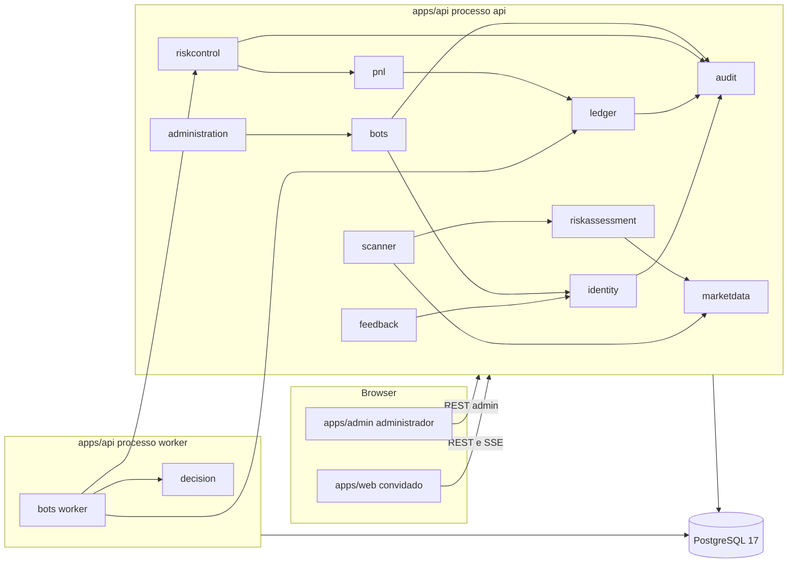
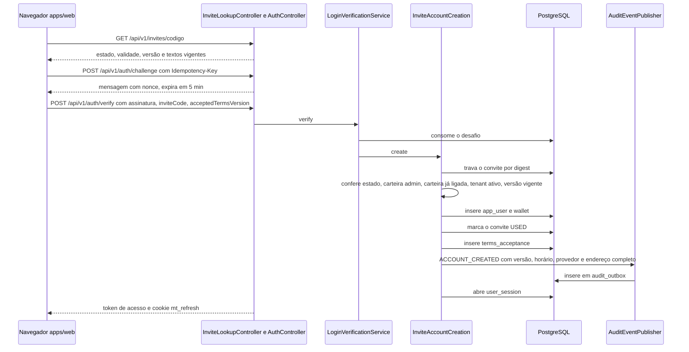
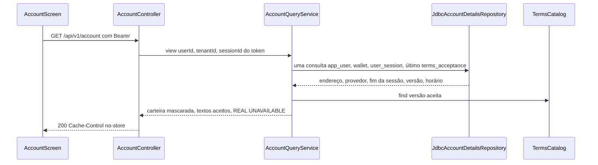
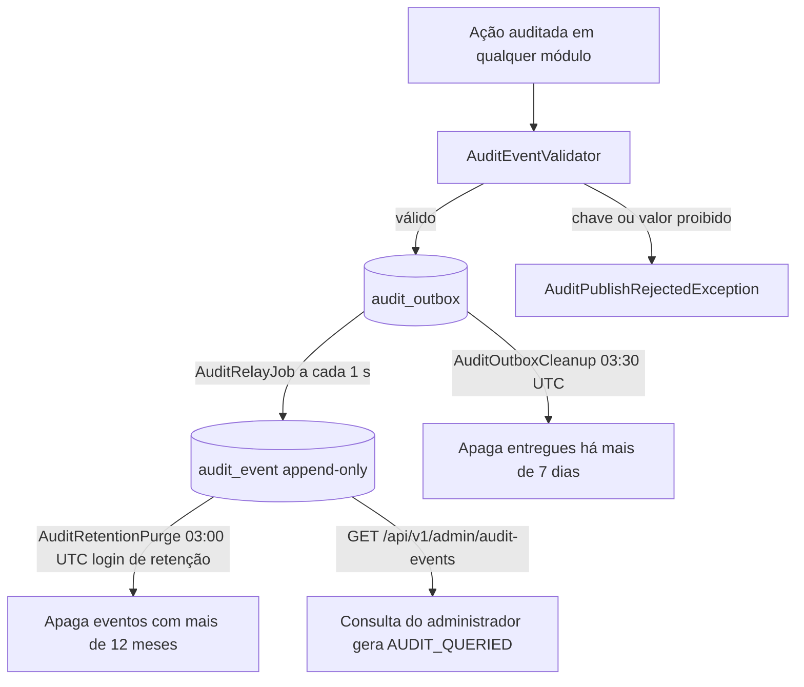
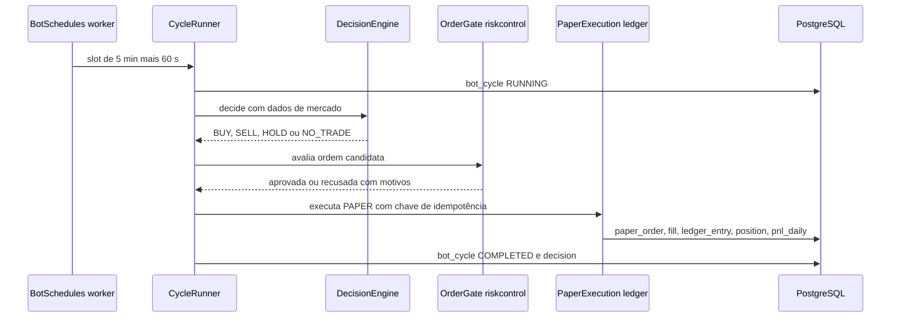

# Arquitetura — eureka-trader-ai

## Architecture Analysis

### System Overview

Monorepo com três aplicações e um banco:

- `apps/api` — API Spring Boot (Java 21), monólito modular por pacote. A mesma imagem roda em três papéis,
  escolhidos por `MEMETRADE_PROCESS` e perfil: `api` (REST, jobs de sistema, canal SSE), `worker` (ciclo de 5 min
  dos bots, meia-noite UTC, expurgo de decisões) e `db-migrate` (perfil `migrate`, aplica o Liquibase com o login
  dono e termina).
- `apps/web` — app do convidado Next.js 15 (porta 3000).
- `apps/admin` — app administrativo Next.js 15 (porta 3001).
- PostgreSQL 17, com três logins (dono, aplicação, retenção) e papéis de grupo fixos de retenção.

Tudo sobe localmente com `docker-compose.yml`, só em `127.0.0.1`. Não há nuvem, fila, cache nem fornecedor externo:
as fontes de mercado são adaptadores simulados.

### Architectural Style

**Monólito modular** com fronteiras verificadas por ArchUnit (`apps/api/src/test/java/com/memetrade/architecture/`).
Cada módulo tem `api` (interfaces públicas, contratos entre módulos), `domain` (regras, sem infraestrutura nem web),
`infra` (JDBC, jobs, configuração) e `web` (controladores e DTOs); alguns têm `application`, `worker` ou `loadtest`.
Um módulo fala com outro só pela interface `api` ou por evento, nunca pelas tabelas do outro. Persistência é JDBC
direto (`JdbcClient`), sem ORM. A integridade crítica fica no banco: gatilhos append-only, CHECKs e matriz de
privilégios por tabela.

Evidências: `apps/api/pom.xml` (um artefato), pacotes por módulo em `com.memetrade.*`, `ProcessRole` e
`ProcessRoleCondition` em `shared/config`, regras como "modules never read another module's tables" em
`ArchitectureTest`.

### Component Relationships

Texto alternativo: o navegador usa `apps/web` (convidado) e `apps/admin` (administrador), que chamam a API por
REST (e SSE no painel). Dentro do processo `api`, `scanner` lê `marketdata` e `riskassessment`; `administration`
comanda `bots`; `feedback` e `bots` usam a idempotência e a identidade de `identity`; `identity`, `ledger`,
`riskcontrol` e `bots` publicam eventos em `audit`. O processo `worker` roda o ciclo dos bots, que chama
`decision`, a barreira `riskcontrol` (que lê o risco da carteira em `pnl`) e a execução PAPER em `ledger`. Os dois
processos usam o mesmo PostgreSQL. A lista completa de dependências entre módulos está em
[dependencies.md](dependencies.md).

### Data Flow

1. **Entrada**: o app pede um desafio (`/auth/challenge`), a carteira assina a mensagem, o app envia a assinatura
   (`/auth/verify`). A API confere Ed25519 (código nativo, sem SDK Solana), consome o nonce, cria a conta quando há
   convite e abre a sessão: token de acesso HMAC de 15 min (só na memória do navegador) e cookie `mt_refresh`
   HttpOnly, Secure, SameSite=Strict.
2. **Mercado**: `MarketCollectorJob` coleta as fontes simuladas a cada 30 s, valida e grava observações; o scanner e
   a avaliação leem com `unknown` explícito.
3. **Bots**: no worker, a cada slot de 5 min, cada bot ACTIVE decide (`decision`), passa pela barreira
   (`riskcontrol`) e, aprovado, executa PAPER (`ledger`), que grava ordem, fill, lançamentos e posição na mesma
   transação; `pnl` mantém o resumo diário e o pico.
4. **Auditoria**: toda ação auditada grava em `audit_outbox` na mesma transação; `AuditRelayJob` (1 s) copia para
   `audit_event` (append-only).
5. **Retenção**: jobs diários com ShedLock apagam o que tem prazo (tabela abaixo), cada um com seu login ou papel.

### Dados pessoais e retenção

Inventário dono deste tema (outros artefatos apontam para cá). "Completo" quer dizer o endereço Base58 inteiro;
"mascarado" é 4 + "…" + 4 caracteres.

| Tabela (migração) | Dado pessoal ou ligado à pessoa | Retenção / expurgo | Travas que afetam exclusão ou anonimização |
|---|---|---|---|
| `app_user` (0001) | `user_id`, tenant, papel, status | Nenhuma | FK de quase todas as tabelas, sem `ON DELETE`; `status DISABLED` nunca escrito |
| `wallet` (0001, 0007) | Endereço **completo**, provedor, `verified_at` | Nenhuma | `address` `NOT NULL`, único (`uq_wallet_address`), CHECK Base58 32 a 44 |
| `login_challenge` (0001) | Endereço **completo**, mensagem assinada (contém o nonce e o domínio) | **Nenhuma** (cresce sempre) | Só muda de estado |
| `user_session` (0001, 0011) | `user_id`, digest SHA-256 do refresh, datas | **Nenhuma** | Linhas expiradas/revogadas ficam |
| `session_used_refresh_digest` (0001) | Digests usados | **Nenhuma** | — |
| `invite` (0007) | Digest e 4 últimos caracteres do código, `issued_by` (carteira mascarada do admin), `used_by_user_id` | Nenhuma | CHECK de estado e datas |
| `terms_acceptance` (0007) | `user_id`, versão, `accepted_at`, `invite_id` | Nenhuma | Aplicação sem UPDATE/DELETE/TRUNCATE; único por convite |
| `idempotency_record` (0002) | `scope` com endereço **completo** antes do login (`wallet:<endereço>:<op>`) ou `tenant/user` depois; resposta guardada | Job de hora em hora apaga expirados (24 h padrão; desafio expira com o TTL de 5 min) | — |
| `audit_outbox` (0004) | Payload do evento (inclui `details` com endereço **completo**) | 7 dias após entrega (03:30 UTC) | — |
| `audit_event` (0004, 0005) | `actor` (userId, adminId ou endereço mascarado), `details` com endereço **completo** em `ACCOUNT_CREATED`, `LOGIN_SUCCEEDED`, `LOGIN_REJECTED` (convidado e admin) | 12 meses (03:00 UTC, papel `audit_retention`, lotes de 1000) | UPDATE e TRUNCATE recusados para **todos** os logins, inclusive o dono; DELETE só por `audit_retention` e só fora da janela de 12 meses |
| `feedback_entry` (0011) | Texto livre (até 2000), tela, `user_id`, tenant | 180 dias (03:00 UTC, papel `feedback_retention`) | UPDATE/TRUNCATE recusados; DELETE só por `feedback_retention` |
| `kill_switch_change` (0011) | `admin_user_id`, motivo | Nenhuma | Append-only para todos |
| `bot` (0010) | `owner_user_id`, `name` (texto livre, 60), parâmetros | Nenhuma (bots nunca são apagados) | FK de `bot_owner` |
| `bot_limits_version` (0010) | `created_by` | Nenhuma | Imutável (UPDATE/DELETE recusados) |
| `bot_cycle`, `decision` (0010) | `owner_user_id`, decisão explicada | HOLD/NO_TRADE e ciclos sem decisão: 30 dias (worker, 04:15 UTC) | `decision` sem UPDATE |
| `paper_account`, `paper_order`, `fill`, `ledger_entry`, `position`, `pnl_daily`, `equity_peak` (0008) | `owner_user_id` e histórico financeiro PAPER | Nenhuma | `ledger_entry` e `fill` append-only para todos; `paper_order`/`paper_account` sem DELETE; matriz de colunas atualizáveis |
| `reconciliation_check` (0008) | `owner_user_id`, divergências | Mantém as últimas 100 por pessoa | — |
| `order_evaluation`, `order_rejection`, `rejection_reason_detail` (0009) | `owner_user_id`, motivos | Avaliações APROVADAS com mais de 30 dias (03:30 UTC, `risk_retention`); recusas nunca | Recusas e detalhes append-only para todos |
| Logs (stdout JSON) | Endereços mascarados pelo `Base58AddressValueMasker`; nunca texto de feedback, token, nonce ou assinatura | Fora da aplicação | — |
| Navegador | Token de acesso só em memória; `sessionStorage` guarda só versão dos termos e as duas marcas de aceite | Até fechar a aba | — |

Tabelas de mercado (`data_source`, `token`, `market_observation`, `observation_sample`, `source_status_mark`,
`risk_weight_set`, `risk_assessment`) são globais e não têm dado de cliente.

### Key Design Decisions

- **Migrações fora da API** (ADR-0002): o login de aplicação não tem DDL; só `db-migrate` com o dono aplica o
  Liquibase. Migrações seguem expand-contract (só acrescentam), com teste `MigrationsBackwardCompatIT`.
- **Proteção no banco, não só no código**: gatilhos sem `SECURITY DEFINER` recusam UPDATE/DELETE/TRUNCATE nas
  tabelas append-only para todo login; exclusões de retenção exigem associação a papel de grupo fixo
  (`audit_retention`, `risk_retention`, `feedback_retention`), e cada expurgo usa um pool próprio de 1 conexão,
  entregue por ArchUnit só à classe do expurgo.
- **Outbox de auditoria**: evento gravado na mesma transação da ação; relay assíncrono para a trilha.
- **Dupla barreira de máscara da carteira**: `WalletAddress.toString()` sempre mascarado; o encoder de log mascara
  qualquer sequência Base58 de 32 a 44 caracteres.
- **Termos como recurso versionado**: pastas imutáveis lidas na subida; a API falha ao subir sem exatamente uma
  versão vigente.
- **Registro de rotas por escopo de dados** (`tenancy/route-registry.yml`): toda rota e job declara escopo; rotas
  CLIENT e ADMIN exigem teste negativo nomeado, senão o build falha.
- **Contrato gerado**: OpenAPI gerado do código e versionado; tipos dos frontends gerados do OpenAPI; a CI compara.

### Improvement Opportunities

- Não há caminho para encerrar conta, atender titular (acesso, correção, exclusão, portabilidade) nem anonimizar;
  o desenho atual de append-only e FKs sem `ON DELETE` impede excluir `app_user` e alterar `audit_event`.
- Expurgo ausente para `login_challenge`, `user_session`, `session_used_refresh_digest` e convites antigos.
- Endereço completo na trilha de auditoria por 12 meses, sem minimização (o mascarado já existe em `actor`).
- Sem fluxo de reaceite de termos para contas existentes quando a versão vigente muda.
- A trilha só é consultável pela API administrativa; o app administrativo não tem tela de auditoria.

## Interaction Diagrams

### Criação de conta por convite com aceite dos termos

Texto alternativo: o app consulta o convite e recebe os textos vigentes; pede um desafio; a carteira assina; o
app envia assinatura, código e versão aceita. A API consome o desafio, trava o convite, confere as regras em ordem e,
numa só transação, cria pessoa, carteira, convite usado, aceite, evento `ACCOUNT_CREATED` na saída da auditoria e a
sessão. Uma violação concorrente de `uq_wallet_address` desfaz tudo e grava um `LOGIN_REJECTED` em nova transação.

### Consulta da tela Conta

Texto alternativo: a tela chama `GET /api/v1/account`; a pessoa, o tenant e a sessão vêm do token; uma consulta
junta pessoa, carteira, sessão e último aceite; o serviço mascara a carteira e busca o texto da versão aceita no
catálogo; a resposta não é cacheada.

### Auditoria: publicação, relay e expurgo

Texto alternativo: toda ação passa pelo validador (que recusa chaves como `nonce`, `signature`, `token` e valores
com JWT, Bearer ou assinatura Base58), é gravada na saída e copiada para a trilha a cada segundo. Às 03:00 UTC o
login de retenção apaga eventos com mais de 12 meses; às 03:30 UTC a limpeza apaga saídas entregues há mais de 7
dias. O administrador consulta a trilha pela API, e cada consulta gera `AUDIT_QUERIED`.

### Ciclo do bot até o ledger

Texto alternativo: o agendador do worker dispara o ciclo de cada bot ativo um minuto após o fim do slot de 5 min;
o motor decide; a barreira avalia os limites (recusa gera `order_rejection` e `ORDER_REJECTED`); aprovada, a
execução PAPER grava ordem, fill, lançamentos, posição e resumo diário na mesma transação, deduplicada pela chave de
idempotência.
