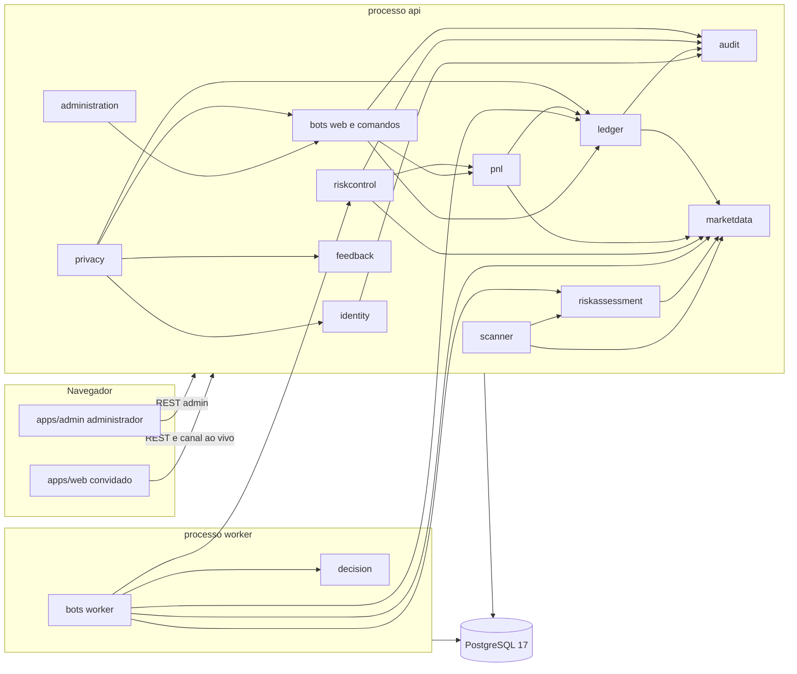
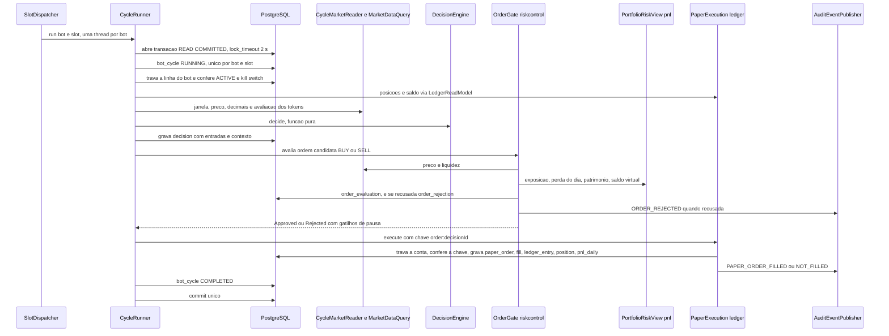
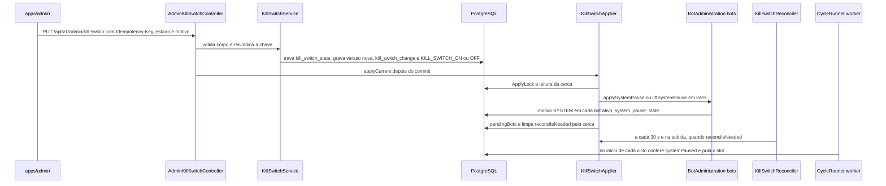
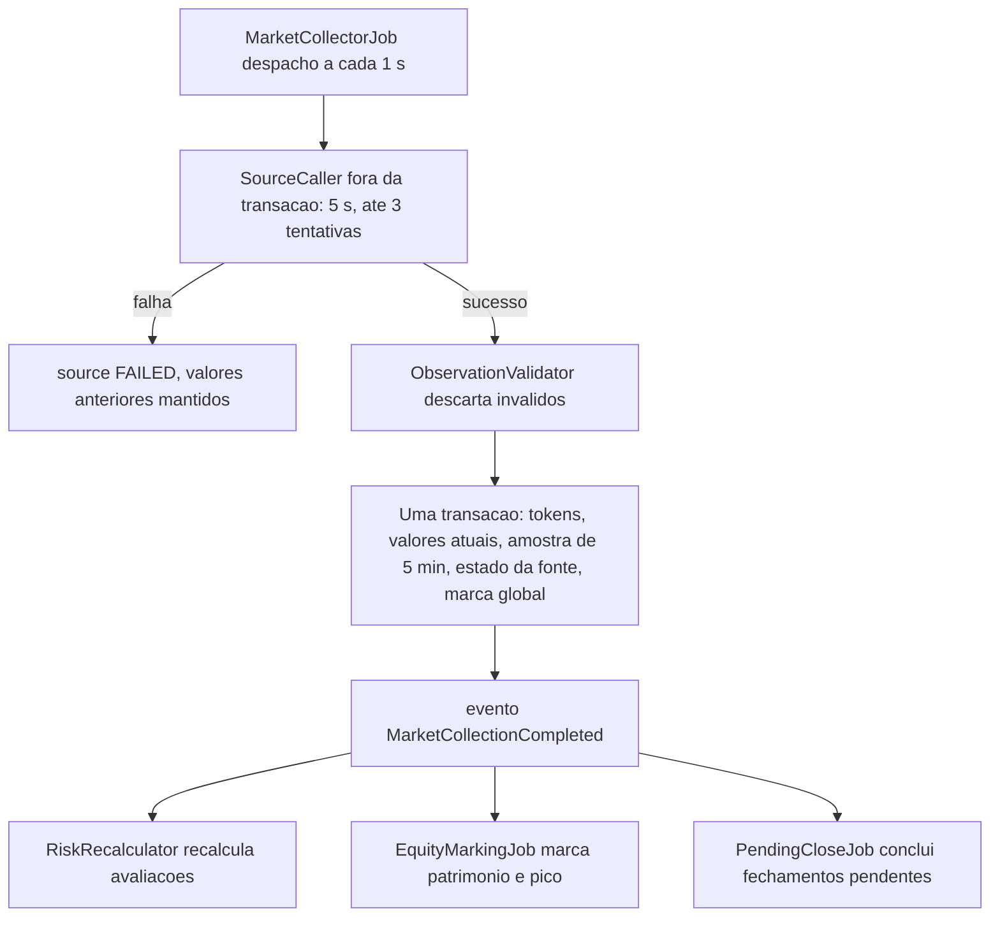
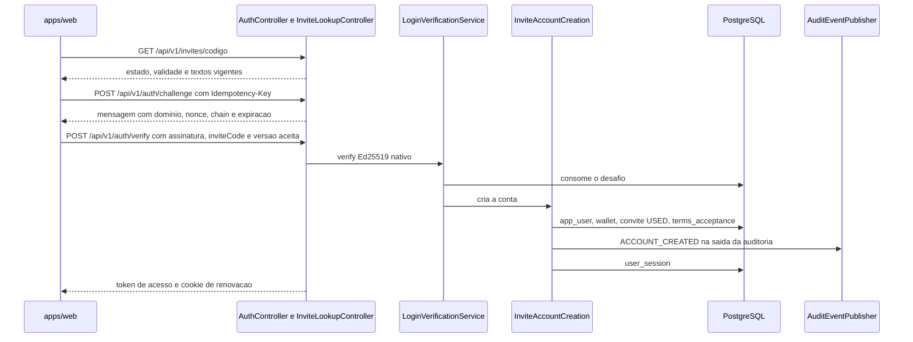

# Arquitetura — eureka-trader-ai

## Architecture Analysis

### System Overview

Monorepo com três aplicações e um banco, tudo local:

- `apps/api` — API Spring Boot 3.5 (Java 21), monólito modular por pacote. A mesma imagem roda em três papéis,
  escolhidos por `MEMETRADE_PROCESS` e perfil Spring:
  - `api` (padrão): rotas REST, canal ao vivo, coleta de mercado, recálculo de risco, marcação de patrimônio,
    reconciliação, kill switch, expurgos e jobs de privacidade (21 jobs agendados, `RuntimeSettingsGuard`);
  - `worker` (perfil `worker`): ciclo dos bots a cada slot de 5 min, meia-noite UTC, verificação de fechamento e
    expurgo de decisões (4 jobs); não tem controlador nem porta publicada;
  - `db-migrate` (perfil `migrate`, `ops/MigrationRunner`): aplica o Liquibase com o login dono e termina.
- `apps/web` — app do convidado, Next.js 15 / React 19 (porta 3000).
- `apps/admin` — app do administrador, Next.js 15 / React 19 (porta 3001).
- PostgreSQL 17 com três logins (dono, aplicação, retenção) e papéis de grupo fixos de retenção.

`docker-compose.yml` sobe `postgres`, `db-bootstrap`, `db-migrate`, `api`, `worker`, `web` e `admin`, todos ligados só
em `127.0.0.1`. Não há nuvem, fila, cache, gerenciador de segredos, KMS, RPC Solana nem fornecedor externo: as fontes de
mercado são adaptadores simulados dentro do processo.

### Architectural Style

**Monólito modular** com fronteiras verificadas por ArchUnit (`apps/api/src/test/java/com/memetrade/architecture/`,
9 classes de teste). Cada módulo tem:

- `api`: interfaces e tipos públicos (os únicos que outros módulos podem importar);
- `domain`: regras puras, sem Spring, JDBC nem web (regra testada em `ledger`, `riskcontrol`, `bots` e `decision`);
- `infra`: JDBC (`JdbcClient`, sem ORM), jobs, configuração;
- `web`: controladores e DTOs;
- às vezes `application`, `worker` ou `loadtest` (este só existe com o perfil `loadtest`).

A integridade crítica fica também no banco: `CHECK (mode = 'PAPER')`, gatilhos append-only sem `SECURITY DEFINER`,
matriz de privilégios por coluna e papéis de grupo para os expurgos. Os eventos entre módulos são síncronos, publicados
pelo `ApplicationEventPublisher` do Spring dentro da transação de quem publica.

### Component Relationships

Texto alternativo: o navegador usa `apps/web` (convidado) e `apps/admin` (administrador), que chamam a API por REST
(e o canal ao vivo no painel). No processo `api`, `scanner` lê `marketdata` e `riskassessment`; os comandos de `bots`
usam `ledger` (financiamento e fechamento) e `pnl` (visão de risco); `administration` comanda `bots` pelo kill switch;
`privacy` lê e aciona `identity`, `bots`, `ledger` e `feedback` por portas públicas; `identity`, `ledger`,
`riskcontrol` e `bots` publicam eventos em `audit`. No processo `worker`, o ciclo dos bots lê mercado e risco, decide
com `decision`, passa pela barreira `riskcontrol` (que lê `marketdata` e `pnl`) e executa em `ledger`. Os dois
processos usam o mesmo PostgreSQL. A lista completa de dependências está em [dependencies.md](dependencies.md).

### Data Flow

1. **Entrada**: o app pede um desafio (`POST /api/v1/auth/challenge`), a carteira assina a mensagem (Wallet Standard,
   `solana:signMessage`), o app envia a assinatura (`POST /api/v1/auth/verify`). A API confere Ed25519 com o JDK (sem
   SDK Solana), consome o nonce, cria a conta quando há convite e abre a sessão: token de acesso HMAC de 15 min (só na
   memória do navegador) e cookie de renovação HttpOnly, SameSite=Strict.
2. **Mercado**: `MarketCollectorJob` despacha a cada 1 s; cada fonte coleta no seu intervalo (padrão 30 s) com limite
   de 5 s e até 3 tentativas (Resilience4j), fora da transação; a validação e a gravação acontecem numa transação; ao
   final publica `MarketCollectionCompleted`, que dispara o recálculo do risco, a marcação de patrimônio e os
   fechamentos pendentes.
3. **Bots**: no worker, `SlotDispatcher` abre o slot 60 s depois de cada múltiplo de 5 min (ShedLock
   `bots-slot-dispatch`) e roda os ciclos em 4 threads; cada ciclo é **uma transação** (veja o diagrama abaixo).
4. **Contabilidade**: o preenchimento grava ordem, fill, lançamentos, posição, resumo diário e evento de auditoria na
   mesma transação e publica `FillRecorded`, que atualiza o pico de patrimônio no `pnl`. A reconciliação roda a cada
   5 min por pessoa e sob demanda.
5. **Auditoria**: toda ação auditada grava em `audit_outbox` na transação da ação; `AuditRelayJob` (1 s) copia para
   `audit_event` (append-only), com a carteira trocada por HMAC (`wallet_hmac`).
6. **Retenção e privacidade**: jobs diários com ShedLock apagam o que tem prazo, cada um com seu pool e papel de
   retenção; pedidos de titular têm prazos e expurgo próprios; a anonimização é uma ação do administrador.

### Estado atual do modo REAL

| Camada | Onde | Comportamento |
|---|---|---|
| Banco | `0008-ledger-pnl.sql`, `0009-risk-control.sql`, `0010-bots-decision.sql` | `mode varchar(8) NOT NULL DEFAULT 'PAPER'` com `CHECK (mode = 'PAPER')` em 13 tabelas: `paper_account`, `paper_order`, `fill`, `ledger_entry`, `position`, `pnl_daily`, `equity_peak`, `reconciliation_check`, `order_evaluation`, `order_rejection`, `rejection_reason_detail`, `bot`, `decision` |
| HTTP | `shared/web/ModeGuardFilter` | Qualquer `mode` diferente de `PAPER` na query ou no corpo JSON de `/api/**` → `403 REAL_MODE_UNAVAILABLE`, auditado como `REQUEST_FORBIDDEN` |
| Domínio | `ledger/api/PaperEnums.MODE = "PAPER"`, `PaperExecution` | "PAPER never builds, signs nor sends a transaction" |
| Conta | `identity/domain/account/AccountQueryService` | REAL sempre `UNAVAILABLE` na resposta de `GET /api/v1/account` |
| Interface | `apps/web/src/lib/i18n/messages.ts` (`realMode`) e `AccountScreen` | Linha de texto "Modo REAL: indisponível no beta", nunca um controle |
| Build | `apps/api/pom.xml` (`maven-enforcer-plugin`) | `solanaj`, `bitcoinj`, `sol4k` e `sava` banidos nos escopos de produção; `solanaj` só em `test` |
| Arquitetura | `ArchitectureTest`, `BotsArchitectureTest`, `LedgerArchitectureTest`, `RiskControlArchitectureTest` | Proíbem em produção `KeyPairGenerator`, `PrivateKey`, `PKCS8EncodedKeySpec`, `*Mnemonic*` e os pacotes dos SDKs; proíbem rede e tipos `Signature`/`Keypair`/`Signer` em `bots`, `ledger` e `riskcontrol`; proíbem `java.net` em `marketdata` |
| Termos | `apps/api/src/main/resources/terms/v1` e `v2` | Textos dizem que o modo REAL está indisponível no beta |

### Inventário de dados

Inventário dono deste tema (outros artefatos apontam para cá). Tabelas por migração, com o que as protege.

| Tabela (migração) | Dono | Conteúdo | Proteção e retenção |
|---|---|---|---|
| `tenant`, `app_user`, `wallet` (0001, 0007, 0015) | `identity` | Conta, papel, status (`ACTIVE`, `DISABLED`, `ANONYMIZED`), carteira com endereço único | `uq_wallet_address`; endereço e provedor ficam nulos juntos só com `anonymized_at` |
| `login_challenge`, `user_session`, `session_used_refresh_digest` (0001, 0012) | `identity` | Desafios de login, sessões, digests de renovação usados | Expurgos diários `LoginChallengePurgeJob` e `SessionPurgeJob`, estado em `identity_job_run` |
| `invite`, `terms_acceptance` (0007, 0013) | `identity` | Convites (digest do código) e aceites dos termos (convite ou reaceite) | Aceites sem UPDATE/DELETE/TRUNCATE para a aplicação |
| `idempotency_record` (0002) | `identity` | Chave, escopo, digest e resposta guardada | Limpeza de hora em hora (24 h padrão) |
| `data_source`, `token`, `market_observation`, `observation_sample`, `source_status_mark` (0003, 0006) | `marketdata` | Dados de mercado globais (sem cliente) | Limpeza de histórico de hora em hora |
| `risk_weight_set`, `risk_assessment` (0006) | `riskassessment` | Pesos versionados (um ACTIVE) e última avaliação por token | Globais |
| `audit_outbox`, `audit_event`, `audit_job_run`, `shedlock` (0004, 0005, 0012) | `audit` | Saída e trilha de eventos; `wallet_hmac` | Trilha append-only para todos; DELETE só pelo papel `audit_retention` após 12 meses; saída limpa 7 dias após a entrega |
| `simulation_policy`, `paper_account`, `paper_order`, `fill`, `ledger_entry`, `position` (0008) | `ledger` | Política v1, conta PAPER por bot, ordens, preenchimentos, lançamentos, posições | `mode = 'PAPER'`; `fill` e `ledger_entry` append-only; `paper_order`/`paper_account` sem DELETE; `uq_paper_order_key (tenant_id, mode, idempotency_key)`; um `FUNDING` por bot |
| `pnl_daily`, `equity_peak`, `reconciliation_check` (0008) | `pnl` (`pnl_daily` gravado pelo `ledger`) | Resumo diário, pico de patrimônio, resultados da reconciliação | `mode = 'PAPER'`; pico só sobe; mantém as últimas 100 reconciliações por pessoa |
| `order_evaluation`, `order_rejection`, `rejection_reason_detail`, `risk_purge_run` (0009) | `riskcontrol` | Avaliações (uma por decisão), recusas e motivos | `mode = 'PAPER'`; recusas append-only; avaliações aprovadas com mais de 30 dias apagadas pelo papel `risk_retention` |
| `strategy_template`, `bot_owner`, `bot`, `bot_limits_version`, `bot_cycle`, `bot_holding`, `system_pause_state` (0010) | `bots` | Modelos, bots, limites imutáveis por versão, ciclos por slot, posse dos tokens, pausa do sistema | `bot.mode = 'PAPER'`; `bot_limits_version` imutável; um ciclo por bot e slot |
| `decision` (0010) | `decision` | Decisão explicada com entradas e contexto (JSONB) | `mode = 'PAPER'`; sem UPDATE; HOLD/NO_TRADE apagadas após 30 dias |
| `kill_switch_state`, `kill_switch_change` (0011) | `administration` | Estado único ON/OFF com versão e histórico | Linha única; histórico append-only |
| `feedback_entry` (0011, 0015) | `feedback` | Comentário, tela, pessoa | Apagado após 180 dias pelo papel `feedback_retention`; função `erase_feedback_of_user` para a anonimização |
| `data_subject_request`, `data_subject_verification`, `privacy_job_run` (0014) | `privacy` | Pedidos de titular e verificação por assinatura | Um pedido aberto por tipo e pessoa; expurgo 12 meses após o fechamento |

Logs: JSON no stdout, com qualquer palavra Base58 de 32 a 44 caracteres mascarada (`Base58AddressValueMasker`) e
`WalletAddress.toString()` sempre mascarado. Navegador: token de acesso só em memória.

### Key Design Decisions

- **Migrações fora da API** (ADR-0002): o login de aplicação não tem DDL; só `db-migrate`, com o dono, aplica o
  Liquibase. Migrações seguem expand-contract, com rollback declarado e `MigrationsBackwardCompatIT`.
- **Proteção no banco além do código**: gatilhos append-only, `CHECK` de modo, matriz de colunas atualizáveis por
  login, papéis de grupo para os expurgos e um pool de 1 conexão por expurgo, entregue por ArchUnit só à classe dele.
- **Ciclo do bot numa transação**: decisão, barreira e execução PAPER são atômicas (`Propagation.MANDATORY` em
  `OrderGate` e `PaperExecution`); uma falha técnica desfaz tudo e o slot é gravado como `FAILED` em outra transação,
  sem repetição.
- **Barreira que falha fechada** (ADR de U6 no código): toda exceção de mercado, risco ou banco é relançada, nunca vira
  aprovação.
- **Duas fontes simuladas e o valor conhecido mais recente** (ADR-0004); **indicador de risco em validação** com pesos
  versionados (ADR-0005).
- **Sem agregação de recusas** (ADR-0003): todo 403 grava um `REQUEST_FORBIDDEN`.
- **Registro de rotas por escopo de dados** (`tenancy/route-registry.yml`, 72 entradas): rotas `CLIENT` e `ADMIN`
  exigem teste negativo nomeado.
- **Contrato gerado**: OpenAPI gerado do código e versionado; tipos dos frontends gerados do OpenAPI; a CI compara.
- **Processos separados por anotação** (`@ProcessRole`): um job só existe no seu processo, verificado por
  `ProcessRoleContextIT`.

### Improvement Opportunities

- A política de simulação v1 existe duas vezes (`ledger` no banco e `riskcontrol/domain/SlippageEstimate.V1` no código),
  mantidas iguais por teste.
- O frescor do preço tem dois limites: 60 s na barreira e 5 min no preenchimento.
- As fronteiras de módulo são verificadas por ArchUnit módulo a módulo, sem uma regra única que cubra os módulos novos
  automaticamente.
- Não há fila nem worker de execução assíncrona: tudo o que o PRD §12 prevê para execução e reconciliação on-chain
  ainda não tem lugar na arquitetura.

### Pontos de extensão e bloqueios para o Trading REAL

| Peça existente | Reaproveitável | Limite atual |
|---|---|---|
| `MarketSourceAdapter` (C19) | Porta pronta para um adaptador real (preço, liquidez, decimais) | Só `sim-a`/`sim-b` aceitos (`MarketDataProperties.KNOWN_SOURCES`); `java.net` proibido em `marketdata` |
| `OrderGate` (C14) e `LimitChecks` | Limite por ordem, exposição, slippage, liquidez, frescor, intervalo, duplicidade, perda diária, drawdown | Saldo e exposição lidos do ledger PAPER; slippage estimado pela política simulada; motivo `INSUFFICIENT_PAPER_BALANCE` |
| `PaperExecution` (C15) | Forma do contrato (resultado selado, idempotência por chave, recusa como resultado) | Exige a transação do ciclo; nunca envia nada |
| Ledger append-only, compensação, reconciliação | Modelo de lançamentos, chave única com `mode`, gatilhos | `CHECK (mode = 'PAPER')`; reconciliação só com fatos internos |
| Kill switch | Estado único, histórico, aplicação com trava e reconciliação a cada 30 s | Só pausa bots; não cancela transações enviadas nem ordens fora da plataforma |
| Idempotência comum | `IdempotencyGuard` com operações fechadas no enum `IdempotentOperation` | Operações REAL não existem |
| Auditoria | Outbox na transação, trilha de 12 meses | `AuditEventValidator` recusa a chave `signature` e sequências Base58 de 80 a 90 caracteres (assinatura de transação) e trata palavras Base58 de 32 bytes como carteira |
| Processo `worker` | Lugar natural para jobs de execução e reconciliação | Pool de 14 conexões e 4 threads de agendamento dimensionados para o ciclo PAPER |
| Login por assinatura | Ed25519 nativo, nonce de uso único | `chain: solana:mainnet` fixo na configuração |

## Interaction Diagrams

### Ciclo de um bot PAPER (worker)

Texto alternativo: o despachante roda cada bot ativo numa thread; o ciclo abre UMA transação, reivindica o slot, trava
o bot e confere o estado e o kill switch, lê posições, saldo e mercado, decide (função pura) e grava a decisão. Uma
ordem BUY ou SELL passa pela barreira, que lê mercado e a visão de risco, grava a avaliação e, se recusar, a recusa e o
evento `ORDER_REJECTED` e devolve os gatilhos de pausa. Aprovada, a execução PAPER trava a conta, confere a chave de
idempotência e grava ordem, fill, lançamentos, posição e resumo diário. Tudo termina num único commit; uma falha
técnica desfaz tudo e o slot vira `FAILED` em outra transação.

### Kill switch

Texto alternativo: o administrador envia o novo estado com motivo e chave de idempotência; o serviço grava o estado,
o histórico e o evento numa transação; depois do commit, o aplicador, sob uma trava própria, lê o estado vigente e
pede ao módulo `bots` que pause (motivo `SYSTEM`) ou libere os bots em lotes. Se algo falhar, a marca
`reconcileNeeded` fica e o reconciliador repete a cada 30 s e na subida. O worker, no início de cada ciclo, confere se
o sistema está pausado e pula o slot.

### Coleta de mercado e efeitos

Texto alternativo: o despacho roda a cada segundo e coleta cada fonte no seu intervalo; a chamada à fonte acontece
fora da transação, com limite de 5 s e até 3 tentativas; uma falha marca a fonte como `FAILED` e mantém os valores
anteriores; um sucesso passa pela validação e grava tudo numa transação; o evento de fim de coleta dispara o recálculo
do risco, a marcação de patrimônio e a conclusão dos fechamentos pendentes.

### Entrada por convite

Texto alternativo: o app consulta o convite e recebe os textos vigentes; pede um desafio; a carteira assina a
mensagem; o app envia assinatura, código e versão aceita; a API confere a assinatura com Ed25519 nativo, consome o
desafio e, numa transação, cria pessoa, carteira, uso do convite, aceite, evento de auditoria e sessão.
