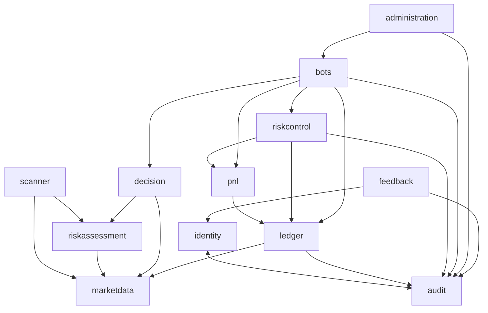

# Dependências — eureka-trader-ai

Versões estão em [technology-stack.md](technology-stack.md); responsabilidades dos componentes em
[component-inventory.md](component-inventory.md).

## Dependências internas entre módulos do backend

Extraídas dos `import com.memetrade.<módulo>.` do código de produção (todos dependem de `shared`, omitido abaixo).

| Módulo | Depende de |
|---|---|
| identity | audit |
| audit | identity (só `identity.api.AdminAccess` e `Principal`, para autorizar a consulta) |
| marketdata | — |
| scanner | identity, marketdata, riskassessment |
| riskassessment | audit, identity, marketdata |
| riskcontrol | audit, identity, ledger, marketdata, pnl, scanner |
| bots | audit, decision, identity, ledger, marketdata, pnl, riskassessment, riskcontrol |
| decision | marketdata, riskassessment |
| ledger | audit, identity, marketdata |
| pnl | audit, identity, ledger, marketdata, scanner |
| administration | audit, bots, identity, marketdata |
| feedback | audit, identity |
| ops | — |

Texto alternativo: `identity` e `audit` dependem um do outro (identity publica eventos; audit usa só os tipos de
autorização de identity). `scanner`, `riskassessment` e `decision` leem `marketdata`; `decision` e `scanner` também
`riskassessment`. `ledger` lê `marketdata`; `pnl` lê `ledger`; `riskcontrol` lê `pnl` e `ledger`; `bots` orquestra
`decision`, `riskcontrol`, `ledger` e `pnl`; `administration` comanda `bots`; `feedback` usa `identity`. Os módulos
com escrita auditada publicam em `audit`. Quase todos usam `identity` para principal e idempotência (arestas omitidas
no diagrama para legibilidade).

### Acoplamentos fora das interfaces `api`

- `bots` usa `decision.domain.*` e `decision.infra.JdbcDecisionRepository` diretamente: `decision` não tem pacote
  `api` e funciona como parte da mesma Unit (U5).
- `riskcontrol` e `pnl` importam `scanner.web.ScannerDtos.MarketValueDto` (DTO web de outro módulo).
- `riskcontrol.loadtest` importa `ledger.loadtest.*` (só perfil `loadtest`).
- `audit` ↔ `identity` formam um ciclo de pacotes (restrito a `identity.api` e `audit.api`).

### Dependências de dados entre módulos (pelo banco)

Todas as tabelas de cliente referenciam `app_user(user_id)` e `tenant(tenant_id)` do módulo `identity`, sem
`ON DELETE`. As do ledger referenciam `paper_account(bot_id)`; `decision` e `bot_cycle` referenciam `bot`;
`order_rejection` referencia `order_evaluation`. Consequência para o intent: excluir uma pessoa em cascata é
impossível hoje (ver [architecture.md](architecture.md#dados-pessoais-e-retenção)).

## Dependências entre aplicações e artefatos

| De | Para | Como |
|---|---|---|
| `apps/web` | `apps/api/openapi/openapi-guest.yaml` | `pnpm gen:api` gera `src/lib/api/schema.d.ts`; `check:api` compara na CI |
| `apps/admin` | `apps/api/openapi/openapi-admin.yaml` | Mesmo processo (`check:api` não roda na CI) |
| `openapi-*.yaml` | Controladores do backend | `GuestOpenApiContractTest`/`AdminOpenApiContractTest`; a CI falha se divergir |
| `apps/web`, `apps/admin` | API em `API_ORIGIN` | REST e SSE no mesmo site (cookie SameSite=Strict) |
| Serviço `db-migrate` | Imagem `memetrade-api` | Perfil `migrate` |
| `api`, `worker` | `db-migrate` concluído | `depends_on` com `service_completed_successfully` |
| `db-migrate` | `db-bootstrap` | Logins e papéis de retenção precisam existir antes das migrações que os citam |
| `scripts/verify.sh` | Compose + sobreposição de teste + Playwright | Carteira de teste gerada fora do repositório e apagada no fim |

## Dependências externas

### Serviços em tempo de execução

- **PostgreSQL 17**: único armazenamento.
- **Carteiras no navegador** (Phantom, Solflare) via Wallet Standard: só assinam a mensagem de login.
- **Nenhum serviço de terceiros**: fontes de mercado simuladas; sem RPC Solana, sem e-mail, sem pagamento, sem nuvem.

### Bibliotecas com restrição de política

- `com.mmorrell:solanaj` só em escopo de teste; `bitcoinj`, `sol4k` e `sava` banidos em compile/runtime pelo
  `maven-enforcer-plugin` (regra de projeto contra APIs de chave e mnemônica).
- `postcss` forçado para 8.5.28 por override do pnpm nos dois apps.

### Atualização e varredura

Dependabot semanal para Maven, npm (dois apps, espera de 5 dias), Docker, docker-compose e GitHub Actions. OWASP
Dependency-Check bloqueia CVSS ≥ 7; `pnpm audit` bloqueia High/Critical nos dois apps; exceções versionadas em
`security/exceptions.yml` (hoje vazio), com validade máxima de 90 dias.
