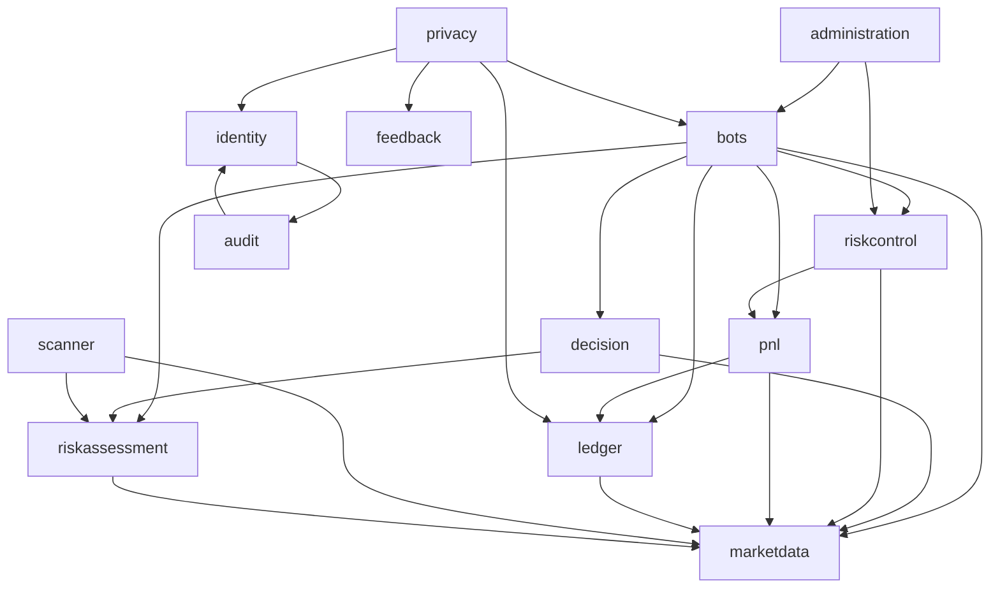

# Dependências — eureka-trader-ai

Versões em [technology-stack.md](technology-stack.md); contratos citados em
[api-documentation.md](api-documentation.md#contratos-internos-interfaces-java-públicas-entre-módulos).

## Dependências entre módulos do backend

Levantadas pelos `import com.memetrade.*` do código de produção (número de imports entre parênteses), mais as
referências por nome completo encontradas na leitura. `shared` não depende de nenhum módulo de negócio
(regra ArchUnit `sharedDoesNotDependOnAnyBusinessModule`).

| Módulo | Depende de |
|---|---|
| `shared` | — |
| `identity` | `audit.api` (25), `shared` |
| `audit` | `identity.api` (2), `shared` |
| `marketdata` | `shared` |
| `scanner` | `marketdata.api` (29), `riskassessment.api` (11), `identity.api` (4), `shared` |
| `riskassessment` | `marketdata.api` (26), `audit.api` (4), `identity.api` (3), `shared` |
| `decision` | `marketdata.api` (26), `riskassessment.api` (6) |
| `riskcontrol` | `marketdata.api` (14), `identity.api` (7), `pnl.api` (5), `audit.api` (4), `scanner.web` (1: `MarketValueDto` em `RejectionDtos`), `ledger.loadtest` (5, só no pacote `loadtest`), `shared` |
| `ledger` | `identity.api` (30), `marketdata.api` (18), `audit.api` (8), `shared` |
| `pnl` | `ledger.api` (24), `identity.api` (13), `marketdata.api` (9), `audit.api` (3), `scanner.web` (1: `MarketValueDto` em `PnlDtos`), `shared` |
| `bots` | `identity.api` (28), `decision.domain` (20), `decision.infra` (11), `ledger.api` (14), `marketdata.api` (12), `riskcontrol.api` (6), `audit.api` (8), `pnl.api` (1), `riskassessment.api` (1), `shared` |
| `administration` | `identity.api` (19), `bots.api` (7), `audit.api` (3), `marketdata.api` (3), `riskcontrol.api` (`RejectionCounts`, por nome completo), `shared` |
| `feedback` | `identity.api` (15), `audit.api` (2), `shared` |
| `privacy` | `identity.api` (56), `audit.api` (12), `bots.api` (3), `feedback.api` (3), `ledger.api` (1), `shared` |
| `ops` | — (só JDK e Spring) |

Texto alternativo: `bots` é o módulo com mais dependências (decisão, barreira, ledger, P&L, mercado e risco);
`riskcontrol` depende de `pnl` e `marketdata`; `pnl` depende de `ledger` e `marketdata`; `ledger` depende só de
`marketdata` entre os módulos de negócio de trading; `administration` comanda `bots` e lê contagens de `riskcontrol`;
`privacy` usa portas de `bots`, `ledger`, `feedback` e `identity`. Quase todos usam `identity.api` (contexto e
idempotência), `audit.api` (eventos) e `shared`, omitidos no diagrama para legibilidade.

Observações:

- **Ciclo `identity` ↔ `audit`**: `identity` publica eventos por `audit.api`; `audit` usa `identity.api` para o
  administrador da consulta e o contexto. Os dois lados passam só por pacotes `api`.
- **`decision` sem `api`**: `bots` usa as classes internas de `decision`; para outro consumidor (por exemplo um executor
  REAL separado), seria preciso publicar uma interface.
- **DTO compartilhado pela web**: `riskcontrol.web` e `pnl.web` reutilizam `scanner.web.ScannerDtos.MarketValueDto`.
- **Carga**: `riskcontrol.loadtest` usa `ledger.loadtest`; ambos só existem com o perfil `loadtest`.
- **Ledger não conhece o P&L**: `LedgerArchitectureTest.theLedgerNeverDependsOnThePnl`; o P&L reage aos eventos
  `FillRecorded` e `PaperAccountFunded`.

## Dependências entre aplicações

| De | Para | Como |
|---|---|---|
| `apps/web` | `apps/api` | REST e canal ao vivo em `API_ORIGIN` (navegador) e `API_INTERNAL_ORIGIN` (servidor Next, rede do Compose); tipos gerados de `openapi-guest.yaml` |
| `apps/admin` | `apps/api` | REST administrativo; tipos gerados de `openapi-admin.yaml` |
| `api` e `worker` | PostgreSQL | Mesmo banco; o `worker` depende de o `api` estar saudável porque só o `api` coleta mercado |
| `db-migrate` | PostgreSQL | Login dono; roda antes de `api` e `worker` |
| `scripts/verify.sh` | Compose + Playwright de `apps/web` | Sobe o ambiente de teste e roda os specs |

## Dependências externas do backend (Maven)

| Grupo:artefato | Escopo | Por quê |
|---|---|---|
| `org.springframework.boot:spring-boot-starter-web`, `-validation`, `-jdbc`, `-actuator` | compile | Base da API |
| `org.liquibase:liquibase-core` | compile | Migrações |
| `org.postgresql:postgresql` | compile (sem escopo declarado) | Driver |
| `io.micrometer:micrometer-registry-prometheus` | compile | Métricas |
| `org.springdoc:springdoc-openapi-starter-webmvc-api` | compile | OpenAPI |
| `net.logstash.logback:logstash-logback-encoder` | compile | Logs JSON |
| `com.nimbusds:nimbus-jose-jwt` | compile | JOSE |
| `net.javacrumbs.shedlock:shedlock-spring`, `shedlock-provider-jdbc-template` | compile | Execução única de jobs |
| `io.github.resilience4j:resilience4j-retry`, `resilience4j-timelimiter` | compile | Fontes de mercado |
| `org.springframework.boot:spring-boot-starter-test`, `spring-boot-testcontainers` | test | Testes |
| `org.testcontainers:junit-jupiter`, `postgresql` | test | PostgreSQL real nos testes |
| `com.tngtech.archunit:archunit-junit5` | test | Regras de arquitetura |
| `com.mmorrell:solanaj` | test | Carteira e assinatura de teste |

**Dependências banidas** (`maven-enforcer-plugin`, regra `bannedDependencies`): `com.mmorrell:solanaj` nos escopos
compile, runtime, provided e system; `org.bitcoinj`, `org.sol4k` e `software.sava` em compile e runtime. O teste
`ArchitectureTest.theBuildBansTheSolanaSdkOutsideTestScope` confere essa regra no próprio `pom.xml`.

**Sobreposições de segurança** sobre o BOM do Boot 3.5.16: `tomcat.version` 10.1.61, `log4j2.version` 2.25.5,
`postgresql.version` 42.7.14, `kotlin.version` 2.4.21 (só no classpath de teste, via solanaj → okhttp 5). Exceções
EX-001 a EX-013 em `security/exceptions.yml` (Spring Framework 6.2.19 e um falso positivo do Micrometer), todas até
2027-02-09.

## Dependências externas dos frontends (npm)

| Pacote | Tipo | Apps | Por quê |
|---|---|---|---|
| `next` 15.5.28, `react` / `react-dom` 19.2.9 | produção | web, admin | Framework |
| `@wallet-standard/app`, `@wallet-standard/base`, `@wallet-standard/features`, `@solana/wallet-standard-features` | produção | web, admin | Conexão e assinatura de mensagem pela carteira |
| `openapi-typescript`, `typescript`, `eslint`, `eslint-config-next`, `prettier`, `jest`, `jest-environment-jsdom`, `@testing-library/*`, `@types/*`, `ts-node` | dev | web, admin | Build, tipos e testes |
| `@playwright/test`, `pg`, `@types/pg` | dev | web | Ponta a ponta e leitura da trilha nos specs |

Nenhum pacote de RPC Solana, `@solana/web3.js`, `@solana/kit` ou SDK da Jupiter.

## Serviços externos

Nenhum em produção. Imagens de contêiner: `postgres:17-alpine`, `eclipse-temurin:21-jdk-alpine` e `21-jre-alpine`,
`node:24-alpine`, todas fixadas por digest. Ações do GitHub fixadas por SHA.
