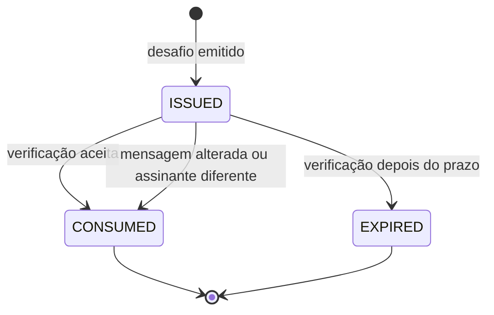
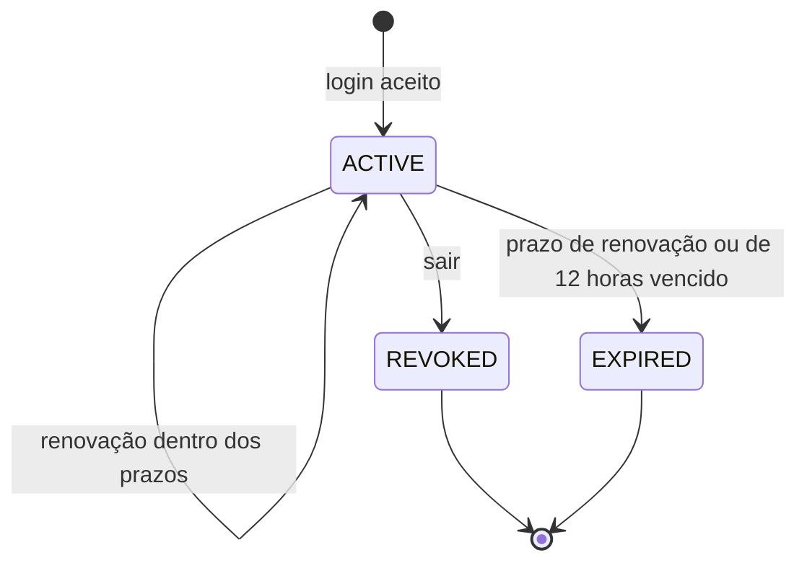
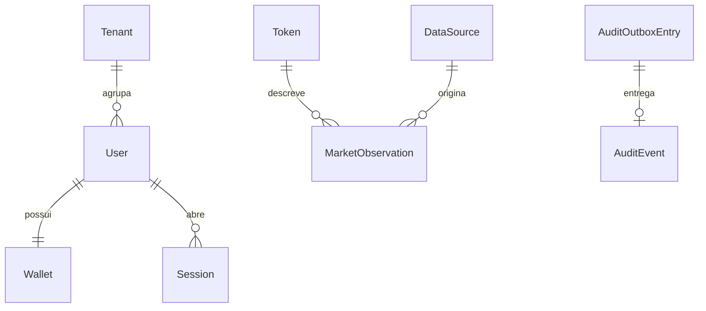

# Especificação funcional — U1 Esqueleto de ponta a ponta

Comportamento da Unit `u1-walking-skeleton` ([unit-of-work.md](../../../inception/units-generation/unit-of-work.md)). A U1 implementa as histórias US1.2 (entrar assinando com a carteira), US1.4 (dados isolados por tenant) e US2.1 (lista com fonte, horário e `unknown`) de [stories.md](../../../inception/user-stories/stories.md), conforme [unit-of-work-story-map.md](../../../inception/units-generation/unit-of-work-story-map.md). Os requisitos estão em [requirements.md](../../../inception/requirements-analysis/requirements.md), os componentes em [components.md](../../../inception/domain-design/components.md) e os contratos em [contract-summary.md](../../../inception/contract-design/contract-summary.md) (C1, C2, C9, C10, C19). O modelo de dados está em [entities.md](entities.md) e as regras em [rules.md](rules.md).

Este documento é a fonte da verdade dos fluxos e das máquinas de estado. O diagrama de entidades e o resumo de regras no fim são visões derivadas.

## Escopo da U1

| Inclui | Não inclui (Unit dona) |
|---|---|
| Fundação do repositório, Docker Compose, CI e script de verificação | Convites, termos e criação de conta (U3) |
| Entrada do convidado por assinatura de carteira, sessão, renovação e saída | Entrada do administrador, AC1.2.6 (U8) |
| Contexto de autenticação e regra de tenant (C10) | Consulta, mascaramento completo e varredura da trilha (U2) |
| Fonte de mercado simulada e lista mínima do scanner, com o cálculo de `stale` que o contrato C2 exige e o estado da única fonte | Filtros, risco, divergência, degradação por fonte com várias fontes, aviso por fonte e `503 SOURCE_UNAVAILABLE` (U4) |
| Interface de auditoria final com tabela de saída e relay mínimo | Tarefas em segundo plano sobre dados de cliente e registros PAPER (U5, U7) |

## Fluxos

### F1 — Entrar assinando com a carteira

1. A pessoa abre a tela de entrada (S1) e conecta Phantom ou Solflare no navegador.
2. O app pede um desafio com o endereço público da carteira e uma `Idempotency-Key` (BR1.10). Acima de 10 pedidos por minuto por carteira ou por IP, a resposta é `429` com `Retry-After` (BR1.11).
3. O sistema emite a mensagem no modelo fixo de linhas (BR1.13), com domínio, endereço, aviso de que a assinatura não autoriza operações, chain, nonce, emissão e expiração de 5 minutos, e grava o desafio em `ISSUED` (BR1.1).
4. A carteira pede a assinatura da mensagem exata; o app nunca vê chave ou frase secreta.
5. O app envia endereço, mensagem, assinatura e provedor. Um campo não declarado é recusado com `VALIDATION_FAILED` sem gravar nada (BR1.8).
6. Numa única transação, o sistema lê o nonce da linha "Nonce" e procura o desafio (BR1.13); confere que a mensagem é idêntica à guardada, a assinatura, o estado do nonce e o prazo (BR1.2, BR1.4); confere a lista de carteiras de administrador e a conta da carteira (BR1.5); e:
   - quando tudo confere, passa o nonce para `CONSUMED` (BR1.3), cria a sessão (BR1.9) e grava `LOGIN_SUCCEEDED` na tabela de saída (BR4.1);
   - quando algo falha, grava o novo estado do desafio conforme a tabela da máquina de estados (nenhuma mudança quando o desafio não existe) e um único `LOGIN_REJECTED` com o motivo e o endereço mascarado, e confirma a transação (BR1.6).
7. Depois da confirmação, a resposta sai: sessão com token de acesso e o cookie de renovação, ou o erro (`401 LOGIN_CHALLENGE_REJECTED` ou `403 FORBIDDEN_ROLE`).
8. A verificação não guarda resposta para repetição: se a resposta se perder, o app pede um novo desafio (BR1.10).
9. O app guarda o token só na memória e leva a pessoa à lista do scanner (na U1 ainda não existe painel).

### F2 — Renovar o token ao recarregar a página

1. Ao recarregar, o app não tem token na memória e chama a renovação; o navegador envia o cookie de renovação.
2. Quando a sessão está `ACTIVE`, o usuário e o tenant estão ativos e os prazos valem, o sistema emite novo token de acesso, troca o token de renovação e estende a renovação sem passar das 12 horas da sessão (BR1.9, BR1.15).
3. Um token de renovação já trocado revoga a sessão inteira e grava `SESSION_REFRESH_REUSED` (BR1.15).
4. Quando a renovação falha, a resposta é `401`; o app mostra o aviso de sessão expirada e volta à entrada, guardando a tela de origem para depois do novo login.

Em toda requisição autenticada, além da renovação, o sistema confere pelo identificador da sessão no token que a sessão, o usuário e o tenant seguem ativos; um token de uma sessão encerrada é recusado mesmo dentro dos 15 minutos (BR1.14).

### F3 — Sair

1. A pessoa escolhe "Sair".
2. O sistema revoga a sessão, invalida a renovação e grava `LOGOUT` (BR1.12).
3. O app apaga o token da memória e volta à entrada.

### F4 — Ver a lista do scanner

1. O app pede a primeira página com o token de acesso.
2. O sistema obtém tenant e pessoa do token (BR2.1). A lista de mercado é global e não traz dado de cliente.
3. O sistema monta cada linha com símbolo, mint abreviado, preço, liquidez, volume em 24 horas, holders e idade, cada um como `KNOWN` ou `UNKNOWN` (BR3.1, BR3.2), com a marca de desatualizado (BR3.4) e a cobertura (BR3.5).
4. A ordem é pela idade, mais novos primeiro, com desempate pelo mint; idades `UNKNOWN` vão para o fim (BR3.6). A resposta traz o cursor da próxima página e o total.
5. A tela mostra "Exibindo X–Y de N"; ao passar o mouse ou focar num valor, mostra fonte, horário e frescor; `unknown`, carregando, erro e parcial são estados visíveis distintos (BR3.7).

### F5 — Coleta da fonte simulada

1. A cada intervalo configurado, o adaptador simulado gera tokens e valores com a semente fixa e o relógio injetável (BR3.3).
2. Cada coleta inclui pelo menos um token com holders não informados e um com liquidez informada como 0.
3. O sistema grava a observação vigente de cada campo com fonte e horário e atualiza o estado da fonte para `OK`.
4. Uma falha da coleta marca a fonte como `FAILED` e mantém as últimas observações com seus horários, que passam a aparecer desatualizadas depois de 5 minutos.

### F6 — Entrega da auditoria

1. Toda ação auditada grava sua entrada na tabela de saída na mesma transação (BR4.1).
2. O relay, só no processo de API, lê as entradas pendentes em lotes, grava cada evento na trilha pelo `eventId` (repetido é descartado) e marca a entrada como entregue.
3. Se o processo cair, as entradas pendentes continuam na tabela e são entregues quando o relay volta.

### F7 — Verificação de ponta a ponta (smoke)

1. O script de verificação sobe o Docker Compose e espera API, app e banco ficarem saudáveis, e espera a fonte simulada informar a primeira coleta (estado `OK` com `lastUpdatedAt`), com limite de 60 segundos.
2. O teste gera um par de chaves na hora e insere tenant, conta `BETA_USER` e carteira pública direto no banco de teste (Q6); a chave nunca é gravada em arquivo.
3. No navegador de teste, uma carteira de teste é injetada antes de o app carregar e se apresenta como provedor de carteira compatível, assinando mensagens com a chave gerada no passo 2. Esse objeto existe só no código de teste.
4. O teste entra pelo app (F1), abre a lista (F4) e confere: a fonte aparece como simulada; cada valor mostra horário; existe um campo `unknown` distinto de zero e um campo com 0 informado.
5. O teste repete a verificação com o mesmo nonce e confere a recusa; depois espera, com consultas a cada segundo e limite de 10 segundos, o evento `LOGIN_REJECTED` aparecer na trilha (o relay roda a cada segundo).
6. O script derruba o ambiente e devolve código diferente de zero em qualquer falha ou tempo esgotado; a chave de teste é descartada.

## Máquinas de estado

### Desafio de login

<!-- Text fallback: O desafio nasce ISSUED. Passa para CONSUMED quando a verificação é aceita, ou quando chega uma mensagem alterada ou de outro assinante (para impedir nova tentativa com o mesmo nonce). Passa para EXPIRED quando a verificação chega depois do prazo. CONSUMED e EXPIRED são finais. -->

| De | Gatilho | Para | Regra |
|---|---|---|---|
| ISSUED | Verificação aceita | CONSUMED | BR1.2, BR1.3, BR1.5 |
| ISSUED | Mensagem alterada ou assinante diferente | CONSUMED | BR1.4 |
| ISSUED | Assinatura válida de carteira sem conta ativa | CONSUMED | BR1.5 |
| ISSUED | Assinatura válida de carteira de administrador | CONSUMED | BR1.5 |
| ISSUED | Verificação depois de `expiresAt` | EXPIRED | BR1.2 |
| CONSUMED ou EXPIRED | Qualquer verificação | sem mudança, recusa | BR1.3 |
| (nenhum) | Nonce lido não corresponde a desafio, ou mensagem fora do modelo | sem mudança, recusa | BR1.13 |

### Sessão

<!-- Text fallback: A sessão nasce ACTIVE no login aceito. Uma renovação dentro dos prazos a mantém ACTIVE. Sair a leva para REVOKED. O vencimento da renovação ou das 12 horas a leva para EXPIRED. REVOKED e EXPIRED são finais. -->

### Entrada da tabela de saída

| De | Gatilho | Para |
|---|---|---|
| (nova) | Transação da ação confirmada | PENDENTE (`deliveredAt` vazio) |
| PENDENTE | Relay grava o evento na trilha | ENTREGUE (`deliveredAt` preenchido) |

## Telas da U1

| Tela | Conteúdo na U1 | Estados |
|---|---|---|
| S1 Entrada | Conectar carteira, assinar, mensagens de recusa em texto | Sem carteira instalada, assinando, recusado, sessão expirada |
| S3 Scanner (mínimo) | Lista com os 7 campos, cobertura, fonte simulada, "Exibindo X–Y de N" | Carregando, erro com "Tentar de novo", parcial, `unknown` por campo |

As telas seguem os critérios transversais CT-UX-1 a CT-UX-9 de [stories.md](../../../inception/user-stories/stories.md): textos em pt-BR, teclado, foco visível, cor nunca como único indicador.

## Diagrama de entidades (derivado de entities.md)

<!-- Text fallback: Um Tenant agrupa vários Users. Cada User tem uma Wallet e várias Sessions. Cada Token tem várias MarketObservations, e cada DataSource origina várias MarketObservations. Cada AuditOutboxEntry vira no máximo um AuditEvent. LoginChallenge e IdempotencyRecord não têm relação direta de chave com as demais entidades. -->

## Resumo das regras (derivado de rules.md)

| Grupo | Regras | Assunto |
|---|---|---|
| Login | BR1.1 a BR1.15 | Modelo da mensagem, desafio, verificação, nonce único, carteira de administrador da configuração, recusa auditada, sessão sem trading, sem segredos, prazos, conferência da sessão a cada requisição, rotação da renovação, idempotência, limite de tentativas, saída |
| Isolamento | BR2.1 a BR2.3 | Tenant só do token, 404 auditado para recurso alheio, registro de rotas com teste negativo obrigatório |
| Mercado e lista | BR3.1 a BR3.7 | `unknown` explícito, chain + mint, fonte simulada, frescor, cobertura, ordem, estados |
| Auditoria | BR4.1 a BR4.3 | Tabela de saída, ações auditadas, sem segredos |

## Critérios que esta Unit não cobre

- AC1.2.6 (entrada do administrador): passa para a U8 (Q1). O mapa de histórias de [unit-of-work-story-map.md](../../../inception/units-generation/unit-of-work-story-map.md) ainda atribui US1.2 só à U1; essa transferência precisa entrar no design funcional da U8, que deve rastrear AC1.2.6.
- AC1.4.1 (recurso de outra conta por ID): a U1 não tem rota de recurso de cliente por identificador; a regra BR2.2 vale para todas, e o primeiro teste nasce com a primeira rota assim (U5). Na U1, o isolamento é provado por AC1.4.2: a lista do scanner chamada com `tenantId` na query ignora o valor (BR2.1), e o registro de BR2.3 nasce com seu teste.
- AC1.4.3 (tarefas em segundo plano sobre dados de cliente): a primeira tarefa assim nasce na U5; a regra BR2.3 obriga o teste quando ela existir.
- AC1.4.4 (registros de modo diferente de PAPER): os primeiros registros financeiros nascem na U7; a regra BR2.3 e o teste de separação REAL/PAPER valem a partir dela.
