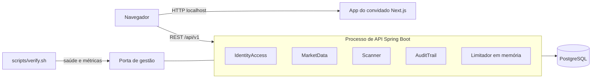

# Componentes lógicos — U1 Esqueleto de ponta a ponta

Inventário dos componentes lógicos da Unit `u1-walking-skeleton`, com fronteiras, domínios de falha e onde cada padrão de [performance-design.md](performance-design.md), [security-design.md](security-design.md), [scalability-design.md](scalability-design.md), [reliability-design.md](reliability-design.md) e [observability-design.md](observability-design.md) se aplica. Base: [functional-spec.md](../functional-design/functional-spec.md), [tech-stack-decisions.md](../nfr-requirements/tech-stack-decisions.md) e [contract-summary.md](../../../inception/contract-design/contract-summary.md). Ponte para o Infrastructure Design.

## Visão geral

Texto equivalente: o navegador carrega o app do convidado e chama a API direto em `/api/v1`. O processo de API contém os módulos IdentityAccess, MarketData, Scanner e AuditTrail e o limitador em memória, e usa um único PostgreSQL. O script de verificação lê saúde e métricas pela porta de gestão.

## Inventário

| Componente | Tipo | Responsabilidade na U1 | Padrões aplicados | Estado |
|---|---|---|---|---|
| App do convidado | Next.js | Telas S1 e S3, conexão de carteira, token de acesso em memória | CSP com nonce, cabeçalhos de segurança, catálogo pt-BR, acessibilidade básica | Sem estado no servidor |
| IdentityAccess | Módulo do processo de API | Desafio, verificação, sessão, renovação, saída, contexto de autenticação e tenant | Limite de tentativas, nonce com atualização condicional, Ed25519 nativo, CORS, entrada estrita, idempotência do desafio | Sessões e desafios no banco; contadores em memória |
| MarketData | Módulo do processo de API | Fonte simulada e observações vigentes | Coleta a cada 15 s, `FAILED` sem zerar valores, `stale` após 5 min | Observações no banco |
| Scanner | Módulo do processo de API | Lista mínima com KNOWN/UNKNOWN e cobertura | Índice e cursor, sem cache | Só leitura das interfaces públicas do MarketData |
| AuditTrail | Módulo do processo de API | Interface publicadora, tabela de saída, relay e trilha | Gravação na mesma transação, relay a cada 1 s com reserva de linhas, desduplicação por `event_id` | Tabela de saída e trilha no banco |
| Limitador | Componente de IdentityAccess | Janelas de 1 minuto por IP e por carteira | Valor configurável com padrão 10 | Memória do processo |
| Tarefas agendadas | Processo de API | Coleta, relay, limpeza de idempotência | `correlationId` por ciclo, log em falha | — |
| PostgreSQL | Banco | Todos os dados da U1, com migrações Liquibase | Pool de 10 conexões | Volume persistente local |
| Porta de gestão | Endpoint da API | Saúde e métricas Prometheus | Separada da porta da API | — |

## Fronteiras entre módulos

- Cada módulo é dono das suas tabelas; nenhum lê tabela ou repositório de outro (`team.md`).
- Scanner lê o MarketData só pela interface pública do módulo.
- Todo módulo publica auditoria só pela interface do AuditTrail (C9).
- IdentityAccess fornece o contexto de autenticação (pessoa, tenant, papel) a todos os módulos (C10).

## Domínios de falha e raio de impacto

| Falha | Afeta | Não afeta | Contenção |
|---|---|---|---|
| PostgreSQL indisponível | Tudo na API | App estático já carregado | `503` e saúde `DOWN`; o script de verificação falha |
| Processo de API cai | Login, lista, coleta, relay | Eventos já gravados na tabela de saída | Entradas pendentes entregues ao voltar; contadores do limite zeram (aceito) |
| Coleta simulada falha | Frescor da lista | Login, auditoria | Fonte `FAILED`, valores antigos com horário, `stale` |
| Relay atrasa | Leitura da trilha | Ações de negócio | Métrica de pendências; saúde degradada |
| Limitador | Pedidos de login do IP ou carteira limitados | Lista, coleta | Janela de 1 minuto |
| App do convidado | Telas | API e dados | Reinício do contêiner |

O processo único é um domínio de falha compartilhado entre login e lista; isso é aceito na U1 (ver [scalability-design.md](scalability-design.md)). A separação em processos de API e worker vem com a U5 (C20).

## Recursos compartilhados

| Recurso | Quem usa | Risco | Tratamento |
|---|---|---|---|
| Pool de conexões | Requisições e tarefas agendadas | Tarefa longa ocupando conexões | Lotes pequenos (100 no relay, 1.000 na limpeza) |
| Memória do processo | Limitador | Crescimento de contadores | Expiração das janelas antigas |
| Chave de assinatura do token de acesso | IdentityAccess | Vazamento | Só no `.env`, nunca em log |

## Para o Infrastructure Design

- Serviços no Docker Compose: PostgreSQL, API (porta da API e porta de gestão), app do convidado; verificações de saúde e `depends_on` com condição de saudável.
- Variáveis em `.env`: credenciais do banco, chave de assinatura do token, origem do app (CORS), lista de proxies confiáveis (vazia no ambiente local).
- Pré-requisitos antes de ambiente compartilhado: TLS 1.2+, criptografia em repouso, Redis para o limitador, executor único da coleta.
