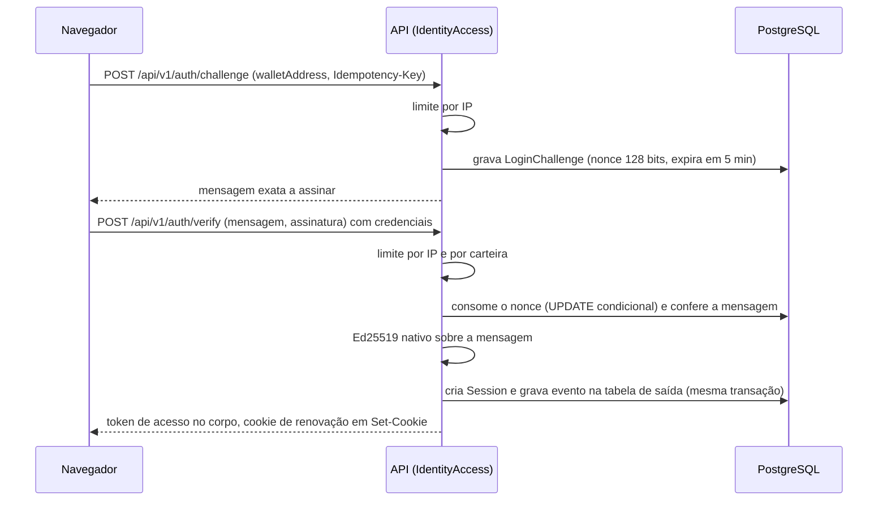

# Desenho de segurança — U1 Esqueleto de ponta a ponta

Como a Unit `u1-walking-skeleton` cumpre os requisitos de [security-requirements.md](../nfr-requirements/security-requirements.md) (NFR6.1 a NFR6.9, NFR5.1, NFR5.2, NFR7.1, NFR7.2, NFR4.1), para os fluxos F1 a F4 de [functional-spec.md](../functional-design/functional-spec.md) e os contratos C1, C9 e C10 de [contract-summary.md](../../../inception/contract-design/contract-summary.md). Decisões em [nfr-design-questions.md](nfr-design-questions.md) (Q1, Q2, Q6, Q7, Q8, Q9).

## Camadas de defesa

| Camada | Controle | Requisito |
|---|---|---|
| Navegador | CSP com nonce por requisição, `connect-src` só com a API, cabeçalhos de segurança; token de acesso só na memória; cookie de renovação `HttpOnly`, `Secure`, `SameSite=Strict` com `Path` da renovação | NFR6.9, NFR6.6 |
| Borda da API | CORS com lista fixa de origens; limite de tentativas por IP e por carteira; validação de entrada que recusa campos desconhecidos | NFR6.9, NFR6.5, NFR6.1 |
| Autenticação | Desafio com nonce de 128 bits, uso único e expiração; conferência Ed25519 nativa; sessão conferida a cada requisição | NFR6.2, NFR6.3, NFR6.6 |
| Autorização | Tenant e pessoa só do contexto de autenticação; registro de rotas de dado de cliente com teste negativo obrigatório | NFR5.1, NFR5.2 |
| Dados | Só o resumo do token de renovação no banco; endereço mascarado fora da trilha; nenhum segredo em log ou evento | NFR6.6, NFR7.1 |
| Entrega | Gitleaks no pré-commit e na CI; CodeQL e OWASP Dependency-Check; regra de dependência que barra o SDK Solana na produção | NFR6.7, NFR6.8, NFR6.4 |

## Login por assinatura (F1)



Texto equivalente: o navegador pede o desafio; a API aplica o limite por IP, grava o desafio e devolve a mensagem. Na verificação, a API aplica os limites, consome o nonce com uma atualização condicional (só uma verificação simultânea vence), compara a mensagem com a guardada, confere a assinatura com Ed25519 nativo, cria a sessão e grava o evento de auditoria na mesma transação, e devolve o token de acesso e o cookie de renovação.

- **Consumo do nonce:** `UPDATE login_challenge SET consumed_at = :now WHERE id = :id AND consumed_at IS NULL AND expires_at > :now`; zero linhas atualizadas significa recusa (NFR6.2). A recusa por mensagem divergente também consome o nonce (BR1.4).
- **Assinatura (NFR6.3):** decodificação Base58 própria (alfabeto Bitcoin, recusa de caracteres fora do alfabeto e de tamanhos diferentes de 32 bytes para a chave e 64 para a assinatura), chave pública Ed25519 montada a partir dos 32 bytes e conferida com `Signature.getInstance("Ed25519")`. Testes com vetores conhecidos e entradas inválidas.
- **Sem SDK na produção (NFR6.4):** o SDK Solana para Java fica no escopo `test` do Maven. Uma regra de dependências do build (por exemplo, `maven-enforcer` com dependências proibidas fora do escopo de teste) e um teste de arquitetura que procura chamadas de geração de par de chaves ou importação de mnemônica nas classes de produção falham o build.
- **Entrada estrita (NFR6.1):** o desserializador JSON falha em propriedade desconhecida; uma requisição com campo extra volta `400 VALIDATION_FAILED` e nada é gravado.
- **Idempotência do desafio (NFR4.1):** mesma `Idempotency-Key` e mesmo conteúdo devolvem o mesmo desafio; conteúdo diferente devolve `409`. A resposta do desafio é guardada só até o desafio expirar (5 min); as demais rotas guardam 24 horas (Q6). A verificação não guarda resposta. Ver [reliability-design.md](reliability-design.md) para a limpeza.

## Limite de tentativas (NFR6.5)

| Aspecto | Desenho |
|---|---|
| Origem do IP | Endereço da conexão direta; `X-Forwarded-For` é ignorado. Quando houver proxy ou balanceador na hospedagem, passa a valer só o cabeçalho escrito pelos proxies de uma lista configurada (Q1) |
| Por IP | Janela de 1 minuto, 10 pedidos somando desafio e verificação |
| Por carteira | Só verificações recusadas contam, e só para os IPs que as fizeram (BR1.11) |
| Resposta | `429` com `Retry-After` e `ProblemDetail` |
| Armazenamento | Contadores na memória do processo de API, com expiração das janelas antigas (NFR3.5) |
| Configuração | Propriedade com valor padrão 10. Só o perfil de teste de carga a eleva. Um teste falha o build se o perfil padrão tiver outro valor, e os testes de `429` rodam no perfil padrão (Q2) |

## Sessão e renovação (NFR6.6)

- Token de acesso assinado pela API, com 15 minutos e o identificador da sessão; a chave de assinatura vem do `.env`, nunca do repositório.
- Cada requisição autenticada lê a sessão pelo identificador e confere sessão ativa, usuário ativo e tenant ativo (BR1.14). Essa leitura é uma busca por chave primária, dentro dos 20 ms do orçamento.
- A renovação troca o token e grava o resumo do token anterior em `usedRefreshTokenDigests`; a apresentação de um resumo já usado revoga a sessão e gera `SESSION_REFRESH_REUSED` (BR1.15).
- A sessão nunca autoriza trading; não existe rota REAL na U1.

## CORS e cabeçalhos (NFR6.9)

- Origens permitidas: só a do app do convidado (o app administrativo entra na U8).
- Credenciais permitidas na verificação, na renovação e na saída. A verificação precisa delas porque devolve o cookie de renovação em `Set-Cookie`, e o navegador só guarda o cookie de uma resposta de outra origem quando o pedido vai com credenciais e a API as permite (Q7). O contrato C1 em [contract-summary.md](../../../inception/contract-design/contract-summary.md) passa a dizer isso; a mudança é registrada na geração de código da U1.
- CSP do app do convidado gerada a cada requisição pelo middleware do Next.js (Q8):

```text
default-src 'self';
script-src 'nonce-<aleatório>' 'strict-dynamic';
connect-src 'self' <origem da API>;
frame-ancestors 'none'; object-src 'none'; base-uri 'self'
```

- Cabeçalhos `X-Content-Type-Options: nosniff`, `X-Frame-Options: DENY` e `Referrer-Policy: no-referrer` no app e na API.
- Erros em `ProblemDetail` sem stack trace, SQL ou segredo.

## Tenant (NFR5.1, NFR5.2)

- Um filtro de autenticação monta o contexto (pessoa, tenant, papel) a partir da sessão; os serviços recebem esse contexto, nunca um `tenantId` vindo da requisição.
- O registro de rotas de dado de cliente é uma lista no código; um teste lê a lista e falha o build se uma rota não tiver teste negativo entre tenants (BR2.3).

## Mascaramento do endereço (NFR7.1)

Duas barreiras (Q9):

1. **Na origem:** o endereço é um tipo próprio cujo texto padrão já sai mascarado (4 + 4 caracteres); o valor completo só sai por um método explícito, usado no banco e na trilha.
2. **Na saída:** um filtro no formatador de logs JSON procura sequências Base58 de 32 a 44 caracteres e as mascara antes de escrever.

```java
public record WalletAddress(String value) {
  public String full() { return value; }          // só banco e trilha
  @Override public String toString() {           // logs, métricas, mensagens
    return value.substring(0, 4) + "…" + value.substring(value.length() - 4);
  }
}
```

A varredura de logs dos testes (NFR7.3) confere as duas barreiras.

## Segredos e portões da CI (NFR6.7, NFR6.8)

- `.env` local ignorado pelo git e `.env.example` sem valores; segredos da U1: chave de assinatura do token de acesso, senha do banco.
- Gitleaks no pré-commit e na CI; varredura única da árvore antes do primeiro commit.
- CodeQL e OWASP Dependency-Check em todo pedido de merge; Crítico ou Alto bloqueia, Médio avisa; exceções em arquivo versionado com validade de até 90 dias.
- Ações de terceiros fixadas por SHA e `permissions` mínimas em cada workflow.

## Trânsito e repouso (NFR7.2)

- Ambiente local: HTTP em `localhost`, que o navegador trata como contexto seguro (o atributo `Secure` do cookie funciona).
- Antes de qualquer ambiente compartilhado (G1): TLS 1.2 ou superior em toda conexão externa, criptografia em repouso do banco e dos backups. Fica registrado como pré-requisito do Infrastructure Design.

## Riscos residuais

| Risco | Tratamento |
|---|---|
| Contadores na memória somem ao reiniciar a API | Aceito no beta local; com mais de uma instância, migração para Redis (NFR3.5) |
| Propriedade do limite elevada fora do perfil de carga | Teste que falha o build se o perfil padrão tiver outro valor |
| Filtro de mascaramento por padrão de texto pode mascarar outros textos Base58 | Aceito: mascarar a mais em log não perde informação de negócio |
