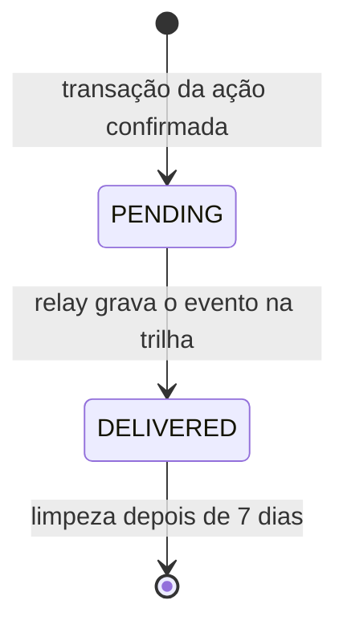
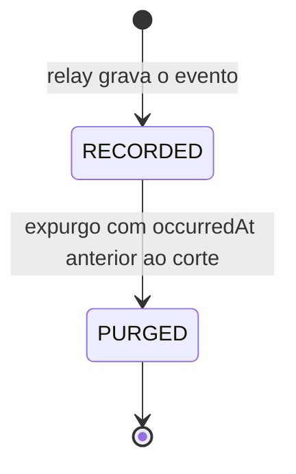
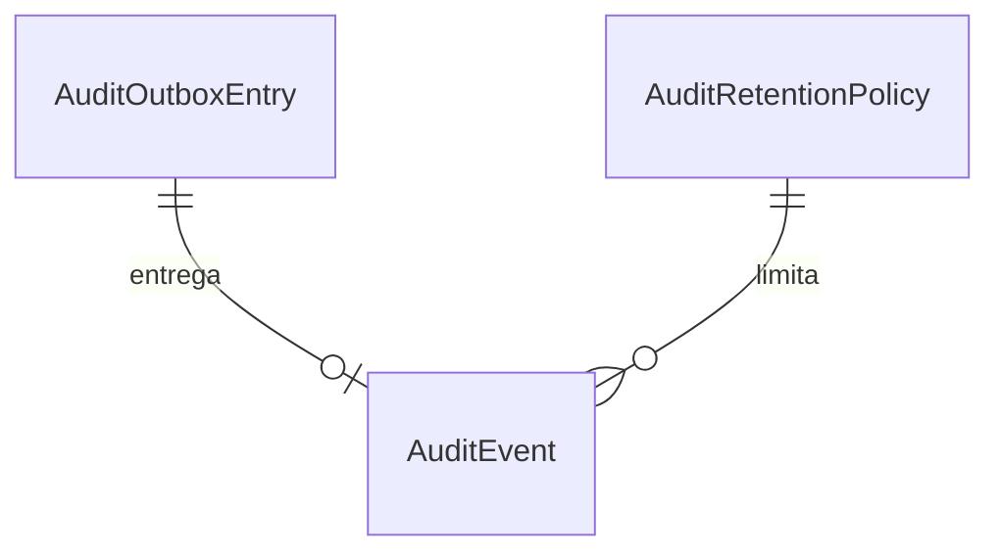

# Especificação funcional — U2 Trilha de auditoria

Comportamento da Unit `u2-audit-trail` ([unit-of-work.md](../../../inception/units-generation/unit-of-work.md)). A U2 implementa a história US7.3 (rastrear ações sensíveis) de [stories.md](../../../inception/user-stories/stories.md), conforme [unit-of-work-story-map.md](../../../inception/units-generation/unit-of-work-story-map.md), e os requisitos FR2.3, FR3.3 e NFR7 de [requirements.md](../../../inception/requirements-analysis/requirements.md). O componente é o AuditTrail de [components.md](../../../inception/domain-design/components.md) e o contrato é o C9 de [contract-summary.md](../../../inception/contract-design/contract-summary.md), mais uma operação nova no C8 (abaixo). O modelo está em [entities.md](entities.md) e as regras em [rules.md](rules.md).

Este documento é a fonte da verdade dos fluxos e das máquinas de estado. O diagrama de entidades e o resumo de regras no fim são visões derivadas.

## Escopo da U2

| Inclui | Já entregue pela U1 (sem mudança de interface) | Não inclui (Unit dona) |
|---|---|---|
| Validação do evento no publicador (BR1.2, BR1.4) | `AuditEventPublisher`, `AuditEventCommand`, tabela de saída, relay, gatilho append-only | Decidir quais ações são sensíveis: cada Unit publica as suas (DP-2) |
| Consulta restrita pelo administrador | Tipo `WalletAddress` mascarado e filtro Base58 nos logs | Entrada do administrador e app administrativo (U8) |
| Retenção de 12 meses com expurgo auditado | Eventos de login da U1 | Tela de auditoria (fora do beta) |
| Limpeza da tabela de saída entregue | | Alarme de atraso do relay e intervalos finais (NFR Design) |
| Varredura completa de logs, métricas e eventos | | |

## Mudança registrada no contrato C8

A U2 acrescenta ao contrato administrativo C8 uma operação só de leitura, sem tela (Q1). O contrato C8 é da U8, mas a operação é provida pelo AuditTrail; pela regra de propriedade de [contract-summary.md](../../../inception/contract-design/contract-summary.md), a mudança fica registrada aqui, no Functional Design da Unit provedora, e é avisada à U8 pelo mapa de arestas.

```yaml
paths:
  /api/v1/admin/audit-events:
    get:
      summary: Eventos da trilha por período e ação, mais recentes primeiro (US7.3, NFR7)
      security: [ { accessToken: [] } ]
      parameters:
        - { name: from, in: query, required: true, schema: { $ref: 'common#/components/schemas/Instant' } }
        - { name: to, in: query, required: true, schema: { $ref: 'common#/components/schemas/Instant' } }
        - { name: action, in: query, schema: { type: string, maxLength: 64 } }
        - $ref: 'common#/components/parameters/Cursor'
        - $ref: 'common#/components/parameters/Limit'
      responses:
        '200': { description: '{ items: AuditEventView[], nextCursor }' }
        '400': { description: VALIDATION_FAILED }
        '401': { description: UNAUTHENTICATED }
        '403': { description: FORBIDDEN_ROLE para token de convidado, auditado }
```

`AuditEventView` tem `eventId`, `tenantId` (ou nulo), `actor`, `actorType`, `action`, `targetRef`, `correlationId`, `occurredAt`, `recordedAt` e `details`. A rota não tem `Idempotency-Key` porque é `GET`.

**Dependência da U8:** o token de administrador nasce na entrada administrativa da U8 (AC1.2.6). Até lá, a rota existe e é testada com um contexto de autenticação de administrador montado só nos testes; nenhum caminho de produção cria esse contexto antes da U8.

## Fluxos

### F1 — Publicar um evento (qualquer Unit)

1. A Unit dona da ação abre a transação da ação e chama o publicador com o `AuditEventCommand` (C9).
2. O publicador confere que existe uma transação ativa; sem ela, recusa (contrato C9).
3. O publicador valida campos e formato (BR1.2) e procura valores proibidos em `details` e `targetRef` (BR1.4); qualquer falha recusa com exceção de programação e desfaz a transação da ação.
4. O publicador grava a entrada na tabela de saída, pendente.
5. A transação da ação confirma ou desfaz; o evento acompanha o resultado (BR1.1).

### F2 — Entregar à trilha (relay, já existente)

1. A cada intervalo, o relay do processo de API lê entradas pendentes em lotes, travando-as para que outro relay não as pegue.
2. Para cada entrada, grava o `AuditEvent` com `recordedAt` do relógio injetável; um `eventId` já existente é descartado sem erro (BR1.1).
3. Marca `deliveredAt` na mesma transação.

### F3 — Consultar a trilha (administrador)

1. O administrador chama `GET /api/v1/admin/audit-events` com `from`, `to` e, opcionalmente, `action`, `cursor` e `limit`.
2. A autenticação monta o contexto; sem token válido, a resposta é `401` (BR2.1).
3. Com token de convidado, a resposta é `403 FORBIDDEN_ROLE` e é gravado `REQUEST_FORBIDDEN` (BR2.1).
4. A consulta valida os parâmetros (BR2.2); parâmetro não declarado ou período inválido devolve `400 VALIDATION_FAILED` com os campos.
5. A consulta lê os eventos de todos os tenants no período, na ordem de BR2.3, a partir do cursor.
6. A resposta traz `items` com o endereço completo onde estiver em `details` (BR2.4) e `nextCursor` (nulo na última página).
7. Na mesma transação de leitura, o sistema publica `AUDIT_QUERIED` com o administrador como ator e os filtros em `details` (BR2.5).

### F4 — Expurgo de retenção (diário)

1. O agendador do processo de API dispara o expurgo uma vez por dia; uma execução em andamento impede outra (BR3.2).
2. O expurgo calcula o corte: início do dia UTC menos 12 meses (BR3.1).
3. Com o papel de banco de retenção, apaga em lotes de até 1000 os eventos com `occurredAt` anterior ao corte.
4. Ao terminar, ou ao parar por falha de um lote, publica `AUDIT_RETENTION_PURGED` com o corte, a quantidade apagada e o resultado (BR3.3); essa publicação usa o publicador normal, com o papel de banco da aplicação.
5. Uma falha deixa o estado de saúde da trilha degradado até a próxima execução bem-sucedida.

### F5 — Limpeza da tabela de saída (diária)

1. Uma vez por dia, a limpeza apaga entradas com `deliveredAt` anterior a agora menos 7 dias (BR3.4).
2. Entradas pendentes ficam, qualquer que seja a idade; o atraso delas aparece no estado de saúde e em `auditOutboxPending` (C8).

### F6 — Varredura da suíte de testes

1. Os testes registram os valores sensíveis que emitem: endereços completos, tokens de acesso e de renovação, nonces e assinaturas de login.
2. Ao fim da suíte, a varredura lê os logs e as métricas expostas e procura esses valores, qualquer forma de token JWT, o cabeçalho `Authorization` e o prefixo `Bearer`, e o endereço completo (BR4.1, BR4.2).
3. A varredura lê também o `payload` da tabela de saída e o `details` da trilha e procura os mesmos tokens, nonces, assinaturas e cabeçalhos; o endereço completo em `details` da trilha é permitido.
4. Qualquer achado falha o teste e o build, com o local e o tipo do valor, nunca o valor em si.

## Máquinas de estado

### Entrada da tabela de saída



<!-- Text fallback: A entrada nasce PENDING quando a transação da ação confirma. Passa para DELIVERED quando o relay grava o evento na trilha. Sai da tabela pela limpeza diária 7 dias depois de entregue. Uma entrada PENDING nunca é apagada. -->

| De | Gatilho | Para | Regra |
|---|---|---|---|
| (nova) | Transação da ação confirmada | PENDING (`deliveredAt` vazio) | BR1.1 |
| PENDING | Relay grava o evento | DELIVERED (`deliveredAt` preenchido) | BR1.1 |
| DELIVERED | Limpeza com `deliveredAt` há mais de 7 dias | removida | BR3.4 |
| PENDING | Limpeza | sem mudança | BR3.4 |

### Evento da trilha



<!-- Text fallback: O evento nasce RECORDED quando o relay o grava. Fica assim até o expurgo de retenção apagá-lo, quando occurredAt é anterior ao corte de 12 meses. Nenhuma outra transição existe: alteração e exclusão fora do expurgo são recusadas. -->

| De | Gatilho | Para | Regra |
|---|---|---|---|
| (novo) | Relay grava | RECORDED | BR1.1 |
| RECORDED | Expurgo, `occurredAt` anterior ao corte | PURGED (removido) | BR3.1, BR3.2 |
| RECORDED | Qualquer UPDATE | sem mudança, recusa | BR1.3 |
| RECORDED | DELETE fora do papel de retenção ou depois do corte | sem mudança, recusa | BR1.3 |

## Cenários de borda

| Cenário | Comportamento |
|---|---|
| Mesmo `eventId` publicado duas vezes por repetição idempotente | Uma entrada na tabela de saída e um evento na trilha (BR1.1) |
| Publicação fora de transação | Recusada antes de gravar (C9) |
| `details` com chave `nonce` ou valor em forma de JWT | Publicação recusada; a transação da ação desfaz (BR1.4) |
| Consulta com período de 32 dias | `400 VALIDATION_FAILED` em `to` (BR2.2) |
| Dois eventos com o mesmo `occurredAt` | Ordem pelo `eventId`, estável entre páginas (BR2.3) |
| Evento gravado depois da primeira página com `occurredAt` mais antigo | Aparece numa página seguinte se for posterior ao cursor; a consulta não fixa instante de corte |
| Expurgo e relay ao mesmo tempo | O expurgo só toca eventos com mais de 12 meses; o relay grava eventos novos; não há disputa de linhas |
| Falha no meio do expurgo | O que já foi apagado fica apagado; a próxima execução continua; `AUDIT_RETENTION_PURGED` registra a parada (BR3.2, BR3.3) |
| Relay parado por dias | Entradas pendentes ficam; a limpeza não as apaga (BR3.4) |

## Diagrama de entidades (derivado de entities.md)



<!-- Text fallback: Cada AuditOutboxEntry vira no máximo um AuditEvent com o mesmo eventId. A AuditRetentionPolicy limita por quanto tempo cada AuditEvent fica na trilha. AuditEventQuery e AuditRetentionRun são objetos de valor sem tabela própria. -->

## Resumo das regras (derivado de rules.md)

| Grupo | Regras | Assunto |
|---|---|---|
| Gravação e integridade | BR1.1 a BR1.4 | Exatamente um evento, validação no publicador, append-only, nenhum segredo no evento |
| Consulta | BR2.1 a BR2.5 | Só administrador, período e ação, ordem e cursor, endereço completo só em details, consulta auditada |
| Retenção | BR3.1 a BR3.4 | 12 meses, expurgo diário com papel separado, evento do expurgo, limpeza da tabela de saída |
| Mascaramento e varredura | BR4.1 e BR4.2 | Endereço mascarado fora da trilha; varredura de logs, métricas e eventos |
