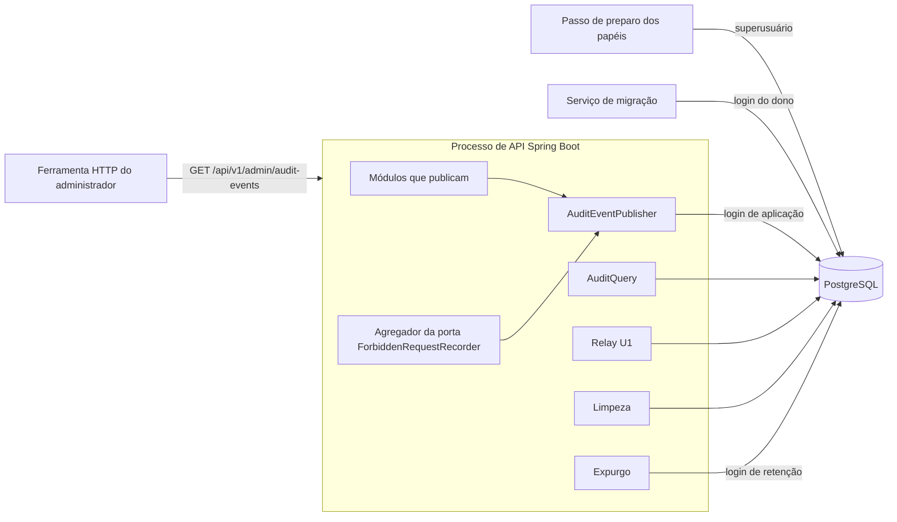

# Componentes lógicos — U2 Trilha de auditoria

Inventário dos componentes lógicos da Unit `u2-audit-trail`, com fronteiras, domínios de falha e onde cada padrão de [performance-design.md](performance-design.md), [security-design.md](security-design.md), [scalability-design.md](scalability-design.md), [reliability-design.md](reliability-design.md) e [observability-design.md](observability-design.md) se aplica. Base: [functional-spec.md](../functional-design/functional-spec.md), [tech-stack-decisions.md](../nfr-requirements/tech-stack-decisions.md) e [contract-summary.md](../../../inception/contract-design/contract-summary.md) (C8, C9, C20). Serve de ponte para o Infrastructure Design.

## Visão geral

<!-- Text fallback: A ferramenta HTTP do administrador chama a consulta da trilha no processo de API. Dentro dele, os módulos publicam pelo AuditEventPublisher; o agregador da porta ForbiddenRequestRecorder também publica por ele; o passo de preparo monta os papéis como superusuário antes da migração; o relay, a limpeza e a consulta usam o login de aplicação; o expurgo usa o login de retenção. O serviço de migração aplica o Liquibase com o login do dono e termina antes de a API subir. Tudo usa um único PostgreSQL. -->

## Inventário

| Componente | Tipo | Responsabilidade na U2 | Padrões aplicados | Estado |
|---|---|---|---|---|
| AuditEventPublisher | Interface pública do AuditTrail (C9) | Validar e gravar o evento na tabela de saída, na transação da ação | Validação BR1.2 e BR1.4 com expressões pré-compiladas; propagação obrigatória | `audit_outbox` |
| Relay | Tarefa do processo de API (U1) | Entregar a tabela de saída à trilha | Lote de 100 a cada 1 s, reserva de linhas, desduplicação por `event_id`, medida do commit real | `audit_event` |
| AuditQuery | Rota administrativa e serviço | Consulta por período, ação e cursor | Busca por cursor com índices; transação de leitura e escrita; `no-store` | Só leitura de `audit_event` e gravação de `AUDIT_QUERIED` |
| Agregador de recusas | Decorador da porta `ForbiddenRequestRecorder` da U1 | Agregar `REQUEST_FORBIDDEN` repetido por quem, método, rota e código, por minuto | Delega a primeira recusa à U1; teto de 500 chaves com resumo de estouro; resumo a cada 10 s e no desligamento | Memória do processo |
| Passo de preparo dos papéis | Serviço do Docker Compose e script SQL idempotente | Criar papéis, transferir posse ao dono, privilégios padrão | Roda como superusuário a cada subida, antes da migração | — |
| Expurgo | Tarefa do processo de API | Apagar eventos anteriores ao corte | ShedLock, lotes de 1000, limite de 30 min, pool de retenção de 1 conexão | `audit_job_run` |
| Limpeza | Tarefa do processo de API | Apagar entradas entregues há mais de 7 dias | ShedLock, lotes de 1000, limite de 30 min | `audit_job_run` |
| JobRunRegistry | Componente do AuditTrail | Estado das tarefas, recuperação ao subir, indicadores de saúde | Linha por tarefa; regra das 24 h e das 26 h | `audit_job_run` |
| Serviço de migração | Contêiner do Docker Compose (mesmo artefato) | Aplicar o Liquibase com o login do dono e terminar | Credencial do dono só nele | — |
| PostgreSQL | Banco | Trilha, tabela de saída, bloqueios e estado das tarefas | Três logins, gatilho, logs sem parâmetros, horário de commit ligado, autovacuum próprio de `audit_event` | Volume persistente local |
| Varredura | Extensão de teste | Procurar valores proibidos em logs (aplicação e banco), métricas e tabelas | Relatório com local e tipo, nunca o valor | — |

## Fronteiras entre módulos

- Outros módulos só tocam a trilha por `AuditEventPublisher` e pela porta `ForbiddenRequestRecorder`; ninguém lê `audit_outbox`, `audit_event` ou `audit_job_run` (C9, `team.md`).
- A consulta é a única leitura da trilha pela aplicação, e só para o administrador.
- O expurgo é o único código que usa o pool de retenção.

## Domínios de falha e raio de impacto

| Falha | Afeta | Não afeta | Contenção |
|---|---|---|---|
| Inserção na tabela de saída falha | A ação sensível que publicava (desfaz) | Outras ações | Fail-closed por desenho (NFR4.7) |
| Relay atrasa ou para | Leitura da trilha e da consulta | Ações de negócio | Saúde degradada, `auditOutboxPending`, alerta |
| Expurgo falha | Retenção de 12 meses | Relay, consulta, ações | Para no lote, saúde degradada, próxima execução continua |
| Limpeza falha | Tamanho da tabela de saída | Entrega | Idem |
| Processo de API cai | Relay, tarefas, contagem de recusas | Eventos já confirmados | Entrega ao voltar; tarefas atrasadas rodam ao subir; até 1 min de contagem perdido |
| Serviço de migração falha | Subida da API | Banco existente | A API não sobe; o script de verificação falha |
| Login de retenção com senha errada | Expurgo | Todo o resto | Expurgo `FAILED`, saúde degradada |

## Recursos compartilhados

| Recurso | Quem usa | Risco | Tratamento |
|---|---|---|---|
| Pool principal (10 conexões) | Requisições, relay, limpeza, consulta, resumos | Tarefa longa ocupando conexões | Lotes de até 1000 em transações curtas |
| Pool de retenção (1 conexão) | Só o expurgo | Uso por outro código | Só o expurgo recebe esse pool; regra ArchUnit restringe quem o injeta |
| Memória do processo | Contagem de recusas | Crescimento | Teto de 500 chaves e janelas de 1 minuto |
| Agendador do Spring | Relay, tarefas, resumos | Tarefa longa atrasando as outras | Pool do agendador com pelo menos 3 linhas de execução |

## Para o Infrastructure Design

- Serviço de migração no Docker Compose, com a API dependendo dele com condição de término bem-sucedido.
- Serviço de preparo dos papéis com o script idempotente de `infra/postgres/bootstrap/`, rodando como superusuário antes do serviço de migração; o script de inicialização da U1 deixa de dar a posse do schema à aplicação.
- Parâmetros do PostgreSQL: `track_commit_timestamp=on`, parâmetros de log de [security-design.md](security-design.md) e autovacuum próprio de `audit_event`.
- `.env.example` com as chaves das três senhas, sem valores; a senha do dono entregue só ao serviço de migração.
- Pré-requisitos antes de ambiente compartilhado: TLS 1.2+, criptografia em repouso do banco e dos backups e retenção dos backups alinhada aos 12 meses. A cadeia de resumos fica para avaliação no G1.
