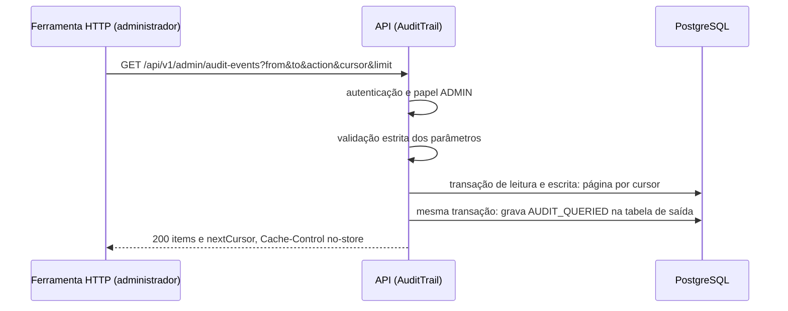

# Desenho de segurança — U2 Trilha de auditoria

Como a Unit `u2-audit-trail` cumpre os requisitos de [security-requirements.md](../nfr-requirements/security-requirements.md) (NFR6.1 a NFR6.9, NFR5.1, NFR7.1 a NFR7.6), para os fluxos F1 a F6 de [functional-spec.md](../functional-design/functional-spec.md) e os contratos C8, C9 e C10 de [contract-summary.md](../../../inception/contract-design/contract-summary.md), com as escolhas de [tech-stack-decisions.md](../nfr-requirements/tech-stack-decisions.md). Decisões em [nfr-design-questions.md](nfr-design-questions.md) (Q1, Q2, Q3, Q6).

## Camadas de defesa

| Camada | Controle | Requisito |
|---|---|---|
| Rota | `/api/v1/admin/audit-events` aceita só token de administrador; convidado recebe `403` auditado, com agregação de repetições; resposta `Cache-Control: no-store` | NFR6.1, NFR6.7 |
| Entrada | Validação estrita de `from`, `to`, `action`, `limit` e `cursor`; parâmetro desconhecido recusado; SQL sempre parametrizado | NFR6.6 |
| Publicação | Validação de campos, formato e valores proibidos antes de gravar; recusa desfaz a ação | NFR7.2 |
| Banco: papéis | Dono do esquema (só migrações), aplicação (só dados), retenção (só leitura e exclusão em `audit_event`); posse e privilégios montados por um passo de preparo idempotente | NFR6.2, NFR6.3 |
| Banco: gatilho | `UPDATE` e `TRUNCATE` sempre recusados; `DELETE` só de membro do papel de retenção e só antes do corte de 12 meses | NFR6.4 |
| Banco: logs | PostgreSQL sem log de instruções, parâmetros e linha que falhou | NFR7.1 |
| Entrega | Migrações fora do processo da API; senhas só no `.env`; Gitleaks, CodeQL e OWASP Dependency-Check | NFR6.3, NFR6.5, NFR6.8 |
| Verificação | Varredura de logs da aplicação e do banco, métricas, `payload` e `details` ao fim da suíte | NFR7.3 |

## Papéis de banco, posse e migrações (NFR6.2, NFR6.3, NFR6.5)

### Papéis

| Papel | Tipo | Quem usa | Privilégios |
|---|---|---|---|
| Dono do esquema | Login, sem superusuário | Só o serviço de migração | Dono do schema `public` e de todos os objetos nele, inclusive as tabelas do Liquibase |
| Aplicação | Login | Processo de API (pool principal) | `USAGE` no schema; leitura e escrita de dados nas tabelas por privilégio padrão; em `audit_event`, só leitura e inserção; sem `CREATE` no schema |
| `audit_retention` | Papel de grupo sem login, nome fixo | Concedido só ao login de retenção | `USAGE` no schema; leitura e exclusão em `audit_event`; nada mais |
| Login de retenção | Login, membro de `audit_retention` | Processo de API (pool de 1 conexão, só o expurgo) | Os de `audit_retention` |

Os nomes e as senhas dos três logins vêm do `.env`. Só o papel de grupo `audit_retention` tem nome fixo, e é ele que a migração e o gatilho usam. Assim o nome do login pode mudar sem mexer no banco.

### Passo de preparo dos papéis (único responsável)

Um passo de preparo cria e ajusta os papéis. Ele roda como superusuário do PostgreSQL, é idempotente e roda a cada subida, tanto em volume novo quanto em volume já criado pela U1:

1. Cria os logins do dono, da aplicação e da retenção e o papel `audit_retention` quando não existem, e atualiza as senhas a partir do `.env`. Todos ficam sem superusuário, sem criação de banco e sem criação de papel.
2. Concede `audit_retention` ao login de retenção e garante que o login da aplicação e o do dono não são membros dele.
3. Transfere ao dono tudo o que pertence ao login da aplicação (`REASSIGN OWNED`): schema `public`, tabelas da U1, sequências, funções, gatilhos e as tabelas `databasechangelog` e `databasechangeloglock`. Num volume novo, o passo não tem nada a transferir.
4. Revoga `CREATE` no schema de `PUBLIC` e da aplicação. Concede `USAGE` à aplicação e a `audit_retention`.
5. Registra privilégios padrão do dono no schema: leitura, inserção, atualização e exclusão em tabelas futuras para a aplicação, e uso e leitura em sequências futuras. As tabelas das Units U3 a U9 já nascem utilizáveis pela aplicação.
6. Concede à aplicação os mesmos privilégios nas tabelas que já existem.

- **Onde roda:** no Docker Compose, um serviço de preparo com o cliente `psql` executa o script versionado em `infra/postgres/bootstrap/`. Ele depende do banco saudável, e o serviço de migração depende dele com término bem-sucedido. O script de inicialização atual da U1 (`infra/postgres/init/`) deixa de tornar a aplicação dona do schema: toda a montagem de papéis passa a ser do passo de preparo.
- **Credencial de superusuário:** só o contêiner do banco e o serviço de preparo a recebem.
- **Na CI e nos testes de integração:** a base de testes roda o mesmo script como superusuário do contêiner, aplica as migrações com o login do dono e conecta a aplicação e o expurgo com os seus logins.

### Migrações fora da API (Q1)

- O serviço de migração roda o mesmo artefato da API num perfil que só aplica o Liquibase com o login do dono e termina. A API sobe depois que ele termina com sucesso, com o Liquibase desligado e sem a credencial do dono no ambiente.
- A migração da U2 só ajusta privilégios específicos da trilha. Ela revoga atualização e exclusão em `audit_event` da aplicação, concede leitura e exclusão a `audit_retention`, cria as tabelas novas e troca a função do gatilho.

### Testes

- Teste de configuração: o perfil padrão da API não tem a credencial do dono e tem o Liquibase desligado.
- Verificação na CI sobre a configuração resolvida do Docker Compose: o serviço da API não recebe a senha do dono nem a do superusuário.
- Teste de privilégios: com o login da aplicação, `UPDATE`, `DELETE`, `TRUNCATE`, `DROP`, `ALTER TABLE ... DISABLE TRIGGER`, `CREATE TABLE` e `SET ROLE audit_retention` falham. Com o login de retenção, `INSERT` e `UPDATE` em `audit_event` falham, e também o acesso a outra tabela.
- **Teste de transição:** monta um banco no formato da U1 (aplicação dona do schema e das tabelas), roda o passo de preparo e as migrações da U2 e confere a posse, os privilégios padrão e o funcionamento da aplicação. Roda também o passo de preparo duas vezes seguidas, sem erro.

## Gatilho de `audit_event` (NFR6.4)

A migração da U2 troca a função `audit_event_reject_change`, usada pelos dois gatilhos da U1: o de linha para `UPDATE` e `DELETE` e o de instrução para `TRUNCATE`. A função nova trata os três casos:

```sql
-- pseudocódigo; função sem SECURITY DEFINER (current_user é quem executa)
IF TG_OP IN ('UPDATE', 'TRUNCATE') THEN RAISE 'audit_event is append-only: %', TG_OP;
IF NOT pg_has_role(current_user, 'audit_retention', 'MEMBER') THEN RAISE 'DELETE not allowed';
IF OLD.occurred_at >= (date_trunc('day', now() AT TIME ZONE 'UTC')
                       - interval '12 months') AT TIME ZONE 'UTC'
THEN RAISE 'audit_event inside retention window';
RETURN OLD;  -- exclusão permitida
```

- Os 12 meses ficam fixos na migração. A aplicação valida `retentionMonths >= 12` na partida e não sobe com valor menor.
- A função não é `SECURITY DEFINER`, então `current_user` é o login que executa a instrução.
- As mensagens não incluem valores da linha.
- Só o dono do esquema pode desligar ou trocar o gatilho, e a credencial do dono não está na API.
- Testes:
  - `UPDATE` recusado para todos os logins;
  - `TRUNCATE` recusado, inclusive para o dono;
  - `DELETE` recusado para a aplicação e para o dono;
  - `DELETE` pelo login de retenção recusado num evento de 11 meses e aceito num de 13 meses.

## Consulta da trilha (NFR6.1, NFR6.6, NFR6.7, NFR7.5)



<!-- Text fallback: A ferramenta HTTP do administrador chama a rota de consulta. A API confere a autenticação e o papel ADMIN, valida os parâmetros, abre uma transação de leitura e escrita, lê a página pelo cursor, grava AUDIT_QUERIED na tabela de saída na mesma transação e responde 200 com items, nextCursor e Cache-Control no-store. -->

- **Transação:** de leitura e escrita, porque grava `AUDIT_QUERIED`. Se a gravação falhar, a transação desfaz e a resposta é `500` com `ProblemDetail`, sem dados. Nenhuma consulta devolve eventos sem deixar rastro.
- **Papel:** a autorização das rotas `/api/v1/admin/...` segue a regra comum de C8. Sem token, `401`. Token de convidado, `403 FORBIDDEN_ROLE`, auditado como abaixo.
- **Cursor:** texto opaco em Base64 URL com `occurredAt` e `eventId`. Forma inválida ou instante fora do período recebe `400 VALIDATION_FAILED` no campo `cursor`. O cursor não é assinado, porque só o administrador consulta e um cursor adulterado só muda o início da página.
- **Contexto de administrador antes da U8 (NFR6.1):** a fábrica do contexto de administrador fica só no código de teste. Duas regras ArchUnit protegem a produção:
  - uma falha o build quando uma classe de produção cria `Principal` fora do filtro de sessão;
  - outra falha quando uma classe de produção referencia `Role.ADMIN` fora de uma lista fechada, que hoje tem só a regra de autorização das rotas administrativas.

  O teste da U1 continua garantindo que a carteira de administrador recebe `403` na entrada do convidado. Por isso nenhuma sessão de administrador nasce antes da U8.

## Tenant (NFR5.1)

- Nenhuma rota do convidado lê `audit_event` ou `audit_outbox`. Uma regra ArchUnit restringe o acesso às tabelas da trilha aos pacotes do AuditTrail.
- Os módulos montam o `tenantId` do evento a partir do `Principal` do contexto de autenticação (C10), nunca da requisição. Um teste de integração envia um `tenantId` diferente na requisição e confere que o evento traz o tenant do token.
- Por desenho, o administrador vê todos os tenants na consulta (BR2.4).

## Agregação de `REQUEST_FORBIDDEN` (Q2, Q6)

A agregação protege a trilha contra amplificação (NFR2.1). Ela é uma extensão da porta que a U1 já tem, `ForbiddenRequestRecorder`, e não cria interface nova.

| Aspecto | Desenho |
|---|---|
| Onde fica | Um decorador agregador da porta `ForbiddenRequestRecorder`, registrado como implementação principal. Ele delega à implementação da U1 (`AuditedForbiddenRequestRecorder`), que continua gravando cada evento em transação própria, com `route` (método e URI), `role`, `code` e `reason` em `details` |
| Chave | Quem foi recusado (`userId` quando autenticado; senão o IP da conexão direta, como no limitador da U1), método, modelo da rota mapeada pelo Spring (por exemplo `GET /api/v1/admin/audit-events`, ou `UNMATCHED` quando nenhuma rota casa) e `code`, por janela de 1 minuto alinhada ao relógio UTC |
| Primeira recusa da chave na janela | Delega à U1: grava `REQUEST_FORBIDDEN` como hoje |
| Recusas seguintes na janela | Não gravam evento; incrementam o contador da chave e guardam o último `reason` |
| Fim da janela | Uma tarefa a cada 10 s grava, para cada chave com contagem maior que zero na janela fechada, um `REQUEST_FORBIDDEN_REPEATED` em transação própria. O ator é o mesmo do primeiro evento, com o mesmo tenant. Em `details` vão método, modelo da rota, `role`, `code`, último `reason`, início e fim da janela e contagem |
| Teto de chaves | Até 500 chaves por janela. Uma recusa de chave nova acima do teto não grava evento: entra num contador de estouro da janela. No fim da janela, ele vira um único `REQUEST_FORBIDDEN_REPEATED` com ator `system` (`actorType SYSTEM`), tenant vazio, `scope = OVERFLOW`, contagem de recusas e de chaves distintas |
| Teto verificável | No máximo 1.001 eventos de recusa por minuto por instância (500 primeiros eventos, 500 resumos e 1 resumo de estouro). Cada chave gera no máximo 2 eventos por minuto. Teste com relógio injetável e 2.000 chaves distintas na mesma janela |
| Desligamento ordenado | Grava os resumos e o estouro pendentes antes de a API parar |
| Queda abrupta | Perde até 1 minuto de contagem; a primeira recusa de cada chave já está gravada. Risco aceito no beta local (Q6) |
| Várias instâncias | Cada instância conta e grava os seus resumos |
| `AUDIT_QUERIED` | Não é agregado: cada consulta do administrador grava o seu evento (BR2.5) |

**Mudança de regra funcional.** Esta agregação refina BR2.1 de [functional-spec.md](../functional-design/functional-spec.md). Cada recusa continua auditada, mas as repetições da mesma chave dentro de 1 minuto viram um evento de resumo com a contagem. O critério de NFR6.1 fica coberto assim: o primeiro `403` de cada chave grava `REQUEST_FORBIDDEN`, e os seguintes entram no resumo. A ação nova `REQUEST_FORBIDDEN_REPEATED` não muda o contrato C9: `action` é texto livre, e cada Unit documenta e testa as suas ações (Q6 do design funcional). A mesma refinação precisa constar no `rules.md` e no `functional-spec.md` da U2, os documentos donos de BR2.1. Ela fica registrada aqui como pendência para levar ao design funcional antes da geração de código da U2.

## Nenhum segredo nem endereço completo fora da trilha (NFR7.1, NFR7.2, NFR7.3)

- **Publicador:** antes de gravar, confere campos obrigatórios e formato (BR1.2) e recusa chaves proibidas de `details` e valores em forma de JWT, de valor `Bearer` ou de assinatura Base58 de 64 bytes em `details` e `targetRef` (BR1.4). As expressões são pré-compiladas. A exceção diz o campo e o motivo, nunca o valor.
- **Mascaramento:** reaproveita as duas barreiras da U1: o tipo `WalletAddress`, que vira texto mascarado, e o filtro do formatador de logs. `actor` antes do login é gravado mascarado.
- **PostgreSQL (Q3):** no Docker Compose e nos testes, o banco roda com estes parâmetros, e um teste os lê do banco de teste e falha se algum divergir:
  - `log_statement=none`;
  - `log_min_duration_statement=-1`;
  - `log_min_error_statement=panic`, que não registra a instrução que falhou;
  - `log_error_verbosity=terse`, sem detalhe nem linha que falhou;
  - `log_parameter_max_length=0` e `log_parameter_max_length_on_error=0`.
- **Varredura (NFR7.3):** uma extensão de teste roda ao fim da suíte e lê os logs capturados da aplicação, os logs do contêiner do PostgreSQL, a saída de métricas da porta de gestão e as tabelas `audit_outbox` e `audit_event`. Procura os valores registrados pelos testes (endereços completos, tokens, nonces, assinaturas) e os padrões gerais (JWT, `Authorization`, `Bearer`). O endereço completo em `details` da trilha não conta como achado. O relatório traz local e tipo, nunca o valor.

## Segredos, dependências e retenção (NFR6.5, NFR6.8, NFR7.4, NFR7.6)

- O `.env.example` ganha os nomes e as chaves das senhas do dono, da aplicação, da retenção e do superusuário, sem valores. O Gitleaks já cobre `.env` no pré-commit e na CI.
- O ShedLock entra com versão fixa no `pom.xml` e passa pelo OWASP Dependency-Check e pelo CodeQL como o resto do código.
- A retenção e a limpeza seguem [reliability-design.md](reliability-design.md).
- Antes do G1, ficam como pré-requisitos do Infrastructure Design: TLS 1.2 ou superior, criptografia em repouso do banco e dos backups, e backups com retenção alinhada aos 12 meses da trilha.

## Riscos residuais

| Risco | Tratamento |
|---|---|
| Administrador do próprio banco ou superusuário altera eventos sem rastro | Aceito no beta local (NFR6.9); cadeia de resumos SHA-256 avaliada no G1. A senha do superusuário só vai para o banco e o passo de preparo |
| Queda abrupta da API perde até 1 minuto de contagem de recusas repetidas | Aceito no beta local (Q6); a primeira recusa de cada chave já está gravada |
| Teto de 1.001 eventos por minuto, sustentado por horas, passa do volume diário previsto | Exige muitas identidades autenticadas ou IPs distintos; o alerta de volume diário acima de 80 mil avisa |
| Cursor não assinado | Aceito: só o administrador consulta, e o cursor só muda o início da página |
