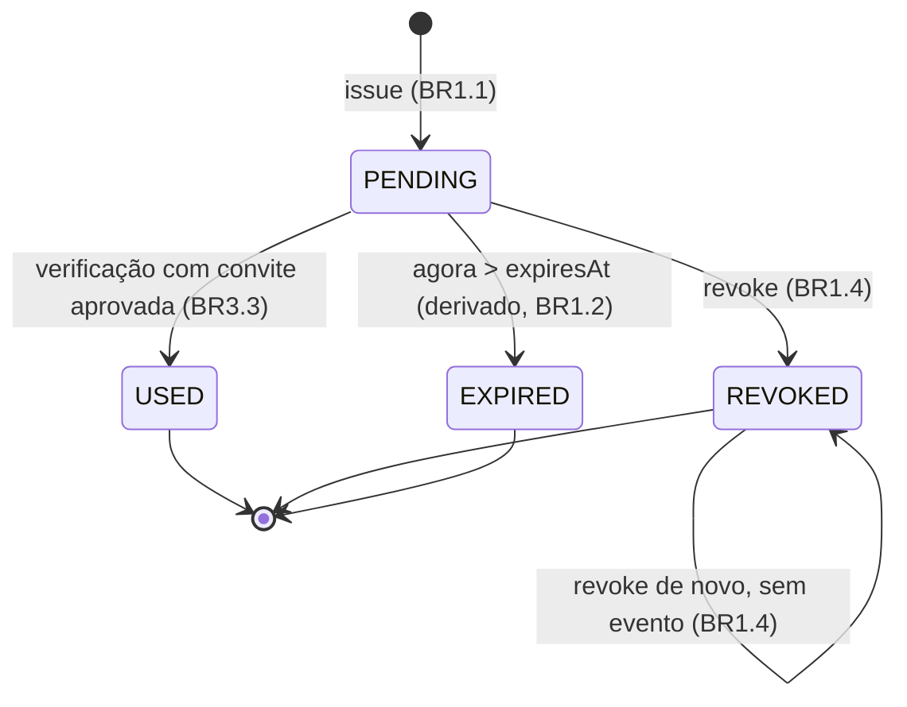
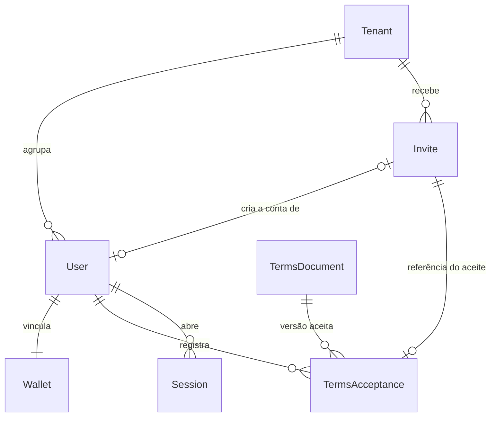

# Especificação funcional — U3 Convites, contas e sessões

A Unit `u3-identity-access` completa o IdentityAccess iniciado na U1: convites de uso único com validade, criação da conta na verificação com convite, aceite de termos e aviso de risco, expiração de sessão com retorno à tela de origem, saída e a tela Conta. Implementa as histórias US7.1 (regras e rotas de convite), US1.1, US1.3 e US1.5 de [stories.md](../../../inception/user-stories/stories.md) e os requisitos FR1.1, FR1.2, FR1.5, FR1.6, FR3.1, FR3.3, FR11.3 e FR15.2 de [requirements.md](../../../inception/requirements-analysis/requirements.md).

Este documento é a fonte da verdade dos fluxos e das máquinas de estado. O modelo de dados está em [entities.md](entities.md) e as regras em [rules.md](rules.md); o diagrama e o resumo de regras abaixo são vistas derivadas deles. As decisões vêm de [functional-design-questions.md](functional-design-questions.md) (Q1 a Q10).

## Fronteiras

- **Dentro:** emissão, lista e revogação de convites (domínio, rotas administrativas e interface `IdentityAdministration`); consulta do convite sem sessão; criação da conta na verificação com convite; termos e aviso de risco versionados; tenant `Beta` semeado; contagens de identidade; telas do convidado de entrada com convite e Conta; aviso de sessão expirada, retorno à origem e Sair.
- **Fora:** telas administrativas de convites e de estado do sistema (U8, que usa a interface `IdentityAdministration` desta Unit); rascunho do bot preservado depois da sessão expirada (U5, que usa o retorno à origem desta Unit); cadastro de tenants (não existe no beta, BR1.7); desconectar carteira (não existe no beta).
- **Sem mudança da U1:** desafio de login, regras de assinatura, uso único do nonce, sessão com 15 minutos de acesso, 8 horas de renovação e 12 horas no total, rotação da renovação, isolamento por tenant, filtro de rotas administrativas e mecanismo comum de idempotência.
- **Contratos usados:** C1 (verificação com convite), C3 (convite, termos e conta), C8 (rotas administrativas de convite), C9 (trilha de auditoria) e C17 (`IdentityAdministration`).
- **Acréscimos e correções a contratos** (a registrar no Contract Design pela geração de código desta Unit):
  - C1, `POST /api/v1/auth/verify`: a descrição do `409` passa a ser só `WALLET_ALREADY_LINKED`; convite já usado, expirado ou revogado é `422 INVITE_INVALID` com `reason` (Q4). O `reason` ganha o valor `TENANT_INACTIVE` (BR3.2). Código desconhecido responde `404 INVITE_NOT_FOUND`.
  - C3, `GET /api/v1/invites/{code}`: respostas `404 INVITE_NOT_FOUND` e `429 RATE_LIMITED` com `Retry-After` (BR2.1, BR2.2).
  - C8, esquema `Invite`: `code` deixa de ser obrigatório e só vem na resposta `201` da emissão; entram `codeSuffix`, `createdAt` e `revokedAt` (Q2, BR1.3). A revogação ganha `404` e `409 INVITE_NOT_REVOCABLE` (BR1.4). A emissão ganha `422 VALIDATION_FAILED` nos campos `tenantId` e `expiresAt` (BR1.1).
  - C8 e C17: leitura dos tenants ativos para o formulário de convite da U8 (`activeTenants()` na interface e a rota correspondente criada pela U8), porque o administrador escolhe entre os tenants existentes (Q1, BR1.7).
  - C9: ações de auditoria `INVITE_ISSUED`, `INVITE_REVOKED` e `ACCOUNT_CREATED`, publicadas pela U3 (BR1.1, BR1.4, BR3.5).

## Fluxos

### F1 — Emissão de convite pelo administrador (US7.1)

Gatilho: `IdentityAdministration.issue(tenantId, expiresAt, admin)`, chamada pela rota `POST /api/v1/admin/invites` da U8, com chave de idempotência.

1. O filtro de rotas administrativas da U1 confere o token. Token de convidado: `403 FORBIDDEN_ROLE` e `REQUEST_FORBIDDEN` na trilha; fim (BR1.5).
2. O mecanismo comum de idempotência confere a chave. Repetição com o mesmo corpo devolve o mesmo convite **sem o código**, só com `codeSuffix`: a resposta guardada pelo mecanismo nunca inclui o código (BR1.8). Corpo diferente com a mesma chave segue a regra da U1. Quem perdeu o código revoga o convite e emite outro.
3. Validar o tenant: precisa existir e estar `ACTIVE`; senão `422 VALIDATION_FAILED` no campo `tenantId` (BR1.1).
4. Validar `expiresAt` contra o relógio injetável: entre agora + 1 hora e agora + 30 dias, inclusive; senão `422 VALIDATION_FAILED` no campo `expiresAt` (BR1.1).
5. Gerar o código aleatório (256 bits, base64url, 43 caracteres). Calcular `codeDigest` e `codeSuffix` (BR1.1, BR2.3).
6. Numa transação: gravar o `Invite` com `status = PENDING`, `issuedBy`, `createdAt` e `expiresAt`, e gravar `INVITE_ISSUED` na saída da trilha, com o administrador como ator e o `inviteId` como referência, sem o código.
7. Guardar no registro de idempotência a resposta sem o código e responder `201` com o convite e o código completo. Esta é a única vez em que o código aparece (BR1.3, BR1.8).

### F2 — Lista de convites (US7.1)

Gatilho: `IdentityAdministration.list(cursor)`, pela rota `GET /api/v1/admin/invites`.

1. Filtro de administrador como em F1.1.
2. Ler uma página por `createdAt` decrescente e `inviteId` como desempate, a partir do cursor (BR1.3).
3. Para cada convite, calcular o estado derivado com o mesmo instante de leitura para a página inteira (BR1.2).
4. Responder com `inviteId`, `tenantId`, estado derivado, `expiresAt`, `createdAt`, `usedAt`, `revokedAt` e `codeSuffix`. Nunca o código nem `issuedBy`.

### F3 — Revogação de convite (US7.1)

Gatilho: `IdentityAdministration.revoke(inviteId, admin)`, pela rota `POST /api/v1/admin/invites/{inviteId}/revoke`, com chave de idempotência. A confirmação ("Revogar este convite?") é da tela da U8.

1. Filtro de administrador e idempotência como em F1.
2. Numa transação, bloquear a linha do convite. Não existe: `404` (BR1.4).
3. Calcular o estado derivado (BR1.2):
   - `PENDING`: gravar `status = REVOKED`, `revokedAt = agora` e `INVITE_REVOKED` na saída da trilha; responder `200` com o convite.
   - `REVOKED`: responder `200` com o mesmo convite, sem novo evento.
   - `USED` ou `EXPIRED`: `409 INVITE_NOT_REVOCABLE`.
4. Como a verificação com convite (F5) bloqueia a mesma linha, uma revogação e um aceite simultâneos se ordenam: quem obtém o bloqueio primeiro vence, e o outro lê o estado já gravado (AC7.1.3).

### F4 — Consulta do convite pelo convidado (US1.1)

Gatilho: a pessoa abre o link do convite; a tela chama `GET /api/v1/invites/{code}` sem sessão.

1. Conferir o limite de 10 consultas por minuto por IP: acima dele, `429 RATE_LIMITED` com `Retry-After`, sem consultar o convite (BR2.2).
2. Procurar pelo resumo do código. Não existe: `404 INVITE_NOT_FOUND` com mensagem genérica (BR2.1).
3. Responder `200` com o estado derivado, `expiresAt` e o texto e a versão vigentes dos termos e do aviso de risco. A resposta não traz tenant, `inviteId` nem dado de outra pessoa (BR2.1).
4. O log e a trilha registram só o modelo da rota; o código nunca é registrado (BR2.3).

### F5 — Criação da conta na verificação com convite (US1.1, US7.1)

Gatilho: `POST /api/v1/auth/verify` com `inviteCode` e `acceptedTermsVersion`, depois do desafio da U1.

Toda a verificação roda numa única transação, como na U1 (BR3.6).

1. Abrir a transação e aplicar as regras de assinatura da U1: desafio existente, dentro do prazo, mensagem e assinante corretos; o desafio passa de `ISSUED` para `CONSUMED`. Qualquer falha: a recusa da U1 (BR3.6, BR3.8).
2. Bloquear a linha do convite pelo resumo do código. Então conferir, nesta ordem, e parar na primeira recusa (BR3.2):
   1. código desconhecido: `404 INVITE_NOT_FOUND`;
   2. estado derivado `EXPIRED`, `REVOKED` ou `USED`: `422 INVITE_INVALID` com `reason` igual ao estado;
   3. carteira de administrador da configuração: `403 FORBIDDEN_ROLE`;
   4. carteira já vinculada a uma conta: `409 WALLET_ALREADY_LINKED`; o convite continua `PENDING` (BR3.7);
   5. tenant do convite fora de `ACTIVE`: `422 INVITE_INVALID` com `reason: TENANT_INACTIVE`;
   6. termos: `acceptedTermsVersion` ausente ou diferente da versão vigente: `422 TERMS_NOT_ACCEPTED` (BR3.1).

   Os termos vêm por último porque só fazem sentido para um convite que pode ser usado: a pessoa com convite inválido recebe o motivo do convite, e não um pedido de aceite que não a levaria a lugar nenhum. A tela já impede chegar aqui sem os aceites (BR3.1), então a recusa por termos na API é a defesa do servidor.
3. Na mesma transação (BR3.3): criar `User` (tenant do convite, `BETA_USER`, `ACTIVE`), `Wallet` (endereço e provedor, BR3.9), passar o convite para `USED` com `usedAt` e `usedByUserId`, criar `TermsAcceptance` com a versão, `acceptedAt` e `inviteId`, gravar `ACCOUNT_CREATED` na saída da trilha (BR3.5) e abrir a sessão como na U1.
4. Confirmar a transação e responder como a verificação da U1 (token de acesso no corpo e renovação no cookie).
5. Recusa nos passos 1 e 2: é um resultado, não um erro (regra de recusas da U1). Na mesma transação confirmada ficam o desafio `CONSUMED` e um único `LOGIN_REJECTED` com o motivo, sem o código; o convite não muda e nenhuma conta é criada (BR3.5, BR3.6). Só depois vem a resposta.
6. Falha técnica (banco, tempo esgotado): a transação inteira é desfeita, inclusive o consumo do desafio, e a resposta é 5xx. Nada foi criado nem consumido; o desafio continua sujeito ao próprio prazo da U1, e a tela pede um novo desafio para tentar de novo (BR3.6).

Concorrência no mesmo convite (BR3.4): duas verificações com o mesmo código disputam o bloqueio do passo 2. A primeira cria a conta e grava `USED`; a segunda, ao obter o bloqueio, lê `USED` e recebe `422 INVITE_INVALID` com `reason: USED`.

Mesma carteira em duas verificações ao mesmo tempo (com convites diferentes): as duas passam pela conferência 4 antes de qualquer gravação, e a unicidade de `Wallet.address` é a garantia final. A segunda a gravar viola a unicidade; sua transação é desfeita e, numa nova transação, o desafio é marcado `CONSUMED` e `LOGIN_REJECTED` é gravado; a resposta é `409 WALLET_ALREADY_LINKED` e o convite dela continua `PENDING` (BR3.7).

### F6 — Sessão expirada e retorno à origem (US1.3)

Gatilho: qualquer chamada do app do convidado recebe `401`.

1. O app tenta uma renovação com o cookie (regra da U1). Sucesso: repete a chamada original uma vez, sem a pessoa perceber.
2. A renovação também recebe `401`: descartar o token da memória e ir para a entrada com `origem` igual ao caminho atual (BR4.1).
3. A entrada mostra "Sua sessão expirou. Entre de novo para continuar.", nunca um erro técnico (AC1.3.3).
4. Ao abrir a entrada, validar `origem` (BR4.2): só caminho interno do app do convidado, começando com uma única `/`; qualquer outro valor vira a tela inicial.
5. Depois de entrar, navegar para a origem validada (BR4.3).

### F7 — Sair (US1.3)

1. A pessoa escolhe "Sair" no menu da conta ou na tela Conta.
2. O app chama `POST /api/v1/auth/logout` (U1): a sessão é revogada e `LOGOUT` é gravado.
3. O app descarta o token da memória e vai para a entrada (BR4.4).
4. Bots PAPER ativos continuam rodando no servidor; nada no fluxo de saída toca nos bots (AC1.3.2).

### F8 — Tela Conta (US1.5)

1. A tela chama `GET /api/v1/account` com o token. Pessoa e tenant vêm do token (regra de tenant da U1).
2. A API responde com `walletAddressMasked` (4 primeiros + `…` + 4 últimos), `provider`, `sessionExpiresAt` igual ao `absoluteExpiresAt` da sessão atual, `acceptedTerms` (versão e `acceptedAt` em UTC) e `realMode: UNAVAILABLE` (BR5.1, BR5.3).
3. A tela mostra o endereço abreviado como texto só para leitura, o provedor, "Sua sessão termina às {hora local}, ou antes, depois de 8 horas sem uso", a linha "Modo REAL: indisponível no beta" sem nenhum controle, e o botão "Sair" (BR5.1, BR5.3, BR5.4, BR4.4).
4. Em "Termos aceitos — ver", a tela mostra a versão, a data do aceite convertida para o fuso do navegador e o texto daquela versão (BR5.2).

### F9 — Contagens de identidade (estado do sistema)

Gatilho: `IdentityAdministration.counts()`, chamada pela tela de estado do sistema da U8.

1. Contar pessoas `BETA_USER` com status `ACTIVE`.
2. Contar convites por estado derivado (BR1.2), com o mesmo instante para todos, e preencher com zero as chaves que não aparecem (BR1.6).
3. Devolver só os números; nenhum endereço nem identificador de pessoa.

## Interação na tela de entrada com convite

| Situação | O que a tela mostra | Regra |
|---|---|---|
| Link aberto, convite `PENDING` | Termos, aviso de risco e as duas marcações; "Conectar carteira" indisponível com o motivo "Marque os dois aceites para continuar" | BR3.1 |
| As duas marcações feitas | "Conectar carteira" disponível; escolha entre Phantom e Solflare detectadas | BR3.1 |
| Sem código na URL | Campo para colar o código e o texto de onde encontrá-lo (no convite recebido) | BR6.1 |
| Nenhuma carteira detectada | Links para instalar Phantom ou Solflare; as marcações continuam guardadas na sessão do navegador | BR6.1 |
| Convite `EXPIRED`, `REVOKED` ou `USED` | "Este convite expirou", "Este convite foi revogado" ou "Este convite já foi usado", com orientação para pedir outro ao administrador; sem botão de conectar | BR1.2, BR3.2 |
| Código desconhecido | "Convite não encontrado. Confira o código." | BR2.1 |
| Muitas consultas | "Muitas tentativas. Tente de novo em {segundos} s." | BR2.2 |
| Carteira já vinculada | "Esta carteira já tem conta. Entre pela entrada normal." com link para a entrada | BR3.7 |
| Recusa depois da assinatura | O motivo em texto e a opção de tentar de novo, que pede um novo desafio | BR3.6 |
| Conta criada | Vai para a tela inicial do convidado com a sessão aberta | BR3.3 |

A página do convite responde com `Referrer-Policy: no-referrer` (BR2.3). Nenhum campo pede frase secreta ou chave privada (BR3.9). Os textos passam pelo catálogo de termos proibidos da U4 (BR6.2). Estados de carregando e de erro técnico são visíveis e distintos.

## Máquinas de estado

### Convite (`Invite.status` guardado e estado derivado)

Texto: o convite nasce `PENDING`. Sai de `PENDING` no máximo uma vez, para `USED` (conta criada) ou `REVOKED` (administrador). `EXPIRED` não é gravado: é como um `PENDING` aparece depois de `expiresAt`, e a partir daí não pode ser usado nem revogado. `USED`, `REVOKED` e `EXPIRED` são finais.

| De | Para | Gatilho | Condição | Efeito |
|---|---|---|---|---|
| — | `PENDING` | emissão | tenant `ACTIVE`, validade de 1 hora a 30 dias | `INVITE_ISSUED` |
| `PENDING` | `USED` | verificação com convite | agora <= `expiresAt`, todas as conferências de BR3.2 aprovadas | conta criada, `ACCOUNT_CREATED` |
| `PENDING` | `REVOKED` | revogação | agora <= `expiresAt` | `INVITE_REVOKED` |
| `PENDING` | `EXPIRED` (derivado) | passagem do tempo | agora > `expiresAt` | nenhum |
| `REVOKED` | `REVOKED` | revogação repetida | — | nenhum evento |
| `USED` ou `EXPIRED` | — | revogação | — | `409 INVITE_NOT_REVOCABLE` |

### Conta (`User.status`)

A U3 cria a conta `ACTIVE` (F5) e não muda o estado depois. `DISABLED` existe desde a U1 e continua sem rota no beta.

### Sessão

Sem mudança da U1. A U3 só lê `absoluteExpiresAt` para a tela Conta.

## Diagrama entidade-relacionamento (derivado de entities.md)

Texto: um tenant agrupa pessoas e convites. Cada convite cria no máximo uma conta. Cada pessoa tem uma carteira e o aceite dos termos ligado ao convite usado e à versão dos termos. Sessões continuam como na U1.

## Resumo das regras (derivado de rules.md)

| Grupo | Regras | Fluxos |
|---|---|---|
| BR1 Convites pelo administrador | BR1.1 a BR1.8 | F1, F2, F3, F9 |
| BR2 Consulta do convite | BR2.1 a BR2.3 | F4 |
| BR3 Criação da conta | BR3.1 a BR3.9 | F5 |
| BR4 Sessão e saída | BR4.1 a BR4.4 | F6, F7 |
| BR5 Tela Conta | BR5.1 a BR5.4 | F8 |
| BR6 Tela de entrada | BR6.1 e BR6.2 | tela de entrada com convite |

## Cantos tratados

- **Limite inclusivo da validade:** em `expiresAt` o convite é aceito; um segundo depois, negado como expirado (AC1.1.2, BR1.2). O instante vem do relógio injetável, então o teste usa T e T + 1 s exatos.
- **Revogação durante o aceite:** a verificação lê o estado com a linha bloqueada; a revogação que chega antes vence (AC7.1.3, F3.4).
- **Dois usos simultâneos:** uma conta só; o outro recebe `reason: USED` (AC1.1.4, BR3.4).
- **Carteira já vinculada:** recusada e o convite continua utilizável por outra carteira (AC1.1.5, BR3.7).
- **Carteira de administrador com convite:** `403 FORBIDDEN_ROLE`; o administrador entra só pela entrada administrativa (BR3.2).
- **Termos mudaram entre a consulta e a verificação:** com o convite ainda utilizável, a versão enviada deixa de ser a vigente e a verificação responde `422 TERMS_NOT_ACCEPTED` (última conferência de F5.2); a tela recarrega os termos novos e pede um novo desafio (BR3.1, BR3.6).
- **Convite inválido e termos ausentes ao mesmo tempo:** vale o motivo do convite, porque os termos são a última conferência (BR3.2).
- **Tenant suspenso depois da emissão:** a verificação recusa com `reason: TENANT_INACTIVE` (BR3.2). No beta não há rota de suspensão, então o caso só aparece por manutenção do banco.
- **Repetição da emissão com a mesma chave:** devolve o mesmo convite sem o código, só com `codeSuffix`, e não cria outro; o código nunca fica guardado, nem no registro de idempotência (BR1.8).
- **Mesma carteira com dois convites ao mesmo tempo:** uma conta só; a outra verificação recebe `409 WALLET_ALREADY_LINKED` e o convite dela continua utilizável (BR3.7).
- **Origem maliciosa:** `//exemplo.com`, `https://…` ou `/\…` viram a tela inicial (BR4.2).
- **Sem carteira instalada ou sem código:** a tela orienta e preserva as marcações (AC1.1.6, BR6.1).
- **Saída com bots ativos:** os bots continuam (AC1.3.2, BR4.4).

## Testes obrigatórios por risco que esta Unit toca

- **Isolamento entre contas:** `GET /api/v1/account` só devolve a conta do token; a conta nasce no tenant do convite, nunca num tenant vindo do corpo.
- **Deduplicação por chave de idempotência:** emissão e revogação repetidas com a mesma chave; a repetição da emissão não devolve o código e o registro de idempotência não o contém (BR1.8).
- **Login sem reutilização de assinatura:** nonce consumido numa verificação recusada, inclusive na recusa por carteira duplicada, não volta a valer; numa falha técnica nada é consumido (BR3.6); a assinatura de login continua sem autorizar trading.
- **REAL desligado por padrão:** a tela Conta não tem controle de REAL e a API sempre responde `UNAVAILABLE` (BR5.3).
- **Código fora de log e trilha:** varredura de log da U1 sobre as rotas de convite (BR2.3).
