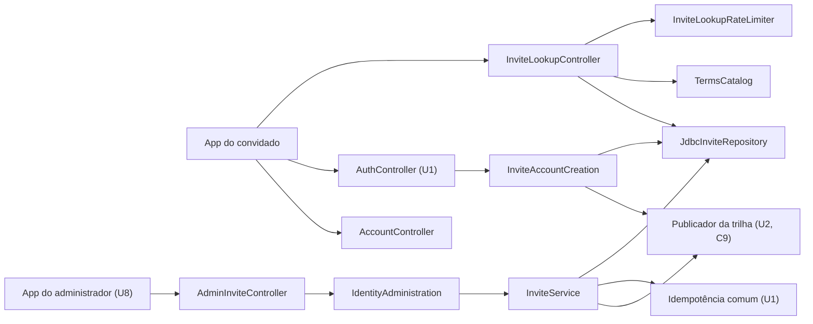

# Componentes lógicos — U3 Convites, contas e sessões

Inventário dos componentes da U3 dentro do monólito modular, com as fronteiras de falha e onde cada padrão não funcional se aplica. Liga este desenho à Infrastructure Design. Componentes marcados "U1" já existem e são estendidos.

## Componentes

| Componente | Módulo | Papel | Padrões aplicados | Falha e alcance |
|---|---|---|---|---|
| `InviteCodes` | `identity.domain.invite` | Gera o código e calcula resumo e final | `SecureRandom`; SHA-256 | Puro |
| `InviteService` | `identity.domain.invite` | F1 a F3 e F9: emissão, lista, revogação, contagens | Idempotência comum na mesma transação; bloqueio da linha; relógio injetável | Recusa ou 5xx sem estado parcial |
| `JdbcInviteRepository` | `identity.infra` | Leitura e gravação de convites, bloqueio, contagens | SQL parametrizado; índices | — |
| `IdentityAdministrationImpl` | `identity.api` | Interface C17 para a U8 | Confere `ADMIN` também aqui | Recusa auditada |
| `AuthenticationFilter` | `identity.web` (U1, ampliado) | Libera sem token só `GET` em `^/api/v1/invites/[^/]{1,128}$`, além das rotas públicas da U1 | Regra estreita por método e caminho inteiro | Qualquer outra rota sob o prefixo exige token |
| `InviteLookupController` | `identity.web` | F4: consulta do convite sem sessão | Limite por IP antes do formato; `404` igual para mal formado e desconhecido | `429`, `404` |
| `InviteLookupRateLimiter` | `identity.domain.ratelimit` | Contador por IP da consulta, separado do da entrada, janela de 1 minuto | Memória do processo; limpeza pelo `LoginLimiterEvictionJob` (ampliado para os dois limitadores); propriedade `invite-lookup-rate-limit-per-minute`, elevada só no perfil `loadtest` | Por instância (risco aceito) |
| `LoginLimiterEvictionJob` | `identity.infra` (U1, ampliado) | Remove chaves ociosas dos dois limitadores | Mesmo agendamento e mesma entrada do registro | — |
| `TermsCatalog` | `identity.infra` | Lê os termos na subida e expõe a versão vigente | Falha rápida na inicialização | API não sobe sem termos |
| `InviteAccountCreation` | `identity.domain.login` (U1, ampliado) | F5: conferências da BR3.2 e criação da conta | Transação única; tratamento por nome de restrição; segunda transação para recusa após violação | Recusa ou 5xx sem estado parcial |
| `AccountQueryService`, `AccountController` | `identity.domain.session`, `identity.web` | F8: tela Conta | Pessoa e tenant do token; endereço mascarado | `401` sem sessão |
| `AdminInviteController` | `identity.web` (rota usada pela U8) | Rotas `/api/v1/admin/invites` | `AdminRouteFilter`, `IdempotencyKeyFilter` (U1) | `403`, `400`, `404`, `409` |
| `SecurityHeadersFilter` | `shared.web` (U1) | `no-store` e `no-referrer` na API | Global | — |
| Página `/convite/[codigo]` | `apps/web/src/app/convite` | Termos, aceites, conectar carteira | `sessionStorage` dos aceites; `no-store` e `no-referrer` pelo `middleware.ts`; sem log da URL | Erro de rede mostra estado de erro |
| Página `/conta` | `apps/web/src/app/conta` | Tela Conta e Sair | Tipos gerados do OpenAPI; horário no fuso do navegador | Estados de carregando, erro e dado distintos |
| Retorno à origem | `apps/web/src/features/auth` | `safeOrigin()` e redirecionamento após 401 | Função pura com lista de rotas do convidado | Valor inválido vira tela inicial |

## Fronteiras e dependências

Texto: o app do convidado chama a consulta do convite, a verificação da U1 (estendida pela criação da conta) e a tela Conta. O app do administrador chega aos convites só pela rota administrativa, que usa a interface `IdentityAdministration`. Todas as gravações publicam na trilha pela interface da U2.

## Domínios de falha

| Domínio | O que cai junto | Isolamento |
|---|---|---|
| Banco PostgreSQL | Toda a identidade (entrada, convites, conta) | Já é o domínio único do monólito; saúde `DOWN` |
| Processo da API | Contadores do limite | Reinício zera contadores (aceito) |
| Arquivo dos termos | Subida da API | Falha rápida, visível no log da subida |

## Recursos compartilhados

- Banco e esquema `identity` (tabelas novas `invite` e `terms_acceptance`; tenant `Beta` semeado).
- Mecanismo comum de idempotência (U1), com as operações novas `ADMIN_INVITE_ISSUE` e `ADMIN_INVITE_REVOKE`, e filtro de rotas administrativas (U1).
- Registro de rotas e trabalhos (`tenancy/route-registry.yml`), com o campo novo `tenantFromClient` e as cinco entradas da U3 listadas em security-design.md.
- Publicador da trilha (U2).

## Para a Infrastructure Design

- Um proxy ou balanceador à frente do app web (hospedagem futura) não pode registrar o caminho completo de `/convite/*`: registra o modelo ou omite o caminho dessa rota.
- A elevação do limite no perfil `loadtest` nunca vai para um ambiente com convidados.
