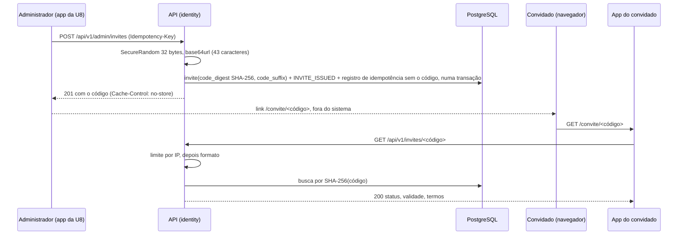

# Desenho de segurança — U3 Convites, contas e sessões

Como a Unit `u3-identity-access` atende aos requisitos de [security-requirements.md](../nfr-requirements/security-requirements.md). Base: fluxos F1 a F9 de [functional-spec.md](../functional-design/functional-spec.md), contratos C1, C3, C8, C9 e C17 de [contract-summary.md](../../../inception/contract-design/contract-summary.md) e as decisões de [nfr-design-questions.md](nfr-design-questions.md). Os IDs `NFRx.y` deste documento são os da U3; um ID de outra Unit vem sempre com a Unit ("NFR6.5 da U1").

## Ciclo de vida do código do convite



Texto: o código nasce na API, sai uma única vez na resposta `201` e só existe depois disso no link que o administrador entrega. Banco, registro de idempotência, logs, trilha e métricas veem só o resumo, o final do código ou o `inviteId`.

| Ponto | Decisão | Requisito |
|---|---|---|
| Geração | `SecureRandom` da plataforma, 32 bytes, base64url sem preenchimento. A produção não tem outra fonte; a classe geradora aceita um gerador alternativo só no construtor usado pelos testes | NFR6.1 |
| Guarda | `invite.code_digest` = SHA-256 hexadecimal do código (sem chave, Q2 de NFR Requirements), índice único; `invite.code_suffix` com os 4 últimos caracteres | NFR6.2 |
| Busca | Por igualdade do resumo; o código nunca é comparado em texto | NFR6.2 |
| Idempotência da emissão | O enum fechado `IdempotentOperation` ganha `ADMIN_INVITE_ISSUE("admin.invite.issue", Retention.DEFAULT)` e `ADMIN_INVITE_REVOKE("admin.invite.revoke", Retention.DEFAULT)` (24 horas, como as demais rotas que mudam estado). A operação de emissão devolve ao mecanismo comum um `IdempotentResponse` cujo corpo é o convite **sem** `code`; o código gerado volta ao controlador por fora do corpo guardado. O controlador compõe a resposta HTTP: quando `replayed` é falso, acrescenta `code` ao corpo; quando é verdadeiro, envia o corpo guardado como está (sem `code`). Convite, `INVITE_ISSUED` e registro de idempotência vão na mesma transação | NFR6.3 |
| Perda do código por falha de rede | Risco conhecido e aceito: se a resposta `201` se perder depois do `commit`, repetir com a mesma chave devolve o convite sem o código, e o código não pode ser recuperado. O procedimento do administrador, escrito na tela da U8, é revogar esse convite (identificado pelo final do código) e emitir outro | NFR6.3 |
| Logs da API | Já usam o modelo da rota (`RequestPaths` da U1) e a redação de segmentos longos; o `LogScanIT` passa a emitir, consultar e usar um convite e procura o código em logs, eventos e métricas | NFR6.4 |
| Link no app web (Q1, opção B) | Link `/convite/<código>`. A rota `/convite/[codigo]` do Next.js não registra a URL: o app não tem log de acesso próprio, e qualquer log que vier a existir no app usa o modelo `/convite/[codigo]`. Um proxy à frente do app (hospedagem futura) precisa da mesma regra; isso vai para a Infrastructure Design | NFR6.4 |
| Referer e cache | A API já envia `Referrer-Policy: no-referrer` e `Cache-Control: no-store` em todas as respostas (`SecurityHeadersFilter` da U1). O `middleware.ts` do app web já envia `no-referrer`; passa a enviar `Cache-Control: no-store` em `/convite/*` e `/conta`. Testes de cabeçalho na emissão, na consulta do convite, na tela Conta e na página do convite | NFR6.5 |

## Consulta do convite sem sessão

### Como a rota fica pública

Hoje o `AuthenticationFilter` libera sem token só as rotas de `PUBLIC_ROUTES`, por igualdade exata (desafio, verificação e renovação). A consulta do convite tem um segmento variável, então a U3 acrescenta ao filtro uma segunda regra, estreita:

- só o método `GET`;
- o caminho, já normalizado como o filtro recebe hoje, bate inteiro com `^/api/v1/invites/[^/]{1,128}$`: exatamente um segmento depois de `/api/v1/invites/`, sem barra a mais;
- nenhum outro prefixo é aberto: `/api/v1/invites` sozinho, `/api/v1/invites/x/y`, `POST`, `PUT` ou `DELETE` em `/api/v1/invites/x` continuam exigindo token.

O segmento aceito pelo filtro é mais largo que um código válido de propósito: um código mal formado chega ao controlador e recebe `404`, igual ao desconhecido (NFR6.7), em vez de um `401` que diferenciaria formato de existência.

Teste do filtro: `GET /api/v1/invites/<43 caracteres>` sem token chega ao controlador; `POST /api/v1/invites/abc`, `GET /api/v1/invites/abc/def`, `GET /api/v1/invites` e `GET /api/v1/invites/` sem token recebem `401`.

### Ordem no servidor

Ordem no servidor para `GET /api/v1/invites/{code}`:

1. Limite por IP: até 10 por minuto, contador próprio da consulta, separado do da entrada. Acima: `429 RATE_LIMITED` com `Retry-After`. Toda consulta conta, inclusive mal formada (NFR6.6).
2. Formato: 43 caracteres do alfabeto base64url; fora disso, `404 INVITE_NOT_FOUND` sem tocar no banco (NFR6.7).
3. Busca pelo resumo; ausente: `404 INVITE_NOT_FOUND` com a mesma mensagem.

O IP vem do `ClientIpResolver` da U1 (cabeçalhos de proxy só de origens confiáveis configuradas). O limite é a propriedade nova `memetrade.auth.invite-lookup-rate-limit-per-minute`, fixa em 10 no `application.yml`. No perfil `loadtest`, que só sobe com o perfil `test` (`LoadtestProfileGuard`), o `application-loadtest.yml` a eleva com `${INVITE_LOOKUP_RATE_LIMIT_PER_MINUTE:1000}`, como já faz com `login-rate-limit-per-minute`, para o teste de carga medir a consulta de verdade.

## Verificação com convite

| Controle | Desenho | Requisito |
|---|---|---|
| Corpo estrito | O DTO da verificação ganha `inviteCode` (43 caracteres base64url) e `acceptedTermsVersion` (até 32); campo desconhecido, inclusive `tenantId`, é recusado com `400 VALIDATION_FAILED` (`additionalProperties: false`, e a API já sobe com `fail-on-unknown-properties: true`), então o tenant nunca vem do corpo. O NFR6.8 fala em "ignorar" o `tenantId`; recusar é mais estrito, atende à mesma intenção e é o que o contrato C1 já pede para campo extra. `inviteCode` mal formado tem o mesmo tratamento de desconhecido | NFR6.7, NFR6.8 |
| Nenhuma chave nem frase | Nenhum campo novo aceita frase secreta ou chave; o teste de arquitetura da U1 (sem APIs de geração ou importação de chave em produção) continua valendo; o SDK Solana fica só no teste | NFR6.8, `project.md` |
| Transação e nonce | Uma transação: desafio `CONSUMED`, bloqueio do convite (`SELECT … FOR UPDATE`), conferências na ordem da BR3.2, gravações. Recusa: resultado confirmado com `LOGIN_REJECTED`. Violação de unicidade de `wallet.address`: a transação é desfeita e uma segunda transação grava desafio `CONSUMED` e `LOGIN_REJECTED`. Falha técnica: tudo desfeito | NFR6.9 |
| Limite da entrada | A verificação com convite conta no limite da entrada da U1 (NFR6.5 da U1), sem contador novo | NFR6.6 |
| Tenant | Vem do convite bloqueado, nunca do corpo; a sessão aberta carrega o tenant da nova conta | NFR5.1 |

## Rotas administrativas e interface `IdentityAdministration`

- As rotas de convite ficam sob `/api/v1/admin/`, atrás do `AdminRouteFilter` e da `AdminAuthorization` da U1: token de convidado recebe `403 FORBIDDEN_ROLE` e `REQUEST_FORBIDDEN` pelo `AuditedForbiddenRequestRecorder` (NFR6.10).
- `IdentityAdministration` recebe o `Principal` do administrador e confere o papel `ADMIN` também na própria interface (defesa em profundidade); um teste ArchUnit proíbe sua dependência a partir de qualquer controlador fora de `/api/v1/admin/` (NFR6.10).
- Emissão e revogação exigem `Idempotency-Key` pelo `IdempotencyKeyFilter` da U1; sem a chave, `400 VALIDATION_FAILED` e nada gravado (NFR4.5 da U3).
- Sem limite de requisições próprio nas rotas administrativas (Q4 de NFR Requirements).
- `tenantId` no corpo da emissão é a única exceção à regra de tenant (NFR5.2). Mecanismo, no registro de rotas que já existe (`tenancy/route-registry.yml`, lido pelo `RouteRegistry` nos testes):
  - cada entrada ganha o campo opcional `tenantFromClient: true`; o `RouteRegistry` passa a lê-lo, e o `RouteRegistryTest` recusa esse campo em qualquer entrada que não seja de escopo `ADMIN`;
  - um teste novo do registro percorre o OpenAPI do convidado e o do administrador e procura, em cada operação, um parâmetro (caminho, query ou cabeçalho) ou uma propriedade do corpo da requisição, em qualquer nível, chamada `tenantId`; o teste falha quando a rota que a tem não está no registro com `tenantFromClient: true`. Hoje só `POST /api/v1/admin/invites` tem a marca.

### Entradas novas do registro de rotas

| Método e caminho | Escopo | `negativeTest` e marca | Por quê |
|---|---|---|---|
| `GET /api/v1/invites/{code}` | `GLOBAL` | — | Sem sessão; não devolve dado de cliente (sem tenant, sem `inviteId`, sem pessoa), só estado, validade e termos públicos (BR2.1) |
| `GET /api/v1/account` | `CLIENT` | `com.memetrade.identity.AccountRouteIT#anotherTenantsSessionNeverSeesThisAccount` | Dado pessoal da própria conta; o teste entra com pessoas de dois tenants e confere que cada uma vê só a própria carteira e o próprio aceite (NFR5.1) |
| `GET /api/v1/admin/invites` | `ADMIN` | `com.memetrade.identity.AdminInviteRouteIT#aGuestTokenIsRefusedWith403AndOneRequestForbiddenEvent` | Lista de convites de todos os tenants, só do administrador |
| `POST /api/v1/admin/invites` | `ADMIN` | mesmo teste; `tenantFromClient: true` | Emissão; única rota com tenant vindo do cliente (ADR-002) |
| `POST /api/v1/admin/invites/{inviteId}/revoke` | `ADMIN` | mesmo teste | Revogação |

`POST /api/v1/auth/verify` continua `GLOBAL`; o tenant da conta criada vem do convite, e o teste da verificação com `tenantId` forjado no corpo (recusado como campo extra) fica no `InviteVerificationIT` (NFR5.1, NFR6.8).

## Retorno à origem

Validação no app web, numa função pura usada pela página de entrada (NFR6.11):

```text
aceitar(origem):
  remover nada; recusar se tiver caractere de controle (incluindo tab, CR, LF) ou '\'
  recusar se não começar com exatamente uma '/' ou começar com '//'
  decodificar uma vez e repetir as duas checagens
  aceitar só se o caminho bater com a lista de rotas do convidado
  senão: tela inicial
```

Teste com `//exemplo.com`, `https://exemplo.com`, `/\exemplo.com`, `/%2F%2Fexemplo.com`, `\t//exemplo.com`, `\n//exemplo.com`, `javascript:alert(1)`, `/admin` e `/rota-inexistente`.

## Tela Conta e REAL

- `GET /api/v1/account` lê pessoa, tenant e sessão do `AuthContext`; o repositório filtra por pessoa e tenant (NFR5.1).
- `realMode` é constante `UNAVAILABLE` no DTO; a tela não tem controle de REAL; o teste obrigatório de REAL desligado cobre a resposta e a tela (NFR6.12).
- O endereço sai mascarado pelo `WalletAddress` da U1; o completo nunca chega ao navegador (NFR7.1).

## Textos e privacidade

- O catálogo de termos proibidos da U4 roda sobre `apps/web/src/content` (textos da entrada e da tela Conta) e sobre o arquivo dos termos e do aviso de risco (NFR6.13).
- `invite.issued_by` guarda o endereço mascarado do administrador; a lista de convites não devolve o campo (NFR7.1).
- Retenção: nenhuma limpeza na U3; a aprovação da regra de retenção (SP-3) é conferida no checklist de liberação dos convites reais, junto com o G1, antes do primeiro convite real (NFR7.2).

## Rastreio para os requisitos

| Requisito | Onde |
|---|---|
| NFR6.1 a NFR6.5 | Ciclo de vida do código |
| NFR6.6, NFR6.7 | Consulta do convite sem sessão (inclusive a regra pública do `AuthenticationFilter`) |
| NFR6.8, NFR6.9, NFR5.1 | Verificação com convite |
| NFR6.10, NFR5.2 | Rotas administrativas e entradas novas do registro de rotas |
| NFR6.11 | Retorno à origem |
| NFR6.12 | Tela Conta e REAL |
| NFR6.13, NFR7.1, NFR7.2 | Textos e privacidade |
