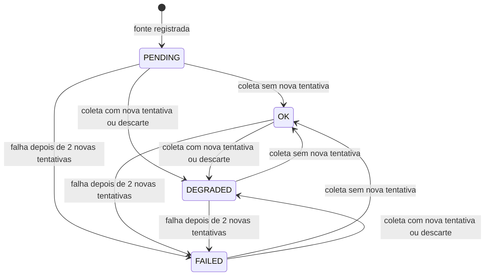
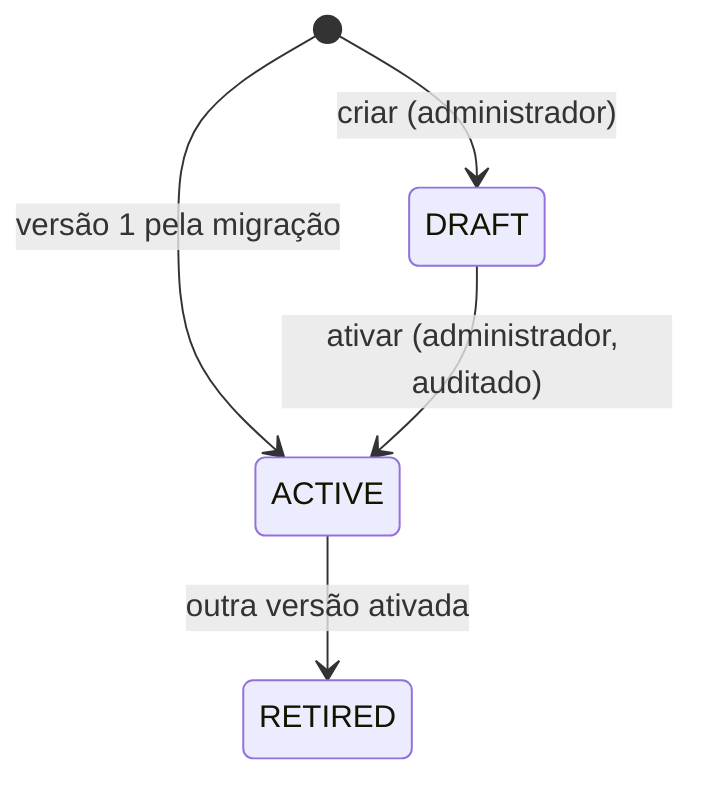
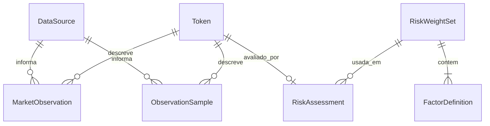

# Especificação funcional — U4 Descoberta e avaliação

A Unit `u4-discovery` completa o MarketData e o Scanner iniciados na U1 e entrega o RiskAssessment, com a tela do scanner com filtros (S3) e o painel lateral de avaliação. Implementa as histórias US2.2, US2.3, US2.4, US3.1 e US3.2 de [stories.md](../../../inception/user-stories/stories.md) e os requisitos FR4.5 a FR4.7, FR5.2 a FR5.4, FR6.1 a FR6.4 e NFR1 de [requirements.md](../../../inception/requirements-analysis/requirements.md).

Este documento é a fonte da verdade dos fluxos e das máquinas de estado. O modelo de dados está em [entities.md](entities.md) e as regras em [rules.md](rules.md); o diagrama e o resumo de regras abaixo são vistas derivadas deles. As decisões vêm de [functional-design-questions.md](functional-design-questions.md) (Q1 a Q10).

## Fronteiras

- **Dentro:** coleta de várias fontes simuladas, histórico de 24 horas, frescor, divergência, estado das fontes, filtros, ordenação e foto da lista, cálculo e guarda da avaliação de risco, versões de pesos (domínio e interface), textos da tela do scanner e do painel lateral.
- **Fora:** decisão de operar (U5), barreira de ordens (U6), tela administrativa de pesos (U8, que usa a interface `RiskWeightAdministration` desta Unit), fontes reais (depois do G0 e do SP-1, C-06).
- **Contratos usados:** C2 (rotas do scanner e da avaliação), C11 e C12 (`MarketDataQuery`, `RiskAssessmentQuery`), C18 (`SourceStatusMarks`), C19 (`MarketSourceAdapter`). C11, C12, C18 e C19 ficam sem mudança.
- **Acréscimos a contratos** (aditivos, a registrar no Contract Design pela geração de código desta Unit):
  - C2, `SourceStatus`: valor `PENDING` em `status` e `lastUpdatedAt` opcional (vazio antes da primeira coleta) (BR1.4, BR1.5);
  - C2, `Assessment`: campos `computedAt` e `bandRaisedByUnknown` (BR3.4, BR3.9);
  - C2, resposta `503 SOURCE_UNAVAILABLE`: extensão `sources` no `ProblemDetail`, com o estado de cada fonte (BR1.4);
  - interface pública `RiskWeightAdministration` (dona: U4, consumidora: U8) para criar e ativar versões de pesos (F7);
  - ação de auditoria `RISK_WEIGHTS_ACTIVATED`, publicada pela U4 pelo contrato C9 (BR4.2);
  - código `409 WEIGHT_SET_NOT_EDITABLE`, a registrar no contrato C8 quando a U8 criar a rota administrativa.

## Fluxos

### F1 — Coleta de uma fonte (US2.3)

Gatilho: agendamento por fonte, a cada `collectionInterval` (padrão 30 s), com uma única execução por fonte por vez.

1. Registrar `lastAttemptAt = agora`.
2. Chamar o adaptador da fonte (C19), com tempo limite e até 2 novas tentativas.
3. Se falhou depois das tentativas: estado `FAILED` com a categoria da falha (BR1.5); manter as observações atuais da fonte como estão; ir ao passo 8.
4. Validar cada token recebido: chain e mint presentes, decimais de 0 a 18, valores decimais não negativos. Um token inválido é descartado e contado, e os demais seguem; algum descarte faz o estado ser `DEGRADED`.
5. Para cada token válido: criar o `Token` se ainda não existe (`firstSeenAt = agora`); atualizar `tokenCreatedAt` pelo campo `CREATED_AT`.
6. Para cada campo: substituir a `MarketObservation` da fonte (BR1.9 para campos ausentes) e acrescentar uma `ObservationSample` (sem duplicar a mesma observação).
7. Estado `OK`, ou `DEGRADED` quando houve nova tentativa ou descarte; `lastUpdatedAt = agora`.
8. Se o estado mudou: aumentar a marca global (BR1.11) na mesma transação.
9. Disparar F5, o recálculo das avaliações.

Os passos 5 a 8 ocorrem numa única transação: uma coleta interrompida não deixa metade dos valores gravada.

### F2 — Leitura de um campo de token (US2.3, US2.4)

1. Juntar as observações do campo de todas as fontes do token, casadas por chain + mint e campo (BR1.6).
2. Descartar as de fontes `FAILED` (BR1.3).
3. Escolher o valor exibido: o `Known` mais recente (BR1.2); sem nenhum, `Unknown` com o motivo (BR1.9).
4. Marcar desatualizado se a idade passa de 5:00 (BR1.1).
5. Com duas ou mais observações `Known` não desatualizadas, calcular a divergência (BR1.7) e guardar as origens.

### F3 — Consulta da lista do scanner (US2.2, US2.3, US3.2)

Entrada: `GET /api/v1/scanner/tokens` com filtros, ordenação, `cursor` e `limit` (C2).

1. Validar os parâmetros e o cursor (BR2.7); erro devolve `400`.
2. Sem nenhuma fonte `OK` ou `DEGRADED`: com alguma `PENDING`, devolver `200` com a lista vazia e o estado das fontes; com todas `FAILED`, devolver `503 SOURCE_UNAVAILABLE` com o estado das fontes (BR1.4).
3. Sem cursor: `snapshotAt = agora`. Com cursor: usar o `snapshotAt` dele.
4. Selecionar os tokens com `firstSeenAt <= snapshotAt`, com alguma observação nas últimas 24 horas e com alguma fonte não `FAILED` (BR1.3, BR1.8, BR2.6).
5. Ler os campos de cada token pelo F2 e a avaliação guardada (BR3.7).
6. Aplicar os filtros (BR2.1, BR2.8); risco indisponível vale como `unknown` (BR2.3).
7. Contar `excludedByUnknown` na foto inteira (BR2.2) e `pendingNewTokens` (BR2.6).
8. Ordenar (BR2.5) e cortar a página depois da posição do cursor.
9. Devolver `items`, `nextCursor`, `total`, `excludedByUnknown`, `pendingNewTokens` e `sources`.

### F4 — Consulta do detalhe da avaliação (US3.1, US3.2)

Entrada: `GET /api/v1/tokens/{chain}/{mint}/assessment` (C2).

1. Token inexistente ou sem observação nas últimas 24 horas: `404 NOT_FOUND`.
2. Ler a avaliação guardada e os valores de entrada de cada fator.
3. Devolver indicador ou indisponibilidade, cobertura, cobertura mínima, versão dos pesos, `inValidation = true`, `decisionHint`, `bandRaisedByUnknown` e os fatores (BR3.9), com `computedAt`. A marca de desatualizado de cada entrada é calculada agora, a partir do horário de observação guardado (BR1.1, BR3.6).
4. Avaliação ainda não calculada (token novo antes do primeiro F5): calcular na hora pelo F5 para esse token, guardar e devolver.

### F5 — Cálculo da avaliação (US3.1, US3.2)

Gatilho: fim de cada coleta (F1) e ativação de uma versão de pesos (F7).

Os recálculos rodam um de cada vez; um gatilho que chega durante um recálculo é juntado no próximo (BR3.7).

1. Ler a versão de pesos `ACTIVE`.
2. Para cada token com observação nas últimas 24 horas:
   1. Ler a entrada de cada fator (BR3.1, BR1.10). Se todas as fontes do token estão `FAILED`, toda entrada é `Unknown(SOURCE_UNAVAILABLE)`.
   2. Converter cada entrada em risco pela curva (BR3.1) e calcular a contribuição; entrada `Unknown` vale risco 100 e contribuição `UNKNOWN` (BR3.4); entrada desatualizada conta (BR3.6).
   3. Calcular a cobertura (BR3.3).
   4. Se todas as fontes do token estão `FAILED`: `UNAVAILABLE` com `SOURCE_UNAVAILABLE` e `NO_TRADE` (BR3.8); ir ao passo 2.7.
   5. Se a cobertura está abaixo da mínima: `UNAVAILABLE` com `INSUFFICIENT_COVERAGE` e `NO_TRADE` (BR3.3); ir ao passo 2.7.
   6. Somar as contribuições e arredondar (BR3.2); definir a faixa (BR3.5); com algum fator `Unknown`, faixa `LOW` passa a `MEDIUM` com `bandRaisedByUnknown` (BR3.4).
   7. Guardar os fatores calculados nos passos 2.1 a 2.3 em qualquer caso. Calcular `inputsFingerprint`; se for igual ao da avaliação guardada com a mesma versão, não regravar; se a versão guardada for maior que a usada, descartar o resultado; senão, substituir.

O cálculo é determinístico: só depende das entradas, da versão e do relógio injetável (para a janela de 1 hora). A marca de desatualizado não entra no cálculo nem no `inputsFingerprint`; é calculada na leitura.

### F6 — Limpeza do histórico (ADR-008)

Gatilho: a cada hora, uma única execução por vez.

1. Apagar, em lotes, as `ObservationSample` com `observedAt` mais de 24 horas antes de agora (BR1.8).
2. Registrar quantas foram apagadas. Repetir a limpeza não muda o resultado.

### F7 — Criação e ativação de versão de pesos (US3.1)

Interface `RiskWeightAdministration`, chamada pela U8.

1. Criar: validar (BR4.1); gravar como `DRAFT` com a versão seguinte e o ator; nada mais muda.
2. Ativar uma `DRAFT`: na mesma transação, a `ACTIVE` passa a `RETIRED` (`retiredAt`), a nova passa a `ACTIVE` (`activatedAt`) e o evento `RISK_WEIGHTS_ACTIVATED` é publicado com as duas versões e o ator (BR4.2).
3. Depois do commit, disparar F5 para todos os tokens.
4. Ativar a versão que já está ativa: nada muda e nenhum evento é publicado.
5. Alterar uma versão `ACTIVE` ou `RETIRED`, ou ativar uma `RETIRED`: recusado com `WEIGHT_SET_NOT_EDITABLE`. Versão inexistente: `NOT_FOUND`.
6. Duas ativações ao mesmo tempo são feitas uma depois da outra: a segunda encontra a primeira já ativa e a retira.

A versão 1 é criada `ACTIVE` pela migração inicial (BR4.3), sem evento de ativação.

## Interação na tela do scanner (S3) e no painel lateral

| Situação | O que a tela mostra | Regras |
|---|---|---|
| Carregando a lista | Marcadores só na área da lista; filtros utilizáveis | CT-UX-2 |
| Lista com itens | "Exibindo X–Y de N"; cada valor com fonte, horário e frescor ao passar o mouse ou receber foco; cobertura por token | BR2.5, AC2.1.1 |
| Valor desatualizado | Marca "Desatualizado" em texto ou ícone com nome acessível e "Atualizado às HH:MM" | BR5.5 |
| Campo divergente | Aviso "Fontes divergem" e, ao passar o mouse ou receber foco, cada origem com fonte, valor e horário | BR5.7 |
| Uma ou mais fontes com falha | Aviso no topo com o nome e a última atualização de cada fonte; a lista continua | BR5.6 |
| Todas as fontes com falha | Aviso explicando a falha, lista vazia com explicação e "Tentar de novo" | BR1.4, BR5.6 |
| Primeira coleta ainda não terminou | Lista vazia com "Aguardando a primeira coleta dos dados" | BR1.4, BR2.4 |
| Nível elevado por fator sem dado | "Nível elevado para Médio porque há fator sem dado" no painel | BR3.4 |
| Filtros sem resultado | Explicação, quantos ficaram fora por dado ausente e "Limpar filtros" | BR2.4 |
| Tokens fora por dado ausente | Contador "N tokens fora por dado ausente" sempre que um filtro ativo exclui algum | BR2.2 |
| Novidades em espera | "N novos tokens — Atualizar lista", anunciado sem mover o foco | BR2.6, CT-UX-8 |
| Coluna Risco indisponível | `--` com o motivo ao passar o mouse e ao receber foco | BR5.4 |
| Seleção de linha | Clique ou Enter abre o painel lateral; a lista mantém posição, filtros, ordenação e página | BR5.3 |
| Painel carregando | "Carregando avaliação", sem indicador provisório | BR5.2 |
| Painel com avaliação | Indicador de 0 a 100, nível por escrito ("Risco baixo", "Risco médio", "Risco alto"), "maior significa mais risco", "Indicador em validação", versão dos pesos, cobertura e cada fator com peso, entrada, fonte, horário e contribuição | BR3.9 |
| Painel indisponível | "Indicador indisponível", o motivo e "Avaliação: NO_TRADE" | BR5.4 |
| Fechar o painel | Esc ou "Fechar" fecha e devolve o foco à mesma linha | BR5.3 |

Filtros da tela: idade máxima (1, 5, 15, 30 e 60 minutos, 6 e 24 horas, ou personalizado em minutos), liquidez mínima, volume mínimo em 24 horas, holders mínimos, indicador máximo e origem. Cada campo tem rótulo visível e unidade, e o erro aparece em texto junto ao campo, também quando a API recusa o valor (CT-UX-6, BR2.7).

## Máquinas de estado

### Estado de uma fonte (`DataSource.status`)

<!-- Text fallback: a fonte nasce PENDING e não volta a PENDING (o estado é guardado; reiniciar a aplicação não o muda). Uma coleta sem nova tentativa leva a OK; uma coleta concluída com nova tentativa ou com tokens descartados leva a DEGRADED; uma falha depois de 2 novas tentativas leva a FAILED. Toda mudança de estado aumenta a marca global (BR1.11). -->

### Versão de pesos (`RiskWeightSet.status`)

<!-- Text fallback: uma versão nasce DRAFT pelo administrador, ou ACTIVE no caso da versão 1 criada pela migração. Ativar uma DRAFT a torna ACTIVE e retira a ACTIVE anterior (RETIRED). ACTIVE e RETIRED não mudam mais de conteúdo. -->

### Avaliação de um token (`RiskAssessment.status`)

A avaliação não tem transições próprias: cada F5 calcula `AVAILABLE` ou `UNAVAILABLE` a partir das entradas atuais e substitui a anterior.

## Diagrama entidade-relacionamento (derivado de entities.md)

<!-- Text fallback: uma fonte informa muitas observações atuais e muitas amostras; um token tem muitas observações e amostras e no máximo uma avaliação guardada; uma versão de pesos contém um ou mais fatores e é usada em muitas avaliações. -->

## Resumo das regras (derivado de rules.md)

| Regra | Resumo |
|---|---|
| BR1.1 | Desatualizado acima de 5:00; idade = agora − observação |
| BR1.2 | Entre fontes, vale o valor conhecido mais recente; empate pelo menor `sourceId` |
| BR1.3 | Fonte com falha não entra; token só aparece com alguma fonte disponível |
| BR1.4 | Fontes só `PENDING`: lista vazia; todas com falha: `503 SOURCE_UNAVAILABLE` com o estado das fontes |
| BR1.5 | Estado da fonte: PENDING até a primeira coleta; depois OK, DEGRADED ou FAILED pela última coleta |
| BR1.6 | Casamento por chain + mint + campo, nunca por símbolo |
| BR1.7 | Divergência acima de 5 pontos percentuais por campo, configurável |
| BR1.8 | Histórico de 24 horas; token sem observação recente fica fora da lista |
| BR1.9 | Motivos de `unknown`; 0 informado continua 0 |
| BR1.10 | Variação de preço de 1 hora pelo histórico |
| BR1.11 | Marca global de estado das fontes |
| BR2.1 a BR2.8 | Filtros inclusivos, `unknown` fora e contado, risco indisponível como `unknown`, estado vazio, ordem determinística, foto da lista, validação, idade exata |
| BR3.1 a BR3.9 | Curvas, soma ponderada determinística, cobertura mínima 80% com NO_TRADE, `unknown` com risco 100 e nunca Baixo, faixas 39/69, desatualizado marcado, recálculo após coleta, fontes fora, explicação completa |
| BR4.1 a BR4.3 | Validação, ativação só pelo administrador e auditada, versão 1 |
| BR5.1 a BR5.7 | Termos proibidos, sem indicador provisório, painel que preserva a lista, `--` com motivo, marca de desatualizado, aviso de fonte, divergência com as duas origens |

## Cantos tratados

| Canto | Tratamento |
|---|---|
| Fonte lenta ou fora | Tempo limite e novas tentativas do C19; só o que depende dela degrada (BR1.3) |
| Um token inválido entre bons | Descartado e contado; os demais são gravados; fonte `DEGRADED` (F1) |
| Mesma observação recebida duas vezes | Uma amostra só (entities.md, `ObservationSample`) |
| Dois tokens com o mesmo símbolo | Itens distintos por chain + mint (BR1.6) |
| Valor 0 e valor ausente | Known(0) e Unknown, distintos de ponta a ponta (BR1.9) |
| Denominador zero (divergência e variação de preço) | Regra explícita em BR1.7 e BR1.10 |
| Empates na ordenação | Mint e chain (BR2.5) |
| Valores mudam entre páginas | As páginas usam a foto de tokens; um token cujo valor de ordenação muda pode trocar de página. Os valores sempre atuais têm prioridade sobre uma ordem congelada |
| Coleta e limpeza sobrepostas | Uma execução por vez por fonte e uma limpeza por vez (F1, F6) |
| Recálculos concorrentes (várias fontes, ativação de pesos) | Um recálculo por vez, gatilhos juntados, e nenhuma avaliação de versão antiga sobre uma mais nova (F5, BR3.7) |
| Reinício da aplicação | O estado das fontes é guardado; nada volta a `PENDING` nem a `FAILED` por reinício (BR1.5) |
| Marca de desatualizado numa avaliação guardada | Calculada na leitura a partir do horário guardado, nunca congelada (BR3.6) |
| Coleta interrompida | Transação única nos passos 5 a 8 do F1 |
| Primeiro uso sem dados | Fontes `PENDING` dão lista vazia com "Aguardando a primeira coleta" (BR1.4, BR2.4); avaliação calculada na hora no primeiro detalhe (F4) |
| Indicador provisório | Nunca exibido (BR5.2) |
| Isolamento entre tenants | Dados da U4 são globais, sem dado de cliente; as rotas exigem sessão (C2). A ativação de pesos só pelo administrador (BR4.2) |
