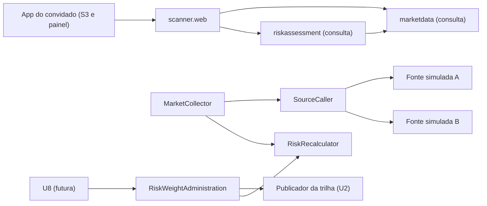

# Componentes lógicos — U4 Descoberta e avaliação

Inventário dos componentes da U4 dentro do monólito modular, com as fronteiras de falha e onde cada padrão não funcional se aplica. Liga este desenho à Infrastructure Design.

## Componentes

| Componente | Módulo | Papel | Padrões aplicados | Falha e alcance |
|---|---|---|---|---|
| `SimulatedSourceA`, `SimulatedSourceB` | `marketdata.infra.simulated` | Implementações da porta `MarketSourceAdapter` (C19), `simulated = true` | Validação na porta; sem rede | Afeta só a própria fonte |
| `SourceCaller` | `marketdata.infra` | Chamada com tempo limite e novas tentativas | Resilience4j `TimeLimiter` e `Retry` por fonte; `Sleeper` injetável | Só a coleta da fonte |
| `MarketCollector` | `marketdata.application` | F1: valida, grava valor atual, amostra e estado, numa transação | ShedLock por fonte; lote; transação única | Fonte fica `FAILED`; dados anteriores ficam |
| `FieldResolver` | `marketdata.domain` | F2: valor mais recente, desatualizado, divergência | Decimal exato; relógio injetável | Puro; sem falha externa |
| `MarketHistoryCleanup` | `marketdata.application` | F6: apaga amostras com mais de 24 h | ShedLock; lotes | Histórico passa um pouco de 24 h |
| `JdbcMarketDataQuery` | `marketdata.infra` | Interfaces C11 (`MarketDataQuery`) e consulta da lista | SQL parametrizado; índices | Erro vira `Unknown(SOURCE_UNAVAILABLE)` no C11 |
| `SourceStatusMarks` | `marketdata.infra` | Marca global C18 | Mesma transação da coleta | — |
| `RiskCalculator` | `riskassessment.domain` | F5 por token: curvas, cobertura, faixa | Decimal exato; determinístico | Puro |
| `RiskRecalculator` | `riskassessment.application` | F5 para todos os tokens; guarda só o que mudou | ShedLock; gatilhos juntados; guarda de versão | Avaliações anteriores ficam; saúde `DEGRADED` |
| `RiskWeightAdministration` | `riskassessment.api` | F7 para a U8 | `AdminAccess`; trava da versão ativa; auditoria C9 | Recusa auditada |
| `RiskAssessmentQuery` | `riskassessment.api` | Interface C12 | Leitura por chave | `Unavailable(SOURCE_UNAVAILABLE)` em falha técnica |
| `ScannerController` | `scanner.web` | F3 (lista) | Limite por pessoa e rota; validação; consulta única | `429`, `400`, `503` |
| `AssessmentController` | `scanner.web` | F4 (detalhe) | Limite por pessoa e rota; cálculo na hora no primeiro acesso | `429`, `404` |
| `PersonRouteRateLimiter` | `shared.web` | Janela deslizante por pessoa e rota | Memória do processo; remoção de ociosos | Por instância (risco aceito) |
| `MarketSourcesHealth`, `RiskRecalculationHealth` | `marketdata.infra`, `riskassessment.infra` | Saúde | Nunca `DOWN`; fora da prontidão | — |
| Tela S3 e painel lateral | `apps/web/src/features/scanner` | Lista com filtros e avaliação | Tipos gerados do OpenAPI; estados distintos; região viva | Erro num quadro não esconde os outros |

## Fronteiras e dependências

<!-- Text fallback: o app do convidado chama o scanner, que lê o MarketData e o RiskAssessment; o RiskAssessment lê o MarketData. O coletor chama as fontes simuladas A e B pelo SourceCaller e, ao fim, dispara o recálculo. A U8 (futura) chama a administração de pesos, que publica na trilha da U2 e dispara o recálculo. -->

Regras de fronteira (ArchUnit): `scanner` lê `marketdata` e `riskassessment` só pelas interfaces públicas; `riskassessment` lê `marketdata` só por `MarketDataQuery`; nenhum dos três depende de bots, ordens, ledger ou carteira; nenhum outro módulo lê as tabelas da U4.

## Recursos compartilhados

| Recurso | Compartilhado com | Isolamento |
|---|---|---|
| PostgreSQL (pool principal de 10 conexões) | Todas as Units | Tabelas próprias da U4; consultas curtas |
| Pool do agendador | U2 | 4 linhas de execução a mais para a U4 |
| Tabela `shedlock` | U2 | Nomes de bloqueio próprios |
| Publicador da trilha (C9) | Todas as Units | Só a ativação de pesos publica |
| Filtros da U1 (autenticação, caminho, papel) | Todas as rotas | Sem mudança |

## Tabelas novas (para a Infrastructure Design)

`observation_sample`, `risk_weight_set`, `risk_assessment`, `source_status_mark`; colunas novas em `data_source` (`failure_category`, `collection_interval_seconds`) e o estado `PENDING`; índices de [performance-design.md](performance-design.md).
