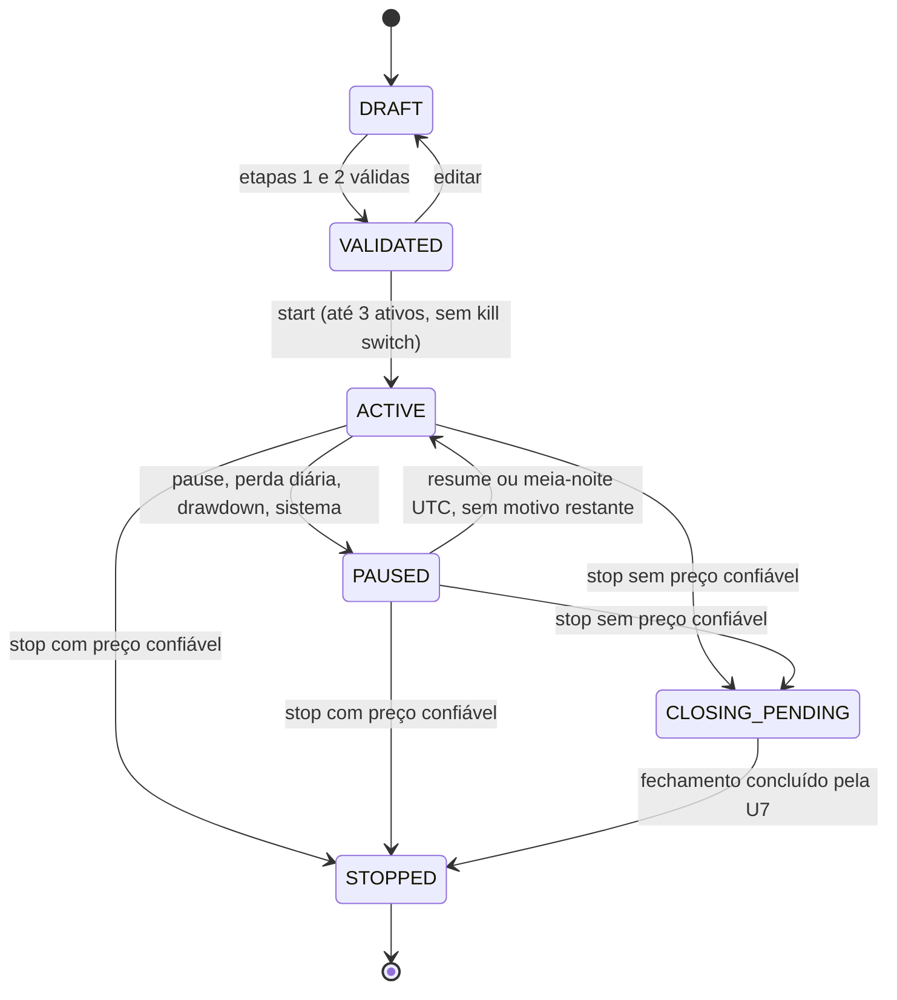
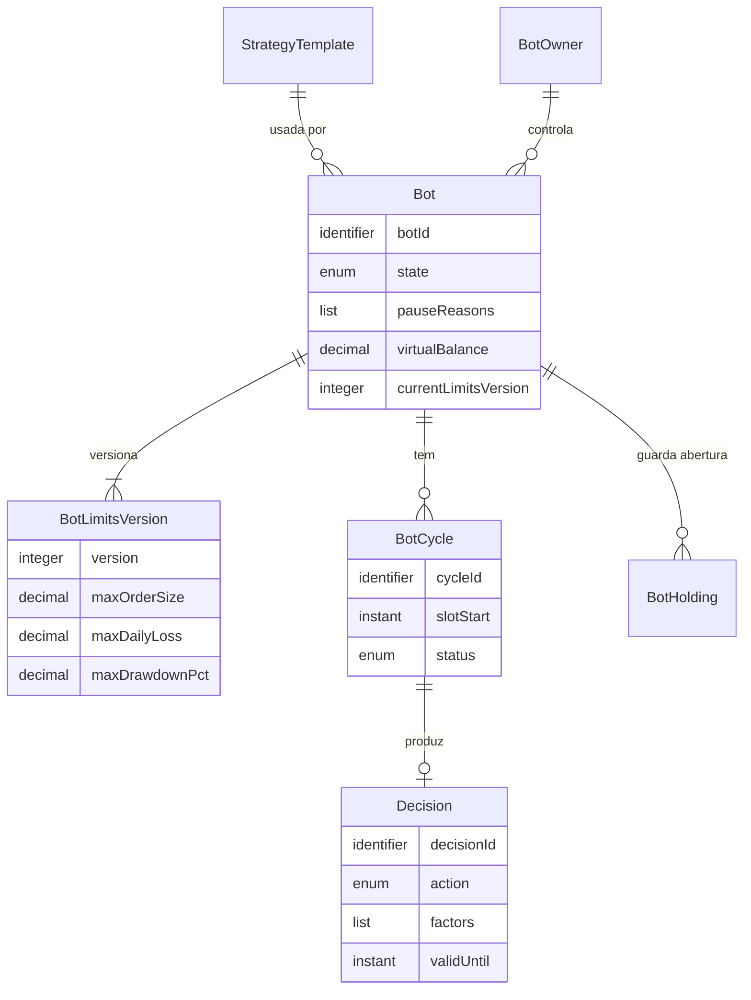

# Especificação funcional — U5 Bots e decisão

A U5 entrega o BotManagement e o DecisionEngine: o assistente de criação, o ciclo de vida dos bots PAPER, o ciclo de decisão no worker e as telas do assistente, da lista e do bot.

Histórias implementadas, de [stories.md](../../../inception/user-stories/stories.md):
- US4.1, US4.2, US4.3, US4.4, US4.5, US4.8, US4.9 e US4.10;
- a parte de motivos de pausa e meia-noite UTC de US4.7;
- a confirmação e os estados de US4.12;
- a pausa de sistema de US7.2.

[entities.md](entities.md) e [rules.md](rules.md) são a fonte da verdade dos dados e das regras. Este documento é a fonte da verdade dos fluxos e da máquina de estados.

## Fronteiras

| Tema | O que a U5 faz | O que fica com outra Unit |
|---|---|---|
| Barreira | Monta a ordem candidata e entrega a versão de limites vigente | A U6 avalia, grava recusas e indica gatilhos de pausa (C14) |
| Execução | Abre a transação do ciclo, trava o bot e chama `fund`, `execute` e `closePositions` | A U7 grava ordens, lançamentos e posições e conclui o fechamento pendente (C15) |
| Dados de mercado | Lê janelas, preço de referência e dados do scanner para filtros | A U4 coleta e marca frescor e `unknown` (C11, C12) |
| Kill switch | Aplica e tira o motivo de sistema (C16) | A U8 tem a tela e a decisão de acionar |
| Painel | Hospeda o canal C7 e o resumo (C16) | A U9 mostra o painel |
| P&L, ledger e recusas na tela do bot | Mostra pelas rotas C5 e C21 | A U7 e a U6 servem os dados |

A U5 não lê tabelas de outra Unit, nunca assina nem envia transações, e tudo é `PAPER`.

## Máquina de estados do bot



<!-- Text fallback: DRAFT vai a VALIDATED quando as etapas estão válidas e volta a DRAFT se editado. VALIDATED vai a ACTIVE no start. ACTIVE vai a PAUSED por pessoa, perda diária, drawdown ou sistema; PAUSED volta a ACTIVE por resume ou meia-noite UTC quando não resta motivo. ACTIVE e PAUSED vão a STOPPED no stop com preço confiável, ou a CLOSING_PENDING sem ele; CLOSING_PENDING vai a STOPPED quando a U7 conclui. STOPPED é final. -->

### Motivos de pausa

| Motivo | Entra por | Sai por |
|---|---|---|
| `PERSON` | pause da pessoa | resume |
| `DAILY_LOSS` | gatilho da U6 no ciclo | meia-noite UTC, ou resume com limite maior que a perda acumulada |
| `DRAWDOWN` | gatilho da U6 no ciclo | resume livre (Q9) |
| `SYSTEM` | kill switch ligado | vira `ADMIN_RELEASED` quando o kill switch é desligado |
| `ADMIN_RELEASED` | kill switch desligado | resume |
| `WAITING_ACTIVE_SLOT` | meia-noite UTC sem vaga de ativo | resume |

### Ordem das travas (BR2.11)

1. `SystemPauseState`: exclusiva só na pausa e na liberação de sistema; compartilhada em start e resume.
2. `BotOwner` da pessoa: só em start, resume e meia-noite, que contam ativos.
3. A linha do bot.

O ciclo, pause, stop, a edição de limites e a conferência do encerramento travam só o bot. Ninguém trava a pessoa depois do bot, e a marca da C18 não trava linha nenhuma.

## Fluxos

### F1 — Assistente em 4 etapas (US4.1, US4.2, US4.3)

1. A pessoa escolhe a estratégia e o nome. `POST /bots` cria o rascunho DRAFT com os parâmetros padrão (BR1.1).
2. **Etapa 1 — Estratégia e tokens.** Parâmetros com faixa e passo (BR1.2) e seleção de tokens (BR1.3). Vindo do scanner, o token já aparece. "Continuar" fica indisponível sem seleção, com o motivo escrito.
3. **Etapa 2 — Limites e saldo.**
   - O saldo vai de 100 a 10.000, com padrão de 1.000 (BR1.4).
   - Os limites padrão são proporcionais ao saldo (BR1.6) e precisam ser coerentes (BR1.5).
   - Cada campo tem rótulo, unidade, padrão e uma frase sobre o que impede.
4. **Etapa 3 — Revisão.** Mostra estratégia, parâmetros, limites, saldo e as hipóteses da simulação. O bot passa a VALIDATED (BR1.7).
5. **Etapa 4 — Início.** "Iniciar bot PAPER" chama `start` (F2). Durante o pedido, a tela mostra "Iniciando bot PAPER" e não aceita novo envio. Numa falha, o bot continua em rascunho e a mensagem diz como tentar de novo.

Cada etapa aceita é salva no servidor com `PUT /bots/{botId}/draft`. Voltar etapas mantém os dados, e o rascunho abre de novo em outro computador.

### F2 — Iniciar (`start`, BR2.2)

1. A rota exige a `Idempotency-Key`. A U5 trava `BotOwner`, lê `SystemPauseState` com trava compartilhada e trava o bot. Ela confere:
   - o kill switch;
   - o número de ativos (máximo 3).
2. Na primeira ativação, chama `PaperExecution.fund(botId, saldo, 'fund:<botId>')` na mesma transação.
3. O bot fica ACTIVE e são gravados o evento `BOT_STARTED` e a marca da pessoa (BR8.1).
4. Duas ativações simultâneas da mesma pessoa se serializam pela trava. A segunda vê 3 ativos e é recusada.

### F3 — Ciclo de decisão (worker, US4.5, US4.6, US4.7)

```mermaid
sequenceDiagram
    participant S as Agendador (worker)
    participant B as BotManagement
    participant D as DecisionEngine
    participant M as U4 MarketData
    participant G as U6 OrderGate
    participant X as U7 PaperExecution
    S->>B: fatia de 5 min (slotStart + 60 s)
    B->>B: BotCycle único (bot, fatia); transação READ COMMITTED, SET LOCAL timeouts, trava do bot
    alt não ACTIVE ou com motivo de pausa
        B->>B: BotCycle SKIPPED
    else ACTIVE
        B->>D: decidir (parâmetros, limites, posições, saldo)
        D->>M: janelas, preço de referência, scanner, avaliação
        D-->>B: Decision (BUY, SELL, HOLD ou NO_TRADE)
        alt BUY ou SELL
            B->>G: evaluate(ordem candidata, limites vigentes)
            alt Approved
                B->>X: execute(ordem, 'order:<decisionId>')
            else Rejected
                B->>B: aplica gatilhos DAILY_LOSS e DRAWDOWN
            end
        end
        B->>B: BotCycle COMPLETED, marca da pessoa
    end
```

<!-- Text fallback: o agendador abre a fatia de 5 minutos; a U5 grava o BotCycle único e trava o bot. Se o bot não está ativo ou tem motivo de pausa, o ciclo é pulado. Se está ativo, o DecisionEngine lê os dados da U4 e decide. BUY ou SELL passam pela barreira da U6; aprovados vão à execução da U7; recusados podem aplicar os motivos de pausa. O ciclo termina com a marca da pessoa atualizada. -->

Uma falha técnica desfaz tudo. Depois, um BotCycle FAILED é gravado em transação separada, e a fatia não é repetida (BR3.5).

### F4 — Decisão (BR4.1 a BR4.10)

1. A U5 monta a lista de tokens. Ela tem a lista explícita, os aprovados pelos filtros (até 10 no total) e os tokens com posição aberta (BR4.8, BR4.9).
2. Para cada token, a U5 lê os dados e marca o motivo de dado quando ele existe (BR4.1).
3. Para cada token com posição, a U5 confere as saídas (BR4.5).
4. Para cada token sem posição, a U5 confere o sinal de compra da estratégia (BR4.3 ou BR4.4) e a faixa de risco (BR4.7).
5. A decisão segue a prioridade: primeiro a saída, depois a compra mais forte, depois HOLD ou NO_TRADE. A quantidade da compra vem da BR4.6.
6. A U5 grava a decisão com fatores de todos os tokens, entradas, validade e a frase (BR4.10).

### F5 — Pausar e retomar (US4.8, BR2.3, BR2.4)

- **Pausar.** É um comando, sem confirmação. Ele espera um ciclo em andamento terminar (trava). O ciclo seguinte vê o motivo e não opera, inclusive saídas.
- **Retomar.** Confere o kill switch, a regra da perda diária, o número de ativos e o motivo de drawdown (livre). Tira os motivos removíveis e volta a ACTIVE quando não resta nenhum.

### F6 — Meia-noite UTC (BR2.6)

Às 00:00:00 UTC, a tarefa do worker tira `DAILY_LOSS` de cada bot que o tem, travando a pessoa e depois o bot. O bot volta a ACTIVE quando não resta motivo e a pessoa tem menos de 3 ativos. Se já houver 3 ativos, o bot recebe `WAITING_ACTIVE_SLOT` e fica pausado com o aviso em texto. A pessoa retoma quando houver vaga.

### F7 — Encerrar (US4.12, BR2.7, BR2.8)

1. A tela pede confirmação. Ela lista as posições abertas (C5) e explica que elas serão fechadas ao preço de referência, ou que ficarão pendentes sem preço confiável. Cancelar não muda nada.
2. `stop` chama `closePositions(botId, versão vigente, 'close:<botId>')`. Sem posição pendente, o bot fica STOPPED. Com posição pendente, fica CLOSING_PENDING.
3. A cada fatia, a tarefa de conferência lê o estado da conta pela interface pública da U7 (`LedgerReadModel.account(botId)`). Ela não repete `closePositions`, cuja resposta fica guardada pela idempotência. Com a conta CLOSED, o bot fica STOPPED, com evento do ator `system` (BR2.8).

### F8 — Kill switch (US7.2, BR7.1, BR7.2)

- **Acionar.** `applySystemPause` grava primeiro `SystemPauseState.active = true`. A partir daí, start e resume são recusados e o ciclo pula. Depois, em lotes repetíveis, acrescenta `SYSTEM` a cada bot ativo ou pausado, inclusive a um bot que um start confirmou logo antes. Um ciclo em andamento termina antes, e o seguinte vê o motivo.
- **Desligar.** `liftSystemPause` grava `active = false` e troca `SYSTEM` por `ADMIN_RELEASED`. Nenhum bot é retomado. A tela mostra "pausado pela administração".

### F9 — Editar limites (US4.9, BR5.1)

Com o bot ACTIVE ou PAUSED, `POST /bots/{botId}/limits` valida os limites e grava a nova versão. Os ciclos seguintes usam essa versão. A U7 registra a versão em cada ordem.

### F10 — Canal ao vivo (C7, BR8.2)

A cada 2 s, o canal compara as marcas da U5, da U7 e da U4 da pessoa do token. Quando uma muda, ele busca os detalhes e envia o evento. Ele envia `heartbeat` a cada 15 s e `auth.expired` quando o token vence.

### F11 — Expurgo das decisões (BR9.1)

A tarefa diária apaga, em lotes, as decisões HOLD e NO_TRADE com mais de 30 dias e os ciclos delas.

## Telas

| Tela | Conteúdo principal | Estados |
|---|---|---|
| S4 Assistente | Indicador "Etapa N de 4" com o nome das etapas; etapas F1; operável só por teclado, com foco visível | Carregando, erro por campo, "Iniciando bot PAPER" |
| Lista de bots | Bots por estado em texto, motivos de pausa, "volta a operar às HH:MM", ações válidas, "N de 3 bots ativos"; rascunhos com "Retomar" | Vazio com atalho para criar, carregando, erro |
| S5 Bot | Nome, estado, limites, uso do dia, "Pausar", "Retomar", "Encerrar", "Editar limites", operações (C5), "ver motivos" das recusas (C21), decisões (C4), aviso de dados desatualizados, posições pausadas marcadas a mercado com o aviso de que não serão fechadas enquanto pausado | Sem operações: "Nenhuma operação simulada até agora"; falha com "Tentar de novo"; estado sempre o último confirmado |

Todas as telas têm "MODO PAPER (simulado)" no título, h1 igual ao item de menu, textos em pt-BR e decimais como texto.

## Catálogo de exemplos (testes escritos antes do código)

**Base:** token com 6 casas e parâmetros padrão; balde b_n fresco.

| # | Regra | Entrada | Resultado |
|---|---|---|---|
| D1 | Momentum no limiar (BR4.3) | janela 15 min; vol(b_0) 1.000.000, vol(b_n) 1.200.000; preço 1,00 → 1,02 | BUY; crescimento 20,0000%, alta 2,0000%, força 1 |
| D2 | Momentum abaixo | vol(b_n) 1.199.999 | sem sinal (19,9999%) |
| D3 | Momentum com balde `unknown` | um preço da janela `UNKNOWN` | NO_TRADE `UNKNOWN_DATA` |
| D4 | Rompimento no limiar (BR4.4) | máxima 1,00 em 24 baldes; preço(b_n) 1,010000000000 | BUY |
| D5 | Rompimento abaixo | preço(b_n) 1,009999999999 | sem sinal |
| D6 | Alvo (BR4.5) | preço médio 1,00; referência 1,10 | SELL `TAKE_PROFIT`, posição inteira |
| D7 | Stop | referência 0,95 | SELL `STOP_LOSS` |
| D8 | Tempo máximo | aberto há 240 min | SELL `MAX_HOLD`; 239 min: HOLD |
| D9 | Saída da faixa | rompimento, preço(b_n) abaixo da mínima | SELL `RANGE_EXIT` |
| D10 | Tamanho (BR4.6) | saldo 1.000, fração 10%, máximo por ordem 100, preço 0,5 | quantidade 200,000000 |
| D11 | Tamanho limitado | saldo 5.000, fração 10%, máximo por ordem 100, preço 0,5 | valor 100, quantidade 200,000000 |
| D12 | Quantidade zero | saldo 0,000001 | NO_TRADE `QUANTITY_BELOW_MINIMUM` |
| D13 | Risco alto (BR4.7) | sinal BUY com faixa HIGH | NO_TRADE `RISK_BAND_HIGH` |
| D14 | Prioridade (BR4.8) | token A com saída, token B com sinal BUY | SELL do A |
| D15 | Compra mais forte | B força 1,2, C força 1,5 | BUY do C |
| D16 | Sem sinal com posição | nenhum sinal, posição aberta | HOLD |
| D17 | Sem tokens | lista vazia e filtros sem resultado | NO_TRADE `NO_TOKENS` |
| D18 | Determinismo (BR4.2) | mesma entrada duas vezes | decisões idênticas |

**Ciclo de vida:**

| # | Regra | Entrada | Resultado |
|---|---|---|---|
| L1 | 3 ativos (BR2.2) | 2 ativos, start | aceito; com 3 ativos: 409 `ACTIVE_BOT_LIMIT` |
| L2 | Ativações simultâneas | 2 ativos e dois starts paralelos | um aceito, um 409 |
| L3 | Meia-noite (BR2.6) | pausado só por `DAILY_LOSS`, pessoa em UTC−3 | 23:59:59 UTC continua; 00:00:00 UTC ACTIVE |
| L4 | Meia-noite com outro motivo | `DAILY_LOSS` + `PERSON` | só `DAILY_LOSS` sai; continua PAUSED |
| L5 | Meia-noite com 3 ativos | `DAILY_LOSS` e 3 ativos | `DAILY_LOSS` sai, `WAITING_ACTIVE_SLOT` entra; continua PAUSED com o aviso |
| L6 | Retomar após perda diária (BR2.4) | perda acumulada 50; novo limite 50,000001 | aceito; com 50: recusado |
| L7 | Pausa antes da ordem (BR3.3) | pause gravado antes da trava do ciclo | ciclo SKIPPED, nenhuma chamada a U6 e U7 |
| L8 | Kill switch | ligado, depois desligado | `SYSTEM` → `ADMIN_RELEASED`; resume aceito só depois de desligar |
| L9 | Transições | todas as combinações | só as da tabela; demais 409 |
| L10 | Reinício (BR3.2) | fatia já com BotCycle | não processa; fatia vencida SKIPPED |
| L11 | Kill switch e start na corrida (BR7.1) | start confirma; applySystemPause grava o estado e roda os lotes | o bot recém-ativado recebe `SYSTEM`; um start depois do estado gravado recebe 409 |
| L12 | Travas (BR2.11) | ciclo e resume do mesmo bot em paralelo, 50 repetições | nenhum deadlock nem tempo de espera estourado |
| L13 | Encerramento pendente concluído (BR2.8) | conta da U7 passa de CLOSING a CLOSED | na fatia seguinte o bot fica STOPPED, um evento só |
| L14 | Venda parcial (BR3.7) | SELL `PARTIALLY_FILLED` | `BotHolding` continua; some só quando a posição zera |

## Mudanças de contrato registradas por este design

| Contrato | Mudança | Tipo | Consumidora |
|---|---|---|---|
| C4 `PauseReason` | Acréscimos de `ADMIN_RELEASED` (BR7.2) e `WAITING_ACTIVE_SLOT` (BR2.6) | Aditiva | U9, U8 (texto) |
| C4 `BotLimits` | Os nomes REST `maxDrawdown` e `maxSlippage` (percentuais) continuam. Internamente, as entidades usam `maxDrawdownPct` e `maxSlippagePct`, com o mapeamento no controlador | Sem mudança no contrato | — |
| C4 `Decision.factors` | Cada fator ganha `token` (chain e mint), porque a decisão avalia vários tokens | Aditiva | U9 |
| U7 `LedgerReadModel` | A U5 passa a consumir `account`, `positions` e `balance`, só leitura e por bot. O Javadoc que diz "caminho do módulo pnl" é atualizado na geração de código da U5 | Uso novo de interface pública | U7 (aviso) |
| C13 `PortfolioRiskView` | A U5 passa a consumir `snapshot` para a perda do dia no resume, com o token da BR2.4 | Uso novo | U7 (aviso) |
| C4 `Decision` | `noTradeReason` ganha `RISK_BAND_HIGH`, `NO_SIGNAL`, `NO_TOKENS` e `QUANTITY_BELOW_MINIMUM`. Novos campos `exitReason`, `requestedQuantity` e `limitsVersion`. `tokenMint` vem acompanhado de `chain` | Aditiva | U9 |
| C4 `StrategyTemplate` | Parâmetros v1 das duas estratégias, com as saídas e a fração de compra (BR4.3 a BR4.6) | Definição | — |
| C4 `TokenSelection.rules` | `field` fechado em `LIQUIDITY`, `VOLUME_24H`, `HOLDERS`, `AGE_MINUTES` e `RISK_SCORE`; `operator` só `GTE` e `LTE` | Restrição | — |
| C15 uso | A U5 faz `SET LOCAL lock_timeout` e `statement_timeout` no início do ciclo. Pedido da U6, que avalia antes da execução | Regra | — |

## Diagrama entidade-relacionamento (derivado de entities.md)



<!-- Text fallback: uma StrategyTemplate é usada por muitos bots; cada bot tem uma ou mais versões de limites, muitos ciclos e aberturas de posição; cada ciclo produz no máximo uma decisão. -->

## Resumo das regras (derivado de rules.md)

| Grupo | Regras |
|---|---|
| Assistente | BR1.1 a BR1.7: rascunho salvo, parâmetros na faixa, seleção, saldo de 100 a 10.000, limites coerentes, padrões proporcionais, VALIDATED |
| Ciclo de vida | BR2.1 a BR2.11: tabela de transições, 3 ativos com trava, pausar, retomar, motivos, meia-noite, encerrar, pendente, só PAPER, dono, ordem das travas |
| Ciclo | BR3.1 a BR3.7: fatia de 5 min, uma vez, trava e conferência, barreira e execução, falha fechada, servidor, abertura da posição |
| Decisão | BR4.1 a BR4.10: dados frescos, determinismo, momentum, rompimento, saídas, tamanho, risco, prioridade, filtros, registro |
| Limites | BR5.1: nova versão para o futuro |
| Telas | BR6.1 a BR6.4 |
| Administração | BR7.1 a BR7.3 |
| Canal ao vivo | BR8.1, BR8.2 |
| Guarda | BR9.1 |

## Cantos tratados

| Canto | Tratamento |
|---|---|
| Intervalo mínimo igual ao período do ciclo | Padrão de 240 s (Q13). Com 300 s escolhidos pela pessoa, as operações seguidas ficam a cada 10 minutos, recusadas por intervalo pela U6 |
| Volume de 24 h do balde inicial zero | UNKNOWN_DATA, nunca divisão por zero |
| Volume móvel de 24 h no momentum | O crescimento mede a soma de 24 h; com 20% o sinal é raro (BR4.3). A tela explica, e a fonte simulada tem um cenário que dispara |
| Frescor para a barreira | Coleta a cada 30 s e ciclo 60 s depois do balde: o preço de referência fica dentro dos 60 s da U6 (BR3.1) |
| Pausa durante o ciclo | Espera a trava; o ciclo termina com o estado anterior; o próximo vê a pausa |
| Edição de limites durante o ciclo | Espera a trava; o ciclo usa a versão antiga |
| Kill switch com muitos bots | Lotes; falha parcial devolvida; a U8 repete |
| Fatia perdida (worker parado) | Não é executada em atraso |
| Posição da U7 sem `BotHolding` | Usa `updatedAt` da posição como abertura |
| Drawdown persiste depois de retomar | A U6 indica a pausa de novo na primeira ordem (Q9) |
| Sessão expirada | O bot continua; a tela mostra o estado ao entrar |

## Testes obrigatórios por risco que esta Unit toca

| Risco (`team.md`) | Como a U5 cobre |
|---|---|
| Pausa do bot impede novas operações | L7, pausa e kill switch antes da trava; ciclo SKIPPED sem chamar U6 e U7 |
| Separação REAL e PAPER e REAL desligado | Só `PAPER` nas tabelas e rotas; `mode` diferente é 403; nenhum código assina ou envia |
| Deduplicação | `Idempotency-Key` nos comandos; chaves `fund:`, `order:` e `close:` na U7; BotCycle único por fatia |
| Dado ausente vira `unknown` | D3 e motivos da BR4.1; NO_TRADE, nunca zero |
| Isolamento entre contas | Rotas C4 e C7 com bot de outra pessoa e de outro tenant (404); tarefas com o Principal do dono |
| Limites | Versão vigente entregue à U6; gatilhos aplicados na mesma transação |
