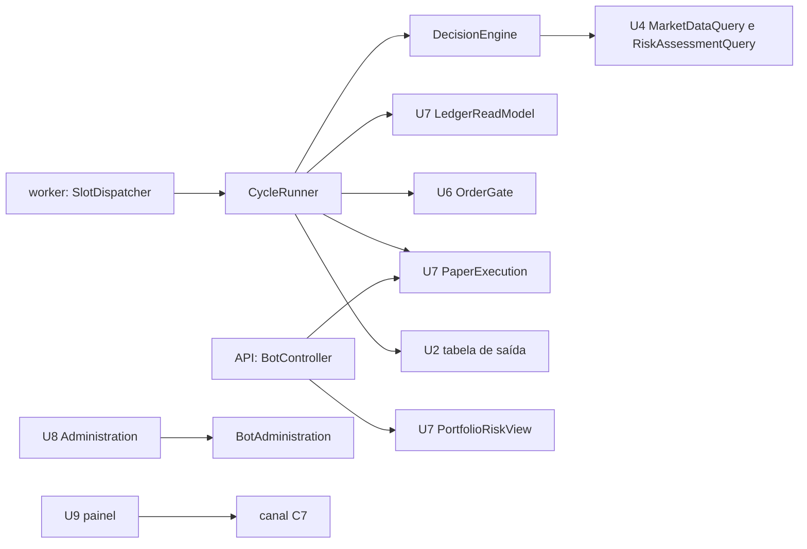

# Componentes lógicos — U5 Bots e decisão

## Dono de cada tabela

| Tabela | Dono |
|---|---|
| `strategy_template`, `bot`, `bot_owner`, `bot_limits_version`, `bot_cycle`, `bot_holding`, `system_pause_state` | `bots` (BotManagement) |
| `decision` | `decision` (DecisionEngine) |

Nenhuma outra Unit lê essas tabelas.

## Componentes

| Componente | Pacote | Processo | Papel |
|---|---|---|---|
| `BotAdministration`, `BotChangeMarks` (C16, C18) | `bots.api` | API | Interfaces públicas |
| `BotCommandService`, `BotStateMachine`, `LockOrder`, `BotConfigValidator` | `bots.domain` e `bots.application` | API e worker | Ciclo de vida, regras de transição e validação |
| `BotController`, `StrategyTemplateController`, `DecisionController`, `DashboardStreamController` e `DashboardMarkPoller` | `bots.web` | API | Rotas C4 e C7 |
| `SlotDispatcher`, `CycleRunner`, `CycleFailureRecorder`, `MidnightJob`, `ClosingCheckJob`, `DecisionPurgeJob` | `bots.worker` | worker | Ciclo e tarefas |
| `DecisionEngine`, `MomentumVolumeStrategy`, `RangeBreakoutStrategy`, `ExitRules`, `OrderSizer` | `decision.domain` | worker | Decisão pura |
| `JdbcBotRepository`, `JdbcDecisionRepository` | `bots.infra`, `decision.infra` | os dois | Persistência com `TenantScope` |
| Telas | `apps/web/src/features/bots`, `apps/web/src/app/bots` | web | S4, lista e S5 |

## Fronteiras

<!-- Text fallback: no worker, o SlotDispatcher entrega bots ao CycleRunner, que chama o DecisionEngine (que lê U4), a U7 para posições e execução, a U6 para a barreira e a trilha da U2. Na API, os comandos chamam fund e closePositions da U7 e a visão de risco para a retomada. A U8 chama BotAdministration e a U9 usa o canal C7. -->

## Domínios de falha

| Falha | Raio | Contenção |
|---|---|---|
| U4, U6 ou U7 indisponível | Ciclo daquele bot | Falha fechada; FAILED; a próxima fatia tenta |
| Worker parado | Todos os ciclos | Bots continuam ACTIVE; nenhuma fatia em atraso; saúde informativa; Compose reinicia por liveness |
| API parada | Comandos e telas | O worker segue operando |

## Interface (NFR11.1, NFR12.1, NFR13.1, NFR14.1)

- **Diálogos** (encerrar, editar limites): usam o componente de diálogo comum das Units anteriores, com foco preso, Esc ou "Cancelar" sem efeito e foco de volta ao botão de origem. Têm teste Jest por diálogo.
- **Campos:** todos têm `label` visível com unidade e erro em texto ligado por `aria-describedby`. O foco visível vem do tema comum. Estado e motivo aparecem sempre em texto.
- **Textos:** ficam em pt-BR num arquivo de mensagens da feature. Os termos de mercado (slippage, drawdown, take profit, stop loss) têm explicação no `Tooltip` comum, que abre ao passar o mouse e ao receber foco.
- **Testes:** os catálogos D e L são escritos antes do código. A cobertura é de 80% de linhas no backend (JaCoCo) e no frontend (Jest), sem exclusão nova. Nenhum teste depende de fuso, local ou fim de linha: o relógio é injetado e as fixtures usam LF.

## Mudanças em código existente

| Onde | Mudança |
|---|---|
| `IdempotentOperation` (U1) | As operações `BOT_*` |
| `tenancy/route-registry.yml` (U1) | As rotas C4 e C7, com teste negativo |
| `LedgerReadModel` (U7) | O Javadoc passa a citar a U5 como consumidora (só leitura) |
| `docker-compose.yml` e o overlay de teste | O serviço `worker` |
| `RuntimeSettingsGuard` e o pool do agendador da API | A API não roda tarefas da U5, e o pool da API não muda |
| Fonte simulada da U4 | Um cenário de volume que dispara o momentum, só no perfil `test` |
