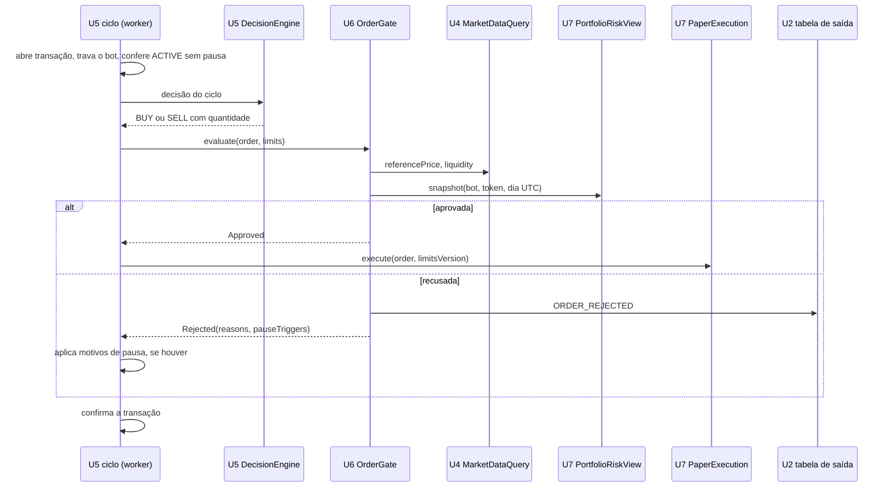
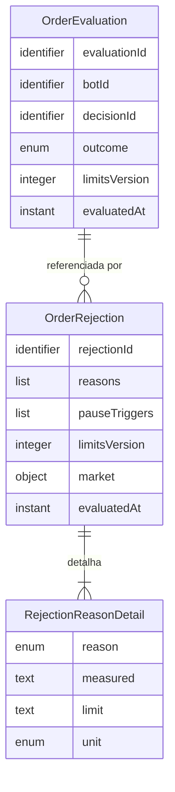

# Especificação funcional — U6 Barreira de limites

A U6 entrega o RiskControl: a barreira obrigatória antes de cada ordem simulada (ADR-003).

- **Histórias:** a U6 implementa a parte da barreira de US4.6 (tabela de exemplos, recusas e saldo PAPER) e a verificação de perda diária e drawdown de US4.7, de [stories.md](../../../inception/user-stories/stories.md).
- **Dados e regras:** [entities.md](entities.md) e [rules.md](rules.md) são a fonte da verdade.
- **Este documento:** é a fonte da verdade dos fluxos. Traz também o catálogo de exemplos dos testes escritos antes do código e as mudanças de contrato.

## Fronteiras

| Tema | O que a U6 faz | O que fica com outra Unit |
|---|---|---|
| Ciclo | Avalia a ordem candidata dentro da transação do ciclo e devolve `Approved` ou `Rejected` | A U5 abre a transação, trava o bot, pede a decisão e chama a execução (C15, ADR-005) |
| Pausa | Indica os gatilhos `DAILY_LOSS` e `DRAWDOWN` | A U5 aplica e remove os motivos de pausa, trata a meia-noite UTC e a retomada (AC4.7.3 a AC4.7.6) |
| Execução e idempotência | Recusa a segunda avaliação da mesma decisão (BR2.8) | A U7 grava ordem, preenchimento e lançamentos uma vez por chave e devolve `Duplicate` ou `Conflict` (AC4.6.3, AC4.6.4) |
| Limites | Lê os valores na chamada e guarda o número da versão | A U5 cria, valida e versiona os limites (FR7.3, FR7.8) |
| Carteira | Lê exposição, perda do dia, patrimônio, maior patrimônio, saldo e última operação pela C13 | A U7 calcula esses valores |
| Mercado | Lê preço de referência e liquidez pela C11 | A U4 coleta e marca frescor e `unknown` |
| Telas | Não tem telas; expõe a rota C21 | A tela do bot (U5) mostra as recusas |

A U6 não lê tabelas de outra Unit, não grava ordens, não pausa bots e nunca assina nem envia transações. Tudo é `PAPER`.

## Fluxos

### F1 — Avaliação de uma ordem candidata (`OrderGate.evaluate`, US4.6, US4.7)

1. A U5, dentro da transação do ciclo e com o Principal do dono do bot ligado, chama `evaluate(order, limits)` (BR1.1). Sem transação, a chamada falha sem gravar nada.
2. A U6 confere a entrada: quantidade maior que zero e limites no domínio (BR1.2).
3. A U6 lê o preço de referência e a liquidez do token (C11) e a visão de risco do bot para o dia UTC de agora (C13), uma única vez (BR1.3).
4. A U6 procura uma avaliação anterior da mesma decisão. Se existe, segue o F2.
5. A U6 calcula o valor da ordem, o slippage estimado, o custo da compra e a queda estimada do patrimônio (BR1.4 a BR1.6), só com dados utilizáveis (BR3.2).
6. A U6 roda as verificações aplicáveis ao lado da ordem (BR2.12) e junta os motivos na ordem fixa (BR3.1). As verificações são:
   - tamanho, exposição por token e exposição total;
   - slippage, liquidez e frescor;
   - intervalo e saldo;
   - perda diária e drawdown.
7. A U6 monta os gatilhos de pausa (BR3.3).
8. A U6 grava a `OrderEvaluation` da decisão com o resultado, por uma inserção que não aborta a transação em conflito (BR3.4, BR2.8). Se outra transação já gravou a mesma decisão, a U6 descarta o resultado calculado e segue o F2 a partir do passo 2.
9. Sem motivo, a U6 devolve `Approved(order)`. A U5 chama `PaperExecution.execute` com a mesma versão de limites.
10. Com motivo, a U6 grava a `OrderRejection` ligada à avaliação, com os detalhes e o evento `ORDER_REJECTED` (BR3.5), e devolve `Rejected(rejectionId, reasons, limitsVersion, pauseTriggers)`.
    - A U5 não chama a execução e aplica os motivos de pausa de `pauseTriggers` na mesma transação.
    - O ciclo é concluído sem operação.

Uma exceção técnica em qualquer passo desfaz a transação inteira do ciclo, inclusive a avaliação e a recusa, sem nova tentativa dentro do ciclo (regras da C15).

### F2 — A mesma decisão avaliada de novo (BR2.8, Q9)

1. Já existe `OrderEvaluation` para (tenant, `PAPER`, bot, decisão). Isso é visto no passo 4 do F1 ou, numa corrida, na inserção do passo 8.
2. Os dados de mercado já lidos no passo 3 do F1 servem só para o registro da recusa (`MarketInputs`). Nenhuma verificação é aplicada, e um resultado já calculado é descartado.
3. A U6 grava a `OrderRejection` com `evaluationId` da avaliação original e `reasons = [DUPLICATE]`. A recusa tem um detalhe (medido = decisão, limite = avaliação original) e um evento `ORDER_REJECTED`.
4. A U6 devolve `Rejected(rejectionId, [DUPLICATE], limitsVersion, {})`. Nada chega à execução.
5. Em duas chamadas paralelas, a unicidade de (tenantId, mode, botId, decisionId) no banco deixa uma única avaliação.
   - A inserção da segunda espera a primeira transação terminar.
   - Se a primeira confirma, a segunda não insere e não aborta. Ela lê a avaliação confirmada e segue os passos 2 a 4.
   - Se a primeira desfaz, a segunda insere e é a primeira avaliação.
   - A trava do bot pela U5 já serializa os ciclos do mesmo bot, então esse caso só aparece por defeito.
6. Uma decisão cuja ordem já foi executada não deveria voltar: a U5 não reprocessa ciclos confirmados (AC4.5.4). Se voltar por defeito, a tela do bot mostra o motivo como "decisão já avaliada; vale o resultado original", não como limite violado.

A unicidade por decisão é o controle de duplicidade próprio da C14. O mecanismo comum de idempotência da identidade vale para requisições que mudam estado e trazem `Idempotency-Key`. A C14 é uma chamada interna do ciclo, sem requisição, e a rota da U6 é só leitura (BR2.8).

### F3 — Leitura das recusas de um bot (C21)

1. `GET /api/v1/bots/{botId}/rejections` com o token do convidado.
2. A U6 aplica o filtro de tenant, pessoa e modo do token em toda consulta (BR4.1). Sem avaliação do bot para essa pessoa, a resposta é 404: bot de outra pessoa, avaliado ou não, bot inexistente e bot próprio ainda não avaliado respondem igual.
3. A U6 devolve a página da mais recente para a mais antiga, com motivos, versão dos limites, horário, gatilhos, detalhes e dados de mercado (BR4.2).

### F4 — Encaixe no ciclo da U5 (C14, C15)



<!-- Text fallback: a U5 abre a transação do ciclo, trava o bot e pede a decisão. Para BUY ou SELL, chama a U6, que lê preço e liquidez na U4 e a visão de risco na U7. Aprovada, a U5 chama a execução da U7. Recusada, a U6 grava a recusa e o evento na tabela de saída, e a U5 aplica os motivos de pausa indicados. No fim, a U5 confirma a transação. -->

HOLD e NO_TRADE não são ordens e não passam pela barreira.

## Máquinas de estado

A U6 não tem entidade com ciclo de vida. `OrderEvaluation` e `OrderRejection` são gravadas uma vez, com o resultado final, e nunca mudam (BR4.3). O estado do bot e os motivos de pausa são da U5, na tabela "Transições do bot" das histórias.

## Catálogo de exemplos (testes escritos antes do código, AC4.6.1, AC4.6.2, AC4.7.1, AC4.7.2, Q11)

**Base de todos os casos, salvo o que a linha muda:**

| Item | Valor |
|---|---|
| Token | 6 casas decimais |
| Preço de referência | 1,000000000000 USDC, observado agora |
| Liquidez | 10.000,000000 USDC, observada agora |
| Visão de risco (C13) | exposição no token 0, exposição total 0, perda do dia 0, patrimônio 1.000,000000, maior patrimônio 1.000,000000, saldo disponível 1.000,000000, sem operação anterior |
| Limites, versão 1 | ordem 100,000000; exposição por token 200,000000; exposição total 500,000000; slippage 2,0000%; liquidez mínima 10.000,000000; intervalo 300 s; perda diária 50,000000; drawdown 10,0000% |
| Ordem | BUY de 100,000000 tokens |
| Contas derivadas da compra | valor 100,000000; consumo 1,0000%; slippage estimado 1,5000%; valor com slippage 101,500000; taxa estimada 0,304500; custo da compra 101,804500 |
| Contas derivadas da saída (BR1.6) | preço de saída 0,985000000000; bruto de saída 98,500000; taxa de saída 0,295500; líquido de saída 98,204500 |
| Queda estimada do patrimônio | 101,804500 − 98,204500 = 3,600000 (na venda, 0) |
| Piso do drawdown | 1.000,000000 × (1 − 10,0000 ÷ 100) = 900,000000 |

**Casos permitidos e recusados:**

| # | Verificação | Caso permitido | Caso recusado | Motivos esperados | Gatilhos |
|---|---|---|---|---|---|
| E1 | Tamanho por ordem | quantidade 100,000000 (valor = 100,000000) | quantidade 100,000001 | ORDER_SIZE | — |
| E2 | Exposição por token | exposição no token e total 100,000000 (depois = 200,000000) | 100,000001 (depois = 200,000001) | TOKEN_EXPOSURE | — |
| E3 | Exposição total | exposição total 400,000000 (depois = 500,000000) | 400,000001 | TOTAL_EXPOSURE | — |
| E4 | Slippage (limite de ordem trocado para 200,000000) | quantidade 150,000000 (consumo 1,5000%, slippage 2,0000%) | quantidade 150,010000 (consumo 1,5001%, slippage 2,0001%) | SLIPPAGE | — |
| E5 | Liquidez mínima | liquidez 10.000,000000 | 9.999,999999; e liquidez `UNKNOWN` | MIN_LIQUIDITY (medido `UNKNOWN` no segundo) | — |
| E6 | Frescor | preço observado há 60 s | há 61 s; e preço `UNKNOWN` | STALE_DATA (medido `UNKNOWN` no segundo) | — |
| E7 | Intervalo | última operação há 300 s | há 299 s | INTERVAL | — |
| E8 | Duplicidade | primeira avaliação da decisão K (aprovada) | segunda avaliação da decisão K | DUPLICATE | — |
| E9 | Saldo PAPER (AC4.6.2) | saldo disponível 101,804500 | 101,804499 | INSUFFICIENT_PAPER_BALANCE | — |
| E10 | Perda diária (AC4.7.1) | perda do dia 49,999999 | 50,000000 | DAILY_LOSS | DAILY_LOSS |
| E11 | Drawdown depois da ordem (AC4.7.2) | patrimônio 903,600000 (depois = 900,000000) | 903,599999 (depois = 899,999999) | DRAWDOWN | — |
| E12 | Drawdown atingido (AC4.7.2) | — | patrimônio 900,000000 | DRAWDOWN | DRAWDOWN |
| E13 | Drawdown sem patrimônio (Q6) | — | patrimônio vazio (preço de posição não confiável) | DRAWDOWN (medido `UNKNOWN`) | — |

**Combinações e casos de venda:**

| # | Caso | Entrada | Resultado esperado |
|---|---|---|---|
| E14 | Vários motivos, ordem fixa (Q1) | quantidade 100,000001 com exposição no token e total 100,000000 | Rejected, reasons = [ORDER_SIZE, TOKEN_EXPOSURE] |
| E15 | Dois gatilhos (Q8) | perda do dia 50,000000 e patrimônio 900,000000 | Rejected, reasons = [DAILY_LOSS, DRAWDOWN], gatilhos = {DAILY_LOSS, DRAWDOWN} |
| E16 | Venda sem as verificações de compra (Q2) | SELL de 150,000000 com exposição no token 200,000000 e saldo disponível 0 | Approved (tamanho, exposição e saldo não rodam; slippage 2,0000% no limite) |
| E17 | Venda barrada pela perda diária (Q2) | SELL de 100,000000 com perda do dia 50,000000 | Rejected, reasons = [DAILY_LOSS], gatilhos = {DAILY_LOSS} |
| E18 | Preço ausente não vira zero (BR3.2) | preço `UNKNOWN` com exposição no token 199,000000 | Rejected, reasons = [STALE_DATA]; nenhum valor de ordem calculado |
| E19 | Liquidez velha é inutilizável (BR2.6, BR3.2) | liquidez 10.000,000000 observada há 61 s, saldo disponível 50,000000 | Rejected, reasons = [STALE_DATA] com o detalhe da liquidez; slippage e saldo não rodam (sem INSUFFICIENT_PAPER_BALANCE); `estimatedSlippagePct` = `UNKNOWN` |
| E20 | Duplicidade em paralelo (BR2.8, F2) | duas transações avaliam a decisão K ao mesmo tempo; a primeira confirma | Uma única `OrderEvaluation`; a segunda devolve Rejected [DUPLICATE] ligada à avaliação da primeira, sem erro de banco |
| E21 | Duplicidade depois de rollback (BR2.8) | a primeira avaliação de K é desfeita por falha técnica do ciclo; K é avaliada de novo | A segunda é a primeira avaliação: Approved |

**Conferência com a U7 (Q5 e BR1.6):**
- **Slippage:** para E1, E4 e E16, o slippage estimado (BR1.5) é igual ao `slippagePct` que a política vigente da U7 grava no preenchimento da mesma ordem. O teste lê a política vigente e falha quando a cópia da U6 deixa de coincidir.
- **Queda do patrimônio:** para a compra da base, num bot sem posição no token, a diferença entre o patrimônio da U7 antes e depois do preenchimento é 3,600000, igual à queda estimada.

Todas as recusas de E1 a E21 gravam uma `OrderRejection` com a versão de limites 1, um detalhe por motivo e um único evento `ORDER_REJECTED`. Os casos permitidos gravam a `OrderEvaluation` aprovada e nenhum evento.

## Mudanças de contrato registradas por este design

Pela regra "mudança de contrato depois da Construction começar", estas mudanças ficam registradas aqui, no Functional Design da Unit provedora, e são avisadas às consumidoras.

| Contrato | Mudança | Tipo | Consumidora avisada |
|---|---|---|---|
| C14 `OrderGate` | `Rejected` passa de `Optional<PauseTrigger> pauseTrigger` para `Set<PauseTrigger> pauseTriggers`, vazio quando nenhum (Q8). Ganha também `UUID rejectionId`. | Quebra, permitida porque a U5 ainda não existe | U5 |
| C14 `OrderGate` | A U6 define os tipos que a C14 deixou abertos: `CandidateOrder(botId, decisionId, side, chain, tokenMint, requestedQuantity)`; `BotLimitsVersionRef` com os campos de `LimitsSnapshot` (entities.md); `RejectionReason` com os 11 valores da C21. | Definição | U5 |
| C14 `OrderGate` | `evaluate` exige transação aberta e o contexto de autenticação do dono do bot (BR1.1). | Regra | U5 |
| C21 recusas | Cada item ganha `pauseTriggers`, `details[{reason, measured, limit, unit}]` e `market{referencePrice, liquidity, estimatedSlippagePct, orderValue}` (Q10). | Aditiva | U5 (tela do bot) |
| C21 recusas | 404 para todo bot sem avaliação da pessoa do token, inclusive o bot dela que ainda não passou pela barreira (BR4.1). A tela do bot trata esse 404 como "nenhuma recusa". Bot de outra pessoa continua respondendo 404, sem leitura entre tenants. | Mudança de comportamento | U5 (tela do bot) |
| C13 `PortfolioRiskView` | Nenhuma mudança: o slippage é estimado na U6 (Q5). | — | — |

```java
// C14 como fica (interface, sem implementação)
public interface OrderGate {
    GateResult evaluate(CandidateOrder order, BotLimitsVersionRef limits);
}
public sealed interface GateResult permits Approved, Rejected {}
public record Approved(CandidateOrder order) implements GateResult {}
public record Rejected(UUID rejectionId, List<RejectionReason> reasons, long limitsVersion,
    Set<PauseTrigger> pauseTriggers) implements GateResult {}
```

## Diagrama entidade-relacionamento (derivado de entities.md)



<!-- Text fallback: uma OrderEvaluation por decisão; ela é referenciada por zero ou mais OrderRejection (a própria recusa e as recusas por duplicidade). Cada OrderRejection tem um ou mais RejectionReasonDetail, um por motivo. -->

## Resumo das regras (derivado de rules.md)

| Regra | Resumo |
|---|---|
| BR1.1 | Só avalia na transação do ciclo, com tenant e pessoa do contexto |
| BR1.2 | Ordem e limites completos e coerentes |
| BR1.3 | Uma leitura da C11 e da C13 por avaliação |
| BR1.4 | Valor = quantidade × preço de referência |
| BR1.5 | Slippage estimado com a cópia da política `v1` |
| BR1.6 | Custo da compra = valor com slippage + taxa de 0,3000%; queda do patrimônio = custo − líquido de saída (na venda, 0) |
| BR2.1 a BR2.3 | Tamanho, exposição por token e total na compra |
| BR2.4 | Slippage estimado até o máximo |
| BR2.5 | Liquidez conhecida e pelo menos a mínima |
| BR2.6 | Preço e liquidez com até 60 s |
| BR2.7 | Intervalo desde a última operação |
| BR2.8 | Segunda avaliação da decisão recusada por duplicidade |
| BR2.9 | Custo da compra cabe no saldo |
| BR2.10 | Perda diária igual ao limite recusa e indica pausa |
| BR2.11 | Piso do drawdown depois da ordem; atingido indica pausa; patrimônio vazio recusa |
| BR2.12 | Venda sem tamanho, exposição e saldo |
| BR3.1 | Todos os motivos, ordem fixa, o primeiro é o principal |
| BR3.2 | Dado ausente não vira zero; verificação dependente não roda |
| BR3.3 | Gatilhos de pausa em conjunto |
| BR3.4 | Avaliação gravada por decisão |
| BR3.5 | Recusa com detalhes e um evento `ORDER_REJECTED` |
| BR4.1 a BR4.3 | Leitura C21 por tenant e pessoa, paginada; registros imutáveis |

## Cantos tratados

| Canto | Tratamento |
|---|---|
| Horário de observação no futuro (relógios diferentes) | A idade negativa conta como 0 s: o dado é fresco. O instante gravado é o da fonte, sem correção |
| Virada do dia UTC durante o ciclo | O dia UTC é fixado no início da avaliação ("agora") e usado na leitura da C13 |
| Bot sem conta PAPER na U7 (a U5 não chamou `fund`) | A C13 lança `IllegalStateException`; é falha técnica e desfaz o ciclo |
| Bot de outra pessoa no contexto | A C13 lança `TenantMismatchException`. Para a U6 é erro de programação da U5 (BR1.1): a exceção desfaz o ciclo, e a U6 não conta com o evento da U7, que some no mesmo rollback |
| Queda real do patrimônio maior que a estimada (posição anterior no mesmo token) | A estimativa trata a compra como se não houvesse posição anterior. O excedente aparece no patrimônio do ciclo seguinte e é barrado por patrimônio no piso ou abaixo dele (BR1.6, BR2.11) |
| Arredondamento do percentual deixaria passar o menor incremento do drawdown | A comparação é em USDC contra o piso (BR2.11); o percentual só aparece no detalhe |
| Quantidade com mais casas que o mint | É defeito da U5 (BR1.2 só exige maior que zero); a U7 trunca na execução. A barreira avalia a quantidade como chegou |
| Duas avaliações paralelas da mesma decisão | Unicidade no banco; a perdedora vira recusa por duplicidade (F2) |
| Limites trocados entre a avaliação e a execução | A U5 passa à execução a mesma versão avaliada, dentro da mesma transação |

## Testes obrigatórios por risco que esta Unit toca

| Risco (`team.md`) | Como a U6 cobre |
|---|---|
| Violação de limites e controles de risco | Catálogo E1 a E21, escrito antes do código, no instante da fronteira e um incremento depois |
| Dado de mercado ausente vira `unknown` | E5, E6, E13 e E18: recusa com medido `UNKNOWN`, nenhuma conta com zero |
| Deduplicação por chave de idempotência | E8 e o caso paralelo do F2 (a deduplicação da execução é da U7) |
| Isolamento entre contas | Rota C21 com bot de outra pessoa já avaliado e nunca avaliado (404 nos dois, sem leitura entre tenants) e tarefas do ciclo com o tenant do contexto (BR1.1, BR4.1) |
| REAL desligado por padrão | Toda linha só aceita `mode = PAPER`; a U6 não tem caminho de assinatura ou envio |
