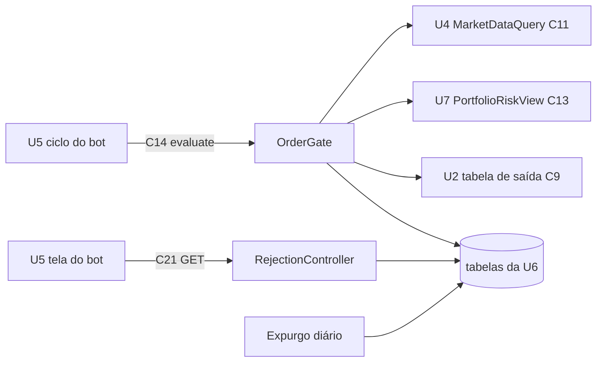

# Componentes lógicos — U6 Barreira de limites

Inventário dos componentes da Unit `u6-risk-control`, onde cada padrão de NFR se aplica e o que muda em código existente.

## Dono de cada tabela

| Tabela | Dono | Quem escreve | Quem lê |
|---|---|---|---|
| `order_evaluation` | U6 | Papel da aplicação (insere); `risk_retention` (apaga aprovadas antigas) | U6 |
| `order_rejection` | U6 | Papel da aplicação (insere) | U6 |
| `rejection_reason_detail` | U6 | Papel da aplicação (insere) | U6 |
| `risk_purge_run` | U6 | `risk_retention` (insere e apaga linhas com mais de 90 dias) | U6 (indicador de saúde) |

Nenhuma outra Unit lê essas tabelas.

## Componentes

| Componente | Pacote | Processo | Papel |
|---|---|---|---|
| `OrderGate` (interface pública, C14) e tipos `CandidateOrder`, `BotLimitsVersionRef`, `GateResult`, `RejectionReason`, `PauseTrigger` | `riskcontrol.api` | API e worker | Contrato com a U5 |
| `OrderGateService` | `riskcontrol.domain` | worker (chamado pela U5) | Fluxo F1 e F2: leituras, procura da decisão, verificações, gravações |
| `LimitChecks` | `riskcontrol.domain` | — | Função pura com as verificações BR2.x e a ordem dos motivos (BR3.1); alvo principal do TDD |
| `SlippageEstimate` | `riskcontrol.domain` | — | Cópia da política v1 (BR1.5 e BR1.6) e conta da queda de patrimônio |
| `EvaluationRepository` e `RejectionRepository` | `riskcontrol.infra` | API e worker | JDBC com `ON CONFLICT DO NOTHING`, consultas por índice |
| `RejectionController` | `riskcontrol.web` | API | Rota C21 |
| `RiskEvaluationPurgeJob` | `riskcontrol.infra` | API (ShedLock) | Expurgo diário com a conexão de retenção |
| `RiskControlHealthIndicator` | `riskcontrol.infra` | API e worker | Saúde informativa |

## Fronteiras e dependências

<!-- Text fallback: o ciclo da U5 chama o OrderGate (C14), que lê a U4 (C11) e a U7 (C13), publica na tabela de saída da U2 (C9) e grava nas tabelas da U6. A tela do bot da U5 lê as recusas pela rota C21. O expurgo diário apaga aprovadas antigas nas tabelas da U6. -->

## Domínios de falha

| Falha | Raio | Contenção |
|---|---|---|
| C11 ou C13 indisponível | O ciclo daquele bot | Exceção desfaz o ciclo; nenhuma ordem executada; o próximo ciclo tenta de novo |
| Banco lento na inserção | O ciclo daquele bot | `lock_timeout` e `statement_timeout` da transação |
| Expurgo falha | Só a limpeza | Indicador `DOWN` informativo; lotes já feitos ficam; rodada seguinte continua |
| Rota C21 lenta | Só a lista de recusas da tela do bot | Índice próprio e página limitada a 100 |

## Mudanças em código e contratos existentes (antes do código da U6)

| Onde | Mudança |
|---|---|
| `infra/postgres/bootstrap/10-roles.sql` | Cria o papel de grupo `risk_retention` (nome fixo, sem login) e o concede ao login de retenção, de forma idempotente, como `audit_retention` |
| Conexão de retenção da U2 | Passa a servir também o expurgo da U6; sem variável de ambiente nova |
| Contrato C14 | `Rejected(rejectionId, reasons, limitsVersion, pauseTriggers)` com `Set<PauseTrigger>` e os tipos definidos no design funcional; a U5 ainda não existe |
| Contrato C21 | Campos aditivos e o `404` para bot sem avaliação da pessoa, inclusive depois do expurgo |

## Para a Infrastructure Design

- Nenhum contêiner, porta ou serviço novo.
- O preparo dos papéis ganha um papel.
- O cenário `u6` entra em `scripts/load-test.sh`.
