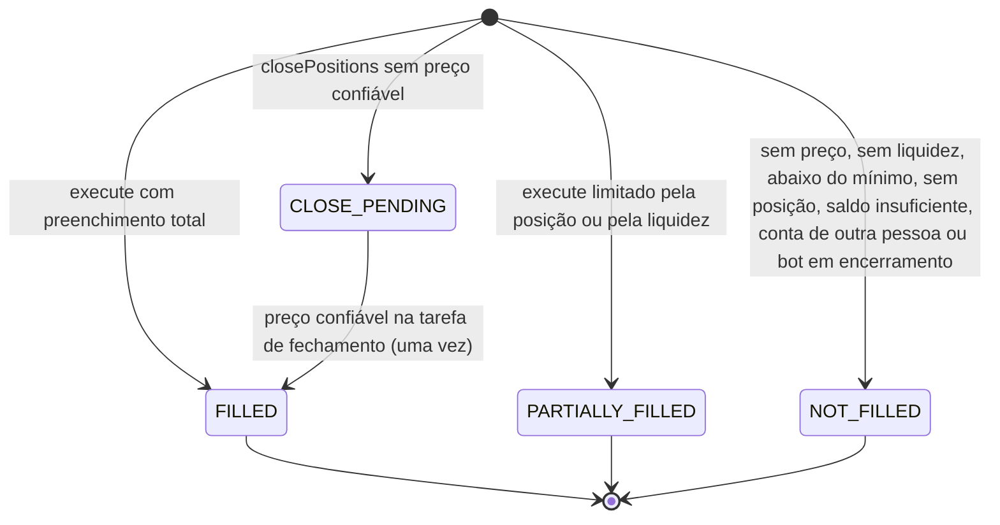
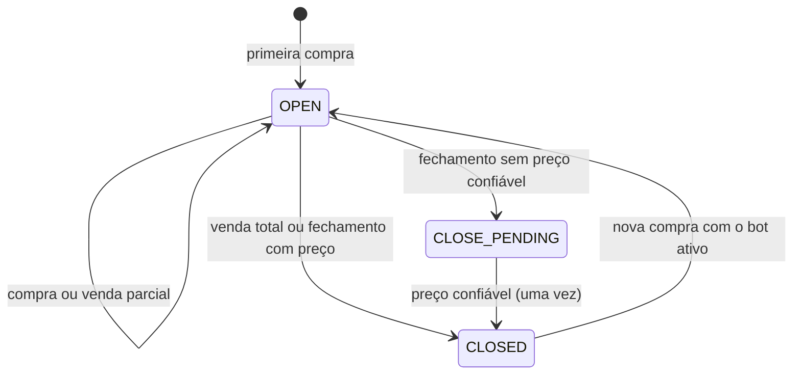
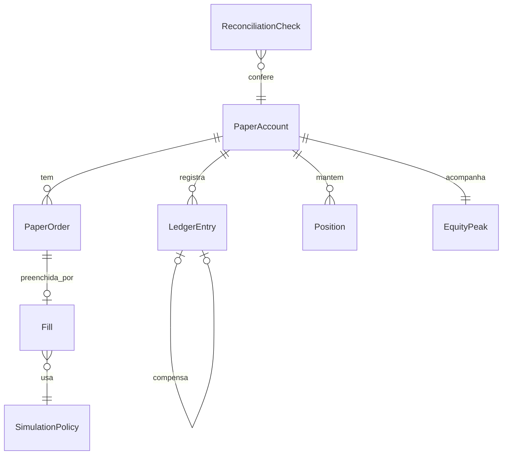

# Especificação funcional — U7 Ledger e P&L

A Unit `u7-ledger-pnl` entrega o PaperTradingLedger (execução simulada, ledger append-only e posições, gravados juntos) e o PortfolioPnL (P&L, visão de risco, maior patrimônio e reconciliação), com as telas de P&L (S6), ledger e reconciliação. Implementa as histórias US4.11, US4.6 (idempotência e unicidade no banco), US4.12 (fechamento e fechamento pendente), US5.1 e US5.2 de [stories.md](../../../inception/user-stories/stories.md) e os requisitos FR8.4, FR9.1 a FR9.3, FR10.1 a FR10.6, FR11.2 e NFR4 de [requirements.md](../../../inception/requirements-analysis/requirements.md).

Este documento é a fonte da verdade dos fluxos, das máquinas de estado e do catálogo de cenários de resultado conhecido. O modelo de dados está em [entities.md](entities.md) e as regras em [rules.md](rules.md); o diagrama e o resumo de regras abaixo são vistas derivadas deles. As decisões vêm de [functional-design-questions.md](functional-design-questions.md) (Q1 a Q12).

## Fronteiras

- **Dentro:** `PaperExecution` (C15: `fund`, `execute`, `closePositions`), `PortfolioRiskView` (C13), rotas C5, tarefas de marcação, fechamento pendente e reconciliação, mecanismo de compensação (só em teste), telas de P&L, ledger, operações do bot e reconciliação.
- **Fora:** decisão (U5), barreira de limites e recusas, inclusive saldo PAPER insuficiente (U6), confirmação do encerramento e estados do bot (U5), canal ao vivo do painel (U9). A U7 recebe bot, decisão e versão de limites só como identificadores e nunca lê tabelas da U5 nem da U6.
- **Dados de mercado:** pela interface C11 da U4 (preço de referência, liquidez, `decimals`, fonte, horário, desatualizado).
- **Trilha:** pela interface C9 da U2, na mesma transação.
- **Idempotência:** `fund` e `closePositions` usam o mecanismo comum de idempotência do módulo de identidade pela interface `IdempotencyGuard` (operações `PAPER_FUND` e `PAPER_CLOSE_POSITIONS`), dentro da transação da U5, como manda a regra do projeto. `execute` deduplica pela própria `PaperOrder`, com a unicidade no banco que o AC4.6.4 exige; as ordens `CLOSE` usam chaves derivadas, uma por posição (BR3.1).
- **Acréscimos e correções a contratos**, com o consumidor afetado e o que ele faz. A geração de código desta Unit atualiza o `contract-summary.md` antes de qualquer código das Units consumidoras; como U5, U6 e U9 ainda não foram construídas, nenhum código existente quebra.

| Contrato | Mudança | Consumidor | Ação do consumidor |
|---|---|---|---|
| C15 | Operação nova `fund(UUID botId, BigDecimal amount, String idempotencyKey)` (Q2, BR2.6) | U5 | Chamar uma vez ao ativar o bot, na transação da ativação |
| C15 | `closePositions(UUID botId, long limitsVersion, String idempotencyKey)`, com a versão dos limites (BR3.4) | U5 | Passar a versão vigente no encerramento |
| C15 | `ExecutionResult` ganha `NotFilled(reason)` (PRICE_UNAVAILABLE, NO_LIQUIDITY, QUANTITY_BELOW_MINIMUM, NO_POSITION, ACCOUNT_CLOSING, INSUFFICIENT_BALANCE, TENANT_MISMATCH); `Filled` traz `requestedQuantity` e `filledQuantity` | U5 | Tratar `NotFilled` como ciclo concluído sem operação (o ciclo confirma, não desfaz), mostrar o motivo e não repetir a mesma decisão |
| C13 | `snapshot(UUID botId, String chain, String tokenMint, LocalDate utcDay)`; `equity` vira `Optional<BigDecimal>` (BR7.4) | U6 | Passar o token avaliado; decidir no próprio design o tratamento de patrimônio ausente para o drawdown, sem tratá-lo como zero |
| C11 | Acréscimo de `decimals` do token; preço e liquidez em USDC (BR1.10) | U4 (dona) | Expor `decimals` como `MarketValue<Integer>` na interface pública |
| C5 | `DayUsage` sem `maxTotalExposure` e `maxDailyLoss` (Q11, BR7.5) | U5 (tela do bot), U9 | Ler os limites da própria U5 e combinar na tela |
| C5 | `LedgerEntry.type` ganha `FUNDING`; `PaperTrade` ganha `requestedQuantity`, `filledQuantity`, `status`, `notFilledReason`, `spreadPct`, `impactPct`, `liquidityConsumedPct`, `marketSource`, `marketObservedAt`; `PnlReport` ganha `empty` e `unrealizedAsOf`; `PnlTokenLine.unrealized` `UNKNOWN` traz o motivo; `divergences.kind` ganha `POSITION_MISMATCH`; rota nova `POST /api/v1/reconciliation/run` com `Idempotency-Key` (BR8.2, BR8.3) | U7 (telas), U5, U9 | Tipos regenerados do OpenAPI |
| Escalas | Moeda de referência USDC; valores com 6 casas; preço unitário com 12 casas; arredondamento `HALF_EVEN` (Q1, Q5); fecha o OQ-3 | Todas | Seguir a tabela |
| C9 | Ações `PAPER_ORDER_FILLED`, `PAPER_ORDER_NOT_FILLED`, `POSITION_CLOSE_PENDING`, `POSITION_CLOSE_COMPLETED`, `LEDGER_ENTRY_COMPENSATED`, `PAPER_ACCOUNT_FUNDED` | U2 (trilha) | Nenhuma: a ação é texto |

## Fluxos

### F1 — Saldo inicial do bot (`fund`, Q2)

Gatilho: a U5 ativa o bot e chama `PaperExecution.fund(botId, amount, idempotencyKey)` dentro da transação da ativação.

1. Exigir transação aberta (BR2.1).
2. Rodar pelo `IdempotencyGuard` (operação `PAPER_FUND`): chave já usada com o mesmo conteúdo devolve o resultado guardado; com conteúdo diferente, `Conflict` (BR2.6).
3. Já existe `PaperAccount` para o bot: `Conflict`; o índice único de `FUNDING` por bot é a garantia final (BR2.6).
4. Criar `PaperAccount` (tenant e pessoa do contexto, `OPEN`), lançamento `FUNDING = +amount` com `referenceId` = a chave, `EquityPeak` com `peakEquity = amount` e `PAPER_ACCOUNT_FUNDED` na trilha.

### F2 — Execução de uma ordem aprovada (`execute`, US4.11, US4.6)

Gatilho: no ciclo da U5, depois da decisão e da barreira aprovarem, a U5 chama `PaperExecution.execute(order, idempotencyKey)` na transação do ciclo, com a linha do bot já travada pela U5.

1. Exigir transação aberta; fora dela, erro técnico (BR2.1).
2. Travar a `PaperAccount` do bot (primeira trava da BR2.8). Inexistente: erro técnico (a U5 não chamou `fund`). De outra pessoa ou de outro tenant: ordem `NOT_FILLED` com `TENANT_MISMATCH`, `REQUEST_FORBIDDEN` na trilha e `NotFilled` (BR9.1).
3. Calcular `contentDigest` do conteúdo canônico. `INSERT ... ON CONFLICT DO NOTHING` da ordem por (tenant, `PAPER`, chave), que não aborta a transação. Já existia: mesmo resumo devolve `Duplicate` com o resultado gravado; resumo diferente devolve `Conflict`; nada mais acontece (BR3.1 a BR3.3). A idempotência vem antes do estado da conta, então uma repetição depois do encerramento ainda é `Duplicate`.
4. Conta em `CLOSING` ou `CLOSED`: a ordem nova fica `NOT_FILLED` com `ACCOUNT_CLOSING`, `PAPER_ORDER_NOT_FILLED` na trilha e `NotFilled` (BR2.7).
5. Ler pela C11 o preço de referência e a liquidez em USDC, `decimals`, fonte e horário (BR1.10). Sem preço confiável ou liquidez: `NOT_FILLED` com o motivo, evento e `NotFilled` (BR1.2, BR1.7).
6. Truncar a quantidade nas casas do mint (BR1.7). Venda: limitar à posição; posição zero é `NotFilled(NO_POSITION)` (BR1.5).
7. Aplicar o teto de 10% da liquidez; truncar; zero é `NotFilled(QUANTITY_BELOW_MINIMUM)` (BR1.4).
8. Calcular consumo, impacto, slippage, preço cotado e de preenchimento (12 casas), valor bruto e taxa (6 casas) (BR1.3, BR1.6, BR1.8).
9. Compra: se valor bruto + taxa passa do saldo disponível, `NOT_FILLED` com `INSUFFICIENT_BALANCE`, evento e `NotFilled` (BR2.5).
10. Travar a posição do token, criando se não existir (segunda trava da BR2.8). Gravar `Fill`, os lançamentos da BR2.2 e a posição da BR2.3; em venda, gravar `realized` no `Fill`. Status `FILLED`, ou `PARTIALLY_FILLED` quando a preenchida é menor que a pedida já truncada (limite da posição ou da liquidez).
11. Recalcular o maior patrimônio com a conta já travada (terceira trava da BR2.8, BR7.3), gravar `PAPER_ORDER_FILLED` e atualizar a marca de última alteração (C18).
12. Devolver `Filled` com pedida, preenchida e os valores do `Fill`.

Todo `NotFilled` é gravado e confirmado com o ciclo: é um resultado, não um erro. Só falha técnica lança exceção; a U5 desfaz o ciclo inteiro (ordem, preenchimento, lançamentos, posição, evento), e uma nova tentativa com a mesma chave é então a primeira (BR3.2).

### F3 — Encerramento com fechamento das posições (`closePositions`, US4.12)

Gatilho: a U5, depois da confirmação da pessoa (AC4.12.1, tela da U5), chama `PaperExecution.closePositions(botId, limitsVersion, idempotencyKey)` na transação do encerramento.

1. Exigir transação aberta; rodar pelo `IdempotencyGuard` (operação `PAPER_CLOSE_POSITIONS`): repetição devolve o `CloseResult` guardado.
2. Travar a `PaperAccount` e depois as posições do bot em ordem de (chain, mint) (BR2.8); conta de outra pessoa: recusa `TENANT_MISMATCH` (BR9.1). `PaperAccount` para `CLOSING`.
3. Para cada posição com quantidade maior que zero, uma ordem `CLOSE` com a chave derivada `<chave>:<positionId>` e a `limitsVersion` recebida (BR3.1, BR3.4):
   - com preço confiável: ordem `FILLED`, lançamentos `CLOSE` e `FEE`, realizado, posição zerada e `CLOSED` (BR5.1);
   - sem preço confiável: ordem `CLOSE_PENDING`, posição `CLOSE_PENDING` e `POSITION_CLOSE_PENDING` na trilha (BR5.2).
4. Sem nenhuma pendente: `PaperAccount` para `CLOSED`.
5. Recalcular o maior patrimônio (BR7.3). Fechar ao preço de referência pode elevar o patrimônio acima da última marcação pelo preço de saída; é o viés otimista que o AC4.12.2 impõe, registrado na BR5.1.
6. Devolver `CloseResult` com as posições fechadas e as pendentes. A U5 marca o bot `STOPPED` nos dois casos; o bot não faz novas operações (BR2.7) e a tela avisa "Encerramento pendente: aguardando preço confiável".

### F4 — Conclusão do fechamento pendente (US4.12)

Gatilho: tarefa com execução única, depois de cada coleta de mercado da U4 (evento de coleta concluída) e na partida do processo.

1. Listar as posições `CLOSE_PENDING`, de todas as pessoas, lendo tenant e pessoa da própria linha.
2. Para cada uma, numa transação própria: travar a `PaperAccount` e depois a posição (ordem da BR2.8); se não está mais `CLOSE_PENDING`, parar; se o preço continua não confiável, parar; senão fechar como na BR5.1, mudar a ordem `CLOSE` para `FILLED`, gravar `POSITION_CLOSE_COMPLETED` com ator `system`, recalcular o maior patrimônio e, sem pendentes no bot, `PaperAccount` para `CLOSED` (BR5.3).
3. Duas execuções paralelas ou depois de reinício: a segunda encontra a posição `CLOSED` e não faz nada.

### F5 — Marcação e maior patrimônio (Q10)

Gatilho: tarefa com execução única depois de cada coleta de mercado; também ao fim de cada preenchimento (F2.11) e de cada fechamento (F3.5, F4.2).

1. Para cada `PaperAccount` `OPEN` ou `CLOSING`, numa transação própria que trava a conta primeiro (BR2.8): ler o saldo disponível (soma dos lançamentos) e as posições no mesmo instante travado, e calcular o valor líquido de saída de cada posição aberta (BR6.2). Um preenchimento em andamento espera a trava; a marcação nunca vê saldo e posições de momentos diferentes.
2. Alguma posição sem preço confiável: `lastEquity` vazio, `peakEquity` mantido. Senão: `lastEquity = patrimônio`, e `peakEquity` sobe por atualização condicional só se o novo valor for maior (BR7.3).

### F6 — Visão de risco para a barreira (C13)

Gatilho: a U6 chama `PortfolioRiskView.snapshot(botId, chain, tokenMint, utcDay)` dentro do ciclo.

Devolve, para o bot da pessoa do contexto: exposição do token e total pelo custo (BR7.1), perda realizada do dia UTC com taxas (BR7.2), patrimônio atual (`Optional`, BR7.3), maior patrimônio, saldo disponível (BR2.5) e o horário da última operação preenchida. Só leitura.

### F7 — P&L de um período (US5.1)

Gatilho: `GET /api/v1/pnl?from=&to=&botId=` (a tela converte o período do fuso da pessoa para UTC).

1. Validar `from < to` e período de até 366 dias; `botId` de outra pessoa: 404; `botId` sem conta PAPER (bot não ativado): resposta vazia (BR6.1, BR9.1).
2. Por token: realizado dos preenchimentos com `filledAt` em [from, to) e taxas dos lançamentos `FEE` dessas ordens, já com as compensações (BR6.1); não realizado das posições abertas agora pelo preço de saída (BR6.2), ou `UNKNOWN` com motivo (BR6.3); `noLiquidity` e a última marcação (BR6.4).
3. Totais = soma das linhas; com algum `UNKNOWN`, total não realizado `UNKNOWN` e `partial = true` (BR6.3, BR6.5).
4. Nada no período e nenhuma posição: `empty = true` (BR6.6). Falha técnica: `503`.
5. `unrealizedAsOf` = instante da marcação usada; a tela diz "Não realizado: posições abertas agora".

### F8 — Ledger e operações (US5.2, AC4.10.3)

- `GET /api/v1/ledger?botId=`: lançamentos da pessoa por `createdAt` decrescente e `entryId`, por cursor; cada um com operação, valor, tipo, horário e versão da política (BR10.2).
- `GET /api/v1/bots/{botId}/trades`: operações do bot, cada uma uma única vez, com todas as hipóteses (BR10.2).
- "Ver hipóteses" usa os campos do `Fill`.
- Nenhuma rota altera ou apaga (BR4.3).

### F9 — Reconciliação (US5.2, Q9)

1. Tarefa a cada 5 minutos, com execução única: para cada pessoa com `PaperAccount`, conferir pela BR8.2 e gravar o `ReconciliationCheck` `SCHEDULED` (BR8.1).
2. `GET /api/v1/reconciliation?botId=`: último resultado da pessoa.
3. `POST /api/v1/reconciliation/run`: confere na hora, grava `ON_DEMAND` e devolve o resultado (BR8.3).
4. A tela mostra o aviso de divergência com a quantidade e o detalhe, ou "Reconciliado" com o horário (BR8.4).

### F10 — Compensação (só mecanismo de domínio, AC5.2.3)

`LedgerCompensation.compensate(entryId, reason)`, sem rota nem tela no beta: grava `COMPENSATION` com o negativo do original e `LEDGER_ENTRY_COMPENSATED` na trilha (BR4.2). Só os testes o chamam.

## Telas

| Tela | O que mostra | Regras |
|---|---|---|
| S6 — P&L | Título com "MODO PAPER (simulado)"; filtro de período no fuso da pessoa e de bot; realizado, não realizado e taxas separados, por token e total; `unknown` com motivo e "parcial"; "sem liquidez" com fonte e horário; aviso de reconciliação; estados de carregando, vazio e erro distintos | BR6.1 a BR6.6, BR8.4, BR10.1 |
| Ledger | Lançamentos agrupados por operação, com custo, taxa, slippage, horário e versão; "ver hipóteses"; sem ação de edição | BR4.3, BR10.2 |
| Operações do bot (componente usado pela tela do bot da U5) | Operações com pedida e preenchida, preço de referência, cotado e de preenchimento, versão da política e dos limites | BR3.4, BR10.2 |
| Reconciliação | Último resultado, horário, lista de divergências, "verificar agora" | BR8.1 a BR8.4 |

Cor nunca é o único indicador (positivo e negativo têm sinal e texto); tudo operável por teclado; textos em pt-BR sem promessa de lucro.

## Máquinas de estado

### Ordem PAPER (`PaperOrder.status`)

Texto: uma ordem nasce num estado final, menos a ordem de fechamento sem preço, que fica `CLOSE_PENDING` até a tarefa de fechamento concluí-la uma única vez.

### Posição (`Position.status`)

Texto: a posição abre na primeira compra e fecha quando a quantidade chega a zero; zerada, o custo recomeça (BR2.4). No encerramento sem preço ela espera em `CLOSE_PENDING`. Depois que a conta está `CLOSING` ou `CLOSED`, nenhuma compra acontece (BR2.7).

### Conta PAPER do bot (`PaperAccount.status`)

| De | Para | Gatilho |
|---|---|---|
| — | `OPEN` | `fund` |
| `OPEN` | `CLOSING` | `closePositions` |
| `CLOSING` | `CLOSED` | nenhuma posição pendente |

## Catálogo de cenários de resultado conhecido (AC5.1.2, AC4.11.1, AC4.11.3, AC4.11.4)

Política v1 (BR1.1). Mint com 6 casas, salvo onde dito. Saldo inicial de 1000.000000 USDC por `FUNDING`, salvo onde dito. Preços unitários têm 12 casas; abaixo, os zeros à direita não são escritos (1.006000 é 1.006000000000). Todas as linhas são escritas como testes antes do código e conferidas por igualdade exata.

| # | Cenário | Entradas | Resultado esperado |
|---|---|---|---|
| C1 | Ganho total | Compra 100 a 1.000000, liquidez 100000.000000; venda 100 a 1.500000, liquidez 100000.000000 | Compra: consumo 0.1000, slippage 0.6000, preço 1.006000, bruto 100.600000; lançamentos TRADE_COST −100.000000, SLIPPAGE −0.600000, FEE −0.301800; posição 100 / custo 100.600000. Venda: consumo 0.1500, slippage 0.6500, preço 1.490250, bruto 149.025000; TRADE_PROCEEDS +150.000000, SLIPPAGE −0.975000, FEE −0.447075; realizado 48.425000; taxas 0.748875; líquido 47.676125; saldo 1047.676125; posição 0 / 0.000000 |
| C2 | Perda total | Compra como C1; venda 100 a 0.800000, liquidez 100000.000000 | Venda: consumo 0.0800, slippage 0.5800, preço 0.795360, bruto 79.536000; TRADE_PROCEEDS +80.000000, SLIPPAGE −0.464000, FEE −0.238608; realizado −21.064000; taxas 0.540408; líquido −21.604408; saldo 978.395592; perda do dia (mesmo dia UTC) 21.604408 |
| C3 | Duas compras e venda parcial | Compra 100 a 1.000000 e compra 100 a 2.000000, liquidez 100000.000000; venda 50 a 3.000000, liquidez 100000.000000 | Segunda compra: consumo 0.2000, slippage 0.7000, preço 2.014000, bruto 201.400000, FEE −0.604200; posição 200 / 302.000000. Venda: consumo 0.1500, preço 2.980500, bruto 149.025000, FEE −0.447075; custo removido 75.500000; realizado 73.525000; posição 150 / 226.500000 |
| C4 | Política de taxas | Mesmos números de C1 | Realizado bruto 48.425000 (sem taxas); coluna de taxas 0.748875; resultado líquido = realizado + não realizado (0) − taxas = 47.676125; custo da posição depois da compra 100.600000 (taxa fora do custo) |
| C5a | Token com 6 casas | Compra pedida 1.123456789 a 2.000000, liquidez 1000000.000000 | Quantidade 1.123456 (truncada); consumo 0.0002; slippage 0.5002; preço 2.010004; TRADE_COST −2.246912; bruto 2.258151; SLIPPAGE −0.011239; FEE −0.006774; status FILLED (o truncamento não é preenchimento parcial); pedida 1.123456789 registrada |
| C5b | Token com 9 casas | Compra pedida 1.123456789 a 2.000000, liquidez 1000000.000000 | Quantidade 1.123456789; consumo 0.0002; slippage 0.5002; preço 2.010004; TRADE_COST −2.246914; bruto 2.258153; SLIPPAGE −0.011239; FEE −0.006774 |
| C6a | Ponto médio arredonda para o par (abaixo) | Compra 0.750000 a 2.000000, liquidez 1000000000.000000 | Consumo 0.0000; slippage 0.5000; preço 2.010000; bruto 1.507500; taxa exata 0.0045225 → FEE −0.004522; TRADE_COST −1.500000; SLIPPAGE −0.007500 |
| C6b | Ponto médio arredonda para o par (acima) | Compra 0.250000 a 2.000000, liquidez 1000000000.000000 | Bruto 0.502500; taxa exata 0.0015075 → FEE −0.001508; TRADE_COST −0.500000; SLIPPAGE −0.002500 |
| C7 | Posição zerada reinicia o custo | Compra 100 a 1.000000; venda 100 a 1.000000; compra 10 a 4.000000; liquidez sempre 100000.000000 | Venda: preço 0.994000, bruto 99.400000, FEE −0.298200, realizado −1.200000, posição 0 / 0.000000. Nova compra: consumo 0.0400, slippage 0.5400, preço 4.021600, bruto 40.216000, FEE −0.120648; posição 10 / 40.216000 |
| C8 | Marcação `unknown` | Posição de C1 depois da compra (100 / 100.600000); preço de referência `UNKNOWN` | Não realizado da linha `UNKNOWN` (PRICE_UNKNOWN); total não realizado `UNKNOWN`; `partial = true`; realizado 0.000000; taxas 0.301800; patrimônio `unknown`, maior patrimônio 1000.000000 mantido |
| C9 | Marcação pelo preço de saída | Posição 100 / 100.600000; referência 1.200000, liquidez 100000.000000 | Consumo 0.1200; preço de saída 1.192560; valor bruto 119.256000; taxa estimada 0.357768; valor líquido 118.898232; não realizado 18.298232; saldo 899.098200; patrimônio 1017.996432; maior patrimônio 1017.996432 |
| C10 | Preenchimento parcial pela liquidez | Saldo inicial 2000.000000; compra 2000 a 1.000000, liquidez 10000.000000 | Valor máximo 1000.000000; preenchida 1000.000000, pedida 2000; status PARTIALLY_FILLED; consumo 10.0000; slippage 10.5000; preço 1.105000; TRADE_COST −1000.000000; SLIPPAGE −105.000000; bruto 1105.000000; FEE −3.315000 |
| C11 | Venda maior que a posição | Posição de C1 (100 / 100.600000); venda pedida 150 a 1.500000, liquidez 100000.000000 | Preenchida 100, pedida 150, status PARTIALLY_FILLED; valores da venda de C1; realizado 48.425000; posição 0 |
| C12 | Fechamento no encerramento | Posição 100 / 100.600000; referência 1.200000 | CLOSE +120.000000; FEE −0.360000; realizado 19.400000; posição 0 / CLOSED; conta CLOSED |
| C13 | Lançamento compensatório | Depois da compra de C1, compensar o FEE −0.301800 | COMPENSATION +0.301800 com `compensatesEntryId` do FEE; saldo 899.098200 → 899.400000; coluna de taxas do período 0.301800 → 0.000000; reconciliação continua RECONCILED (a compensação entra no esperado e no encontrado); segunda compensação do mesmo lançamento recusada |
| C14 | Token de preço muito baixo | Compra 50000000 a 0.000002, liquidez 1000000.000000 | Consumo 0.0100; slippage 0.5100; preço 0.0000020102 (12 casas: 0.000002010200); bruto 100.510000; TRADE_COST −100.000000; SLIPPAGE −0.510000; FEE −0.301530; posição 50000000 / 100.510000 |
| C15 | Saldo insuficiente na execução | Saldo inicial 100.000000; compra 99.600000 a 1.000000, liquidez 100000.000000 | Consumo 0.0996; slippage 0.5996; preço 1.005996; bruto 100.197202; taxa 0.300592; custo total 100.497794 > 100.000000: ordem NOT_FILLED com INSUFFICIENT_BALANCE, evento PAPER_ORDER_NOT_FILLED, nenhum lançamento; saldo 100.000000 |

Cenários de regra sem valor monetário novo (também testes antes do código): mesma chave em sequência e em paralelo dá uma operação só (BR3.1, BR3.2); mesma chave com outra quantidade é `Conflict` (BR3.3); `UPDATE` e `DELETE` em lançamento falham com o papel da aplicação (BR4.1); preço desatualizado (5:01) dá `NotFilled(PRICE_UNAVAILABLE)` (BR1.2); liquidez zero dá `NotFilled(NO_LIQUIDITY)` e "sem liquidez" na marcação (BR1.2, BR6.4); fechamento pendente concluído uma vez com duas tarefas em paralelo (BR5.3); soma das linhas igual ao total com três tokens (BR6.5).

## Diagrama entidade-relacionamento (derivado de entities.md)

Texto: cada bot tem uma conta PAPER com ordens, lançamentos, posições e o maior patrimônio. Uma ordem tem no máximo um preenchimento, que registra a versão da política. Um lançamento compensatório aponta para o original. A reconciliação confere as contas de cada pessoa.

## Resumo das regras (derivado de rules.md)

| Grupo | Regras | Fluxos |
|---|---|---|
| BR1 Simulação | BR1.1 a BR1.10 | F2, F3 |
| BR2 Registro | BR2.1 a BR2.8 | F1, F2, F3, F4, F5 |
| BR3 Idempotência | BR3.1 a BR3.4 | F1, F2, F3 |
| BR4 Ledger imutável | BR4.1 a BR4.3 | F8, F10 |
| BR5 Fechamento | BR5.1 a BR5.3 | F3, F4 |
| BR6 P&L | BR6.1 a BR6.7 | F7 |
| BR7 Risco para a U6 | BR7.1 a BR7.5 | F5, F6 |
| BR8 Reconciliação | BR8.1 a BR8.4 | F9 |
| BR9 Isolamento | BR9.1 e BR9.2 | todos |
| BR10 Telas | BR10.1 e BR10.2 | F7, F8 |

## Cantos tratados

- **Mesma decisão em paralelo:** a restrição única espera a primeira transação; a segunda vê a linha e devolve `Duplicate` (AC4.6.3).
- **Falha no meio:** a U5 desfaz o ciclo inteiro; a nova tentativa com a mesma chave grava tudo uma vez (AC4.6.3).
- **Preço muda entre a barreira e a execução:** a U7 lê o dado de mercado de novo na execução; a cotação registrada é a usada no preenchimento.
- **Truncamento a zero:** `NotFilled(QUANTITY_BELOW_MINIMUM)` em vez de uma operação de quantidade zero.
- **Teto de liquidez numa venda grande:** a venda é parcial e o restante da posição continua aberto.
- **Posição maior que 10% da liquidez na marcação:** o preço de saída usa o consumo inteiro (até 100%), então o não realizado fica conservador.
- **Encerramento com parte das posições sem preço:** as com preço fecham na hora; as outras ficam pendentes; a conta só fica `CLOSED` quando todas fecham.
- **Reinício com fechamento pendente:** a tarefa roda na partida e conclui uma vez.
- **Período que corta o dia UTC:** o filtro usa instantes UTC; a perda do dia da barreira usa sempre o dia UTC inteiro.
- **Barreira aprova, mas o custo real passa do saldo:** `NotFilled(INSUFFICIENT_BALANCE)` gravado e confirmado; o ciclo não falha nem entra em laço (C15).
- **Token de preço muito baixo:** o preço unitário com 12 casas preserva spread e impacto (C14).
- **Marcação concorrente com preenchimento:** ambos travam a conta primeiro; a marcação nunca combina saldo e posições de momentos diferentes, então o maior patrimônio não sobe por engano.
- **Bot da pessoa ainda não ativado:** rotas devolvem vazio; bot de outra pessoa, 404.

## Testes obrigatórios por risco que esta Unit toca

- **Separação REAL e PAPER:** `CHECK mode = 'PAPER'`; consultas filtradas por `PAPER`; requisição com outro modo `403`.
- **Deduplicação por chave de idempotência:** sequência, paralelo e depois de falha.
- **Ledger sem edição:** `UPDATE` e `DELETE` falham no banco; correção só por compensação.
- **P&L determinístico:** cenários C1 a C15 com igualdade exata, em decimal e unidades de token.
- **`unknown` nunca zero:** C8 e "sem liquidez".
- **Isolamento entre contas:** bot de outra pessoa `404` em todas as rotas C5; tarefas leem o tenant da linha.
- **REAL desligado:** nenhum caminho assina ou envia transação (BR1.9).
