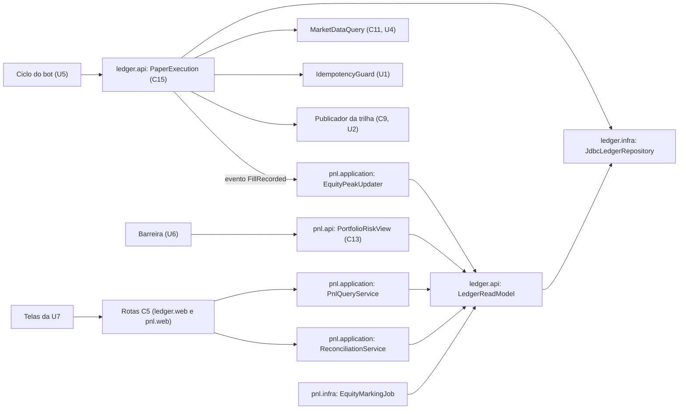

# Componentes lógicos — U7 Ledger e P&L

Inventário dos componentes da U7 dentro do monólito modular, com o dono de cada tabela, as fronteiras de falha e onde cada padrão não funcional se aplica. Segue a convenção do `team.md`: um módulo fala com outro só pela interface pública ou por evento, e o domínio não depende de infraestrutura.

## Dono de cada tabela

| Módulo | Tabelas | Quem lê de fora |
|---|---|---|
| `ledger` (PaperTradingLedger) | `paper_account`, `paper_order`, `fill`, `ledger_entry`, `position`, `pnl_daily`, `simulation_policy` | `pnl`, só pela interface `LedgerReadModel` em `ledger.api` |
| `pnl` (PortfolioPnL) | `equity_peak`, `reconciliation_check` | Ninguém; a U6 lê pela `PortfolioRiskView` (C13) |

`pnl_daily` é do `ledger` porque é gravada na mesma transação do preenchimento; o `pnl` só a lê.

## Componentes

| Componente | Módulo | Papel | Padrões aplicados | Falha e alcance |
|---|---|---|---|---|
| `PaperExecution` (C15) | `ledger.api` (impl. em `ledger.application`) | `fund`, `execute`, `closePositions` | `MANDATORY`; travas na ordem da BR2.8; tempos de espera; idempotência | Erro de domínio vira `NotFilled`; falha técnica desfaz o ciclo da U5 |
| `LedgerReadModel` | `ledger.api` | Interface pública de leitura: saldo, posições, preenchimentos e taxas de um intervalo, resumo diário, página do ledger, ordens para reconciliação, e `lockAccountForMarking(botId)` que trava a conta e devolve saldo e posições do mesmo instante | Só leitura, mais a trava de conta para a marcação | — |
| `FillRecorded` (evento) | `ledger.api` | Evento de domínio publicado de forma síncrona, na mesma transação, depois de cada preenchimento ou fechamento | `ApplicationEventPublisher` + `@EventListener` síncrono (não `@TransactionalEventListener` depois do commit) | Falha no ouvinte desfaz a transação inteira |
| `FillCalculator`, `PositionAccounting` | `ledger.domain` | Cálculo puro | `BigDecimal` com escalas da política | — |
| `LedgerCompensation` | `ledger.domain` | Lançamento compensatório | Visibilidade de pacote; só testes | — |
| `JdbcLedgerRepository` | `ledger.infra` | Persistência do `ledger` | SQL parametrizado; `ON CONFLICT`; `FOR UPDATE` | Exceção técnica |
| `PendingCloseJob` | `ledger.infra` | F4 | ShedLock; após coleta, a cada 60 s e na partida | Conta presa é pulada |
| `EquityPeakUpdater` | `pnl.application` | Ouve `FillRecorded` e recalcula o pico na mesma transação; também usado pela marcação | Lê pelo `LedgerReadModel`; grava `equity_peak` (dono `pnl`) | — |
| `EquityMarkingJob` | `pnl.infra` | F5 | ShedLock; `LedgerReadModel.lockAccountForMarking`; pico condicional | Conta presa é pulada |
| `PortfolioRiskViewImpl` (C13) | `pnl.application` | Visão de risco | Perda do dia direto de `fill` e `FEE` pelo `LedgerReadModel` (não do resumo) | — |
| `PnlQueryService` | `pnl.application` | F7 | Resumo diário nos dias inteiros e consulta direta nas pontas, pelo `LedgerReadModel` | `unknown` e parcial |
| `ReconciliationService`, `ReconciliationJob` | `pnl.application`, `pnl.infra` | F9 | `REPEATABLE READ`; ShedLock a cada 5 min | Divergência gravada e sinalizada |
| `LedgerController` | `ledger.web` (rotas de trades, ledger, day-usage) e `pnl.web` (pnl, reconciliation) | Rotas C5 | Isolamento; validação; limitador de "verificar agora" em `pnl.web` | `400`, `404`, `429` |
| `LedgerJobsHealth` | `pnl.infra` | Saúde das tarefas | Nunca `DOWN` | — |
| Telas P&L, ledger, operações, reconciliação | `apps/web/src/features/pnl` | S6 e afins | Tipos gerados; decimais como texto; estados distintos | Erro numa parte não esconde as outras |

## Fronteiras e dependências

Texto: o `ledger` não depende do `pnl`; o `pnl` depende só de `ledger.api` (a interface `LedgerReadModel` e o evento `FillRecorded`). Nenhum domínio depende de infraestrutura.

Regra ArchUnit nova (`LedgerArchitectureTest`): classes de `com.memetrade.pnl..` só dependem de `com.memetrade.ledger.api..` dentro do `ledger`; classes de `com.memetrade.ledger..` não dependem de `com.memetrade.pnl..`; `..domain..` não depende de `..infra..` nem de `..web..`.

## Domínios de falha

| Domínio | O que cai junto | Isolamento |
|---|---|---|
| Banco | Execução, P&L, tarefas | Domínio único do monólito |
| Dado de mercado indisponível | Novos preenchimentos e marcação | `NotFilled` e `unknown`; ledger e P&L realizado continuam |
| Tarefa travada | Só a rodada daquela tarefa | Tempo de espera e ShedLock |

## Mudanças em código e contratos existentes (antes do código da U7)

- U4: `decimals` na interface pública `MarketDataQuery` (C11).
- U1: valores `PAPER_FUND` e `PAPER_CLOSE_POSITIONS` no enum `IdempotentOperation`, com retenção padrão.
- U1: entradas das rotas C5 da U7 em `tenancy/route-registry.yml` (`CLIENT`, com `negativeTest`) e das tarefas (`GLOBAL`).
- Contrato C5 no `contract-summary.md` e no `openapi-guest.yaml`: os acréscimos do functional-spec.md mais `SUMMARY_MISMATCH` em `divergences.kind`; tipos do frontend regenerados; teste de contrato do convidado atualizado.
- Contratos C13 e C15 no `contract-summary.md`, como no functional-spec.md.

## Para a Infrastructure Design

- Migração `0008-ledger-pnl` com tabelas, índices, `CHECK`, gatilhos e privilégios da matriz.
- Cenário de carga `u7` no `scripts/load-test.sh`.
