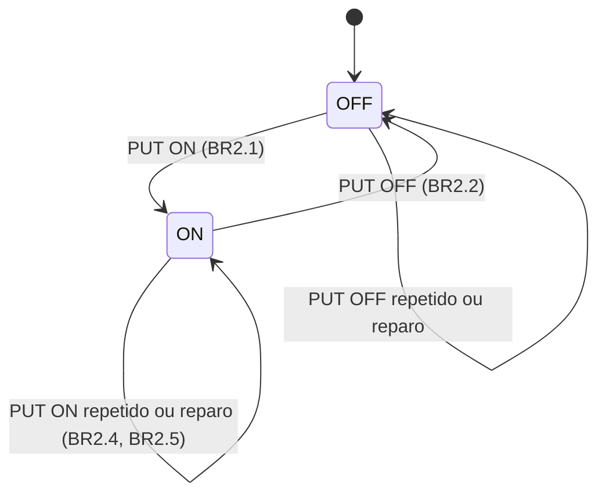
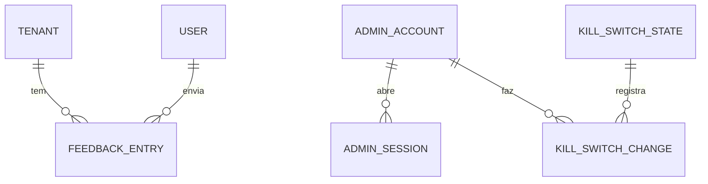

# Especificação funcional — U8 Administração e feedback

Unit `u8-admin-feedback`. Ela implementa estas histórias de [stories.md](../../../inception/user-stories/stories.md):
- US7.1, só as telas; as regras e as rotas são da U3.
- US7.2, na parte do kill switch e das telas; o motivo SYSTEM e as recusas são da U5.
- US7.4.
- US6.1.
- O AC1.2.6, entrada do administrador, que a U1 passou para esta Unit.

As decisões estão em [functional-design-questions.md](functional-design-questions.md), as entidades em [entities.md](entities.md) e as regras em [rules.md](rules.md).

## Escopo

- **Dentro:**
  - A entrada do administrador (C8 `admin/auth`).
  - O kill switch (C8) com repetição de falhas.
  - O estado do sistema (C8), com o acréscimo `rejectedOrdersToday`.
  - A rota `GET /api/v1/admin/tenants`.
  - O envio de feedback (C6), a leitura do feedback (C8) e o expurgo em 180 dias.
  - O app web do administrador (A1, A2, entrada, kill switch, feedback).
  - O diálogo de feedback no app do convidado.
- **Fora:**
  - As regras e as rotas de convite (U3).
  - A pausa de sistema dentro dos bots e as recusas de iniciar ou retomar (U5).
  - O menu novo do convidado (U9).
  - Qualquer rota que leia ledger, operações ou carteiras.
- **Acréscimos a contratos:**
  - C8 `system-status`: cada parte (`guestCount`, `inviteCounts`, `botCountsByState`, `killSwitch`, `sources`, `auditOutboxPending` e o novo `rejectedOrdersToday`) passa a ser uma união `{status: OK, value}` ou `{status: UNKNOWN, reason}`, para a BR3.3 nunca virar zero.
  - C8 kill switch: `pendingBots` e `reconcileNeeded` nas respostas do `GET` e do `PUT`.
  - C8 feedback: cada item ganha `tenantName`.
  - C8 ganha a rota `GET /api/v1/admin/tenants` (lista de `TenantOption`).
  - A interface pública da U6 ganha `long countRejectedSince(Instant from)`, sem identificadores.
  - C6 ganha a resposta `429 RATE_LIMITED`.

## Fluxos

### F1 — Entrada do administrador (BR1.1–BR1.6)
1. O app do administrador abre a tela de entrada. A pessoa conecta a carteira no navegador.
2. O app pede `POST /api/v1/admin/auth/challenge` com o endereço. Se o endereço não está na lista, a resposta é 403 e a tela mostra "Acesso restrito" (BR1.1, BR7.4).
3. A carteira assina a mensagem do desafio. O app envia `POST /api/v1/admin/auth/verify`.
4. O servidor confere o nonce, a assinatura e a lista. Na primeira entrada, cria a AdminAccount. Depois abre a sessão ADMIN (15 min / 8 h) e grava ADMIN_LOGIN (BR1.2).
5. O app guarda o token só na memória e renova pelo cookie próprio antes do vencimento (BR1.3). Se a carteira saiu da lista, a renovação falha com 401 e o app volta à entrada (BR1.4).
6. "Sair" chama `logout` (BR1.6).

### F2 — Acionar o kill switch (BR2.1, BR2.3, BR2.7, BR7.2)
1. O administrador abre a tela do kill switch. `GET` traz o estado e `activeBotsToPause`.
2. "Acionar kill switch" abre o diálogo "N bots ativos serão pausados" e pede o motivo.
3. Ao confirmar, o app envia `PUT {state: ON, reason}` com Idempotency-Key.
4. O servidor trava `KillSwitchState`. Ele grava ON, `KillSwitchChange` e KILL_SWITCH_ON, e confirma a transação.
5. O servidor chama `applySystemPause`. A U5 grava a própria cópia antes dos lotes. A partir daí, start e resume são recusados e o ciclo não opera (AC7.2.2, AC7.2.3).
6. Se houver `failed`, o servidor repete até 3 vezes. Se ainda sobrar falha, grava `pendingBots`.
7. A resposta 200 traz o estado e `pendingBots`. A faixa "Kill switch ACIONADO" aparece em todas as telas (BR7.1).

### F3 — Desligar o kill switch (BR2.2, BR2.3)
1. "Desligar" abre um diálogo. Ele explica que os bots continuam pausados até cada dono retomar e pede o motivo.
2. `PUT {state: OFF, reason}`. O servidor trava a linha, grava OFF, zera `pendingBots` e grava `KillSwitchChange` e KILL_SWITCH_OFF.
3. O servidor chama `liftSystemPause`, que troca SYSTEM por ADMIN_RELEASED e não retoma bots (AC7.2.4). Falhas seguem a BR2.3.

### F4 — Repetição, ordem e reconciliação (BR2.3–BR2.5, BR2.8)
- Um pedido do mesmo estado não grava histórico nem evento. Um ON repetido roda `applySystemPause` de novo.
- A gravação do estado é ordenada pela trava da linha. As chamadas à U5 (das requisições e do trabalho) passam por uma trava distribuída única de aplicação, e quem a segura relê o estado e aplica a operação do estado atual. Um `apply` atrasado nunca desfaz um OFF mais novo.
- O trabalho de reconciliação roda a cada 30 s no processo de API, sempre. Ele compara `BotAdministration.systemPaused()` com o estado da U8 e repete a operação quando há divergência, `pendingBots > 0` ou `reconcileNeeded`. Grava o resultado só se `version` não mudou desde a leitura.
- Queda do processo entre confirmar o estado e chamar a U5, ou exceção dessa chamada: a divergência é corrigida pelo trabalho em até 30 s. A tela mostra "Pausa ainda sendo aplicada" enquanto `reconcileNeeded`.

### F5 — Estado do sistema (BR3.1–BR3.3)
1. A tela A1 chama `GET /api/v1/admin/system-status`.
2. O servidor consulta em sequência a U3 (`counts`), a U5 (`countByState`), o `KillSwitchState`, a U4 (estado das fontes), a U2 (`auditOutboxPending`) e a U6 (`countRejectedSince(00:00 UTC de hoje)`).
3. Uma consulta que falha volta como `unknown` com o motivo. As outras aparecem normalmente.
4. A tela mostra "Atualizado HH:MM", com o horário convertido para o fuso do navegador. A nota "Sem acesso a ledger, operações ou carteiras dos convidados" fica fixa.

### F6 — Convites (BR5.1–BR5.3)
1. A tela A2 lista os convites (`GET /api/v1/admin/invites`), com o estado em texto, a validade e o sufixo.
2. "+ Emitir convite" abre o formulário: tenant (de `GET /api/v1/admin/tenants`) e validade (padrão 7 dias). Ao emitir, o código completo aparece uma vez, com "Copiar link".
3. "Revogar" abre a confirmação. Um 409 mostra o motivo e atualiza a linha.

### F7 — Enviar feedback (BR6.1–BR6.4, BR7.3)
1. Em qualquer tela do convidado, "Enviar feedback" no cabeçalho abre o diálogo S9 com a tela de origem já preenchida.
2. A pessoa escreve. O contador mostra quantos caracteres usou, de 2.000.
3. "Enviar" chama `POST /api/v1/feedback` com Idempotency-Key gerada ao abrir o diálogo.
   - Com 201, o diálogo fecha e o foco volta ao item do cabeçalho.
   - Com 400, 429, 503 ou falha de rede, o motivo aparece e o texto fica no campo. Um novo envio usa a mesma chave.

### F8 — Ler e expurgar feedback (BR6.5–BR6.7)
1. A tela de feedback do administrador lista do mais novo para o mais antigo: nome do tenant, tela, horário e texto puro.
2. O trabalho diário apaga os comentários com mais de 180 dias e grava FEEDBACK_PURGED com a quantidade.

## Máquina de estados — kill switch

| De | Gatilho | Para | Efeito |
|---|---|---|---|
| OFF | PUT ON | ON | Histórico, KILL_SWITCH_ON, `applySystemPause`, `pendingBots` |
| ON | PUT ON | ON | Sem histórico nem evento; `applySystemPause` de novo |
| ON | PUT OFF | OFF | Histórico, KILL_SWITCH_OFF, `pendingBots = 0`, `liftSystemPause` |
| OFF | PUT OFF | OFF | Sem efeito |
| ON ou OFF | Trabalho de reparo com `pendingBots > 0` | Mesmo estado | Repete a operação do estado; atualiza `pendingBots` |

<!-- Texto: o kill switch começa OFF. PUT ON leva a ON; PUT OFF volta a OFF; repetir o mesmo estado ou o reparo mantém o estado. -->

## Diagrama de entidades (derivado de entities.md)

<!-- Texto: um tenant e uma pessoa têm vários feedbacks; uma conta de administrador abre várias sessões e faz várias mudanças do kill switch; o estado do kill switch tem um histórico de mudanças. -->

## Resumo das regras (derivado de rules.md)

| Grupo | Regras |
|---|---|
| Entrada do administrador | BR1.1–BR1.6 |
| Kill switch | BR2.1–BR2.9 |
| Estado do sistema | BR3.1–BR3.3 |
| Fronteira e auditoria | BR4.1–BR4.2 |
| Convites (telas) | BR5.1–BR5.3 |
| Feedback | BR6.1–BR6.7 |
| Telas | BR7.1–BR7.4 |

## Eventos de auditoria novos

| Evento | Ator | Detalhes (nunca segredo, nonce, assinatura ou código) |
|---|---|---|
| ADMIN_LOGIN, ADMIN_LOGOUT | ADMIN | Endereço mascarado |
| ADMIN_SESSION_REVOKED | system | reason NOT_ADMIN_WALLET |
| LOGIN_REJECTED (entrada administrativa) | ANONYMOUS | reason NOT_ADMIN_WALLET, WALLET_IS_GUEST, NONCE_INVALID ou SIGNATURE_INVALID |

As recusas 403 por papel usam o `REQUEST_FORBIDDEN` já existente (U1/U3), um evento por recusa.
| KILL_SWITCH_ON, KILL_SWITCH_OFF | ADMIN, sem tenant | Motivo, `version`, `activeBotsToPause` |
| FEEDBACK_PURGED | system | Quantidade |

## Cenários de borda

- Kill switch acionado com um ciclo em andamento: o ciclo termina, e o seguinte vê o motivo (U5 BR7.1).
- ON pedido enquanto um start está confirmando: o start que confirmou antes entra no lote. O que vem depois é recusado (U5).
- OFF pedido com `pendingBots > 0` de um ON anterior: o pendente é zerado e passa a valer a retirada.
- Administrador com duas abas: as duas leem o mesmo estado, e a trava ordena os pedidos.
- Feedback no limite exato de 2.000 pontos de código: aceito. Com 2.001: 400.
- Feedback com `<script>`: guardado como veio e exibido como texto.
- Queda do processo logo depois de gravar ON: a U5 ainda não pausou; o trabalho de reconciliação vê `systemPaused() = false` com ON e aplica a pausa em até 30 s (BR2.5).
- ON confirma, depois OFF confirma, e o `apply` do ON atrasa: sob a trava de aplicação, ele relê o estado OFF e chama `lift` (BR2.8).
- Carteira de administrador já usada como convidado: 403 com `WALLET_IS_GUEST`, sem mudar a conta (BR1.2).
- Dois envios de feedback simultâneos da 10ª vaga: a trava por pessoa deixa passar só um (BR6.3).
- O app do administrador roda em `localhost:3001` no ambiente local, no mesmo site da API, por causa do cookie `SameSite=Strict` (BR1.3).
