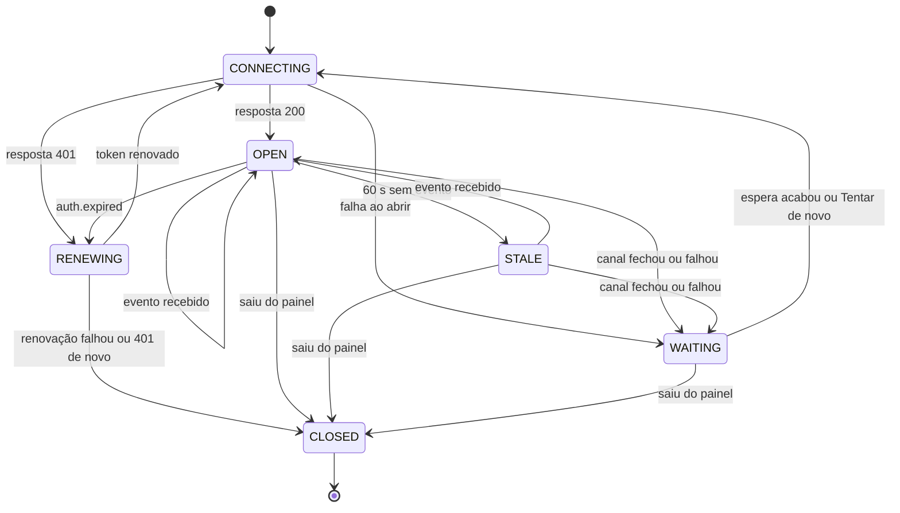

# Especificação funcional — U9 Painel e navegação

Unit `u9-dashboard`, kind `ui`, definida em [unit-of-work.md](../../../inception/units-generation/unit-of-work.md). Implementa as histórias US5.3 (painel com o resumo dos bots) e US5.4 (P&L e avisos de dados sem recarregar) de [stories.md](../../../inception/user-stories/stories.md), atribuídas a esta Unit em [unit-of-work-story-map.md](../../../inception/units-generation/unit-of-work-story-map.md), e os requisitos FR12.1, FR12.2 e NFR1 de [requirements.md](../../../inception/requirements-analysis/requirements.md). As escolhas vêm das respostas Q1 a Q9 de [functional-design-questions.md](functional-design-questions.md).

Esta é uma Unit só de interface e não tem entidades próprias, por isso não há `entities.md`: os dados vêm das rotas e do canal listados abaixo. Este documento é a fonte da verdade dos fluxos e das transições de tela; as regras ficam em [rules.md](rules.md), que é a fonte da verdade delas e é lido pela verificação de rastreabilidade. A hierarquia de componentes, estados locais e textos estão em [frontend-components.md](frontend-components.md).

## Escopo

Entra nesta Unit:

- A tela S2 (Painel) do app do convidado, que passa a ser a primeira tela depois da entrada e a rota `/`.
- A casca única das telas logadas S2 a S8 (cabeçalho, menu geral, carteira abreviada, regiões nomeadas e região de avisos), usada também pelas telas das Units U3, U4, U5 e U7.
- O cliente do canal ao vivo do painel (C7) no app do convidado.

Fica fora (fronteira de [unit-of-work.md](../../../inception/units-generation/unit-of-work.md)):

- Nenhuma rota, tabela, marca ou evento novo no backend. O painel só lê e só usa um comando que já existe.
- O painel não calcula P&L, não soma valores de bots e não altera bots além do comando `pause`.
- As telas S1 (convite e entrada) e S9 (diálogo de feedback) mantêm o próprio layout; o botão "Feedback" e o diálogo continuam da U8.

Componentes do catálogo de [components.md](../../../inception/domain-design/components.md): só o GuestWebApp (painel e menu geral). Interfaces lidas, todas de [contract-summary.md](../../../inception/contract-design/contract-summary.md):

| Contrato | Dono | Uso pela U9 |
|---|---|---|
| C4 `GET /api/v1/bots?state=…` | U5 | Lista e contagens dos bots da pessoa por estado (`items`, `nextCursor`, `activeCount`, `activeLimit`) |
| C4 `POST /api/v1/bots/{botId}/commands/pause` | U5 | Atalho "Pausar", com `Idempotency-Key` |
| C5 `GET /api/v1/bots/{botId}/trades?limit=1` | U7 | Última ordem de cada bot, ao abrir |
| C5 `GET /api/v1/pnl?from&to` | U7 | P&L simulado do dia UTC |
| C5 `GET /api/v1/reconciliation` | U7 | Resumo da última conferência |
| C2 `GET /api/v1/scanner/tokens?limit=1` | U4 | Estado das fontes (`sources`) quando o canal não abre |
| C3 `GET /api/v1/account` | U3 | Carteira abreviada da casca (`walletAddressMasked`) |
| C1 `POST /api/v1/auth/refresh` | U1/U3 | Renovar o token depois de `auth.expired` |
| C7 `GET /api/v1/stream/dashboard` | U5 | Canal ao vivo: `bot.state`, `trade.recorded`, `pnl.updated`, `data.status`, `heartbeat`, `auth.expired` |

## Fluxos

### F1 — Abrir o painel (BR1.1, BR1.2, BR1.4, BR6.5, BR6.7)

1. A pessoa entra (U1/U3) sem tela de origem pendente, ou abre `/`. O app mostra a casca e o painel com os três quadros em carregando (marcadores só dentro de cada quadro, CT-UX-2).
2. O foco vai para o título do primeiro quadro, "Bots PAPER" (wireframe S2).
3. Em paralelo, cada quadro chama a própria rota:
   - Bots: `GET /api/v1/bots?state=<estado>&limit=100` para cada estado (`ACTIVE`, `PAUSED`, `CLOSING_PENDING`, `DRAFT`, `VALIDATED` e `STOPPED`), seguindo `nextCursor` até `null` em cada um, porque a rota não garante `total` (BR1.5). `activeLimit` vem dessas respostas. Com a lista, a última operação busca `GET /api/v1/bots/{botId}/trades?limit=1` dos bots que não são rascunho (no máximo 3 chamadas ao mesmo tempo).
   - P&L: `GET /api/v1/pnl` com o período do dia UTC (BR3.1) e `GET /api/v1/reconciliation`.
   - Avisos de dados: aguardam o primeiro `data.status` do canal por até 5 s; sem ele, chamam `GET /api/v1/scanner/tokens?limit=1` e usam `sources`.
4. O canal ao vivo abre ao mesmo tempo (F5). Um evento do canal que chega antes da resposta REST do mesmo quadro é guardado e aplicado depois dela, se for mais novo (BR5.2).
5. Cada quadro passa sozinho para pronto, vazio ou erro. Um quadro com erro mostra o que aconteceu e "Tentar de novo", que repete só as chamadas daquele quadro (BR1.2).

### F2 — Ver o resumo dos bots (BR1.3, BR2.1, BR2.3, BR2.4)

1. Sem bot em uso (nenhum `ACTIVE`, `PAUSED` ou `CLOSING_PENDING`), o quadro mostra "Nenhum bot PAPER em uso", "Abrir scanner" e "Criar bot PAPER". Com rascunho, acrescenta "Você tem N rascunhos" e "Continuar rascunho", que abre o primeiro item da primeira página de `GET /api/v1/bots?state=DRAFT` (a rota ordena pela última alteração, mais recente primeiro; BR1.3); só com rascunhos `VALIDATED`, vale o primeiro item de `state=VALIDATED`. Com bots encerrados, acrescenta "N encerrados" com link para a lista.
2. Com bot em uso, o quadro mostra "Ativos: N de 3" e "Pausados: N", uma linha por bot em uso (ativos primeiro, depois pausados, depois em encerramento pendente, cada grupo por nome), a última operação e, abaixo, as contagens de rascunhos e encerrados com link para a lista de bots.
3. Cada linha mostra o nome (link para S5), o estado em texto, os motivos de pausa em texto e o horário de retomada automática quando existir (`resumesAt`). Só a linha de um bot `ACTIVE` tem "Pausar".
4. A última operação é a ordem simulada mais recente (`createdAt`) entre todos os bots da pessoa: horário local HH:MM, nome do bot, "Compra" ou "Venda", token abreviado e situação em texto (preenchida, parcial, não preenchida com o motivo, fechamento pendente). Sem ordem nenhuma: "Nenhuma operação ainda".

### F3 — Pausar pelo painel (BR2.2, BR7.3)

1. A pessoa aciona "Pausar" na linha de um bot ativo. Não há confirmação (AC4.8.1).
2. O app gera uma `Idempotency-Key` nova para esse acionamento, desabilita o botão com "Pausando…" e chama `POST /api/v1/bots/{botId}/commands/pause`.
3. `200`: a linha mostra o estado da resposta (`PAUSED`, motivo "pausado por você"); as contagens são recalculadas da lista local; o foco vai para o texto do estado da linha, porque o botão some; a região de avisos anuncia "Bot X pausado por você".
4. Falha técnica (`503`, rede, tempo esgotado): a linha mostra "Não foi possível pausar agora." com "Tentar de novo", que repete com a MESMA chave, para o servidor não criar uma segunda transição.
5. `409 INVALID_TRANSITION` (o bot já mudou de estado): a linha mostra "O bot já não estava ativo." e o quadro busca a lista de novo. `404 NOT_FOUND`: o bot sai da lista e o quadro busca a lista de novo.
6. O `bot.state` seguinte do canal confirma o estado; se ele chegar antes da resposta, a linha já aparece pausada e a resposta só confirma.

### F4 — Ver o P&L simulado do dia (BR3.1 a BR3.5)

1. O quadro "P&L PAPER (simulado)" mostra o rótulo do período, "Hoje (dia UTC, desde HH:MM no seu horário)", em que HH:MM é 00:00 UTC no fuso do navegador.
2. Mostra realizado, não realizado e taxas, cada um com sinal escrito (+ ou −) e unidade. O não realizado `UNKNOWN` aparece como "unknown" com o motivo em texto; com `partial: true`, o quadro diz "Parte das posições está sem preço confiável". Com `empty: true`: "Nenhuma operação hoje".
3. Abaixo, o resumo da reconciliação: "Reconciliado às HH:MM", "N divergências" (link para S6) ou "Ainda não conferido". Uma falha só nessa linha mostra "Reconciliação indisponível agora" com "Tentar de novo", sem esconder os valores do P&L.
4. "Ver P&L" leva à tela S6.
5. A cada `pnl.updated`, o quadro busca de novo P&L e reconciliação (BR3.3). Na virada do dia UTC, o quadro recalcula o período e busca de novo (BR3.1).

### F5 — Receber atualizações sem recarregar (BR5.1 a BR5.6, BR4.1, BR7.1)

1. O app abre `GET /api/v1/stream/dashboard` com `fetch` em leitura contínua e o cabeçalho `Authorization` do token em memória; reabertura leva `Last-Event-ID` com o último `id` recebido.
2. Cada evento recebido atualiza "Atualizado às HH:MM" (horário local do recebimento) e é tratado assim:
   - `bot.state`: o estado e os motivos de cada bot já mostrado que vem no evento são aplicados na hora; em seguida o quadro de bots é buscado de novo pela carga completa de F1 (uma busca por vez, como BR3.3), porque o evento traz no máximo 100 bots de qualquer estado e não traz `activeLimit` nem contagens por estado (BR1.5). Mudanças de estado em relação à lista anterior são anunciadas (BR7.1).
   - `trade.recorded`: a ordem mais nova do evento substitui a última operação se for mais recente que a atual e é anunciada. Como o evento não traz o motivo de uma ordem não preenchida, o quadro busca `GET /api/v1/bots/{botId}/trades?limit=1` desse bot e completa a linha com a `PaperTrade` inteira; até a resposta, a situação aparece sem o motivo (BR2.3).
   - `pnl.updated`: dispara a busca do P&L e da reconciliação (F4 passo 5).
   - `data.status`: substitui o estado das fontes e recalcula os avisos (BR4.1); fonte que ficou atrasada ou voltou é anunciada.
   - `heartbeat`: só confirma que o canal está vivo.
   - `auth.expired`: F6.
3. A mudança feita por um bot aparece na tela em até 60 s depois da gravação (AC5.4.1): o canal lê as marcas a cada 2 s e refaz a leitura completa a cada 60 s (C7, C18).

### F6 — Perder e recuperar o canal ao vivo (BR5.3, BR5.4, BR5.5, BR4.2)

1. Quando o canal fecha ou falha, ou fica 60 s sem evento nenhum (nem `heartbeat`), a faixa de avisos mostra "Os valores podem estar desatualizados; última atualização às HH:MM", com "Tentar de novo", e a região de avisos anuncia a perda.
2. O app tenta reabrir sozinho, esperando 2 s, 4 s, 8 s, 16 s e depois 30 s entre tentativas, sem limite. "Tentar de novo" reabre na hora e busca de novo os três quadros.
3. O canal conta como aberto quando a abertura responde `200` com `text/event-stream` (antes de qualquer evento, porque com as marcas iguais o primeiro evento pode levar até 15 s, o intervalo do `heartbeat`). Nesse momento o aviso some, a espera volta a 2 s, o temporizador de 60 s recomeça e a volta é anunciada ("Atualização automática retomada").
4. Com `auth.expired`, ou com `401` na abertura ou numa reabertura (token vencido durante a espera), o app renova o token por `POST /api/v1/auth/refresh` e reabre com `Last-Event-ID`, sem mostrar aviso se reabrir em até 10 s. Se a renovação falhar, ou se a reabertura logo depois de uma renovação também responder `401`, o app segue o fluxo de sessão expirada da U3 (entrada com retorno ao painel) e o canal fecha, sem novas tentativas (BR5.5).
5. Ao sair do painel (outra tela ou "Sair"), o canal é fechado e nenhuma tentativa fica agendada.

### F7 — Navegar pela casca (BR6.1 a BR6.6)

1. Toda tela logada S2 a S8 usa a mesma casca: o link "Pular para o conteúdo" (já existente), o cabeçalho com o nome do app e "MODO PAPER (simulado)", o menu "Navegação principal" na ordem Painel, Scanner, Bots PAPER, P&L PAPER, Conta, o botão "Feedback" (U8), a carteira abreviada e "Sair".
2. O item da tela atual tem `aria-current="page"`. S4 (assistente) e S5 (bot) marcam "Bots PAPER".
3. A carteira abreviada vem de `GET /api/v1/account` (`walletAddressMasked`), lida uma vez por sessão. Se a leitura falhar, o lugar da carteira mostra "Carteira" sem endereço, e a tela Conta continua mostrando o próprio erro.
4. `/` abre o painel; a entrada sem origem pendente leva ao painel; com origem pendente (sessão expirada), volta para a origem (U3).

## Máquinas de estados

### Quadro (bots, P&L e avisos de dados, cada um com a sua)

| Estado | Entra quando | Sai para |
|---|---|---|
| `LOADING` | O painel abre, ou "Tentar de novo" no erro | `READY`, `EMPTY` ou `ERROR` |
| `READY` | A rota respondeu com dados | `READY` (evento do canal ou nova busca), `ERROR` (nova busca falhou sem dados anteriores) |
| `EMPTY` | Bots: nenhum bot em uso (BR1.3); P&L: `empty: true` | `READY` quando um evento ou nova busca traz dados |
| `ERROR` | A rota falhou e o quadro não tem dados anteriores | `LOADING` ("Tentar de novo") ou `READY` (evento do canal com os dados do quadro) |

Uma nova busca que falha quando o quadro já tem dados mantém os valores, não troca para `ERROR` e deixa que a faixa de avisos diga que os valores podem estar desatualizados (BR1.2, BR4.2).

### Canal ao vivo

<!-- Text fallback: O canal começa em CONNECTING e vai para OPEN quando a abertura responde 200, para WAITING se falhar ao abrir, ou para RENEWING se a abertura responder 401. RENEWING vai para CLOSED também quando a reabertura logo depois da renovação responde 401 de novo. Em OPEN, cada evento mantém OPEN; 60 s sem evento leva a STALE, e um evento volta para OPEN. Canal fechado ou com falha, em OPEN ou STALE, leva a WAITING, que volta a CONNECTING quando a espera acaba ou com "Tentar de novo". auth.expired em OPEN leva a RENEWING, que vai para CONNECTING com o token renovado ou para CLOSED se a renovação falhar. Sair do painel leva qualquer estado aberto a CLOSED. -->

O aviso de valores desatualizados aparece em `STALE`, `WAITING` e em `CONNECTING` depois de uma queda; em `RENEWING` só aparece se a reabertura passar de 10 s.

## Resumo das regras (derivado de rules.md)

O bloco YAML de [rules.md](rules.md) é a fonte da verdade; esta tabela só resume.

| ID | Categoria | Regra | Violação | Origem |
|---|---|---|---|---|
| BR1.1 | policy | O painel é a primeira tela depois da entrada sem origem pendente e é a rota `/`. | Teste de rota falha se `/` levar a outra tela | FR12.1 |
| BR1.2 | policy | Cada quadro carrega pela própria rota e tem o próprio carregando, erro e "Tentar de novo"; a falha de um quadro não esconde nem bloqueia os demais. Uma nova busca que falha num quadro com dados mantém os valores. | O erro aparece só no quadro afetado | AC5.3.3, CT-UX-2, CT-UX-3 |
| BR1.3 | validation | O quadro de bots está vazio quando nenhum bot está em `ACTIVE`, `PAUSED` ou `CLOSING_PENDING`; mostra "Abrir scanner" e "Criar bot PAPER", mais "Você tem N rascunhos" e "Continuar rascunho" (primeiro item de `state=DRAFT`, senão de `state=VALIDATED`, pela ordem da rota) quando há rascunho, e a contagem de encerrados. | — | AC5.3.1, Q4 |
| BR1.4 | constraint | Um evento do canal que chega antes da resposta REST do mesmo quadro é guardado e aplicado depois dela; vale o dado mais novo (para bots, o último `bot.state`; para a última operação, o maior `createdAt`). | — | Q9 |
| BR1.5 | calculation | A lista e as contagens do quadro de bots vêm só da carga completa por estado (`GET /bots?state=…` até `nextCursor` nulo); `activeLimit` vem dessas respostas. `bot.state` atualiza na hora os bots já mostrados e dispara uma nova carga completa, uma por vez. | — | AC5.3.2, C4, C7 |
| BR2.1 | policy | O quadro de bots mostra "Ativos: N de 3" e "Pausados: N" e uma linha por bot em uso, com nome, estado em texto, motivos de pausa em texto e retomada automática quando houver; só bots `ACTIVE` têm "Pausar". Rascunhos e encerrados aparecem só como contagem com link para a lista. | — | AC5.3.2, Q2 |
| BR2.2 | policy | "Pausar" manda `pause` de C4 sem confirmação, com uma `Idempotency-Key` nova por acionamento e a mesma chave ao repetir aquele acionamento; o botão fica desabilitado enquanto espera. `409` busca a lista de novo; `404` tira o bot da lista; falha técnica oferece "Tentar de novo". | Uma segunda transição não pode nascer de um clique repetido | AC5.3.2, AC4.8.1 |
| BR2.3 | calculation | A última operação é a ordem de maior `createdAt` entre todos os bots da pessoa que não são rascunho, tanto ao abrir (`trades?limit=1` por bot) quanto pelo `trade.recorded`; depois de um `trade.recorded`, a linha é completada com `trades?limit=1` daquele bot para ter o motivo de não preenchimento; sem nenhuma, "Nenhuma operação ainda". | — | AC5.3.2, Q1 |
| BR2.4 | constraint | Estado, motivo de pausa, lado e situação da ordem sempre aparecem em texto, nunca só por cor ou ícone; os textos dos motivos são os mesmos da tela do bot (U5). | — | CT-UX-7 |
| BR3.1 | calculation | O período do P&L do painel é `from` = 00:00 UTC do dia corrente e `to` = agora (relógio do app); o rótulo mostra o início do dia no fuso do navegador. Na virada do dia UTC com o painel aberto, o período é recalculado e o P&L buscado de novo. | — | FR12.1, Q3 |
| BR3.2 | validation | O não realizado `UNKNOWN` aparece como "unknown" com o motivo, nunca como zero; com `partial: true` o quadro diz que parte das posições está sem preço confiável; com `empty: true`, "Nenhuma operação hoje". | Teste "unknown nunca zero" falha | FR4.4, AC5.1.3 |
| BR3.3 | policy | Cada `pnl.updated` busca de novo P&L e reconciliação; só uma busca fica em andamento, e avisos que chegam durante ela geram uma única busca depois dela. | — | AC5.4.1 |
| BR3.4 | policy | O resumo da reconciliação mostra "Reconciliado às HH:MM" (`RECONCILED`), "N divergências" com link para S6 (`DIVERGENT`) ou "Ainda não conferido" (`PENDING`); a falha dessa leitura aparece só na linha da reconciliação. | — | Q5 |
| BR3.5 | constraint | Valores monetários e quantidades chegam como texto decimal e são mostrados sem conversão para ponto flutuante, com sinal escrito e unidade. | Teste de formatação com valores de muitas casas falha | project.md (Forbidden), CT-UX-7 |
| BR4.1 | validation | Para cada fonte com `status` diferente de `OK`, ou com `lastUpdatedAt` mais antigo que 5 minutos no relógio do app (conferido a cada 30 s), a faixa de avisos mostra o nome da fonte e o horário da última atualização; com todas em dia, mostra "Dados: OK HH:MM". | — | AC5.4.2, NFR1 |
| BR4.2 | policy | A faixa de avisos mostra "Os valores podem estar desatualizados; última atualização às HH:MM" quando o canal está em `STALE` ou `WAITING`, ou em `CONNECTING` depois de uma queda, com "Tentar de novo"; HH:MM é o horário do último evento ou resposta recebida com sucesso. | — | AC5.4.3 |
| BR5.1 | constraint | O canal abre com `fetch` em leitura contínua e o cabeçalho `Authorization`; nunca com `EventSource` e nunca com o token na URL. | Revisão de código e teste do cliente | C7, project.md (Corrections) |
| BR5.2 | policy | Todo evento recebido atualiza "Atualizado às HH:MM"; `bot.state` aplica BR1.5, `trade.recorded` aplica BR2.3, `pnl.updated` aplica BR3.3, `data.status` aplica BR4.1. Os eventos seguem os envelopes da seção "Formato dos eventos do canal"; um evento fora do formato é descartado com registro de aviso, sem fechar o canal. | — | AC5.4.1, FR12.2 |
| BR5.3 | policy | Depois de uma queda, o canal reabre sozinho esperando 2, 4, 8, 16 e depois 30 s entre tentativas, sem limite, sempre com `Last-Event-ID`. O canal conta como aberto na resposta `200` da abertura, quando a espera volta a 2 s e o temporizador de 60 s recomeça. "Tentar de novo" reabre na hora e busca de novo os três quadros. | — | Q8 |
| BR5.4 | validation | O canal está em `STALE` quando passam 60 s desde a abertura ou desde o último evento, `heartbeat` incluído. | — | AC5.4.3, C7 |
| BR5.5 | policy | `auth.expired`, ou `401` na abertura ou numa reabertura, renova o token por C1 e reabre com `Last-Event-ID`; a falha da renovação, ou um novo `401` logo depois dela, leva ao fluxo de sessão expirada da U3, com retorno ao painel, e fecha o canal sem novas tentativas. | — | C7, US1.3 |
| BR5.6 | constraint | Sair do painel fecha o canal e cancela tentativas agendadas; nenhuma reabertura acontece fora do painel. | — | C7 |
| BR6.1 | policy | Toda tela logada S2 a S8 usa a casca única com o menu Painel, Scanner, Bots PAPER, P&L PAPER e Conta, nessa ordem, mais "Feedback", a carteira abreviada e "Sair". | — | Mockups (navegação principal), Q6 |
| BR6.2 | constraint | O item da tela atual tem `aria-current="page"`; S4 e S5 marcam "Bots PAPER". Telas que são um item do menu têm h1 igual ao texto do item. | — | CT-UX-9 |
| BR6.3 | constraint | A casca tem regiões nomeadas: navegação ("Navegação principal"), conteúdo principal (`#conteudo`) e avisos ("Avisos", anunciada sem mover o foco). | — | CT-UX-9, CT-UX-8 |
| BR6.4 | constraint | A carteira da casca é o `walletAddressMasked` de C3 (4 primeiros e 4 últimos caracteres), lido uma vez por sessão; o endereço completo nunca aparece. | — | NFR7, AC7.3.2 |
| BR6.5 | policy | O foco inicial do painel vai para o título do primeiro quadro, "Bots PAPER". | — | Wireframe S2, CT-UX-4 |
| BR6.6 | constraint | Todo título de quadro de bots e de P&L traz "MODO PAPER (simulado)" em texto. | — | DP-4 |
| BR7.1 | policy | A região de avisos anuncia só: bot que mudou de estado (nome, estado novo e motivo), ordem nova, fonte que ficou atrasada ou voltou, perda e volta da atualização automática e o resultado de "Pausar". Não anuncia `heartbeat`, leitura completa sem mudança nem "Atualizado às HH:MM". | — | CT-UX-8, Q7 |
| BR7.2 | constraint | Mudanças recebidas em até 2 s uma da outra viram um único anúncio. | — | CT-UX-8 |
| BR7.3 | constraint | Nenhuma atualização automática move o foco; quando o botão focado some (bot pausado), o foco vai para o texto do estado daquela linha. | — | CT-UX-4, CT-UX-8 |
| BR8.1 | authorization | O painel nunca manda identificador de tenant ou de pessoa; tudo vem do token, e um bot de outra pessoa responde `404` (tratado como em BR2.2). | Teste negativo entre tenants das rotas lidas | DP-1, FR2.1 |
| BR8.2 | constraint | Nenhum texto do painel promete lucro; os valores são sempre chamados de simulados. | — | project.md (Forbidden), C-16 |

## Formato dos eventos do canal

O OpenAPI de C7 descreve o corpo como `string`, e o [contract-summary.md](../../../inception/contract-design/contract-summary.md) cita os esquemas de C4, C5 e C2 sem os envelopes. Os envelopes abaixo são os que a implementação da U5 (`DashboardMarkPoller`) envia hoje; o campo `data` de cada evento é JSON.

| Evento | `data` | Uso no painel |
|---|---|---|
| `bot.state` | `{ items: BotSummary[], activeCount }`, no máximo 100 bots de qualquer estado, mais recentes primeiro | BR1.5 |
| `trade.recorded` | `{ items: [{ orderId, botId, side, chain, tokenMint, status, createdAt }] }`, sem preços nem `notFilledReason` | BR2.3 |
| `pnl.updated` | `{ ledgerMark }` | BR3.3 |
| `data.status` | `{ items: SourceStatus[] }` | BR4.1 |
| `heartbeat` | `{ at }` | BR5.4 |
| `auth.expired` | `{ expiredAt }` | BR5.5 |

O `id` de cada evento tem a forma `b<marca>.l<marca>.s<marca>` e só é devolvido em `Last-Event-ID`, nunca interpretado pelo app.

Para seguir a regra do `team.md` de tipos gerados do contrato, a geração de código desta Unit acrescenta ao OpenAPI gerado os esquemas desses seis envelopes (anotações de documentação no controlador do canal da U5, sem mudar rota, comportamento nem formato) e registra o acréscimo no [contract-summary.md](../../../inception/contract-design/contract-summary.md), em C7. É só documentação de um formato que já existe; a U9 continua sem rota nem tabela nova.

## Cenários de borda

| Cenário | Resultado esperado | Regras |
|---|---|---|
| Pessoa com 120 bots encerrados e 2 ativos | A carga por estado traz os 2 ativos e conta os 120 encerrados percorrendo as páginas; um `bot.state` com 100 itens não muda as contagens até a nova carga completa | BR1.5 |
| Token vence enquanto o canal espera para reabrir | A reabertura responde `401`; o app renova e reabre; se a renovação falhar, entrada com retorno ao painel e nenhuma nova tentativa | BR5.5 |
| Reabertura com as marcas iguais | O aviso some na resposta `200`, sem esperar o `heartbeat` | BR5.3 |
| `trade.recorded` de uma ordem não preenchida | A linha aparece com "não preenchida" e, depois de `trades?limit=1`, com o motivo | BR2.3 |
| Pessoa com 3 bots ativos e 2 pausados, um deles por perda diária e sistema ao mesmo tempo | "Ativos: 3 de 3", "Pausados: 2"; a linha pausada mostra os dois motivos em texto | BR2.1, BR2.4 |
| Dois cliques rápidos em "Pausar" | O segundo não acontece (botão desabilitado); se a primeira chamada falhar por rede, "Tentar de novo" reusa a mesma chave | BR2.2 |
| "Pausar" num bot que o ciclo acabou de pausar por perda diária | `409 INVALID_TRANSITION`; "O bot já não estava ativo." e a lista é buscada de novo | BR2.2 |
| Kill switch ligado com o painel aberto | O `bot.state` chega em até 60 s com o motivo "sistema"; a mudança é anunciada | BR5.2, BR7.1 |
| P&L com uma posição sem preço confiável | Não realizado "unknown" com o motivo e o aviso de parte sem preço; realizado e taxas continuam com valor | BR3.2 |
| Painel aberto às 20:59 em Brasília (23:59 UTC) | Às 21:00 o rótulo passa para "desde 21:00" do novo dia e o P&L é buscado de novo | BR3.1 |
| Rota de P&L responde `503` ao abrir | Só o quadro de P&L mostra erro com "Tentar de novo"; bots e avisos aparecem | BR1.2 |
| Canal cai e a rede volta depois de 3 minutos | Aviso de valores desatualizados com o horário do último evento; tentativas a 2, 4, 8, 16, 30, 30… s; no primeiro evento o aviso some e a volta é anunciada | BR4.2, BR5.3 |
| Token vence com o painel aberto | `auth.expired`, renovação e reabertura sem aviso; se a renovação falhar, entrada com retorno ao painel | BR5.5 |
| Fonte B sem atualização há 6 minutos com `status: OK` | Aviso nomeando a fonte B e o horário da última atualização | BR4.1 |
| Rajada de `trade.recorded` e `bot.state` no mesmo segundo | Um único anúncio com as mudanças | BR7.1, BR7.2 |
| Pessoa só com rascunhos | Estado vazio com "Você tem N rascunhos" e "Continuar rascunho" | BR1.3 |
| `bot.state` chega antes da resposta de `GET /bots` | O evento é aplicado depois da resposta e prevalece | BR1.4 |

## Testes que esta Unit precisa ter

A estratégia de testes do workflow é `Comprehensive`; o painel é interface, então vale o test-after do `team.md` (o núcleo financeiro não está nesta Unit). Os testes do frontend usam relógio falso e respostas simuladas do contrato gerado, sem rede real.

- Rota `/` e entrada levam ao painel (BR1.1).
- Cada quadro com carregando, pronto, vazio e erro, e erro isolado num quadro com os outros visíveis (BR1.2, BR1.3).
- "Pausar": sucesso, `409`, `404`, falha técnica com a mesma chave na repetição e foco depois de pausar (BR2.2, BR7.3).
- Última operação escolhida pelo maior `createdAt` entre bots e trocada por `trade.recorded` mais novo, nunca por um mais antigo (BR2.3, BR1.4).
- `unknown` no não realizado nunca mostrado como zero; formatação decimal sem ponto flutuante (BR3.2, BR3.5).
- Período do dia UTC e virada à meia-noite UTC com relógio falso (BR3.1).
- Coalescência das buscas de P&L com vários `pnl.updated` seguidos (BR3.3).
- Cliente do canal: leitura do formato `text/event-stream` em pedaços, `Last-Event-ID` na reabertura, aberto na resposta `200`, espera crescente, `STALE` em 60 s, `auth.expired` e `401` na abertura com renovação, com falha da renovação e com `401` de novo depois dela, evento fora do formato descartado, fechamento ao sair (BR5.1 a BR5.6).
- Carga completa por estado com várias páginas e `bot.state` truncado sem mudar as contagens (BR1.5); "Continuar rascunho" no primeiro item de `state=DRAFT` (BR1.3).
- Avisos de fonte por `status` e por idade acima de 5 minutos (BR4.1).
- Anúncios: o que é e o que não é anunciado, e a junção em 2 s (BR7.1, BR7.2).
- Casca: ordem do menu, `aria-current`, regiões nomeadas e carteira abreviada em todas as telas S2 a S8 (BR6.1 a BR6.4).
- Smoke de ponta a ponta: entrar com a conta de teste, ver o painel e a última operação aparecer sem recarregar depois de uma ordem gravada pelo worker.
