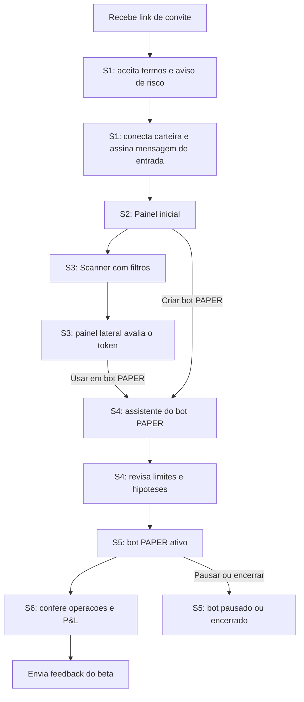

# Fluxos de usuário — MemeTrade Analytics (beta PAPER por convite)

Fluxos do convidado no beta, alinhados ao fluxo de valor do [Scope Document](../scope-definition/scope-document.md) (convite → acesso seguro → descoberta → avaliação → simulação PAPER → conferência de P&L → feedback), às proto-Units Must do [Intent Backlog](../scope-definition/intent-backlog.md) e ao público e limites do [Intent Statement](../intent-capture/intent-statement.md). As telas citadas (S1 a S7) estão em [wireframes.md](wireframes.md).

## Fluxo principal



<!-- Text fallback: O convidado recebe o link, aceita termos e aviso de risco, conecta a carteira assinando uma mensagem de entrada e chega ao Painel. Do Painel vai ao Scanner, filtra e avalia um token no painel lateral. Pelo botão "Usar em bot PAPER" (ou "Criar bot PAPER" no Painel) abre o assistente, revisa limites e hipóteses e inicia o bot. Com o bot ativo, confere operações e P&L e envia feedback. A qualquer momento pode pausar ou encerrar o bot. -->

## F1 — Entrar no beta

```
Fluxo: Entrar no beta
Persona: trader convidado no Brasil, já usa carteira Solana
Gatilho: abre o link de convite
Passos:
  1. S1 -> confere o convite -> convite reconhecido como válido
  2. S1 -> marca termos e aviso de risco -> botão de conectar fica disponível
  3. S1 -> escolhe a carteira e assina a mensagem de entrada -> sessão iniciada
  4. S2 -> vê o Painel (vazio no primeiro acesso, com atalhos)
Resultado: convidado autenticado, carteira associada, nenhuma autorização de operação concedida
Caminhos de erro:
  - convite expirado ou já usado -> mensagem em S1 -> pedir novo convite ao responsável
  - assinatura recusada ou expirada -> mensagem em S1 -> tentar de novo
  - carteira não instalada -> orientação para instalar Phantom ou Solflare -> voltar a S1
```

## F2 — Descobrir e avaliar um token

```
Fluxo: Descobrir e avaliar token
Persona: trader convidado
Gatilho: "Abrir scanner" no Painel ou item Scanner no menu
Passos:
  1. S3 -> ajusta filtros básicos -> lista atualizada com fonte e horário
  2. S3 -> seleciona uma linha -> painel lateral abre sem sair da lista
  3. S3 -> lê avaliação, fatores, riscos e origem de cada dado
  4. S3 -> decide: seguir na lista ou "Usar em bot PAPER"
Resultado: token avaliado com dados rastreáveis; ausências mostradas como unknown
Caminhos de erro:
  - filtros sem resultado -> mensagem em S3 -> "Limpar filtros"
  - fonte atrasada -> aviso com nome e horário -> tokens afetados marcados como desatualizados
  - cobertura insuficiente -> avaliação NO_TRADE com motivo -> usuário segue com outro token
  - todas as fontes fora -> aviso no topo -> "Tentar de novo"
```

## F3 — Criar e iniciar um bot PAPER

```
Fluxo: Criar bot PAPER
Persona: trader convidado
Gatilho: "Criar bot PAPER" no Painel, item Bots PAPER ou "Usar em bot PAPER" no scanner
Passos:
  1. S4 etapa 1 -> define as regras de seleção de tokens (token pré-selecionado se veio do scanner)
  2. S4 etapa 2 -> define os limites (ordem, exposição por token e total, perda diária, slippage, liquidez, pausa)
  3. S4 etapa 3 -> revisa limites e hipóteses da simulação
  4. S4 etapa 4 -> "Iniciar bot PAPER" -> bot ativo
  5. S5 -> acompanha o bot
Resultado: bot PAPER ativo, rotulado como simulado, respeitando os limites definidos
Caminhos de erro:
  - limite inválido ou incoerente -> mensagem no campo -> corrigir antes de continuar
  - falha ao iniciar -> bot fica em rascunho -> tentar de novo em Bots PAPER
  - assistente abandonado -> rascunho salvo -> retomado em Bots PAPER
  - duplo clique em iniciar -> apenas um bot criado
```

## F4 — Acompanhar, pausar e encerrar o bot

```
Fluxo: Controlar bot PAPER
Persona: trader convidado
Gatilho: "Ver bot" no Painel ou item Bots PAPER
Passos:
  1. S5 -> vê estado, uso dos limites e operações simuladas
  2. S5 -> "Pausar" -> nenhuma nova operação simulada; estado PAUSADO
  3. S5 -> "Encerrar" -> confirmação descrevendo as posições simuladas abertas -> estado ENCERRADO
Resultado: o usuário controla o bot a qualquer momento
Caminhos de erro:
  - falha ao pausar ou encerrar -> mensagem e nova tentativa; estado exibido é o confirmado
  - dados atrasados -> aviso de que o bot pode ficar sem operar
  - ordem barrada por limite -> registrada em "Ordens recusadas" com o limite que barrou
```

## F5 — Conferir P&L e reconciliação

```
Fluxo: Conferir P&L PAPER
Persona: trader convidado
Gatilho: "Ver P&L" no Painel ou item P&L PAPER
Passos:
  1. S6 -> escolhe período e bot -> totais realizado, não realizado e taxas
  2. S6 -> vê resultado por token
  3. S6 -> abre a reconciliação -> confere operações contra o ledger
  4. S6 -> abre as hipóteses da simulação
Resultado: cada valor de P&L pode ser rastreado até as operações simuladas e suas premissas
Caminhos de erro:
  - divergência de reconciliação -> aviso destacado -> detalhe das operações divergentes
  - preço sem liquidez -> valor sinalizado ao lado da marcação
  - falha no cálculo -> mensagem; nenhum total parcial exibido como completo
```

## F6 — Sessão e conta

```
Fluxo: Sessão e conta
Persona: trader convidado
Gatilho: item Conta ou sessão expirada
Passos:
  1. S7 -> vê carteira associada, sessão e termos aceitos
  2. S7 -> "Sair" ou "Desconectar"
Resultado: sessão encerrada ou carteira desconectada com consequências explicadas
Caminhos de erro:
  - sessão expirada no meio de um fluxo -> volta a S1 -> após entrar, rascunho de bot é preservado
  - desconectar com bot ativo -> confirmação informando que os bots PAPER serão pausados
```

## Fora destes fluxos no beta

- Trading REAL, autorização de delegação e qualquer assinatura de transação.
- Cobrança, planos e administração ampla.
- Filtros salvos, watchlist, alertas e métricas avançadas (Should, depois de validar o núcleo).
- Uso em celular.
