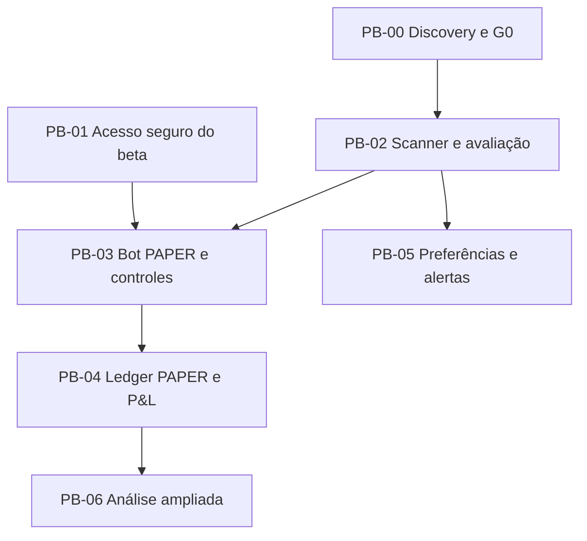

# Backlog inicial da iniciativa — MemeTrade Analytics

Este é um backlog de proto-Unidades para orientar requisitos e decomposição posterior; os IDs não substituem as Units formais da etapa de Units Generation. Priorização MoSCoW baseada no escopo aprovado e no [Intent Statement](../intent-capture/intent-statement.md), com condições da [Feasibility Assessment](../feasibility/feasibility-assessment.md) e do [Constraint Register](../feasibility/constraint-register.md).

## Must Have — beta PAPER por convite

| Proto-Unit | Resultado para o usuário | Dependências | Evidência de conclusão/valor |
|---|---|---|---|
| PB-00 — Discovery e G0 | Convidados confirmam tarefas e critérios do scanner; duas fontes candidatas são comparadas quanto a cobertura, frescor, quotas, custo e licença. | Acesso a participantes e documentação de fornecedores; jurídico para termos e redistribuição. | Tarefas reais documentadas; comparação observada; nenhuma fonte declarada aprovada sem evidência de licença e custo. |
| PB-01 — Acesso seguro do beta | Convidado entra por convite e associa carteira sem expor chave privada; dados de cada conta permanecem isolados. | Decisões de privacidade, identidade, permissões e responsabilidades operacionais. | Fluxo de convite/autenticação validado; acesso cruzado entre contas negado; eventos relevantes auditáveis. |
| PB-02 — Scanner e avaliação | Trader descobre e avalia tokens com origem, frescor, cobertura e campos ausentes explícitos. | PB-00; fontes autorizadas; tarefas e campos prioritários validados. | Pelo menos duas fontes operacionais segundo o critério do PRD ou decisão explícita do responsável sobre impedimento; `unknown` não vira zero; dados e avaliação podem ser rastreados. |
| PB-03 — Bot PAPER e controles | Trader configura, inicia, pausa e encerra simulação com limites; nenhuma operação sai do modo PAPER. | PB-01; PB-02; política de simulação e controles a detalhar. | Testes determinísticos mostram operações simuladas idempotentes, modo claramente identificado e respeito aos limites definidos. |
| PB-04 — Ledger PAPER e P&L | Trader confere resultados simulados e reconcilia cada valor com suas operações e hipóteses de execução. | PB-03; convenções de custos, taxas, precisão e marcação a definir. | Cenários determinísticos reproduzem o P&L; taxas, slippage e divergências ficam visíveis; nenhuma posição PAPER mistura-se com REAL. |

## Should Have — após validar o núcleo

| Proto-Unit | Resultado | Dependências | Prioridade/condição |
|---|---|---|---|
| PB-05 — Preferências e alertas | Salvar filtros/watchlist e receber alertas internos úteis. | PB-02 e validação da demanda com convidados. | Após o fluxo central; revisar prioridade com feedback. |
| PB-06 — Análise ampliada | Explorar métricas avançadas, comparação de estratégias e históricos mais amplos. | Cobertura estável, dados históricos adequados e evidência de uso. | Adiar até confirmar utilidade e custo. |
| PB-07 — Operação ampliada e planos | Gerenciar beta/administração e avaliar quotas/planos pagos. | Responsáveis de operações e jurídico; custos e modelo comercial aprovados. | Depois do beta por convite; cobrança pública continua fora do primeiro beta. |

## Won't Have nesta entrega

| Item | Tratamento | Condição de reconsideração |
|---|---|---|
| Trading REAL automatizado | Excluído do beta inicial; continua desativado. | Nova decisão após delegação limitada/revogável demonstrada, testes de revogação, auditoria/revisão independente, análise jurídica, operação e reconciliação aprovadas e autorização humana específica. |
| Billing público / SaaS aberto | Excluído do beta inicial. | Revisitar depois do aprendizado do beta, estimativas e validação jurídica/comercial. |
| Alavancagem, derivativos, outras chains, copy trading, custódia centralizada, saques administrados e manipulação | Fora de escopo do produto conforme intenção aprovada e PRD. | Exigiria mudança formal de escopo e nova análise. |

## Caminho crítico e sequenciamento

**Leitura em texto:** G0 reduz riscos de fornecedores e valida necessidades antes do scanner; acesso seguro e scanner são pré-requisitos do bot PAPER; operações do bot alimentam ledger e P&L; preferências e análises ampliadas dependem de evidência de uso. PB-07 depende da definição de responsáveis e da revisão comercial/jurídica. Trading REAL não está no grafo de entrega do beta; é uma linha futura sujeita a gates próprios.

## Hipóteses que não são compromissos

- O benefício mais importante pode ser a combinação entre dados transparentes, avaliação e P&L PAPER, mas ainda requer validação com convidados.
- Uma comparação de duas fontes é suficiente para discovery inicial, conforme resposta desta etapa; fornecedores, número final de integrações e contrato seguem pendentes.
- Ordem relativa e esforço dos proto-Unidades serão revistos após Sprint 0, quando houver dados de usuários, licenças, capacidade e custos.
