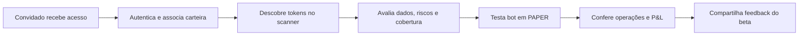

# Definição de escopo — MemeTrade Analytics

## Objetivo e segmento

Entregar a traders convidados no Brasil um beta que permita descobrir e avaliar tokens de Solana, testar estratégias em PAPER e conferir resultados em P&L rastreável. A dor específica, os campos de maior valor e a ordem dos critérios precisam ser validados com os convidados; a pesquisa de mercado não os trata como fatos já demonstrados.

O projeto é greenfield e o plano enterprise organiza o trabalho. Essa classificação de workflow não amplia por si só o escopo do produto.

## MVP do beta convidado

### Must Have

- Acesso por convite e associação segura de uma carteira; autenticação não coleta seed phrase nem equivale a autorização de trading.
- Scanner e avaliação de tokens com fonte, horário de observação, frescor e cobertura visíveis. Dado ausente fica como `unknown`, nunca como zero ou sinal de segurança.
- Avaliação compreensível e rastreável aos dados apresentados; usar NO_TRADE quando cobertura ou dados forem insuficientes. Pesos e qualidade preditiva do score continuam hipóteses a validar, não promessa de detecção de fraude.
- Um fluxo utilizável de bot PAPER, com limites configuráveis e pausa/encerramento acessíveis. O beta não assina nem envia swaps reais.
- Simulação PAPER com hipóteses de spread, slippage, taxas e preenchimentos registradas, para permitir interpretar seus resultados.
- P&L e ledger de PAPER que possam ser reconciliados com as operações simuladas; separar persistentemente resultados PAPER de qualquer dado REAL.
- Isolamento entre tenants, permissões, proteção de dados e trilha de auditoria como base do beta multiusuário, mesmo que a experiência visível seja simples.
- Validação no Gate G0 de ao menos duas fontes candidatas e dos seus termos. O PRD estabelece duas fontes operacionais como critério do scanner; se cobertura ou licença impedir esse resultado, isso volta ao responsável antes de declarar o critério atendido.

### Should Have — após validar o núcleo

- Filtros salvos, watchlist e alertas internos.
- Métricas analíticas avançadas, comparação de estratégias e detalhamento adicional de performance.
- Ferramentas administrativas amplas, quotas de planos pagos e cobrança recorrente. O beta pode permanecer por convite e sem cobrança.

### Fora do primeiro beta

- Trading REAL automatizado, execução com fundos, assinatura de transações pelo produto e implantação de programa on-chain. Uma investigação de viabilidade não libera essas funções. Eventual etapa futura depende de delegação limitada e revogável demonstrada, revisão independente, auditoria, testes de segurança/reconciliação e análise jurídica documentada, além de aprovação humana específica.
- Cobrança pública e abertura irrestrita de SaaS.
- Alavancagem, derivativos, outras blockchains, copy trading, custódia centralizada, saques administrados pela plataforma e manipulação de mercado.

## Fluxo de valor

**Leitura em texto:** convite → acesso seguro → descoberta → avaliação explicável → simulação PAPER → conferência de operações/P&L → feedback. A pausa do bot e o acesso ao histórico devem permanecer disponíveis como controles do fluxo. Os passos refletem capacidades do PRD e a ordem confirmada pelo responsável, não uma arquitetura técnica.

## Sequência por valor e dependência

1. **Sprint 0 — discovery e redução de risco:** entrevistar convidados e observar tarefas; confirmar critérios mínimos do scanner; comparar duas fontes candidatas em leitura; validar limites e licenças; inventariar dados e retenção; mapear capacidade e estimativas; estudar, sem ativar, a viabilidade de delegação para uma possível fase posterior.
2. **Fundação do beta:** acesso por convite/carteira, isolamento de contas e auditoria. É pré-requisito para uma disponibilização multiusuário.
3. **Descoberta e avaliação:** scanner, cobertura, frescor, proveniência e critérios de avaliação alinhados ao discovery. Depende do resultado do G0 e da permissão de uso dos dados.
4. **PAPER e P&L:** bot PAPER, controles e simulação alimentam ledger e P&L; validar a reconciliação antes de convidar usuários para avaliar resultados.
5. **Incrementos posteriores:** filtros salvos, alertas e métricas avançadas conforme feedback. REAL e billing seguem gates separados e não fazem parte da sequência comprometida do primeiro beta.

Esta sequência concretiza as decisões anteriores: discovery e avaliação precedem a automação na construção; PAPER/P&L integram o beta convidado; não há data externa obrigatória e as estimativas serão revistas após Sprint 0.

## Critérios de sucesso e validação

- Cada operação PAPER deve ter chave de idempotência e aparecer uma única vez como operação independente.
- O scanner deve mostrar fonte e atualização e distinguir campo ausente de zero; a cobertura mínima por fonte será validada no G0 e com tarefas de usuários.
- Cada P&L PAPER deve poder ser confrontado com os registros das operações simuladas; divergências devem ser sinalizadas, não escondidas.
- Nenhuma ordem PAPER pode exceder os limites definidos pelo usuário; a ação de pausa precisa impedir novas operações simuladas do bot.
- Entrevistas/tarefas com convidados devem confirmar se a proposta resolve uma dificuldade real e quais sinais e critérios são úteis. Não há meta de adoção aprovada ainda.
- Métricas de disponibilidade e latência serão observadas por provedor; limites numéricos serão definidos quando houver baseline e estimativa de capacidade.

## Restrições, dependências e decisões em aberto

- [Feasibility Assessment](../feasibility/feasibility-assessment.md) conclui que discovery e PAPER são condicionalmente viáveis, enquanto SaaS aberto e REAL carecem de validações.
- [Constraint Register](../feasibility/constraint-register.md) mantém em aberto fornecedores, licença de redistribuição, conta AWS, região, orçamento, retenção, enquadramento jurídico e responsáveis humanos.
- [Intent Statement](../intent-capture/intent-statement.md) é a fonte das decisões de público, primeira disponibilização, exclusões e ausência de data obrigatória.
- Sem contratação ou compromisso financeiro nesta etapa. A priorização não seleciona fornecedor nem região.
- Não há responsável nomeado para operações, segurança, jurídico ou auditoria externa; esses papéis são dependências antes do beta e condições obrigatórias antes de REAL.

## Premissas e limites da estimativa

- A primeira validação ocorre com convidados brasileiros que já conhecem Solana e carteiras digitais.
- A capacidade disponível para desenvolver e operar o produto ainda precisa ser mapeada na Sprint 0.
- O horizonte, orçamento, número de convidados e níveis de serviço não foram fixados. Não se inferem prazo, custo ou volume a partir das estimativas ilustrativas do roadmap do PRD.
- A necessidade do scanner, a qualidade dos sinais e o benefício do fluxo integrado continuam hipóteses até validação com usuários.
