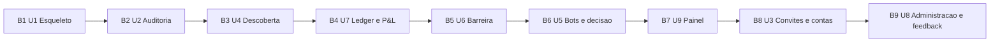

# Plano de Bolts — MemeTrade Analytics (beta PAPER por convite)

Um **Bolt** é uma passada de construção sobre uma parte do trabalho, do design ao código, que termina em algo que roda e é verificado. Este plano ordena os Bolts que constroem as 9 Units de [unit-of-work.md](../units-generation/unit-of-work.md), respeitando o grafo de [unit-of-work-dependency.md](../units-generation/unit-of-work-dependency.md), as histórias de [unit-of-work-story-map.md](../units-generation/unit-of-work-story-map.md) e [stories.md](../user-stories/stories.md), os requisitos de [requirements.md](../requirements-analysis/requirements.md), os componentes de [components.md](../domain-design/components.md), as telas de [mockups.md](../refined-mockups/mockups.md), os contratos de [contract-summary.md](../contract-design/contract-summary.md) e as práticas de [team-practices.md](../practices-discovery/team-practices.md). As escolhas vêm de [delivery-planning-questions.md](delivery-planning-questions.md). A justificativa da ordem está em [risk-and-sequencing-rationale.md](risk-and-sequencing-rationale.md).

## Regras do plano

- **Um Bolt por Unit** (Q3): 9 Bolts, B1 a B9.
- **Um Bolt por vez** (Q4): cada Unit passa por todas as etapas de construção que se aplicam a ela (design funcional, requisitos e design não funcionais, infraestrutura e código) e termina num ponto de controle verificado antes do próximo Bolt.
- **Esqueleto primeiro**: o primeiro Bolt é o **esqueleto de ponta a ponta** (walking skeleton), a menor fatia que atravessa navegador, app web, API e banco e funciona de verdade (`team.md`). Ele é também a primeira Unit do grafo (U1).
- **Integração**: cada Bolt roda numa cópia própria do repositório criada a partir de `main` e entra em `main` por squash-merge num único commit com o nome do Bolt; nenhum merge com a CI vermelha (`team.md`).
- **Testes**: TDD no núcleo financeiro (U5 nas regras de pausa, U6, U7); nas demais camadas, testes logo depois de cada camada; piso de 80% de cobertura de linhas separado no backend e no frontend; testes obrigatórios por risco do `team.md` sempre verdes.
- **Pronto comum a todos os Bolts**: testes da Unit e de todas as anteriores verdes; smoke de ponta a ponta verde; cobertura no piso; varreduras de segredos, dependências e SAST sem achado Crítico ou Alto; critérios DP-1 a DP-4 e CT-UX-1 a CT-UX-9 de [stories.md](../user-stories/stories.md) para o que a Unit entrega; contrato gerado igual ao versionado.

## Sequência

| Ordem | Bolt | Unit | Histórias | Esqueleto | Tamanho |
|---|---|---|---|---|---|
| 1 | B1 | U1 `u1-walking-skeleton` | US2.1, US1.2, US1.4 | Sim | L |
| 2 | B2 | U2 `u2-audit-trail` | US7.3 | Não | S |
| 3 | B3 | U4 `u4-discovery` | US2.2, US2.3, US2.4, US3.1, US3.2 | Não | L |
| 4 | B4 | U7 `u7-ledger-pnl` | US4.11, US4.6 (idempotência), US4.12 (fechamento), US5.1, US5.2 | Não | L |
| 5 | B5 | U6 `u6-risk-control` | US4.6 (barreira), US4.7 (verificação) | Não | M |
| 6 | B6 | U5 `u5-bots-decision` | US4.1 a US4.5, US4.7 (pausa), US4.8, US4.9, US4.10, US4.12 (estado), US7.2 (motivo de sistema) | Não | XL |
| 7 | B7 | U9 `u9-dashboard` | US5.3, US5.4 | Não | S |
| 8 | B8 | U3 `u3-identity-access` | US1.1, US1.3, US1.5, US7.1 (regras) | Não | M |
| 9 | B9 | U8 `u8-admin-feedback` | US7.1 (telas), US7.2, US7.4, US6.1 | Não | M |

A sequência é uma ordem válida do grafo: cada Bolt vem depois de todas as Units de que a sua Unit depende.

<!-- Text fallback: Os Bolts seguem em fila única: B1 (U1, esqueleto), B2 (U2, auditoria), B3 (U4, descoberta), B4 (U7, ledger e P&L), B5 (U6, barreira), B6 (U5, bots e decisão), B7 (U9, painel), B8 (U3, convites e contas), B9 (U8, administração e feedback). -->

## Bolts

### B1 — Esqueleto de ponta a ponta (U1) — esqueleto

- **Unit:** U1 `u1-walking-skeleton`.
- **O que prova da arquitetura:** que navegador, app web Next.js, API Spring Boot e PostgreSQL sobem juntos no Docker Compose do Windows; que o adaptador de mercado simulado entrega valores com fonte, horário e `unknown` até a tela; que o login por assinatura de carteira emite sessão sem autorizar trading; que a auditoria grava pela tabela de saída com a interface final (C9); que a CI com portões de segurança e cobertura funciona desde o primeiro commit.
- **Pré-requisitos:** Docker Desktop funcionando (Q9); `master` renomeado para `main`; varredura única de segredos da árvore atual e `.claude/settings.local.json` ignorado antes do primeiro commit (`team.md`).
- **Definição de pronto:** pronto comum; o script de verificação sobe o ambiente, espera os serviços ficarem saudáveis, roda o smoke e devolve código diferente de zero em qualquer falha; o smoke entra com a conta `BETA_USER` semeada só no perfil de teste (OQ-8 de [contract-summary.md](../contract-design/contract-summary.md)) e confere fonte, horário e `unknown` na lista; testes de login sem reutilização de assinatura e de `unknown` nunca zero verdes; os achados do contrato que tocam a U1 resolvidos no seu design funcional: credenciais de CORS no `verify` (R-10), evento de recusa sobrevivendo ao desfazer da transação (R-13) e idempotência sem guardar token (R-18).
- **Hipótese de confiança:** "a fatia inteira roda e é verificada por um único comando no Windows e na CI em Linux com o mesmo resultado".
- **Demonstração:** abrir o app do convidado, assinar com a carteira de teste, ver a lista do scanner com fonte simulada, horário e um campo `unknown` distinto de zero; rodar o script de verificação e ver código de saída zero.

### B2 — Trilha de auditoria (U2)

- **Unit:** U2 `u2-audit-trail`.
- **Definição de pronto:** pronto comum; relay da tabela de saída gravando cada evento uma vez, inclusive com eventos vindos do worker em teste de integração; mascaramento de carteira e varredura automática de logs e métricas sem endereço completo, segredo, token, nonce ou assinatura (AC7.3.2, AC7.3.3); eventos sem tenant visíveis só ao administrador.
- **Hipótese de confiança:** "toda ação sensível deixa exatamente um evento, mesmo com queda do processo entre a ação e a gravação na trilha".
- **Demonstração:** derrubar o processo depois do commit de uma ação em teste e ver o evento aparecer na trilha uma única vez quando o relay volta.

### B3 — Descoberta e avaliação (U4)

- **Unit:** U4 `u4-discovery`.
- **Definição de pronto:** pronto comum; dois adaptadores simulados, falha de uma fonte degradando só o que depende dela, marca de desatualizado após 5:00, divergência com tolerância configurável (aceita com fontes simuladas, Q5); filtros com fronteiras inclusivas e contador de `unknown`; indicador de risco determinístico, indisponível abaixo da cobertura mínima e sem texto proibido; SP-1 concluída ou com data registrada pelo responsável (Q5).
- **Hipótese de confiança:** "a pessoa distingue com clareza dado confiável, desatualizado, divergente e ausente, e o indicador nunca trata ausência como segurança".
- **Demonstração:** desligar a fonte B simulada e ver a fonte A continuar com o aviso; filtrar por liquidez e ver o contador de excluídos por `unknown`; abrir o painel lateral de um token sem cobertura e ver "indisponível" com o motivo.

### B4 — Ledger e P&L (U7)

- **Unit:** U7 `u7-ledger-pnl`.
- **Definição de pronto:** pronto comum; testes escritos antes do código a partir das tabelas do design funcional (TDD); gravação atômica de ordem, preenchimento, lançamentos e posição; `UPDATE` e `DELETE` em lançamento falham no banco; correção só por lançamento compensatório; idempotência com conflito para mesma chave e conteúdo diferente; catálogo de cenários de P&L com resultado exato em decimal e unidades de token; `PaperExecution` exige a transação do ciclo (C15); moeda e escala definidas (OQ-3); regra única para bot sem registros (R-11) e interface de leitura para o canal do painel (R-12) definidas no design funcional.
- **Hipótese de confiança:** "o P&L de qualquer sequência de operações simuladas reconcilia exatamente com o ledger, sem ponto flutuante e sem lançamento editável".
- **Demonstração:** rodar o catálogo de cenários de P&L e a conferência de reconciliação com uma divergência injetada por fixture.

### B5 — Barreira de limites (U6)

- **Unit:** U6 `u6-risk-control`.
- **Definição de pronto:** pronto comum; tabela de exemplos de US4.6 e regras de perda diária e drawdown de US4.7 escritas como testes antes do código (TDD); recusa grava motivo e versão dos limites e um único evento "ordem recusada"; rota própria de leitura das recusas (C21); **teste de contrato entre a barreira e o ledger** (C13), cobrindo exposição, perda do dia e patrimônio lidos da U7 (Q8).
- **Hipótese de confiança:** "nenhuma ordem que exceda qualquer limite passa da barreira, nas fronteiras exatas".
- **Demonstração:** rodar a tabela de exemplos com o caso permitido e o recusado de cada limite.

### B6 — Bots e decisão (U5)

- **Unit:** U5 `u5-bots-decision`.
- **Definição de pronto:** pronto comum; regras de pausa, perda diária, meia-noite UTC e encerramento escritas como testes antes do código (TDD); tabela de transições percorrida por inteiro; limite de 3 bots ativos com ativações simultâneas; processo worker com no máximo uma decisão por ciclo e retomada segura após reinício; trava do bot e conferência de pausa na mesma transação que grava a operação (C15, Q16); marca global de pausa de sistema e repetição de falha parcial (R-14) e ordem de travas das marcas de alteração (R-16) definidas no design funcional; canal ao vivo do painel no processo de API (C7); **teste do ciclo completo** decisão → barreira → execução → ledger (Q8); nenhuma chamada ao componente de assinatura com a configuração padrão.
- **Hipótese de confiança:** "um bot PAPER roda sozinho no worker, respeita todos os limites e para de verdade quando pausado, inclusive no meio de um ciclo".
- **Demonstração:** criar um bot pelo assistente, iniciá-lo, ver decisões e operações aparecerem, pausar no meio de um ciclo e ver que nenhuma operação nova é criada.

### B7 — Painel e navegação (U9)

- **Unit:** U9 `u9-dashboard`.
- **Definição de pronto:** pronto comum; painel como primeira tela, estado vazio com atalhos, quadro de bots com "Pausar", P&L e avisos de dados atualizados sem recarregar em até 60 s com "Atualizado às HH:MM"; falha num quadro não esconde os demais; menu geral com h1 igual ao item de menu.
- **Hipótese de confiança:** "o que o worker faz aparece no painel em até 60 segundos, sem recarregar a página".
- **Demonstração:** com um bot ativo, ver uma operação nova aparecer no painel sem recarregar.

### B8 — Convites, contas e sessões (U3)

- **Unit:** U3 `u3-identity-access`.
- **Definição de pronto:** pronto comum; convite de uso único com validade; conta, carteira, convite e aceite numa única operação, com concorrência no mesmo convite; termos antes de conectar a carteira; sessão que expira e volta à tela de origem; tela Conta; origem do `tenantId` do convite e `Principal` do administrador definidos (R-15).
- **Hipótese de confiança:** "um convidado entra só com convite válido e aceita os termos antes de qualquer vínculo de carteira".
- **Demonstração:** emitir um convite pelo teste, usar o link, aceitar os termos, assinar e cair no painel; repetir o mesmo convite e ver "convite já usado".

### B9 — Administração e feedback (U8)

- **Unit:** U8 `u8-admin-feedback`.
- **Definição de pronto:** pronto comum; app do administrador em endereço separado, sem rotas administrativas no código do convidado; convites, kill switch e estado do sistema só com contagens; kill switch pausando todos os bots ativos, inclusive com decisão em processamento, e desligamento sem retomar bots; feedback de até 2.000 caracteres lido como texto puro.
- **Hipótese de confiança:** "o administrador para toda a simulação com um comando e nunca enxerga dados financeiros dos convidados".
- **Demonstração:** acionar o kill switch com bots ativos e ver todos pausados pelo sistema; tentar ler o ledger de um convidado pela API administrativa e receber 403.

## Comando de verificação da Construction

Cada ponto de controle de Bolt roda um único comando versionado no repositório, autorizado pelo responsável do projeto no fim deste estágio. A proposta é `bash scripts/verify.sh`, que sobe o Docker Compose, espera os serviços ficarem saudáveis, roda os testes de unidade e de integração do backend com PostgreSQL em contêiner e o piso de cobertura, os testes e a cobertura do frontend, a verificação do contrato gerado e o smoke de ponta a ponta, devolvendo código diferente de zero em qualquer falha. Com o Docker Desktop funcionando (Q9), todos esses níveis rodam desde o B1.
