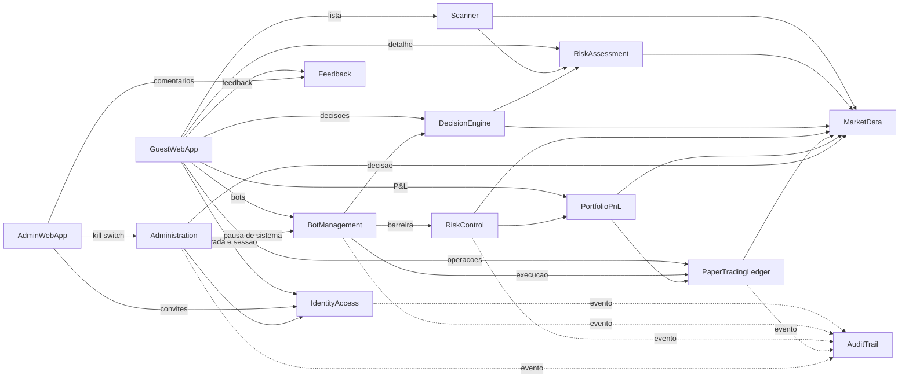

# Componentes — MemeTrade Analytics (beta PAPER por convite)

Blocos lógicos de software do beta, derivados de [requirements.md](../requirements-analysis/requirements.md), das histórias de [stories.md](../user-stories/stories.md) e das práticas de [team-practices.md](../practices-discovery/team-practices.md) (monólito modular organizado por módulo, adaptadores externos atrás de interfaces, `unknown` como tipo explícito, tenant da autenticação). Decisões em [decisions.md](decisions.md); respostas em [domain-design-questions.md](domain-design-questions.md). Topologia de implantação, tecnologia e padrões não funcionais ficam para as etapas seguintes. Nomes de componentes e entidades estão em inglês, conforme a prática de código.

Fora deste catálogo: execução REAL e autorização on-chain (bloqueadas, FR15.3), modelo de sinal com IA (FR8.6), cobrança e planos. A prova de conceito da delegação (SP-5) é investigação, não componente.

## Catálogo

```yaml
components:
  - name: IdentityAccess
    summary: Tenants, usuários, convites, login por assinatura, sessões, carteiras e aceite de termos.
    behaviour: >
      Cria conta só a partir de convite válido, de uso único e dentro da validade, consumindo o convite,
      vinculando a carteira e registrando o aceite de termos numa única operação. Emite nonce de uso único
      com expiração de 5 minutos e verifica domínio, chain, nonce e assinante. A sessão de login nunca
      autoriza trading. Nunca aceita frase secreta nem chave privada. Tenants são compartilhados entre
      usuários, mas o dono de cada dado de negócio é a pessoa; o administrador escolhe o tenant ao convidar.
      A carteira de administrador vem da configuração do ambiente.
    responsibilities:
      - Emitir, listar e revogar convites
      - Emitir desafio de login e verificar assinatura
      - Manter sessões e papéis (usuário beta, administrador)
      - Vincular carteira pública e registrar aceite de termos
      - Fornecer o contexto de autenticação (tenant e usuário) para os demais componentes
    depends_on:
      - component: AuditTrail
        interaction: Publica eventos de login, aceite de termos, convites e recusas
        style: event
    dependents:
      - component: GuestWebApp
        interaction: Entrada, sessão e conta
      - component: AdminWebApp
        interaction: Gestão de convites
      - component: Administration
        interaction: Contagens de convidados e convites para o estado do sistema
    external_dependencies:
      - name: Carteiras Phantom e Solflare (no navegador do usuário)
        kind: third-party-api
        purpose: Assinatura da mensagem de login; nenhuma chave passa pelo sistema
      - name: Banco relacional
        kind: database
        purpose: Persistência de contas, convites, sessões e desafios
    entities:
      - name: Tenant
        identifier: tenantId
        attributes: [name, status, createdAt]
      - name: User
        identifier: userId
        attributes: [tenantId, role, status, createdAt]
        references:
          - entity: Tenant
            owned_by: IdentityAccess
            relationship: cada usuário pertence a um tenant
      - name: Membership
        identifier: membershipId
        attributes: [userId, tenantId, role, joinedAt]
      - name: Invite
        identifier: inviteId
        attributes: [code, tenantId, issuedBy, expiresAt, status, usedByUserId, usedAt]
      - name: Wallet
        identifier: walletId
        attributes: [userId, address, provider, verifiedAt]
      - name: LoginChallenge
        identifier: nonce
        attributes: [walletAddress, domain, chain, issuedAt, expiresAt, usedAt]
      - name: Session
        identifier: sessionId
        attributes: [userId, tenantId, role, createdAt, expiresAt]
      - name: TermsAcceptance
        identifier: acceptanceId
        attributes: [userId, inviteId, termsVersion, acceptedAt]

  - name: AuditTrail
    summary: Registro único e imutável das ações sensíveis do sistema.
    behaviour: >
      Recebe eventos dos demais componentes e grava exatamente um registro por ação, com ator (pessoa,
      administrador ou system), ação, tenant, horário UTC e identificador de correlação. Descarta repetição
      idempotente pelo identificador do evento. Mascara endereços de carteira em qualquer saída fora da
      própria trilha e nunca guarda segredos, tokens de sessão, nonces ou assinaturas.
    responsibilities:
      - Receber e gravar eventos de auditoria sem duplicidade
      - Permitir consulta restrita da trilha
    depends_on: []
    dependents:
      - component: IdentityAccess
        interaction: Eventos de acesso e convites
      - component: BotManagement
        interaction: Eventos de ciclo de vida dos bots
      - component: RiskControl
        interaction: Eventos de ordem recusada
      - component: PaperTradingLedger
        interaction: Eventos de operação simulada e fechamento pendente concluído
      - component: Administration
        interaction: Eventos de kill switch
    external_dependencies:
      - name: Banco relacional
        kind: database
        purpose: Armazenamento append-only da trilha
    entities:
      - name: AuditEvent
        identifier: eventId
        attributes: [tenantId, actor, actorType, action, targetRef, correlationId, occurredAt, details]

  - name: MarketData
    summary: Ingestão, normalização e histórico curto dos dados de mercado com origem e frescor.
    behaviour: >
      Cada fonte fica atrás de um adaptador com contrato comum; no ambiente local a fonte é simulada e
      identificada como tal. Identifica tokens por chain + mint e pools por identificador próprio. Todo valor
      carrega fonte, horário de observação (UTC) e frescor; campo não informado é unknown, nunca zero.
      Marca como desatualizado o valor com mais de 5 minutos, sinaliza divergência entre fontes acima da
      tolerância e degrada só o que depende de uma fonte com falha. Guarda observações pela janela de
      24 horas (proposta inicial) e descarta o restante.
    responsibilities:
      - Integrar fontes por adaptadores (simulados no ambiente local)
      - Normalizar tokens, pools e observações
      - Calcular frescor, cobertura e divergência
      - Expor preço de referência, liquidez e janelas recentes de preço e volume
      - Manter o estado de cada fonte
    depends_on: []
    dependents:
      - component: Scanner
        interaction: Lista de tokens com observações
      - component: RiskAssessment
        interaction: Dados de entrada dos fatores de risco
      - component: DecisionEngine
        interaction: Janelas recentes de preço e volume
      - component: RiskControl
        interaction: Frescor e liquidez no momento da ordem
      - component: PaperTradingLedger
        interaction: Preço de referência e liquidez para o preenchimento simulado
      - component: PortfolioPnL
        interaction: Marcação a mercado
      - component: Administration
        interaction: Estado das fontes para o estado do sistema
    external_dependencies:
      - name: Fontes de dados de mercado (a escolher no G0)
        kind: third-party-api
        purpose: Descoberta, preços, liquidez e holders; simuladas até a aprovação
      - name: Banco relacional
        kind: database
        purpose: Tokens, pools e observações da janela de 24 horas
    entities:
      - name: Token
        identifier: chain + mint
        attributes: [chain, mint, symbol, name, firstSeenAt]
      - name: Pool
        identifier: poolId
        attributes: [tokenMint, venue, address, createdAt]
      - name: MarketObservation
        identifier: observationId
        attributes: [tokenMint, poolId, sourceId, field, value, isUnknown, observedAt]
        references:
          - entity: Token
            owned_by: MarketData
            relationship: cada observação descreve um token
      - name: DataSource
        identifier: sourceId
        attributes: [name, kind, status, lastUpdatedAt]

  - name: Scanner
    summary: Consulta, filtro, ordenação e paginação dos tokens para a tela do scanner.
    behaviour: >
      Combina filtros por idade, liquidez, volume, holders, indicador de risco e origem com fronteiras
      inclusivas. Tokens com o campo filtrado como unknown ficam fora e são contados. Ordena com desempate
      estável e pagina por cursor. Separa atualização de valores no lugar de novidades em espera
      ("Atualizar lista").
    responsibilities:
      - Montar a lista do scanner a partir de dados de mercado e avaliações
      - Aplicar filtros e contar exclusões por unknown
      - Paginar com ordem determinística e informar novidades pendentes
    depends_on:
      - component: MarketData
        interaction: Ler tokens e observações
        style: sync
      - component: RiskAssessment
        interaction: Ler indicador e faixa de cada token
        style: sync
    dependents:
      - component: GuestWebApp
        interaction: Tela do scanner
    entities: []

  - name: RiskAssessment
    summary: Indicador de risco de 0 a 100 por token, com fatores, cobertura e faixa.
    behaviour: >
      Calcula o indicador a partir de fatores ponderados de um conjunto de pesos versionado; mesmo dado de
      entrada e mesma versão de pesos dão o mesmo resultado. Indisponível quando a cobertura fica abaixo do
      mínimo, gerando NO_TRADE; fator unknown nunca conta como risco zero. Classifica em Baixo, Médio, Alto ou
      Indisponível por faixas configuráveis e rotula o indicador como "em validação". Nenhum texto promete
      lucro ou detecção de fraude.
    responsibilities:
      - Calcular e guardar avaliações por token
      - Manter conjuntos de pesos, faixas e cobertura mínima versionados
    depends_on:
      - component: MarketData
        interaction: Ler dados de entrada dos fatores
        style: sync
    dependents:
      - component: Scanner
        interaction: Indicador na lista
      - component: DecisionEngine
        interaction: Avaliação usada nas regras das estratégias
      - component: GuestWebApp
        interaction: Detalhe da avaliação no painel lateral
    entities:
      - name: RiskAssessment
        identifier: assessmentId
        attributes: [tokenMint, score, band, coverage, factors, weightSetVersion, createdAt]
        references:
          - entity: Token
            owned_by: MarketData
            relationship: cada avaliação é de um token
          - entity: RiskWeightSet
            owned_by: RiskAssessment
            relationship: cada avaliação usa uma versão de pesos
      - name: RiskWeightSet
        identifier: version
        attributes: [weights, bandThresholds, minCoverage, activatedAt]

  - name: BotManagement
    summary: Estratégias modelo, ciclo de vida dos bots, limites versionados e coordenação do ciclo de decisão.
    behaviour: >
      Cria bots a partir de duas estratégias modelo, salvando rascunho a cada etapa. Aplica a tabela de
      transições (DRAFT, VALIDATED, ACTIVE, PAUSED, CLOSING_PENDING, STOPPED) e recusa as demais. Só bots
      ACTIVE contam no limite de 3 por pessoa, inclusive com ativações simultâneas; retomar conta como
      ativação. Motivos de pausa se acumulam (pessoa, perda diária, drawdown, sistema); a meia-noite UTC
      remove só o motivo perda diária. Versiona os limites e só permite retomar após perda diária com limite
      maior que a perda acumulada. A cada intervalo, coordena de forma síncrona decisão, controle de risco e
      execução PAPER, com no máximo uma decisão por ciclo e retomada segura após reinício. Pausa bloqueia
      qualquer nova operação, inclusive saídas. Os dados de bot pertencem à pessoa dona, nunca aos demais
      membros do tenant. Recebe da Administração o comando de pausa e liberação do sistema.
    responsibilities:
      - Gerenciar estratégias modelo e parâmetros
      - Gerenciar rascunhos, bots e transições de estado
      - Versionar limites e saldo virtual dentro do teto
      - Coordenar o ciclo decisão → controle de risco → execução PAPER
      - Aplicar e remover motivos de pausa, inclusive o do sistema
    depends_on:
      - component: DecisionEngine
        interaction: Pedir a decisão do ciclo
        style: sync
      - component: RiskControl
        interaction: Submeter a ordem candidata à barreira de limites
        style: sync
      - component: PaperTradingLedger
        interaction: Executar a ordem aprovada e encerrar posições
        style: sync
      - component: AuditTrail
        interaction: Publicar eventos de criação, início, pausa, retomada e encerramento
        style: event
    dependents:
      - component: GuestWebApp
        interaction: Assistente, lista e controle dos bots
      - component: Administration
        interaction: Pausa e liberação do sistema; contagens de bots por estado
    external_dependencies:
      - name: Agendador interno
        kind: other
        purpose: Disparo do ciclo por intervalo de cada bot ativo
      - name: Banco relacional
        kind: database
        purpose: Bots, rascunhos, limites e ciclos
    entities:
      - name: StrategyTemplate
        identifier: templateId
        attributes: [name, description, parameters, ranges, defaults, version]
      - name: Bot
        identifier: botId
        attributes: [tenantId, ownerUserId, name, templateId, parameters, tokenSelection, virtualBalance, state, pauseReasons, draftStep, createdAt]
        references:
          - entity: User
            owned_by: IdentityAccess
            relationship: cada bot pertence a uma pessoa
          - entity: StrategyTemplate
            owned_by: BotManagement
            relationship: cada bot usa uma estratégia modelo
      - name: BotLimitsVersion
        identifier: limitsVersionId
        attributes: [botId, version, maxOrderSize, maxTokenExposure, maxTotalExposure, maxDailyLoss, maxDrawdown, maxSlippage, minLiquidity, minInterval, createdAt]
      - name: BotCycle
        identifier: cycleId
        attributes: [botId, scheduledAt, startedAt, finishedAt, status]

  - name: DecisionEngine
    summary: Decisões determinísticas e explicadas das estratégias modelo.
    behaviour: >
      Aplica as regras da estratégia aos dados de mercado e à avaliação de risco e produz BUY, SELL, HOLD ou
      NO_TRADE com fatores, dados de entrada com horário, versão da estratégia, validade e uma frase simples.
      NO_TRADE é o padrão com dado unknown, desatualizado, histórico insuficiente ou avaliação indisponível;
      SELL sem posição vira NO_TRADE. Não usa modelo de IA no beta. Mesma entrada e mesma versão dão a mesma
      decisão.
    responsibilities:
      - Avaliar as regras das estratégias modelo
      - Registrar decisões explicadas e reproduzíveis
    depends_on:
      - component: MarketData
        interaction: Ler janelas recentes de preço e volume
        style: sync
      - component: RiskAssessment
        interaction: Ler avaliação do token
        style: sync
    dependents:
      - component: BotManagement
        interaction: Decisão do ciclo
      - component: GuestWebApp
        interaction: Lista e detalhe das decisões
    entities:
      - name: Decision
        identifier: decisionId
        attributes: [botId, cycleId, tokenMint, action, strategyVersion, factors, inputs, summary, validUntil, createdAt]
        references:
          - entity: Bot
            owned_by: BotManagement
            relationship: cada decisão é de um bot
          - entity: BotCycle
            owned_by: BotManagement
            relationship: no máximo uma decisão por ciclo

  - name: RiskControl
    summary: Barreira de limites antes de cada ordem simulada.
    behaviour: >
      Verifica tamanho da ordem, exposição por token e total, slippage estimado, liquidez mínima, frescor do
      dado (até 60 segundos), intervalo entre operações, saldo virtual, perda diária realizada do dia UTC com
      taxas e drawdown sobre o maior patrimônio virtual, com fronteiras inclusivas e atingir a perda diária já
      bloqueando. Recusa registra os motivos e a versão dos limites e gera evento de auditoria. Nenhuma ordem
      chega à execução sem passar por aqui.
    responsibilities:
      - Avaliar cada ordem candidata contra os limites vigentes
      - Registrar recusas com motivo e versão dos limites
      - Indicar ao coordenador quando um limite de pausa foi atingido
    depends_on:
      - component: PortfolioPnL
        interaction: Ler exposição, perda do dia, patrimônio e saldo disponível
        style: sync
      - component: MarketData
        interaction: Ler frescor e liquidez no momento da ordem
        style: sync
      - component: AuditTrail
        interaction: Publicar eventos de ordem recusada
        style: event
    dependents:
      - component: BotManagement
        interaction: Barreira do ciclo
    entities:
      - name: OrderRejection
        identifier: rejectionId
        attributes: [botId, decisionId, reasons, limitsVersionId, evaluatedAt]
        references:
          - entity: Decision
            owned_by: DecisionEngine
            relationship: cada recusa se refere a uma decisão
          - entity: BotLimitsVersion
            owned_by: BotManagement
            relationship: cada recusa registra a versão dos limites

  - name: PaperTradingLedger
    summary: Execução simulada, ledger append-only e posições, gravados juntos.
    behaviour: >
      Preenche a ordem aprovada pela política de simulação versionada (spread, impacto, taxas, slippage,
      liquidez) e grava ordem, preenchimento, lançamentos e posição a custo médio ponderado numa única
      operação, ou nada. Deduplica por chave de idempotência por tenant e modo; mesma chave com conteúdo
      diferente é conflito. Ledger append-only, corrigido só por lançamento compensatório; sem correção manual
      no beta. Usa decimal exato e regras de arredondamento documentadas. Nunca assina nem envia transações.
      Encerramento sem preço confiável deixa a posição em fechamento pendente e conclui uma única vez quando o
      preço volta. Dados ficam isolados por pessoa e por modo.
    responsibilities:
      - Simular preenchimentos com hipóteses registradas
      - Gravar ordens, preenchimentos, lançamentos e posições de forma atômica
      - Garantir idempotência e imutabilidade do ledger
      - Fechar posições no encerramento e tratar fechamento pendente
    depends_on:
      - component: MarketData
        interaction: Ler preço de referência e liquidez
        style: sync
      - component: AuditTrail
        interaction: Publicar eventos de operação e de fechamento pendente concluído
        style: event
    dependents:
      - component: BotManagement
        interaction: Execução e encerramento
      - component: PortfolioPnL
        interaction: Leitura de lançamentos e posições
      - component: GuestWebApp
        interaction: Operações simuladas e ledger
    external_dependencies:
      - name: Banco relacional
        kind: database
        purpose: Ordens, lançamentos e posições com gravação atômica e bloqueio de alteração
    entities:
      - name: PaperOrder
        identifier: orderId
        attributes: [tenantId, ownerUserId, botId, decisionId, idempotencyKey, side, tokenMint, quantity, limitsVersionId, status, createdAt]
        references:
          - entity: Bot
            owned_by: BotManagement
            relationship: cada ordem é de um bot
          - entity: Decision
            owned_by: DecisionEngine
            relationship: cada ordem nasce de uma decisão
          - entity: BotLimitsVersion
            owned_by: BotManagement
            relationship: cada ordem registra a versão dos limites
      - name: Fill
        identifier: fillId
        attributes: [orderId, referencePrice, quotedPrice, fillPrice, slippage, fees, simulationPolicyVersion, filledAt]
      - name: LedgerEntry
        identifier: entryId
        attributes: [tenantId, ownerUserId, botId, mode, type, amount, asset, referenceId, compensatesEntryId, createdAt]
      - name: Position
        identifier: positionId
        attributes: [ownerUserId, botId, tokenMint, quantity, costBasis, status, updatedAt]
      - name: SimulationPolicy
        identifier: version
        attributes: [spreadModel, impactModel, feeModel, slippageModel, roundingRules, activatedAt]

  - name: PortfolioPnL
    summary: P&L, exposição, patrimônio e reconciliação calculados a partir do ledger.
    behaviour: >
      Calcula realizado, não realizado e taxas por token, bot e período (filtro no fuso do usuário), com soma
      exata. Posição sem preço confiável tem não realizado unknown e total parcial. Sinaliza preço sem
      liquidez. Fornece exposição, perda realizada do dia UTC, patrimônio virtual e o maior patrimônio já
      atingido para a barreira de risco. Reconcilia operações e ledger e mostra divergências. Só lê o ledger;
      nunca grava lançamentos.
    responsibilities:
      - Calcular P&L e métricas de risco por bot
      - Manter o maior patrimônio virtual de cada bot
      - Executar e registrar a reconciliação
    depends_on:
      - component: PaperTradingLedger
        interaction: Ler lançamentos e posições
        style: sync
      - component: MarketData
        interaction: Marcar posições a mercado
        style: sync
    dependents:
      - component: RiskControl
        interaction: Exposição, perda do dia, patrimônio e saldo
      - component: GuestWebApp
        interaction: Telas de P&L e painel
    entities:
      - name: EquityPeak
        identifier: botId
        attributes: [peakEquity, reachedAt]
      - name: ReconciliationCheck
        identifier: checkId
        attributes: [botId, checkedAt, result, divergenceCount, details]

  - name: Administration
    summary: Kill switch global e estado do sistema para o administrador.
    behaviour: >
      É dono do registro do kill switch (estado, quem, quando, motivo). Ao acionar, pede à gestão de bots a
      pausa de sistema em todos os bots ativos; ao desligar, retira o motivo de sistema, mas os bots continuam
      pausados até cada dono retomar. Monta o estado do sistema só com contagens e estado das fontes, sem
      acesso a ledger, operações ou carteiras. Toda ação gera evento de auditoria. Só administradores acessam.
    responsibilities:
      - Acionar e desligar o kill switch
      - Consolidar o estado do sistema a partir de contagens
    depends_on:
      - component: BotManagement
        interaction: Aplicar e retirar a pausa de sistema; contar bots por estado
        style: sync
      - component: IdentityAccess
        interaction: Contar convidados e convites
        style: sync
      - component: MarketData
        interaction: Ler o estado das fontes
        style: sync
      - component: AuditTrail
        interaction: Publicar eventos do kill switch
        style: event
    dependents:
      - component: AdminWebApp
        interaction: Telas administrativas
    entities:
      - name: KillSwitch
        identifier: killSwitchId
        attributes: [state, changedBy, changedAt, reason]

  - name: Feedback
    summary: Comentários dos convidados sobre o beta.
    behaviour: >
      Recebe comentários de até 2.000 caracteres com a tela de origem e o horário, associados ao tenant e à
      pessoa. Só o administrador lê, sempre como texto puro. Falha ao enviar preserva o texto no cliente.
    responsibilities:
      - Registrar comentários
      - Listar comentários para o administrador
    depends_on: []
    dependents:
      - component: GuestWebApp
        interaction: Envio de feedback
      - component: AdminWebApp
        interaction: Leitura dos comentários
    entities:
      - name: FeedbackEntry
        identifier: feedbackId
        attributes: [tenantId, userId, screen, text, createdAt]

  - name: GuestWebApp
    summary: Interface do convidado (telas S1 a S9), em português e só para computador.
    behaviour: >
      Apresenta entrada, painel, scanner, assistente, bots, P&L, conta e feedback conforme os mockups
      refinados, com estados distintos para carregando, erro, parcial e unknown, rótulo PAPER persistente e
      atualização no lugar. Assina a mensagem de login pela carteira do navegador e nunca executa ordens no
      navegador. Usa tipos gerados do contrato da API.
    responsibilities:
      - Exibir as telas do convidado e seus estados
      - Encaminhar ações do convidado aos componentes
    depends_on:
      - component: IdentityAccess
        interaction: Entrada, sessão e conta
        style: sync
      - component: Scanner
        interaction: Lista do scanner
        style: sync
      - component: RiskAssessment
        interaction: Detalhe da avaliação
        style: sync
      - component: BotManagement
        interaction: Assistente, lista e controle dos bots
        style: sync
      - component: DecisionEngine
        interaction: Decisões do bot
        style: sync
      - component: PaperTradingLedger
        interaction: Operações simuladas e ledger
        style: sync
      - component: PortfolioPnL
        interaction: P&L e painel
        style: sync
      - component: Feedback
        interaction: Envio de comentários
        style: sync
    dependents: []
    external_dependencies:
      - name: Extensão da carteira no navegador
        kind: third-party-api
        purpose: Assinatura da mensagem de login
    entities: []

  - name: AdminWebApp
    summary: Interface administrativa em endereço separado (telas A1 e A2).
    behaviour: >
      Apresenta estado do sistema, convites, kill switch e feedback só para administradores, com confirmação
      para revogar convites e acionar o kill switch.
    responsibilities:
      - Exibir as telas administrativas e encaminhar as ações
    depends_on:
      - component: IdentityAccess
        interaction: Gestão de convites
        style: sync
      - component: Administration
        interaction: Kill switch e estado do sistema
        style: sync
      - component: Feedback
        interaction: Leitura dos comentários
        style: sync
    dependents: []
    entities: []
```

## Diagrama de componentes



<!-- Text fallback: As interfaces do convidado e do administrador chamam os componentes de negócio. O Scanner lê MarketData e RiskAssessment; RiskAssessment lê MarketData. BotManagement coordena o ciclo chamando DecisionEngine, RiskControl e PaperTradingLedger. DecisionEngine lê MarketData e RiskAssessment. RiskControl lê PortfolioPnL e MarketData. PaperTradingLedger lê MarketData. PortfolioPnL lê PaperTradingLedger e MarketData. Administration chama BotManagement (pausa de sistema), IdentityAccess e MarketData. IdentityAccess, BotManagement, RiskControl, PaperTradingLedger e Administration publicam eventos para AuditTrail. O grafo não tem ciclos. -->

## Resumo dos componentes

| Component | Purpose | Depends On | Dependents | Entities Owned |
|---|---|---|---|---|
| IdentityAccess | Tenants, convites, login, sessões, carteiras, termos | AuditTrail | GuestWebApp, AdminWebApp, Administration | Tenant, User, Membership, Invite, Wallet, LoginChallenge, Session, TermsAcceptance |
| AuditTrail | Trilha única de auditoria | — | IdentityAccess, BotManagement, RiskControl, PaperTradingLedger, Administration | AuditEvent |
| MarketData | Dados de mercado com origem, frescor e histórico de 24 h | — | Scanner, RiskAssessment, DecisionEngine, RiskControl, PaperTradingLedger, PortfolioPnL, Administration | Token, Pool, MarketObservation, DataSource |
| Scanner | Lista, filtros e paginação | MarketData, RiskAssessment | GuestWebApp | — |
| RiskAssessment | Indicador de risco por token | MarketData | Scanner, DecisionEngine, GuestWebApp | RiskAssessment, RiskWeightSet |
| BotManagement | Bots, limites e coordenação do ciclo | DecisionEngine, RiskControl, PaperTradingLedger, AuditTrail | GuestWebApp, Administration | StrategyTemplate, Bot, BotLimitsVersion, BotCycle |
| DecisionEngine | Decisões determinísticas explicadas | MarketData, RiskAssessment | BotManagement, GuestWebApp | Decision |
| RiskControl | Barreira de limites antes da ordem | PortfolioPnL, MarketData, AuditTrail | BotManagement | OrderRejection |
| PaperTradingLedger | Execução simulada, ledger e posições | MarketData, AuditTrail | BotManagement, PortfolioPnL, GuestWebApp | PaperOrder, Fill, LedgerEntry, Position, SimulationPolicy |
| PortfolioPnL | P&L, exposição, patrimônio e reconciliação | PaperTradingLedger, MarketData | RiskControl, GuestWebApp | EquityPeak, ReconciliationCheck |
| Administration | Kill switch e estado do sistema | BotManagement, IdentityAccess, MarketData, AuditTrail | AdminWebApp | KillSwitch |
| Feedback | Comentários dos convidados | — | GuestWebApp, AdminWebApp | FeedbackEntry |
| GuestWebApp | Interface do convidado | IdentityAccess, Scanner, RiskAssessment, BotManagement, DecisionEngine, PaperTradingLedger, PortfolioPnL, Feedback | — | — |
| AdminWebApp | Interface administrativa | IdentityAccess, Administration, Feedback | — | — |

## Propriedade das entidades

| Entity | Owning Component | Identifier | Attributes | References |
|---|---|---|---|---|
| Tenant | IdentityAccess | tenantId | name, status, createdAt | — |
| User | IdentityAccess | userId | tenantId, role, status, createdAt | Tenant |
| Membership | IdentityAccess | membershipId | userId, tenantId, role, joinedAt | — |
| Invite | IdentityAccess | inviteId | code, tenantId, issuedBy, expiresAt, status, usedByUserId, usedAt | — |
| Wallet | IdentityAccess | walletId | userId, address, provider, verifiedAt | — |
| LoginChallenge | IdentityAccess | nonce | walletAddress, domain, chain, issuedAt, expiresAt, usedAt | — |
| Session | IdentityAccess | sessionId | userId, tenantId, role, createdAt, expiresAt | — |
| TermsAcceptance | IdentityAccess | acceptanceId | userId, inviteId, termsVersion, acceptedAt | — |
| AuditEvent | AuditTrail | eventId | tenantId, actor, actorType, action, targetRef, correlationId, occurredAt, details | — |
| Token | MarketData | chain + mint | chain, mint, symbol, name, firstSeenAt | — |
| Pool | MarketData | poolId | tokenMint, venue, address, createdAt | — |
| MarketObservation | MarketData | observationId | tokenMint, poolId, sourceId, field, value, isUnknown, observedAt | Token |
| DataSource | MarketData | sourceId | name, kind, status, lastUpdatedAt | — |
| RiskAssessment | RiskAssessment | assessmentId | tokenMint, score, band, coverage, factors, weightSetVersion, createdAt | Token (MarketData), RiskWeightSet |
| RiskWeightSet | RiskAssessment | version | weights, bandThresholds, minCoverage, activatedAt | — |
| StrategyTemplate | BotManagement | templateId | name, description, parameters, ranges, defaults, version | — |
| Bot | BotManagement | botId | tenantId, ownerUserId, name, templateId, parameters, tokenSelection, virtualBalance, state, pauseReasons, draftStep, createdAt | User (IdentityAccess), StrategyTemplate |
| BotLimitsVersion | BotManagement | limitsVersionId | botId, version, limites, createdAt | — |
| BotCycle | BotManagement | cycleId | botId, scheduledAt, startedAt, finishedAt, status | — |
| Decision | DecisionEngine | decisionId | botId, cycleId, tokenMint, action, strategyVersion, factors, inputs, summary, validUntil, createdAt | Bot, BotCycle (BotManagement) |
| OrderRejection | RiskControl | rejectionId | botId, decisionId, reasons, limitsVersionId, evaluatedAt | Decision (DecisionEngine), BotLimitsVersion (BotManagement) |
| PaperOrder | PaperTradingLedger | orderId | tenantId, ownerUserId, botId, decisionId, idempotencyKey, side, tokenMint, quantity, limitsVersionId, status, createdAt | Bot, BotLimitsVersion (BotManagement), Decision (DecisionEngine) |
| Fill | PaperTradingLedger | fillId | orderId, referencePrice, quotedPrice, fillPrice, slippage, fees, simulationPolicyVersion, filledAt | — |
| LedgerEntry | PaperTradingLedger | entryId | tenantId, ownerUserId, botId, mode, type, amount, asset, referenceId, compensatesEntryId, createdAt | — |
| Position | PaperTradingLedger | positionId | ownerUserId, botId, tokenMint, quantity, costBasis, status, updatedAt | — |
| SimulationPolicy | PaperTradingLedger | version | spreadModel, impactModel, feeModel, slippageModel, roundingRules, activatedAt | — |
| EquityPeak | PortfolioPnL | botId | peakEquity, reachedAt | — |
| ReconciliationCheck | PortfolioPnL | checkId | botId, checkedAt, result, divergenceCount, details | — |
| KillSwitch | Administration | killSwitchId | state, changedBy, changedAt, reason | — |
| FeedbackEntry | Feedback | feedbackId | tenantId, userId, screen, text, createdAt | — |

## Dependências externas

| Component | Dependency | Kind | Purpose |
|---|---|---|---|
| IdentityAccess | Carteiras Phantom e Solflare | third-party-api | Assinatura de login, sem chaves no sistema |
| IdentityAccess, AuditTrail, MarketData, BotManagement, PaperTradingLedger | Banco relacional | database | Persistência dos dados de cada componente, em áreas separadas por componente |
| MarketData | Fontes de dados de mercado (a escolher no G0) | third-party-api | Descoberta, preços, liquidez e holders; simuladas até a aprovação |
| BotManagement | Agendador interno | other | Disparo do ciclo por intervalo |
| GuestWebApp | Extensão da carteira no navegador | third-party-api | Assinatura da mensagem de login |

## Rationale

| Component | Por que é um bloco separado |
|---|---|
| IdentityAccess | Concentra identidade, convites e sessões, que mudam por motivos de segurança e não de mercado. |
| AuditTrail | Dono único da trilha; separa quem registra de quem age e simplifica o mascaramento e a retenção. |
| MarketData | Isola fornecedores atrás de adaptadores (fonte ainda não escolhida no G0) e concentra frescor, cobertura e `unknown`. |
| Scanner | Consulta de leitura com regras de filtro e paginação próprias; muda com a experiência da tela, não com os dados. |
| RiskAssessment | Indicador com pesos versionados e calibração própria; muda com a calibração, não com os bots. |
| BotManagement | Ciclo de vida, limites versionados e coordenação do ciclo; dono da tabela de transições. |
| DecisionEngine | Regras das estratégias e explicação; muda quando as estratégias mudam e é testado isoladamente (TDD). |
| RiskControl | Barreira obrigatória antes de qualquer ordem; regra de segurança financeira que muda por motivos de risco. |
| PaperTradingLedger | Agrupa o que precisa ser gravado junto (ordem, preenchimento, lançamento, posição) para garantir atomicidade. |
| PortfolioPnL | Cálculos de leitura sobre o ledger; muda com a apresentação de resultados sem tocar no ledger. |
| Administration | Ações globais do administrador, separadas das ações dos convidados. |
| Feedback | Fluxo independente, sem relação com dados financeiros. |
| GuestWebApp, AdminWebApp | Interfaces com públicos, endereços e permissões diferentes (decisão Q3 dos mockups refinados). |

**Alternativas rejeitadas (resumo; detalhes em [decisions.md](decisions.md)):** um único componente de risco (ADR-003); execução e ledger separados por eventos (ADR-004); ciclo por eventos assíncronos (ADR-005); trilha de auditoria distribuída (ADR-006); administração dona dos convites (ADR-007); tenant por convidado ou tenant como equipe (ADR-002).
