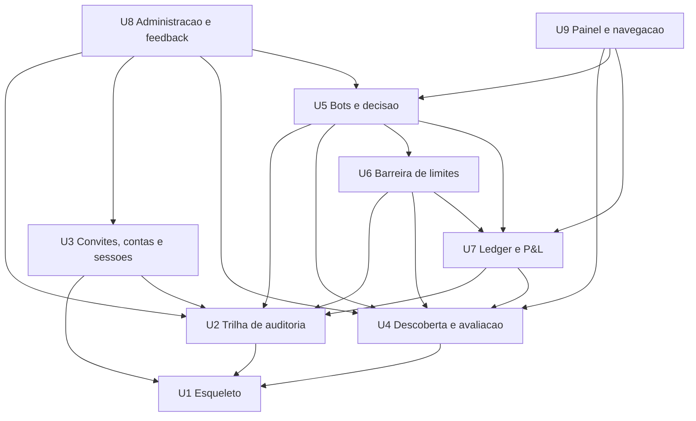

# Dependências entre Units — MemeTrade Analytics (beta PAPER por convite)

Grafo de dependências (topologia) das 9 Units de [unit-of-work.md](unit-of-work.md). As arestas seguem as dependências entre componentes de [components.md](../domain-design/components.md) e as decisões de [decisions.md](../domain-design/decisions.md) (ciclo síncrono coordenado pelos bots no ADR-005, administração sem ciclo no ADR-007, trilha central no ADR-006). Os requisitos e as histórias que cada Unit atende estão em [requirements.md](../requirements-analysis/requirements.md), [stories.md](../user-stories/stories.md) e [unit-of-work-story-map.md](unit-of-work-story-map.md).

Este documento descreve só o que depende de quê. Ele não escolhe uma ordem de construção recomendada nem um caminho crítico: essa escolha econômica é do planejamento de entrega, que usa este grafo como entrada. Por decisão Q10, só as dependências reais foram declaradas, para que Units independentes possam ser construídas em paralelo.

## Arestas

"A depende de B" significa que A chama a interface pública de B ou precisa do que B entrega para funcionar e ser testada de ponta a ponta.

| Unit | Depende de | Motivo |
|---|---|---|
| U1 `u1-walking-skeleton` | — | Fatia inicial: cria a fundação, o processo de API, o app do convidado e os módulos mínimos que as demais completam |
| U2 `u2-audit-trail` | U1 | Completa o AuditTrail mínimo criado em U1 e usa a fundação e o processo de API |
| U3 `u3-identity-access` | U1, U2 | Completa o IdentityAccess iniciado em U1; publica eventos de convite, termos e recusa pelo contrato de auditoria de U2 (Q15) |
| U4 `u4-discovery` | U1 | Completa MarketData e Scanner iniciados em U1; RiskAssessment lê MarketData |
| U7 `u7-ledger-pnl` | U2, U4 | Lê preço de referência, liquidez e frescor de MarketData (U4); publica eventos de operação e fechamento pendente (U2) |
| U6 `u6-risk-control` | U2, U4, U7 | Lê exposição, perda do dia e patrimônio do PortfolioPnL (U7) e frescor e liquidez do MarketData (U4); publica "ordem recusada" (U2) |
| U5 `u5-bots-decision` | U2, U4, U6, U7 | O motor de decisão lê MarketData e RiskAssessment (U4); o ciclo chama a barreira (U6) e a execução PAPER (U7) de forma síncrona (ADR-005); publica eventos de ciclo de vida (U2) |
| U8 `u8-admin-feedback` | U2, U3, U4, U5 | O kill switch aplica a pausa de sistema pela interface de U5 (ADR-007); convites e contagens vêm de U3; estado das fontes vem de U4; ações administrativas são auditadas (U2) |
| U9 `u9-dashboard` | U4, U5, U7 | O painel lê avisos de dados (U4), resumo e pausa dos bots (U5) e P&L (U7) |

As dependências de U1 das Units seguintes que não aparecem na tabela são transitivas (por U2 ou U4).



<!-- Text fallback: As setas apontam para a Unit da qual se depende. U1 não depende de nenhuma. U2 depende de U1. U3 depende de U1 e U2. U4 depende de U1. U7 depende de U2 e U4. U6 depende de U2, U4 e U7. U5 depende de U2, U4, U6 e U7. U8 depende de U2, U3, U4 e U5. U9 depende de U4, U5 e U7. O grafo não tem ciclos. -->

## Pontos de integração

Mecanismos escolhidos em Q7; a especificação formal (formatos, erros, versões) é feita no Contract Design.

| De | Para | Ponto de integração | Mecanismo |
|---|---|---|---|
| U3, U5, U6, U7, U8 | U2 | Publicação de eventos de auditoria com identificador do evento | Evento em processo |
| U1 | U1 | Gravação mínima dos eventos de login (substituída pelo contrato de U2 quando U2 existir) | Chamada síncrona interna |
| U4 | U1 | Adaptadores de mercado e lista do scanner estendem as interfaces criadas no esqueleto | Interface pública do módulo |
| U3 | U1 | Contexto de autenticação (tenant e usuário) e sessão | Interface pública do módulo |
| U7 | U4 | Preço de referência, liquidez e frescor | Chamada síncrona |
| U6 | U7 | Exposição, perda realizada do dia UTC, patrimônio e maior patrimônio | Chamada síncrona |
| U6 | U4 | Frescor e liquidez no momento da ordem | Chamada síncrona |
| U5 | U4 | Janelas de preço e volume; avaliação do token | Chamada síncrona |
| U5 | U6 | Avaliar ordem candidata; sinal de limite de pausa atingido | Chamada síncrona no ciclo |
| U5 | U7 | Executar ordem aprovada; fechar posições; uso do dia | Chamada síncrona no ciclo |
| U8 | U5 | Aplicar e retirar pausa de sistema; contar bots por estado | Chamada síncrona |
| U8 | U3 | Rotas de convite; contagens de convidados e convites | Chamada síncrona |
| U8 | U4 | Estado e última atualização das fontes | Chamada síncrona |
| U9 | U5, U7, U4 | Resumo dos bots, P&L e avisos de dados | REST com tipos gerados; atualização ao vivo a partir de eventos em processo |
| Telas de U1, U3, U4, U5, U7, U8, U9 | Backend | Contrato da API em `/api/v1/` com tipos gerados para os dois apps | REST |

## Oportunidades de desenvolvimento em paralelo

Conjuntos de Units sem dependência entre si, que podem estar em construção ao mesmo tempo quando suas dependências já estiverem prontas. Existem várias ordens topológicas válidas; a escolha é do planejamento de entrega.

| Conjunto | Por que são independentes |
|---|---|
| U2 e U4 | Ambas dependem só de U1 |
| U3 e U4 | U3 não usa dados de mercado; U4 não usa convites nem contas |
| U3 e U7, U3 e U6, U3 e U5 | O núcleo financeiro usa o contexto de autenticação de U1, não os convites de U3 |
| U3 e U9 | O painel não depende de convites |
| U8 e U9 | Administração e painel não se chamam |

## Esqueleto (Walking Skeleton)

O `team.md` adota a fatia fina primeiro, e a ordem resolvida do grafo começa por U1, a única Unit sem dependências. U1 roda antes das demais porque contém, em versão mínima, tudo de que a fatia precisa: fundação do repositório e CI, processo de API, app do convidado, PostgreSQL no Docker Compose, adaptador de mercado simulado, lista mínima do scanner com fonte, horário e `unknown`, login por carteira (Q8) e a gravação mínima de auditoria dos eventos de login (Q15). Nenhuma parte da fatia espera outra Unit, e o script de verificação ponta a ponta prova o caminho completo. O comando exato da verificação é autorizado pelo responsável do projeto na Construction; o planejamento de entrega confirma a demonstração esperada.

## Bloco de arestas

```yaml
units:
  - name: u1-walking-skeleton
    kind: service
    depends_on: []
  - name: u2-audit-trail
    kind: service
    depends_on: [u1-walking-skeleton]
  - name: u3-identity-access
    kind: service
    depends_on: [u1-walking-skeleton, u2-audit-trail]
  - name: u4-discovery
    kind: service
    depends_on: [u1-walking-skeleton]
  - name: u5-bots-decision
    kind: service
    depends_on: [u2-audit-trail, u4-discovery, u6-risk-control, u7-ledger-pnl]
  - name: u6-risk-control
    kind: service
    depends_on: [u2-audit-trail, u4-discovery, u7-ledger-pnl]
  - name: u7-ledger-pnl
    kind: service
    depends_on: [u2-audit-trail, u4-discovery]
  - name: u8-admin-feedback
    kind: service
    depends_on: [u2-audit-trail, u3-identity-access, u4-discovery, u5-bots-decision]
  - name: u9-dashboard
    kind: ui
    depends_on: [u4-discovery, u5-bots-decision, u7-ledger-pnl]
```
