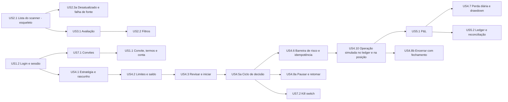

**Collaborator:** aidlc-developer-agent

## Contribution

Revisão pelo ângulo de implementação: tamanho das histórias (1 a 3 dias, Q3), dependências, trabalho técnico escondido, cantos de concorrência, idempotência e máquina de estados, e decisões de arquitetura que o texto forçaria cedo demais. Cada item diz a história e o que mudar, para o lead integrar direto.

### A. Ordem de entrega e dependências

**A1. Esqueleto andante bloqueado pela dependência US2.1 → US1.2.** O `team.md` (Walking Skeleton) define a primeira Unit como navegador → Next.js → API → PostgreSQL com o adaptador simulado alimentando a lista do scanner (fonte, horário, `unknown`), sem login. Como US2.1 depende de US1.2, o esqueleto só sai depois de convite, termos e login. Dado de mercado não é dado de tenant, então a dependência não é real.
- Trocar em US2.1: **Depende de:** nenhuma (é a história do esqueleto).
- Acrescentar em US1.2 o critério: "Dado o login entregue, quando qualquer rota fora de convite, termos e login é chamada sem sessão, então ela é recusada" (isso protege o scanner depois, sem prender a ordem).

**A2. Ciclo entre convite, login e administrador.** US1.1 depende de US7.1 (convites), US7.1 precisa de um administrador autenticado, e a autenticação (US1.2) depende de US1.1. Nenhuma história diz como o administrador entra. Proposta de ordem sem ciclo:
1. **US1.2** passa a ser só "assinar mensagem e abrir sessão", para quem já tem conta. Ganha o critério: "Dada a carteira de administrador definida na configuração do ambiente, quando ela assina a mensagem de login, então a sessão abre com o papel de administrador sem precisar de convite." (O mecanismo exato fica para o design; o critério só exige que exista um administrador inicial.)
2. **US7.1** (convites) depende de US1.2.
3. **US1.1** (convite, termos e criação da conta) depende de US7.1 e US1.2 e usa a verificação de assinatura de US1.2 no primeiro acesso.

**A3. Quando o convite é consumido e quando a conta nasce.** US1.1 diz que o convite inválido não cria conta, e FR1.2 diz que a carteira só conecta depois do aceite. Logo a conta só pode nascer na primeira assinatura, depois do aceite. Acrescentar em US1.1:
- "Dado um convite válido com termos aceitos, quando assino a mensagem de login pela primeira vez, então a conta é criada, a carteira fica vinculada e o convite passa a usado, tudo de uma vez."
- "Dado o mesmo convite usado ao mesmo tempo por duas carteiras, quando as duas assinaturas chegam, então só uma conta é criada e a outra recebe o motivo 'convite já usado'."
- "Dada uma carteira já vinculada a outra conta, quando ela tenta usar um novo convite, então o vínculo é recusado com o motivo."
- Em AC1.1.3, dizer quem é o ator do evento de aceite antes de existir conta (por exemplo, o identificador do convite), para que "exatamente um evento" (AC7.3.1) seja verificável.

**A4. Dependências que faltam ou estão erradas** (trocar o campo **Depende de:**):
- US2.2 → US2.1 **e US3.1** (o filtro por indicador de risco precisa do indicador). Alternativa: deixar o filtro de risco como critério separado entregue depois de US3.1.
- US4.1 → US1.2; o AC4.1.4 ("Usar em bot PAPER" vindo do scanner) depende também de US2.1. Marcar como dependência de US2.1 ou mover o AC4.1.4 para depois.
- US5.3 → hoje só US1.2, mas o resumo usa bots (US4.4), P&L (US5.1) e avisos de dados (US2.3). Ver C8.
- US7.2 → hoje US4.3; o kill switch só tem efeito com o ciclo de decisão rodando (nova US4.5a, ver B4).
- US4.7 → US4.6 **e** o cálculo de posição e P&L (ver B6).
- US4.9: o versionamento dos limites é pré-requisito de US4.6 e US4.7 (Must); só a tela de editar bot ativo pode seguir como Should (ver Positions).

**A5. Diagrama de dependências incompleto.** Faltam US1.3, US1.4, US2.2, US2.3, US3.2, US4.4, US4.7 a US4.9, US5.3, US6.1 e US7.2, US7.3. Depois das divisões abaixo, a ordem sugerida fica:

<!-- Text fallback: US2.1 (esqueleto, sem login) leva a US2.3a e US3.1; US3.1 leva a US2.2. US1.2 (login e sessão, com administrador inicial) leva a US7.1 (convites), que leva a US1.1 (convite, termos e conta). US1.2 também leva a US4.1, US4.2, US4.3 e ao ciclo de decisão US4.5a. Do ciclo saem a barreira de risco US4.6, depois a operação simulada US4.10, o P&L US5.1, a perda diária US4.7 e o ledger US5.2. Do ciclo saem também pausar/retomar US4.8a e o kill switch US7.2; de US4.10 sai o encerramento US4.8b. -->

### B. Histórias grandes demais ou com trabalho técnico escondido

**B1. US1.3 junta quatro assuntos com dependências diferentes.** Expiração e saída dependem só de US1.2; rascunho preservado depende do rascunho salvo no servidor (US4.1/US4.4); bot rodando sem sessão depende do ciclo de decisão (US4.5a); desconectar com pausa depende de pausar (US4.8a). Proposta:
- **US1.3** fica com sessão que expira e "Sair" (FR1.6). Acrescentar: "Dada uma sessão expirada, quando chamo a API, então recebo 401 e a tela me leva ao login sem perder a rota de origem."
- Mover AC1.3.1 para US4.4 (rascunho no servidor, ver B3).
- Mover AC1.3.2 para US4.5a (o bot roda no servidor sem depender da sessão).
- Criar **US1.5 — Desconectar a carteira** (Must, depende de US4.8a) com AC1.3.3 e AC1.3.4.
- Ver também em Positions a questão sobre o que "desconectar" significa quando a carteira é a identidade da conta.

**B2. US1.4 e US7.3 não são fatias verticais.** Isolamento e auditoria valem para toda história com dado de cliente; como histórias soltas, ou ficam "prontas" cedo e não cobrem o que vem depois, ou nunca ficam prontas. Proposta:
- Criar uma seção **"Critérios transversais (definição de pronto)"** aplicada a toda história: (1) teste negativo de acesso de outro tenant por ID (403/404, sem dado) para cada rota e tarefa nova; (2) evento de auditoria para cada ação sensível nova, com ator `system` para ações automáticas (pausa por limite, kill switch, fechamento pendente concluído); (3) erros no formato `ProblemDetail`; (4) instantes em UTC; (5) textos em pt-BR e navegação por teclado com foco visível; (6) rótulo "MODO PAPER (simulado)" em toda tela de bot e P&L (hoje AC4.3.5, que é transversal).
- Manter US1.4 como história habilitadora pequena entregue junto com US1.2: tenant obtido da sessão e o primeiro conjunto de testes negativos. AC1.4.3 vai para a nova US7.4 (ver C1).
- Reescrever AC1.4.4, que hoje é vazio (não existe registro REAL no beta): "Dado um registro de modo diferente de PAPER criado por fixture de teste, quando qualquer consulta PAPER executa, então ele não aparece nem entra em somas." Isso testa a separação sem decidir se REAL fica em tabela, esquema ou coluna separada.
- US7.3 entrega o mecanismo de auditoria e o mascaramento (AC7.3.2, AC7.3.3) logo depois de US1.2; cada história seguinte acrescenta seus eventos pela definição de pronto. Acrescentar: "Dada uma ação que falha e é desfeita, quando termina, então não existe evento de sucesso dela; dada a repetição idempotente da mesma ação, então não há evento duplicado."

**B3. Rascunho do bot: onde ele vive.** AC4.1.2 (voltar etapas) pode ser só estado da tela, mas AC1.3.1 e AC4.4.1 exigem rascunho que sobrevive a sessão expirada e a outro computador. Acrescentar em US4.1: "Dado que avanço uma etapa, quando a etapa é aceita, então o rascunho é salvo no servidor no estado DRAFT com os dados preenchidos até ali." Em US4.4: "Dado um rascunho salvo, quando o retomo depois de a sessão expirar, então volto à última etapa salva com os dados preenchidos."

**B4. US4.5 esconde o motor do bot e a simulação de preenchimento.** Entre "bot ACTIVE" (US4.3) e "P&L" (US5.1) existem quatro peças que nenhuma história assume: o ciclo do bot no servidor a cada intervalo, as duas estratégias, a simulação de preenchimento (FR9.1) e a gravação da operação no ledger e na posição (FR10.1, FR10.2). O primeiro lançamento do ledger nasce aí, mas só aparece em US5.2 como leitura. Proposta de divisão:
- **US4.5a — Decisões determinísticas registradas** (Must, depende de US4.3). Mantém AC4.5.1, AC4.5.2, AC4.5.3, AC4.5.5 e recebe AC1.3.2. Ainda não cria operação. Acrescentar:
  - "Dado um bot ACTIVE, quando chega o intervalo configurado, então exatamente uma decisão é registrada para aquele ciclo."
  - "Dada uma estratégia que precisa de uma janela recente de preço ou volume, quando o histórico de observações não cobre a janela, então decide NO_TRADE com o motivo 'histórico insuficiente'." (Torna explícito que a ingestão precisa guardar histórico de observações, não só o último valor, sem decidir como.)
  - "Dado um reinício do servidor, quando ele volta, então os bots ACTIVE retomam o ciclo, o ciclo interrompido não gera decisão duplicada e os intervalos perdidos não são executados em atraso."
  - "Dada uma decisão SELL para um token sem posição, quando registrada, então vira NO_TRADE com motivo."
- **US4.10 — Registrar a operação simulada no ledger e na posição** (Must, núcleo financeiro com TDD, depende de US4.6). Recebe AC4.5.4. Acrescentar:
  - "Dada uma ordem aprovada pela barreira de risco, quando preenchida, então a operação, os lançamentos do ledger e a posição atualizada a custo médio ponderado são gravados juntos ou nada é gravado."
  - "Dada uma quantidade calculada com mais casas que o mint permite, quando registrada, então segue a regra de arredondamento documentada (por exemplo, quantidade para baixo e taxa para cima), coberta por cenários de resultado conhecido."
  - "Dada uma venda maior que a posição, quando avaliada, então segue a política documentada (limitar à posição ou recusar)."
  - Política de preenchimento parcial por falta de liquidez: a definir no design funcional, mas a história precisa citar a regra escolhida em um critério.
- A ordem é obrigatória pela regra `ALWAYS deduplicar ... e verificar os limites ... antes de cada ordem, inclusive em PAPER`: nenhuma história pode criar operação antes de US4.6 existir. Hoje US5.1 depende de US4.5 e US4.6 é ramo paralelo, o que permitiria criar operação sem barreira.

**B5. US4.6 junta nove verificações e a idempotência.** Cada verificação é núcleo financeiro com teste escrito antes; tende a passar de 3 dias. Proposta:
- **US4.6** fica com tamanho da ordem, exposição por token e total, slippage estimado, liquidez mínima, frescor, intervalo entre operações e idempotência.
- Perda diária e drawdown vão para US4.7, porque dependem do P&L (B6).
- Acrescentar o critério que falta: "Dada uma ordem maior que o saldo virtual disponível do bot, quando avaliada, então é recusada por saldo PAPER insuficiente."
- Reescrever AC4.6.2 com os cantos reais: "Dada a mesma decisão processada duas vezes, em sequência, em paralelo ou depois de uma falha no meio do processamento, quando registrada, então existe uma única operação e uma única série de lançamentos."
- Acrescentar: "Dada uma ordem recusada, quando registrada, então a recusa grava a versão dos limites que a barrou." Do mesmo modo, toda operação aprovada grava a versão dos limites vigente, desde a primeira (pré-requisito de AC4.9.2).
- O slippage estimado vem da mesma política de simulação de US4.10; o design precisa expor a estimativa antes do preenchimento. Só registrar como nota, sem decidir a forma.

**B6. Perda diária e drawdown dependem de um cálculo que só existe em US5.1.** US4.7 precisa saber a perda acumulada do bot no dia UTC; o drawdown precisa de um patrimônio de referência. Hoje US4.7 depende só de US4.6. Corrigir a dependência (US4.7 → US5.1) e deixar explícita a base de cálculo (ver Positions). Acrescentar em US4.7:
- "Dado o horário exatamente 00:00:00 UTC, quando a decisão ocorre, então ela já conta no novo dia." (relógio injetável, conforme `team.md`)
- "Dado um bot pausado pelo limite, quando tento elevar o limite para um valor menor ou igual à perda já acumulada, então a revisão é recusada com o motivo."
- Deixar claro em AC4.7.1 que a verificação é sobre a perda já acumulada, não sobre uma perda prevista da próxima ordem.

**B7. US2.3 junta três mecanismos.** Desatualizado é simples; falha de fonte e divergência pedem duas fontes para o mesmo token e uma regra de casamento por mint e por campo. Proposta:
- **US2.3a** — desatualizado (AC2.3.1) e falha de fonte (AC2.3.2), Must.
- **US2.3b** — divergência entre fontes (AC2.3.3), Must, depende de US2.3a.
- No ambiente local, os dois casos se testam com dois adaptadores simulados e injeção de falha. Acrescentar a US2.3a: "Dado o adaptador simulado configurado para falhar, quando o scanner carrega, então ..." para não depender de fornecedor real (C-06).
- Retirar AC2.3.4 da história: medir 95% com idade ≤ 60 s por 1 hora exige fonte real e é verificação de NFR1 depois do G0 (SP-1), não um critério que fecha em 1 a 3 dias. Levar para a lista de verificações de NFR.

**B8. US4.8 junta pausar (simples) e encerrar com fechamento pendente (grande).** Falta também retomar um bot pausado pela pessoa (PAUSED → ACTIVE, FR7.5). Proposta:
- **US4.8a — Pausar e retomar** (Must, depende de US4.5a): AC4.8.1 e mais:
  - "Dada uma decisão em processamento no instante da pausa, quando ela termina, então nenhuma operação é criada se a pausa foi registrada antes da verificação de risco dessa ordem."
  - "Dado um duplo clique em pausar, quando processado, então há uma única transição e um único evento de auditoria."
  - "Dado um bot pausado por mim, quando retomo, então ele volta a ACTIVE, respeitando o limite de bots ativos (ver Positions)."
- **US4.8b — Encerrar com fechamento das posições** (Must, depende de US4.10): AC4.8.2 a AC4.8.4 e mais:
  - "Dada uma posição em encerramento pendente, quando surge preço confiável, então o fechamento é registrado uma única vez, mesmo se o processo de tentativa rodar em paralelo ou depois de reinício."
  - "Dado o encerramento confirmado, quando concluído, então o bot fica STOPPED e nenhuma transição o leva de volta a ACTIVE."

### C. Histórias ou critérios que faltam

**C1. Estado do sistema para o administrador.** FR2.2 dá ao administrador "estado do sistema" com metadados mínimos, e a persona P3 pede visibilidade, mas não há história. Criar **US7.4 — Ver o estado do sistema** (Must, depende de US7.2): contagens de convidados e bots por estado, estado do kill switch, última atualização por fonte, sem ledger nem operações (recebe AC1.4.3).

**C2. Kill switch e ativações.** Acrescentar em US7.2: "Dado o kill switch acionado, quando um convidado tenta iniciar ou retomar um bot, então a ação é recusada com o motivo." e "Dada uma decisão em processamento no instante do acionamento, então nenhuma operação é criada depois do registro do acionamento."

**C3. Motivos de pausa e precedência.** Hoje existem pausas pela pessoa, pelo limite diário, pelo sistema (kill switch) e pela desconexão da carteira, e o retorno automático à meia-noite (AC4.7.2). Sem uma regra de precedência os critérios se contradizem: um bot pausado pelo limite e depois pelo kill switch não pode voltar sozinho à meia-noite. Acrescentar em US4.7 e US7.2:
- "Dado um bot pausado pelo limite e também pelo sistema, quando chega a meia-noite UTC, então ele continua pausado pelo sistema."
- "Dado um bot pausado pelo limite, quando o kill switch é desligado no mesmo dia, então ele continua pausado pelo limite."
- Sugestão ao lead: um anexo curto "Transições do bot" (estado de origem, gatilho, quem aciona, estado de destino, motivo) referenciado pelos critérios de US4.3, US4.4, US4.7, US4.8a/b, US1.5 e US7.2. É regra de domínio, não arquitetura, e incluir "encerramento pendente" (AC4.8.4) como estado ou subestado explícito.

**C4. Valores `unknown` em somas.** US5.1 não diz o que acontece quando falta preço para marcar uma posição. Acrescentar: "Dada uma posição sem preço confiável, quando o P&L é exibido, então o não realizado dessa posição aparece como `unknown` com o motivo, e o total não realizado é sinalizado como parcial, nunca somado com zero."

**C5. Período do P&L e fuso.** O limite diário usa o dia UTC; o filtro de período de US5.1 não diz se "hoje" é o dia UTC ou o dia no fuso do usuário. Acrescentar um critério explícito (ver Positions).

**C6. Ledger: quem gera lançamento compensatório.** AC5.2.2 diz que correções aparecem só como lançamentos compensatórios, mas nenhuma história cria um. Ou o beta não tem caminho de correção (e o critério testa só a imutabilidade e a existência do mecanismo no domínio), ou precisa de uma história para isso (ver Positions). Acrescentar em AC5.2.3: "divergência injetada por fixture de teste", porque com gravação atômica (B4) ela não acontece no caminho normal.

**C7. US1.2: emissão do nonce e cantos de assinatura.** Acrescentar:
- "Dado um pedido de login, quando o servidor emite o nonce, então ele expira em no máximo 5 minutos (NFR6)."
- "Dada uma mensagem com domínio diferente, ou assinada por outra carteira que não a declarada, quando enviada, então o login é recusado e auditado."
- "Dado o mesmo nonce enviado duas vezes ao mesmo tempo, quando verificado, então só uma sessão é criada."
- Reescrever AC1.2.3: no beta não existe "rota de autorização de trading" (REAL está desligado, FR15.2), então o critério não tem o que testar. Proposta: "Dada a configuração padrão, quando inspeciono o contrato da API, então não existe rota de autorização REAL, e a assinatura de login não é aceita como prova por nenhuma outra rota."
- Tornar AC1.2.4 verificável: "o contrato da API (OpenAPI) e os formulários não têm campo de frase secreta ou chave privada", verificado na CI.

**C8. US5.3: dividir pela dependência.** **US5.3a** — painel com estado vazio e resumo de bots (depende de US4.4). **US5.3b** — P&L e avisos de dados atualizados sem recarregar (depende de US5.1 e US2.3a). Em AC5.3.2, trocar "sem recarregar a página" por "sem recarregar a página, dentro do limite de frescor de NFR1 (≤ 60 s)". Assim o critério não obriga WebSocket ou SSE; consulta periódica atende. A escolha fica para o design.

**C9. US2.1: estados de tela.** Acrescentar o critério de FR5.3 que falta: "Dados carregando, erro e `unknown`, quando exibidos, então são três estados visivelmente distintos" (`team.md`, Code Style). Em AC2.2.2, deixar claro que o contador de excluídos por dado ausente conta o conjunto filtrado inteiro, não só a página atual.

**C10. US3.1: limites do cálculo.** Acrescentar: "Dados os mesmos dados de entrada e a mesma versão dos pesos, quando recalculado, então o indicador é idêntico." e, em US3.2, "Dada a cobertura exatamente igual ao mínimo configurado, quando avaliado, então o indicador fica disponível" (ou o contrário, mas o limite precisa estar escrito).

**C11. US6.1: entrada livre.** Acrescentar: "Dado um texto acima do tamanho máximo, quando envio, então ele é recusado com o limite exibido." e "Dado um feedback com marcação HTML, quando o administrador o lê, então aparece como texto, sem executar." Também falta como o administrador lê o feedback (AC6.1.3 cita, mas não há tela); dizer se é tela, exportação ou consulta direta no beta.

**C12. US7.1: estados do convite.** Acrescentar: "Dado um convite pendente cuja validade passou, quando listo, então ele aparece como expirado." e "Dado um convite revogado enquanto alguém está no aceite dos termos, quando a pessoa assina, então a conta não é criada."

### D. Estimativa para o planejamento de entrega

Com as divisões acima, o Must passa de 22 para cerca de 30 histórias de 1 a 3 dias. Para um desenvolvedor sozinho, isso é ordem de grandeza de 2 a 3 meses só de histórias, sem os spikes SP-1 a SP-5. É só um dado para o planejamento de entrega, não uma decisão.

## Positions

- AGREE: organização por jornada mais um grupo de administração (Q2); deixa claro o valor de cada fatia.
- AGREE: spikes separados das histórias com critério de pronto (Q4); o SP-1 com "menos de duas fontes volta ao responsável" protege US2.3b.
- AGREE: Q5 e Q6 bem refletidas em US4.7 e AC4.8.4; o ledger nunca recebe preço inventado.
- AGREE: AC4.3.2 e AC4.3.3 já cobrem concorrência na ativação e duplo clique; é o nível de detalhe que as outras histórias precisam.
- AGREE: AC2.1.5 (desempate estável) e AC2.1.3 (mint distinto) evitam defeitos clássicos de listagem.
- OBJECT: US2.1 depender de US1.2 impede o esqueleto andante definido no `team.md` (lista do scanner sem login como primeira Unit). Ponto de conhecimento: a regra já está decidida; basta remover a dependência (A1).
- OBJECT: convite, login e administrador formam um ciclo (US7.1 precisa de administrador autenticado e não há administrador inicial). Ponto de conhecimento: resolve-se com a ordem US1.2 → US7.1 → US1.1 e um administrador definido na configuração (A2, A3).
- OBJECT: US4.5 é grande demais e esconde o motor do bot, a simulação de preenchimento e a primeira escrita no ledger; e hoje uma operação poderia nascer sem passar por US4.6, contra a regra obrigatória de verificar limites antes de cada ordem. Ponto de conhecimento (B4, B5).
- OBJECT: US1.3, US2.3, US4.6, US4.8 e US5.3 juntam partes com dependências diferentes ou passam de 3 dias. Ponto de conhecimento: dividir como em B1, B5, B7, B8 e C8.
- OBJECT: US1.4 e US7.3 não são fatias verticais; devem virar critérios transversais de pronto mais uma história habilitadora pequena, e AC1.4.4 hoje não testa nada no beta. Ponto de conhecimento (B2).
- OBJECT: perda diária e drawdown dependem de P&L que só existe em US5.1, e a base de cálculo não está definida (só realizado ou realizado mais marcação a mercado; drawdown sobre o saldo virtual inicial ou sobre o maior patrimônio já atingido). A dependência é ponto de conhecimento; a base de cálculo é decisão da pessoa (ou do design funcional, se ela delegar) (B6).
- OBJECT: US4.9 (versão dos limites) está como Should, mas US4.7 (Must) já exige elevar o limite com nova revisão, e AC4.9.2 só funciona se toda operação gravar a versão dos limites desde a primeira. Ponto de conhecimento: o versionamento de limites entra no Must junto com US4.6/US4.7; a tela de edição de bot ativo pode continuar Should.
- OBJECT: não está definido se uma pausa (pela pessoa, pelo limite ou pelo kill switch) ainda deixa o bot executar saídas por stop ou alvo das posições abertas. Bloquear tudo deixa posição sem proteção; permitir saídas muda o sentido de "nenhuma nova operação" em FR11.1. Decisão da pessoa.
- OBJECT: não está definido se bots pausados contam no limite de 3 ativos (FR7.6). Se não contam, o retorno automático à meia-noite (AC4.7.2) pode levar a 4 ativos, e retomar manualmente com 3 ativos precisa de regra. Decisão da pessoa; sugestão: contar todo bot fora de DRAFT e STOPPED.
- OBJECT: com a carteira como identidade da conta, "desconectar a carteira" (FR1.6, AC1.3.3) e "sair" não estão distinguidos, nem o que acontece ao reconectar. Decisão da pessoa.
- OBJECT: o período do P&L não diz se usa o dia UTC (como o limite diário) ou o dia no fuso do usuário. Decisão da pessoa; sugestão: filtro no fuso do usuário, convertido para UTC, com o limite diário explicitamente em UTC na tela.
- OBJECT: nenhuma história gera lançamento compensatório, embora AC5.2.2 o exija. Decisão da pessoa: o beta tem ou não um caminho de correção.
- OBJECT: AC2.3.4 (95% dos valores com idade ≤ 60 s em 1 hora) não fecha dentro de uma história com fonte simulada. Ponto de conhecimento: é verificação de NFR1 depois do G0 (B7).
- OBJECT: AC1.2.3 não tem o que testar no beta, porque não existe rota de autorização de trading. Ponto de conhecimento: reescrever como em C7.
