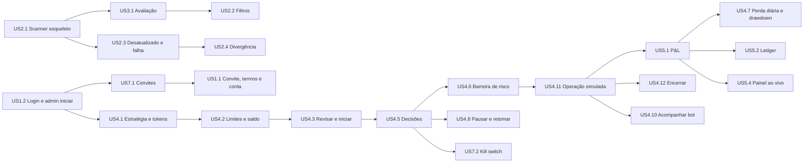

# Histórias de usuário — MemeTrade Analytics (beta PAPER por convite)

Base: [requirements.md](../requirements-analysis/requirements.md) (FR1 a FR15, NFR1 a NFR14), [personas.md](personas.md), práticas em [team-practices.md](../practices-discovery/team-practices.md) (TDD no núcleo financeiro, testes obrigatórios por risco) e respostas Q1 a Q16 de [user-stories-questions.md](user-stories-questions.md). As revisões de design, desenvolvimento e qualidade estão em `contributions/`. Prioridade MoSCoW; a fronteira do MVP é decidida no planejamento de entrega.

Personas: **P1** Bruno (trader experiente), **P2** Camila (trader iniciante em automação), **P3** administrador do beta.

## Convenções de teste

1. **Fronteiras (Q8):** limites máximos e mínimos são inclusivos: o valor igual ao limite é permitido e o menor incremento além dele é recusado. Exceção: atingir a perda diária já pausa. "Mais de 5 minutos" significa estritamente acima de 5:00. O menor incremento é a unidade base do token ou a escala decimal definida para o saldo virtual.
2. **Tempo:** critérios com prazo (expiração, frescor, meia-noite UTC, intervalo) são verificados com relógio injetável no instante da fronteira e um instante depois. Todo instante é gravado em UTC e exibido no fuso do usuário.
3. **Servidor primeiro:** toda validação descrita como "o campo indica o erro" vale também na API (requisição direta recusada com 4xx e `ProblemDetail`).
4. **`[TDD]`:** critério do núcleo financeiro, escrito como teste antes do código; os valores numéricos dos exemplos vêm de tabelas definidas no design funcional.
5. **`[RISCO:<item>]`:** critério que cumpre um teste obrigatório por risco de `team.md` (mapa no fim do documento).
6. **Dinheiro e quantidades:** sempre decimal exato ou inteiros em unidades base, nunca ponto flutuante.

## Definição de pronto transversal

Vale para toda história, sem repetir em cada uma:

| ID | Critério | Origem |
|---|---|---|
| DP-1 | Toda rota e tarefa nova que toca dado de cliente tem teste negativo entre tenants (acesso por ID de outro tenant devolve 403 ou 404, sem dado). `[RISCO:tenant]` | FR2.1, NFR5 |
| DP-2 | Toda ação sensível nova gera exatamente um evento de auditoria; ações automáticas usam o ator `system`; repetição idempotente não gera segundo evento; ação desfeita não gera evento de sucesso. | FR2.3 |
| DP-3 | Erros da API em `ProblemDetail`, sem stack trace, SQL ou segredo; logs sem segredos e com endereço de carteira mascarado. | team-practices; NFR7 |
| DP-4 | Toda tela de bot e de P&L mostra "MODO PAPER (simulado)" em texto no título. | FR9.3 |
| CT-UX-1 | Texto de interface em pt-BR; termos de mercado em inglês com explicação ao passar o mouse e ao receber foco. | NFR14 |
| CT-UX-2 | Carregando: marcadores de conteúdo só na área afetada; o resto da tela continua utilizável. | Wireframes S2 a S7 |
| CT-UX-3 | Erro: diz o que aconteceu, por quê e o que fazer, com "Tentar de novo" quando cabível; falha num quadro não esconde os demais. | Wireframes |
| CT-UX-4 | Fluxo principal operável só por teclado, com foco visível e sem armadilha de foco; o foco inicial de cada tela segue o wireframe. | NFR11 |
| CT-UX-5 | Diálogos de confirmação: foco entra no diálogo, Esc ou "Cancelar" fecha sem efeito, o foco volta ao botão de origem. | Wireframes S5, S7 |
| CT-UX-6 | Campos com rótulo visível e unidade; erro em texto junto ao campo. | NFR11 |
| CT-UX-7 | Cor nunca é o único indicador (sinal +/-, nível escrito, estado em texto); contraste de texto ≥ 4,5:1 no tema escuro. | NFR11 |
| CT-UX-8 | Atualizações automáticas anunciadas a leitores de tela sem mover o foco, com "Atualizado às HH:MM". | FR12.2 |
| CT-UX-9 | Cada tela tem h1 igual ao item de menu e regiões nomeadas. | Wireframes |

## Grupo 1 — Acesso e conta

### US1.2 — Entrar assinando uma mensagem com a carteira
**Como** P1, **quero** entrar assinando uma mensagem com Phantom ou Solflare, **para que** eu acesse minha conta sem expor minha chave.
**Prioridade:** Must · **Requisitos:** FR1.3, FR1.4, FR1.5, NFR6 · **Depende de:** nenhuma

- **AC1.2.1** Dada uma mensagem com domínio, nonce, expiração e chain emitida pelo servidor, quando assino e envio, então a sessão é criada para a conta vinculada àquela carteira.
- **AC1.2.2** Dado um nonce emitido em T com expiração de 5 minutos, quando a assinatura chega em T + 4:59 e em T + 5:01, então a primeira cria a sessão e a segunda é recusada e auditada. `[RISCO:login]`
- **AC1.2.3** Dada uma mensagem com domínio, chain ou nonce diferente do emitido, assinada por outra carteira ou alterada, ou um nonce já usado (inclusive duas verificações simultâneas do mesmo nonce), quando enviada, então no máximo uma sessão é criada e as demais tentativas são recusadas e auditadas. `[RISCO:login]`
- **AC1.2.4** Dada a configuração padrão, quando a suíte verifica o contrato da API, então não existe rota de autorização REAL e a assinatura de login não é aceita como prova por nenhuma outra rota. `[RISCO:login]`
- **AC1.2.5** Dado o contrato da API e o código de produção, quando a verificação automática roda, então nenhum campo aceita frase secreta, mnemônica ou chave privada, uma requisição com campo extra desse tipo não persiste nada, e o código de produção não usa APIs de importação ou geração de chave secreta ou mnemônica.
- **AC1.2.6** Dada a carteira de administrador definida na configuração do ambiente, quando ela entra, então a sessão abre com o papel de administrador sem convite; qualquer rota fora de convite, termos e login chamada sem sessão é recusada.

**INVEST:** fatia independente (login para contas existentes e administrador inicial); a criação de conta por convite fica em US1.1.

### US1.1 — Entrar no beta com convite e aceite de termos
**Como** P2, **quero** usar meu convite e aceitar os termos e o aviso de risco, **para que** eu entre no beta sabendo que é uma simulação sem promessa de lucro.
**Prioridade:** Must · **Requisitos:** FR1.1, FR1.2 · **Depende de:** US1.2, US7.1

- **AC1.1.1** Dado um convite válido, quando abro o link, então vejo os termos e o aviso de risco, e "Conectar carteira" fica indisponível com o motivo escrito até eu marcar os dois aceites; a API de vínculo também recusa a chamada antes do aceite.
- **AC1.1.2** Dado um convite com validade até T, quando usado em T e em T + 1 s, então em T é aceito e em T + 1 s é negado com o motivo "expirado"; convites revogados ou usados também são negados com o motivo e nenhuma conta é criada.
- **AC1.1.3** Dado um convite válido com termos aceitos, quando assino a mensagem pela primeira vez, então, de uma só vez, a conta é criada, a carteira fica vinculada, o convite passa a usado e o aceite (versão e horário) é auditado com o identificador do convite como referência.
- **AC1.1.4** Dado o mesmo convite usado ao mesmo tempo por duas carteiras, quando as duas assinaturas chegam, então só uma conta é criada e a outra recebe o motivo "convite já usado".
- **AC1.1.5** Dada uma carteira já vinculada a outra conta, quando tenta usar um novo convite, então o vínculo é recusado com o motivo.
- **AC1.1.6** Dado que abro a entrada sem código, ou que nenhuma carteira Phantom ou Solflare está instalada, quando a tela carrega, então vejo como colar o código ou instalar uma carteira e posso voltar sem perder os aceites marcados.

### US1.3 — Manter a sessão e sair com segurança
**Como** P1, **quero** que minha sessão expire com segurança e que eu possa sair, **para que** ninguém use minha conta sem mim.
**Prioridade:** Must · **Requisitos:** FR1.6, FR11.3 · **Depende de:** US1.2

- **AC1.3.1** Dada uma sessão expirada, quando chamo a API, então recebo 401 e a tela me leva à entrada; depois de entrar, volto à tela onde estava.
- **AC1.3.2** Dada uma sessão ativa, quando escolho "Sair", então a sessão termina, volto à entrada e meus bots PAPER ativos continuam rodando no servidor (Q13: não existe desconectar carteira no beta).
- **AC1.3.3** Dado que a sessão expira enquanto uso qualquer tela, quando faço a próxima ação, então vejo um aviso de sessão expirada em vez de um erro técnico.

### US1.4 — Ter meus dados isolados dos outros convidados
**Como** P1, **quero** que nenhum outro convidado veja ou altere meus bots, operações e resultados, **para que** eu confie no beta.
**Prioridade:** Must · **Requisitos:** FR2.1, FR2.2, FR10.6, NFR5 · **Depende de:** US1.2 · **Nota:** história habilitadora entregue com US1.2; cada história seguinte cumpre DP-1.

- **AC1.4.1** Dado um recurso meu, quando outro convidado tenta lê-lo ou alterá-lo pelo ID, então recebe 403 ou 404 e nenhum dado meu. `[RISCO:tenant]`
- **AC1.4.2** Dada uma requisição do tenant A com o identificador do tenant B no corpo ou na query, quando processada, então o tenant B é ignorado e nada de B é lido ou gravado. `[RISCO:tenant]`
- **AC1.4.3** Dados registros dos tenants A e B e uma tarefa em segundo plano executada para A, quando termina, então os registros de B ficam inalterados; uma tarefa cujo tenant não corresponde ao do bot é recusada e auditada. `[RISCO:tenant]`
- **AC1.4.4** Dado um registro de modo diferente de PAPER criado por fixture de teste, quando qualquer consulta PAPER executa, então ele não aparece nem entra em somas. `[RISCO:REAL/PAPER]`
- **AC1.4.5** Dada a lista de rotas e tarefas que tocam dados de cliente, quando a suíte roda, então cada uma tem um teste negativo entre tenants; uma rota nova sem esse teste falha a verificação.

### US1.5 — Ver os dados da minha conta
**Como** P1, **quero** ver a carteira associada, a validade da sessão e os termos aceitos, **para que** eu saiba com que identidade estou e o que aceitei.
**Prioridade:** Should · **Requisitos:** FR1.2, FR1.5, FR1.6, FR15.2 · **Origem:** wireframes S7, F6 · **Depende de:** US1.2

- **AC1.5.1** Dada a tela Conta, quando abro, então vejo o endereço da carteira abreviado e só para leitura, o provedor e quando a sessão expira.
- **AC1.5.2** Dados os termos aceitos, quando abro "ver", então vejo a versão e a data do aceite no meu fuso.
- **AC1.5.3** Dada a tela Conta, quando exibida, então mostra "Modo REAL: indisponível no beta" em texto e nenhum controle para ativá-lo.

## Grupo 2 — Descoberta

### US2.1 — Ver tokens com fonte, horário e dados ausentes explícitos (esqueleto)
**Como** P1, **quero** ver a lista de tokens com fonte, horário, frescor e cobertura de cada dado, **para que** eu saiba em que posso confiar.
**Prioridade:** Must · **Requisitos:** FR4.1, FR4.2, FR4.3, FR4.4, FR5.1, FR5.3, NFR14 · **Depende de:** nenhuma · **Nota:** é a fatia fina de ponta a ponta definida em `team.md` (sem login, com fonte simulada).

- **AC2.1.1** Dado qualquer valor exibido, quando passo o mouse ou foco nele, então vejo a fonte, o horário de observação e o frescor; cada token mostra quantos campos foram informados (cobertura).
- **AC2.1.2** Dados um campo que a fonte informou como 0 e outro que a fonte não informou, quando exibidos e lidos pela API, então o primeiro aparece como 0 e o segundo como `unknown`, distinguíveis no contrato sem depender de `null` ou de zero. `[RISCO:unknown]`
- **AC2.1.3** Dados dois tokens com o mesmo símbolo e mints diferentes, quando listados, então aparecem como itens distintos com o mint abreviado.
- **AC2.1.4** Dado o ambiente local sem fornecedor contratado, quando o scanner abre, então os dados vêm da fonte simulada, identificada como simulada.
- **AC2.1.5** Dados dois tokens empatados no critério de ordenação, quando a página é recarregada, então a ordem entre eles não muda; ao paginar, filtros e ordenação continuam e a tela mostra "Exibindo X–Y de N".
- **AC2.1.6** Dados os estados carregando, erro e resultado parcial, quando ocorrem, então cada um aparece de forma distinta, em texto, e diferente de `unknown`; novos dados chegando não mudam a linha selecionada nem o foco.

### US2.2 — Filtrar tokens por critérios combinados
**Como** P1, **quero** combinar filtros de idade, liquidez, volume, holders, indicador de risco e origem, **para que** eu chegue rápido aos tokens que me interessam.
**Prioridade:** Must · **Requisitos:** FR5.2, FR5.3 · **Depende de:** US2.1, US3.1 (filtro de risco)

- **AC2.2.1** Dados filtros de liquidez mínima L e idade máxima A, quando aplicados, então tokens com liquidez exatamente L e idade exatamente A aparecem, e tokens com L menos o menor incremento ficam fora.
- **AC2.2.2** Dado um token com o campo filtrado como `unknown`, quando o filtro é aplicado, então ele fica fora e um contador informa quantos foram excluídos por dado ausente no conjunto filtrado inteiro. `[RISCO:unknown]`
- **AC2.2.3** Dados filtros sem resultado, quando aplicados, então a tela explica e oferece "Limpar filtros".

### US2.3 — Saber quando os dados estão atrasados ou uma fonte falhou
**Como** P1, **quero** ser avisado quando um dado está desatualizado ou uma fonte falha, **para que** eu não decida com informação velha.
**Prioridade:** Must · **Requisitos:** FR4.5, FR4.6, NFR1 · **Depende de:** US2.1

- **AC2.3.1** Dado um valor observado em T, quando exibido em T + 5:00 e em T + 5:01, então em T + 5:00 não está desatualizado e em T + 5:01 está marcado com texto ou ícone e o horário da última atualização.
- **AC2.3.2** Dado o adaptador simulado da fonte B configurado para falhar, quando o scanner carrega, então os tokens da fonte A continuam visíveis e um aviso nomeia a fonte B e sua última atualização.
- **AC2.3.3** Dadas todas as fontes indisponíveis, quando o scanner abre, então um aviso no topo explica a falha, a lista aparece vazia com explicação (nunca com valores zerados ou antigos sem marca) e há "Tentar de novo".
- **AC2.3.4** Dada a fonte simulada atualizando a cada N segundos e relógio injetável, quando o scanner é consultado, então a idade exibida é agora menos o horário de observação, e não o horário da busca. (A medição de 95% ≤ 60 s em 1 hora com fonte real é verificação de NFR1 após o G0.)

### US2.4 — Ver divergência entre fontes
**Como** P1, **quero** ver quando duas fontes discordam sobre o mesmo dado, **para que** eu desconfie de números inconsistentes.
**Prioridade:** Must · **Requisitos:** FR4.7 · **Depende de:** US2.3 e resultado do G0 (SP-1)

- **AC2.4.1** Dada uma tolerância de divergência D, quando as fontes diferem exatamente D, então não há aviso; quando diferem D mais o menor incremento, então o campo mostra as duas origens e o aviso de divergência.
- **AC2.4.2** Dados dois adaptadores simulados para o mesmo mint, quando um campo diverge, então o casamento é por chain + mint e por campo, nunca por símbolo.

## Grupo 3 — Avaliação

### US3.1 — Entender a avaliação de risco de um token
**Como** P2, **quero** abrir o detalhe de um token e ver o indicador de risco com os fatores e dados que o compõem, **para que** eu entenda por que ele é arriscado.
**Prioridade:** Must · **Requisitos:** FR5.4, FR6.1, FR6.3 · **Depende de:** US2.1

- **AC3.1.1** Dada uma linha da lista, quando a seleciono com clique ou Enter, então o painel lateral abre sem que a lista perca posição e filtros; ao fechar com Esc, o foco volta à mesma linha.
- **AC3.1.2** Dado um token com cobertura igual ou acima do mínimo configurado, quando avaliado, então vejo o indicador de 0 a 100, o nível por escrito, a explicação de que maior significa mais risco e o rótulo de indicador em validação, com fatores, pesos e versão dos pesos.
- **AC3.1.3** Dado um fator da avaliação, quando aberto, então mostra o valor de entrada, a fonte e o horário.
- **AC3.1.4** Dados os mesmos dados de entrada e a mesma versão dos pesos, quando o indicador é recalculado, então o valor é idêntico e fica entre 0 e 100 inclusive.
- **AC3.1.5** Dado o painel lateral carregando, quando a avaliação ainda não chegou, então mostra "Carregando avaliação" e nunca um indicador provisório.

### US3.2 — Ver quando não há dados suficientes para avaliar
**Como** P2, **quero** que o sistema diga claramente quando não consegue avaliar um token, **para que** eu nunca tome falta de dado por segurança.
**Prioridade:** Must · **Requisitos:** FR6.2, FR6.4 · **Depende de:** US3.1

- **AC3.2.1** Dado um token com cobertura abaixo do mínimo, quando avaliado, então o indicador aparece como indisponível com o motivo, a avaliação é NO_TRADE e a coluna Risco da lista mostra `--` com o motivo acessível por foco ou mouse.
- **AC3.2.2** Dado um token com um fator `unknown`, quando avaliado, então esse fator não conta como risco zero e nenhum rótulo de baixo risco é exibido. `[RISCO:unknown]`
- **AC3.2.3** Dado o catálogo de textos da interface, quando a verificação automática roda, então nenhum texto contém termos da lista proibida versionada ("lucro garantido", "sem risco", "100% seguro", "detecta golpes" e outros revisados pelo responsável).

## Grupo 4 — Bot PAPER

### US4.1 — Escolher a estratégia modelo e os tokens
**Como** P2, **quero** escolher entre duas estratégias prontas e definir quais tokens o bot considera, **para que** eu comece sem montar regras do zero.
**Prioridade:** Must · **Requisitos:** FR7.1, FR7.2 · **Depende de:** US1.2 (o atalho do scanner depende também de US2.1)

- **AC4.1.1** Dado o assistente, quando abro a etapa 1 "Estratégia e tokens", então vejo as duas estratégias modelo (momentum de volume e rompimento de faixa), cada uma com descrição simples, parâmetros, valores padrão e faixa aceita, seguidas das regras de seleção de tokens com orientação e exemplo.
- **AC4.1.2** Dado um parâmetro com faixa [mín, máx], quando informo mín, máx, mín menos um passo, máx mais um passo e um valor não numérico, então mín e máx são aceitos e os demais são recusados no campo e pela API.
- **AC4.1.3** Dado que avanço uma etapa, quando a etapa é aceita, então o rascunho é salvo no servidor no estado DRAFT; ao voltar etapas, os dados continuam preenchidos.
- **AC4.1.4** Dado que vim do scanner com "Usar em bot PAPER", quando o assistente abre, então o token já aparece nas regras de seleção.
- **AC4.1.5** Dada a etapa 1 sem regra de seleção, quando a tela aparece, então "Continuar" fica indisponível com o motivo escrito.
- **AC4.1.6** Dado o assistente, quando uso só o teclado, então completo as quatro etapas com foco visível; o indicador mostra "Etapa N de 4" com o nome das etapas.

### US4.2 — Definir limites e saldo virtual do bot
**Como** P2, **quero** definir limites de risco e o saldo virtual do bot dentro de um teto, **para que** a simulação respeite o que eu aceito arriscar.
**Prioridade:** Must · **Requisitos:** FR7.3, FR7.4 · **Depende de:** US4.1

- **AC4.2.1** Dado o assistente, quando chego à etapa 2, então todos os limites obrigatórios (ordem, exposição por token, exposição total, perda diária, drawdown, slippage, liquidez mínima, intervalo) aparecem com rótulo, unidade, valor padrão e uma frase simples sobre o que cada um impede.
- **AC4.2.2** Dada exposição total T, quando a exposição por token é igual a T, então é aceita; quando é T mais o menor incremento, então é recusada com o erro no campo.
- **AC4.2.3** Dados tamanho por ordem maior que a exposição por token, valor zero ou negativo, ou slippage acima de 100%, quando tento continuar, então a etapa não avança e cada campo indica o erro.
- **AC4.2.4** Dado um teto de saldo virtual S, quando informo S, S mais o menor incremento, zero e um valor negativo, então só S é aceito e o teto é exibido.
- **AC4.2.5** Dado qualquer bot PAPER, quando uma requisição tenta transferir saldo, mudar o modo para REAL ou criar ordem REAL, então é recusada com 4xx, nenhum registro muda e o evento é auditado. `[RISCO:REAL/PAPER]`

### US4.3 — Revisar e iniciar o bot PAPER
**Como** P1, **quero** revisar estratégia, limites e hipóteses da simulação antes de iniciar o bot, **para que** eu saiba exatamente o que vai rodar.
**Prioridade:** Must · **Requisitos:** FR7.5, FR7.6, FR9.2, FR15.2 · **Depende de:** US4.2

- **AC4.3.1** Dada a etapa de revisão, quando abro, então vejo estratégia, parâmetros, limites, saldo virtual e hipóteses da simulação, e só então a ação "Iniciar bot PAPER".
- **AC4.3.2** Dados 2 bots ATIVOS, quando inicio o terceiro, então a ativação é aceita; dados 3 bots ATIVOS, quando tento iniciar o quarto (inclusive com duas ativações simultâneas), então a ativação é recusada com "3 de 3 bots ativos" e o rascunho continua salvo. Bots pausados não contam (Q11).
- **AC4.3.3** Dado um duplo clique em iniciar, quando as duas requisições chegam com a mesma chave de idempotência, então só um bot é ativado e a segunda devolve o mesmo resultado da primeira. `[RISCO:deduplicação]`
- **AC4.3.4** Dado um bot PAPER operando com a configuração padrão, quando cria operações, então o componente de assinatura ou envio de transação registra zero chamadas. `[RISCO:REAL desligado]`
- **AC4.3.5** Dada a configuração padrão, quando a suíte enumera rotas, tarefas e telas, então nenhuma aceita operação REAL e qualquer chamada de modo REAL devolve 403 ou 404. `[RISCO:REAL desligado]`
- **AC4.3.6** Dada uma falha ao iniciar, quando ocorre, então o bot continua em rascunho e a mensagem diz como tentar de novo; durante o pedido, a tela mostra "Iniciando bot PAPER" sem aceitar novo envio.

### US4.4 — Encontrar e retomar meus bots
**Como** P1, **quero** ver todos os meus bots por estado e retomar rascunhos, **para que** eu não perca o que comecei.
**Prioridade:** Must · **Requisitos:** FR7.5, FR7.7 · **Depende de:** US4.1

- **AC4.4.1** Dado um rascunho salvo, quando o retomo depois de a sessão expirar ou em outro computador, então volto à última etapa salva com os dados preenchidos.
- **AC4.4.2** Dados bots em rascunho, ativo, pausado (com motivo), encerramento pendente e encerrado, quando abro a lista, então cada um aparece com o estado em texto e as ações válidas.
- **AC4.4.3** Dada a tabela de transições permitidas (anexo "Transições do bot"), quando qualquer transição fora dela é pedida (por exemplo DRAFT → ACTIVE ou STOPPED → ACTIVE), então é recusada; o teste percorre todas as combinações.

### US4.5 — Ter decisões determinísticas registradas e explicadas
**Como** P2, **quero** ver cada decisão do bot com a ação, o motivo e os dados usados, **para que** eu entenda e possa reproduzir o que aconteceu.
**Prioridade:** Must · **Requisitos:** FR8.1, FR8.2, FR8.6, FR11.3, NFR8 · **Depende de:** US4.3 · **Nota:** ainda não cria operação; isso fica em US4.11, depois da barreira de risco (US4.6).

- **AC4.5.1** Dado um bot ATIVO, quando chega o intervalo configurado, então exatamente uma decisão é registrada para aquele ciclo, com token, ação (BUY, SELL, HOLD ou NO_TRADE), versão da estratégia, fatores, dados de entrada com horário e validade, e uma frase simples que resume ação e motivo.
- **AC4.5.2** Dados os mesmos dados de entrada e a mesma versão da estratégia, quando a decisão é recalculada, então o resultado é idêntico. `[TDD]`
- **AC4.5.3** Dado um token com dado `unknown`, desatualizado, histórico insuficiente para a janela da estratégia ou avaliação indisponível, quando o bot avalia, então decide NO_TRADE e registra o motivo; uma decisão SELL sem posição vira NO_TRADE com motivo. `[RISCO:unknown]`
- **AC4.5.4** Dado um reinício do servidor, quando ele volta, então os bots ATIVOS retomam o ciclo sem decisão duplicada do ciclo interrompido e sem executar intervalos perdidos em atraso; uma sessão expirada não interrompe o bot.
- **AC4.5.5** Dada a configuração do beta, quando o teste do motor de decisão roda, então nenhum componente de modelo de IA é carregado nem chamado.

### US4.6 — Ter ordens barradas pelos limites e sem duplicidade
**Como** P1, **quero** que nenhuma ordem simulada ultrapasse meus limites nem seja registrada duas vezes, **para que** os resultados sejam confiáveis.
**Prioridade:** Must · **Requisitos:** FR8.3, FR8.4, FR7.8, NFR4 · **Depende de:** US4.5

- **AC4.6.1** Dada a tabela de exemplos abaixo, quando cada caso é avaliado, então o caso permitido segue e o caso recusado não cria operação nem lançamento, mostra o motivo, grava a versão dos limites que o barrou e gera um único evento "ordem recusada". `[TDD]` `[RISCO:limites]`
- **AC4.6.2** Dada uma ordem maior que o saldo virtual disponível do bot, quando avaliada, então é recusada por "saldo PAPER insuficiente". `[TDD]`
- **AC4.6.3** Dada a mesma decisão processada duas vezes, em sequência, em paralelo ou após falha no meio, quando registrada, então existe uma única operação e uma única série de lançamentos. `[TDD]` `[RISCO:deduplicação]`
- **AC4.6.4** Dada uma chave de idempotência já usada com conteúdo diferente, quando chega, então é recusada como conflito e nada é registrado; o banco recusa segunda linha com a mesma chave no mesmo tenant e modo. `[RISCO:deduplicação]`
- **AC4.6.5** Dada qualquer operação persistida, quando lida, então tem chave de idempotência não nula e a versão dos limites vigente.

| Verificação (FR8.3) | Caso permitido | Caso recusado | Motivo |
|---|---|---|---|
| Tamanho por ordem | ordem = máximo | máximo + menor incremento | "tamanho por ordem" |
| Exposição por token | exposição após a ordem = máximo | máximo + menor incremento | "exposição por token" |
| Exposição total | total após a ordem = máximo | máximo + menor incremento | "exposição total" |
| Slippage estimado | estimado = máximo | máximo + menor incremento | "slippage" |
| Liquidez mínima | liquidez = mínimo | mínimo − menor incremento ou `unknown` | "liquidez mínima" |
| Frescor (Q10) | idade do dado = 60 s | 60 s + 1 s | "frescor" |
| Intervalo | T + I | T + I − 1 s | "intervalo" |
| Duplicidade | primeira com a chave K | segunda com a chave K | "duplicada" |

Perda diária e drawdown ficam em US4.7. Os valores numéricos de cada linha vêm do design funcional; quando mais de um limite falha, a regra de qual motivo aparece é definida lá.

### US4.7 — Ter o bot pausado por perda diária ou drawdown
**Como** P2, **quero** que o bot pare sozinho ao atingir a perda diária máxima ou o drawdown máximo, **para que** um dia ruim não se agrave.
**Prioridade:** Must · **Requisitos:** FR8.5, FR7.8, FR8.3 · **Depende de:** US4.6, US5.1

- **AC4.7.1** Dado o limite de perda diária P e a perda realizada do bot no dia UTC, com taxas (Q9), quando ela é P menos o menor incremento, então a próxima decisão pode gerar operação; quando é igual a P, então nenhuma operação é criada e o bot fica pausado pelo motivo "perda diária". `[TDD]` `[RISCO:limites]`
- **AC4.7.2** Dado o drawdown máximo D medido sobre o patrimônio virtual (saldo + posições marcadas) a partir do maior valor já atingido pelo bot (Q9), quando uma operação levaria o drawdown acima de D, então é recusada; ao atingir D, o bot fica pausado pelo motivo "drawdown". `[TDD]` `[RISCO:limites]`
- **AC4.7.3** Dado um bot pausado só pelo motivo "perda diária", quando o relógio passa de 23:59:59 para 00:00:00 UTC (testado com usuário em UTC−3), então às 23:59:59 continua pausado e a partir de 00:00:00 volta a operar; se já houver 3 bots ativos, fica pausado com aviso (Q11). `[TDD]`
- **AC4.7.4** Dado um bot pausado por perda diária e também pela pessoa ou pelo kill switch, quando chega a meia-noite UTC, então só o motivo "perda diária" é removido e o bot continua pausado. `[TDD]`
- **AC4.7.5** Dado um bot pausado pela perda diária com perda acumulada X, quando elevo o limite para um valor maior que X e confirmo a nova revisão, então ele retoma com a nova versão dos limites; quando o novo valor é menor ou igual a X, então a retomada é recusada com o motivo. `[TDD]`
- **AC4.7.6** Dado um bot pausado pelo limite, quando exibido, então mostra o motivo em texto e o horário de reinício no meu fuso (por exemplo, "volta a operar às 21:00, horário de Brasília").

### US4.8 — Pausar e retomar o bot a qualquer momento
**Como** P1, **quero** pausar e retomar o bot quando quiser, **para que** eu mantenha o controle.
**Prioridade:** Must · **Requisitos:** FR11.1, FR7.5, FR7.6 · **Depende de:** US4.5

- **AC4.8.1** Dado um bot ativo, quando pauso pela tela do bot ou pelo painel, com um único comando e sem confirmação, então o estado PAUSADO aparece em texto e nenhuma nova operação é criada, inclusive saídas por alvo, stop ou tempo (Q12). `[RISCO:pausa]`
- **AC4.8.2** Dado um ciclo de decisão em andamento, quando a pausa é registrada antes do registro da ordem, então a ordem é recusada por bot pausado; a verificação do estado acontece na mesma transação que registra a operação. `[TDD]` `[RISCO:pausa]`
- **AC4.8.3** Dado um duplo clique em pausar, quando processado, então há uma única transição e um único evento de auditoria.
- **AC4.8.4** Dado um bot que pausei, quando retomo, então ele volta a ATIVO com os limites vigentes; se já houver 3 bots ativos, a retomada é recusada com o limite exibido (Q11).
- **AC4.8.5** Dado um bot pausado com posições abertas, quando exibido, então as posições aparecem marcadas a mercado com o aviso de que não serão fechadas enquanto o bot estiver pausado.

### US4.9 — Ajustar os limites de um bot ativo
**Como** P1, **quero** editar os limites de um bot ativo com nova revisão, **para que** eu adapte o risco sem recriar o bot.
**Prioridade:** Should · **Requisitos:** FR7.8 · **Depende de:** US4.6 · **Nota:** o versionamento dos limites já existe no Must (AC4.6.5, AC4.7.5); esta história entrega a tela de edição.

- **AC4.9.1** Dado um bot ativo, quando edito e confirmo novos limites, então novas decisões usam a nova versão.
- **AC4.9.2** Dada uma operação já registrada, quando consulto o ledger, então vejo qual versão dos limites vigorava nela.
- **AC4.9.3** Dados novos limites incoerentes, quando tento confirmar, então a confirmação é recusada com o erro no campo.

### US4.10 — Acompanhar meu bot PAPER
**Como** P1, **quero** ver numa tela o estado do bot, quanto dos limites já usei hoje, as operações simuladas e as ordens recusadas, **para que** eu saiba o que o bot está fazendo e possa agir rápido.
**Prioridade:** Must · **Requisitos:** FR8.3, FR9.3, FR11.1, FR4.5, FR7.3 · **Origem:** wireframes S5, fluxo F4 (o "uso do dia" vem do wireframe S5) · **Depende de:** US4.11

- **AC4.10.1** Dado um bot ativo, quando abro a tela dele, então vejo nome, estado em texto, os limites e o uso do dia (exposição atual de exposição total, perda do dia de perda diária máxima).
- **AC4.10.2** Dado um bot ativo sem operações, quando abro a tela, então vejo "Nenhuma operação simulada até agora" e as regras em uso.
- **AC4.10.3** Dadas operações simuladas, quando listadas, então cada uma aparece uma única vez, com horário, token, lado, quantidade, preço simulado, taxas, slippage e identificador.
- **AC4.10.4** Dadas ordens recusadas, quando abro "ver motivos", então cada recusa mostra o limite que a barrou e o horário.
- **AC4.10.5** Dados dados de mercado desatualizados, quando a tela está aberta, então um aviso diz que o bot pode ficar sem operar até os dados voltarem a ficar frescos.
- **AC4.10.6** Dada uma falha ao pausar ou encerrar, quando ocorre, então a mensagem permite tentar de novo e o estado exibido é sempre o último confirmado pelo servidor.

### US4.11 — Registrar a operação simulada no ledger e na posição
**Como** P1, **quero** que cada ordem aprovada seja preenchida pela simulação e registrada com custos explícitos, **para que** o P&L reflita condições observáveis.
**Prioridade:** Must · **Requisitos:** FR9.1, FR9.2, FR10.1, FR10.2 · **Depende de:** US4.6

- **AC4.11.1** Dado um conjunto fixo de liquidez, spread e taxas (fixture gravada), quando uma ordem aprovada é preenchida, então preço, slippage e taxas são exatamente os do exemplo e a operação mostra preço de referência, cotação usada e versão da política de simulação. `[TDD]` `[RISCO:P&L]`
- **AC4.11.2** Dada uma ordem aprovada pela barreira de risco, quando preenchida, então operação, lançamentos do ledger e posição a custo médio ponderado são gravados juntos ou nada é gravado. `[TDD]`
- **AC4.11.3** Dada uma quantidade com mais casas que o mint permite, quando registrada, então segue a regra de arredondamento documentada no design funcional, coberta por cenário de resultado conhecido. `[TDD]` `[RISCO:P&L]`
- **AC4.11.4** Dada uma venda maior que a posição, ou liquidez insuficiente para o preenchimento total, quando avaliada, então segue a política documentada no design funcional (limitar ou recusar), citada em um cenário de teste. `[TDD]`

### US4.12 — Encerrar o bot com fechamento das posições
**Como** P1, **quero** encerrar um bot com as posições fechadas de forma segura, **para que** os resultados sejam finais e confiáveis.
**Prioridade:** Must · **Requisitos:** FR11.2, FR10.4 · **Depende de:** US4.11

- **AC4.12.1** Dado um bot com posições abertas, quando peço para encerrar, então uma confirmação lista as posições e o que acontecerá com elas; cancelar não muda nada.
- **AC4.12.2** Dado o encerramento confirmado com preço confiável, quando processado, então as posições são fechadas ao preço de referência vigente, a quantidade fica zero, o resultado vai para o realizado e o bot fica STOPPED. `[TDD]`
- **AC4.12.3** Dado o encerramento sem preço confiável (`unknown`, desatualizado ou sem liquidez), quando processado, então a posição fica em "encerramento pendente" com aviso, o não realizado aparece `unknown`, o bot não faz novas operações e o fechamento ocorre quando houver preço confiável (Q6). `[TDD]`
- **AC4.12.4** Dada uma posição em encerramento pendente, quando surge preço confiável, então o fechamento é registrado uma única vez, mesmo com tentativas paralelas ou após reinício, com um evento de auditoria do ator `system`.
- **AC4.12.5** Dado um bot STOPPED, quando qualquer transição para ATIVO é pedida, então é recusada.

## Grupo 5 — Resultados

### US5.1 — Ver o P&L simulado por token, bot e período
**Como** P1, **quero** ver realizado, não realizado e taxas por token, bot e período, **para que** eu avalie a estratégia com números corretos.
**Prioridade:** Must · **Requisitos:** FR10.2, FR10.3, FR10.4, FR9.3 · **Depende de:** US4.11

- **AC5.1.1** Dado um período no meu fuso (Q14) e um bot, quando filtro, então realizado, não realizado e taxas aparecem separados e a soma por token é exatamente igual ao total, sem tolerância.
- **AC5.1.2** Dado o catálogo mínimo de cenários (ganho total; perda total; duas compras e venda parcial; política de taxas; tokens com 6 e 9 casas; arredondamento no ponto médio; posição zerada que reinicia o custo; marcação `unknown`), quando calculados, então os valores coincidem exatamente com a tabela do design funcional. `[TDD]` `[RISCO:P&L]`
- **AC5.1.3** Dada uma posição sem preço confiável, quando o P&L é exibido, então o não realizado dela aparece `unknown` com o motivo e o total não realizado é sinalizado como parcial, nunca somado com zero. `[RISCO:unknown]`
- **AC5.1.4** Dado um token sem liquidez, quando marcado a mercado, então aparece o texto "sem liquidez", a fonte e o horário da última marcação.
- **AC5.1.5** Dado um período sem operações ou uma falha de cálculo, quando a tela abre, então explica o que houve e nenhum total parcial aparece como completo.

### US5.2 — Conferir o ledger e a reconciliação
**Como** P1, **quero** conferir cada lançamento do ledger e ver se as operações reconciliam, **para que** eu confie no P&L.
**Prioridade:** Must · **Requisitos:** FR10.1, FR10.5, NFR4 · **Depende de:** US5.1

- **AC5.2.1** Dado o ledger, quando aberto, então cada lançamento mostra operação, custo, taxa, slippage, horário e versão da política; "ver hipóteses" mostra as premissas de spread, slippage, taxas e preenchimento.
- **AC5.2.2** Dada uma tentativa de alterar ou apagar um lançamento, quando feita pela aplicação, então é recusada, e quando feita no banco com o papel da aplicação (`UPDATE` ou `DELETE`), então falha. `[RISCO:ledger]`
- **AC5.2.3** Dado um lançamento compensatório criado pelo mecanismo de domínio em teste, quando registrado, então referencia o original e o saldo final é o esperado; o beta não oferece correção manual (Q15). `[TDD]` `[RISCO:ledger]`
- **AC5.2.4** Dada uma divergência injetada por fixture entre operações e ledger, quando a tela abre, então aparece o aviso com a quantidade e o detalhe das operações divergentes; sem divergência, aparece "reconciliado" com o horário da verificação.

### US5.3 — Ver o painel com o resumo dos bots
**Como** P1, **quero** ver ao entrar um resumo dos meus bots, **para que** eu saiba em segundos como estão as coisas.
**Prioridade:** Must · **Requisitos:** FR12.1 · **Depende de:** US4.4

- **AC5.3.1** Dado um usuário sem bots, quando entra, então o painel mostra o estado vazio com atalhos para o scanner e para criar bot.
- **AC5.3.2** Dado um usuário com bots, quando entra, então o painel mostra quantos estão ativos e pausados, a última operação e o atalho "Pausar" com o mesmo efeito de AC4.8.1.
- **AC5.3.3** Dada uma falha ao carregar um quadro, quando o painel abre, então só aquele quadro mostra a mensagem com "Tentar de novo".

### US5.4 — Ver o P&L e os avisos de dados atualizados no painel
**Como** P1, **quero** que o painel mostre o P&L simulado e os avisos de dados sem recarregar, **para que** eu acompanhe sem esforço.
**Prioridade:** Must · **Requisitos:** FR12.2, NFR1 · **Depende de:** US5.1, US2.3

- **AC5.4.1** Dado um bot que registra uma operação, quando o painel está aberto, então a mudança aparece sem recarregar a página em até 60 segundos, com "Atualizado às HH:MM".
- **AC5.4.2** Dada uma fonte atrasada ou indisponível, quando o painel abre, então o aviso nomeia a fonte e o horário da última atualização.
- **AC5.4.3** Dada uma falha da atualização automática, quando ocorre, então o painel mostra que os valores podem estar desatualizados, com o horário da última atualização bem-sucedida.

## Grupo 6 — Feedback

### US6.1 — Enviar feedback de qualquer tela
**Como** P2, **quero** enviar um comentário por um formulário curto acessível pelo menu, **para que** minha experiência ajude a melhorar o beta.
**Prioridade:** Should · **Requisitos:** FR13.1 · **Depende de:** US1.2

- **AC6.1.1** Dado o menu, quando escolho enviar feedback (Q16), então posso escrever e enviar sem sair da tela; ao confirmar, o diálogo fecha e o foco volta ao ponto de origem.
- **AC6.1.2** Dado um feedback enviado, quando salvo, então fica associado ao meu tenant, à tela de origem e ao horário, e só o administrador o vê.
- **AC6.1.3** Dado um texto acima do tamanho máximo ou uma falha ao enviar, quando ocorre, então o motivo aparece e o texto escrito é preservado.
- **AC6.1.4** Dado um feedback com marcação HTML, quando o administrador o lê, então aparece como texto, sem executar.

## Grupo 7 — Administração do beta

### US7.1 — Emitir e revogar convites
**Como** P3, **quero** emitir, listar e revogar convites, **para que** eu controle quem entra no beta.
**Prioridade:** Must · **Requisitos:** FR3.1, FR3.3 · **Depende de:** US1.2

- **AC7.1.1** Dado o formulário de convite, quando emito, então o convite tem uso único, validade definida e aparece como pendente.
- **AC7.1.2** Dada a lista de convites, quando aberta, então cada convite mostra o estado em texto (pendente, usado, expirado, revogado) e a validade; um pendente vencido aparece como expirado.
- **AC7.1.3** Dado um convite revogado, inclusive enquanto alguém está no aceite dos termos, quando a pessoa assina, então a conta não é criada; revogar pede confirmação.
- **AC7.1.4** Dado um usuário sem papel de administrador, quando chama a rota de convites, então recebe 403 e o evento é auditado.

### US7.2 — Parar todos os bots de uma vez
**Como** P3, **quero** acionar um kill switch global, **para que** eu interrompa toda a simulação em um incidente.
**Prioridade:** Must · **Requisitos:** FR3.2, FR3.3 · **Depende de:** US4.5

- **AC7.2.1** Dado o comando de acionar o kill switch, quando escolhido, então uma confirmação diz quantos bots ativos serão pausados e só age depois de confirmada; enquanto ligado, "Kill switch ACIONADO" fica visível na área administrativa.
- **AC7.2.2** Dado o kill switch acionado, inclusive com uma decisão em processamento, quando qualquer bot tentaria uma nova operação após o registro do acionamento, então nenhuma operação é criada e os bots aparecem pausados pelo sistema. `[RISCO:pausa]`
- **AC7.2.3** Dado o kill switch acionado, quando um convidado tenta iniciar ou retomar um bot, então a ação é recusada com o motivo "pausado pelo sistema".
- **AC7.2.4** Dado o kill switch desligado, quando volto ao estado normal, então os bots pausados pelo sistema continuam pausados até cada dono retomá-los, e o dono vê em texto que a pausa foi feita pela administração.
- **AC7.2.5** Dado um usuário sem papel de administrador, quando chama a rota do kill switch, então recebe 403; acionamento e desligamento geram evento de auditoria com o administrador como ator.

### US7.3 — Rastrear ações sensíveis
**Como** P3, **quero** uma trilha de auditoria das ações sensíveis, **para que** eu reconstrua o que aconteceu sem acessar segredos.
**Prioridade:** Must · **Requisitos:** FR2.3, NFR7 · **Depende de:** US1.2 · **Nota:** entrega o mecanismo; cada história seguinte acrescenta seus eventos pela DP-2.

- **AC7.3.1** Dado login, aceite de termos, ação sobre bot, ação administrativa ou ordem recusada, quando ocorre, então existe exatamente um evento com ator, ação, tenant, horário UTC e identificador de correlação.
- **AC7.3.2** Dados os logs e as métricas dos testes, quando a varredura automática roda, então nenhum endereço de carteira completo aparece (formato mascarado: 4 primeiros e 4 últimos caracteres); o completo só aparece na trilha de auditoria.
- **AC7.3.3** Dados os eventos e os logs, quando inspecionados pela varredura, então não contêm segredos, tokens de sessão, cabeçalhos `Authorization`, nonces nem assinaturas.

### US7.4 — Ver o estado do sistema
**Como** P3, **quero** ver um resumo do estado do beta, **para que** eu saiba se está tudo bem sem acessar dados dos convidados.
**Prioridade:** Must · **Requisitos:** FR2.2 · **Depende de:** US7.2

- **AC7.4.1** Dada a área administrativa, quando abro o estado do sistema, então vejo contagens de convidados e de bots por estado, o estado do kill switch e a última atualização por fonte.
- **AC7.4.2** Dado o administrador, quando tenta iniciar, pausar ou encerrar o bot de um usuário individual, ou ler o ledger e as operações dele, então recebe 403 e o evento é auditado; o kill switch global é a única ação dele sobre bots. `[RISCO:tenant]`

## Anexo — Transições do bot

| De | Gatilho | Quem | Para | Motivo registrado |
|---|---|---|---|---|
| DRAFT | Etapas válidas concluídas | Pessoa | VALIDATED | — |
| VALIDATED | Iniciar (até 3 ativos) | Pessoa | ACTIVE | — |
| ACTIVE | Pausar | Pessoa | PAUSED | pessoa |
| ACTIVE | Perda diária atingida | Sistema | PAUSED | perda diária |
| ACTIVE | Drawdown atingido | Sistema | PAUSED | drawdown |
| ACTIVE | Kill switch | Administrador | PAUSED | sistema |
| PAUSED | Retomar (sem motivo de sistema ativo, até 3 ativos) | Pessoa | ACTIVE | — |
| PAUSED (só perda diária) | Meia-noite UTC (até 3 ativos) | Sistema | ACTIVE | — |
| ACTIVE ou PAUSED | Encerrar com preço confiável | Pessoa | STOPPED | — |
| ACTIVE ou PAUSED | Encerrar sem preço confiável | Pessoa | CLOSING_PENDING | encerramento pendente |
| CLOSING_PENDING | Preço confiável disponível | Sistema | STOPPED | — |

Motivos de pausa se acumulam; o bot só volta a ACTIVE quando nenhum motivo resta. Qualquer transição fora da tabela é recusada (AC4.4.3).

## Itens técnicos de investigação (fora do backlog de histórias)

| ID | Item | Requisitos | Critério de pronto |
|---|---|---|---|
| SP-1 | Comparar duas fontes candidatas no G0 | FR14.1 | Relatório com medições observadas e decisão por fonte; menos de duas fontes aprovadas volta ao responsável antes de o scanner ser dado como atendido (US2.4 depende disso) |
| SP-2 | Entrevistas e tarefas acompanhadas | FR14.2 | Registros de tarefas e conclusão sobre a hipótese da dificuldade |
| SP-3 | Inventário de dados pessoais e retenção | FR14.3 | Inventário com categoria, finalidade, base legal e prazo propostos |
| SP-4 | Capacidade na stack e estimativas | FR14.4 | Estimativa revisada e pedido de orçamento |
| SP-5 | Prova de conceito da delegação em devnet | FR15.1 | Relatório por critério com evidência em devnet; nenhuma transação em mainnet |

## Dependências e ordem sugerida

<!-- Text fallback: US2.1 (scanner, esqueleto sem login) leva a US2.3 e US3.1; US3.1 leva aos filtros US2.2; US2.3 leva à divergência US2.4. US1.2 (login e administrador inicial) leva aos convites US7.1, que levam a US1.1 (convite, termos e conta), e também ao assistente US4.1, US4.2 e US4.3. Do bot iniciado sai o ciclo de decisões US4.5, que leva à barreira de risco US4.6, depois à operação simulada US4.11, ao P&L US5.1, à perda diária e drawdown US4.7, ao ledger US5.2 e ao painel ao vivo US5.4. De US4.5 saem também pausar e retomar US4.8 e o kill switch US7.2; de US4.11 saem encerrar US4.12 e acompanhar o bot US4.10. -->

## Mapa dos testes obrigatórios por risco

| Teste obrigatório (`team.md`) | Critérios |
|---|---|
| Isolamento entre tenants, por ID e em segundo plano | AC1.4.1, AC1.4.2, AC1.4.3, AC1.4.5, AC7.4.2, DP-1 |
| Separação REAL e PAPER | AC1.4.4, AC4.2.5, AC4.3.5 |
| Deduplicação por chave de idempotência | AC4.3.3, AC4.6.3, AC4.6.4 |
| Violação de limites e controles de risco | AC4.6.1, AC4.7.1, AC4.7.2, AC4.2.2 |
| `unknown` nunca zero | AC2.1.2, AC2.2.2, AC3.2.2, AC4.5.3, AC5.1.3 |
| Pausa impede novas operações | AC4.8.1, AC4.8.2, AC7.2.2 |
| Ledger sem edição | AC5.2.2, AC5.2.3 |
| P&L determinístico em decimal e unidades de token | AC4.11.1, AC4.11.3, AC5.1.2 |
| REAL desligado por padrão | AC4.3.4, AC4.3.5 |
| Login sem reutilização de assinatura | AC1.2.2, AC1.2.3, AC1.2.4 |

## Resumo de prioridade

| Prioridade | Histórias |
|---|---|
| Must | US1.1–US1.4, US2.1–US2.4, US3.1–US3.2, US4.1–US4.8, US4.10–US4.12, US5.1–US5.4, US7.1–US7.4 (30) |
| Should | US1.5, US4.9, US6.1 (3) |
| Won't (este beta) | REAL e delegação (FR15.3), cobrança e planos, filtros salvos, watchlist, alertas e métricas avançadas |

Observação de independência: os critérios de risco, ledger e P&L (US4.6, US4.7, US4.11, US5.1, US5.2) são testáveis isoladamente com fixtures do motor de risco e do ledger, sem passar pelo assistente. Estimativa do desenvolvedor para o planejamento de entrega: cerca de 30 histórias Must de 1 a 3 dias, ordem de 2 a 3 meses para uma pessoa, sem os spikes.
