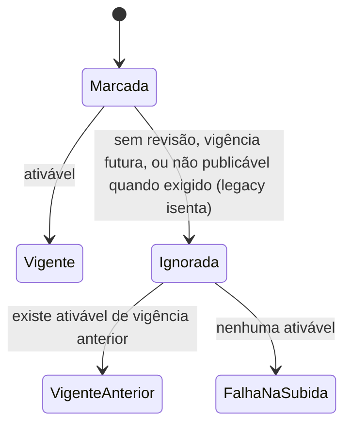
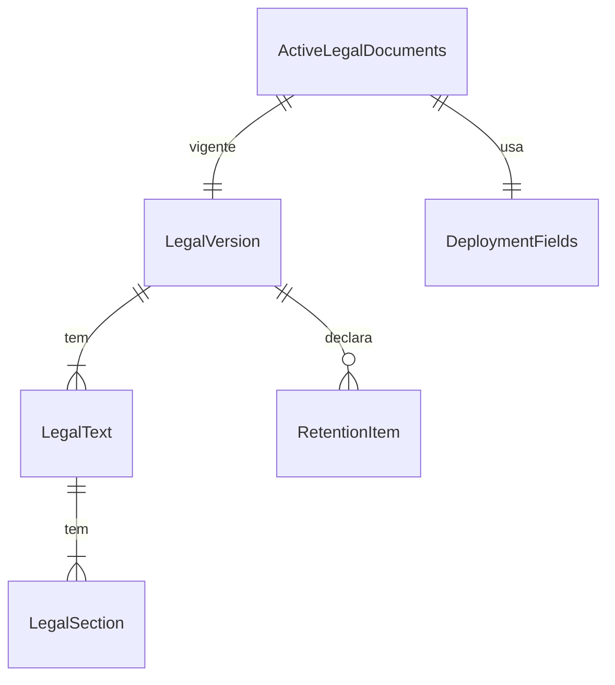

# Especificação funcional — U1 `u1-legal-documents`

Conversa: português (Brasil). Implementa US1.1, US1.2, US1.3, US2.1, US2.2, US2.4, US2.5 e US2.6 de `inception/user-stories/stories.md`. Fontes:
- `inception/units-generation/unit-of-work.md`;
- `inception/domain-design/components.md` (Identity, GuestWebApp, AdminWebApp);
- `inception/contract-design/contract-summary.md` (L1, J5);
- `inception/requirements-analysis/requirements.md`;
- `entities.md`, `rules.md` e `functional-design-questions.md`.

## Fluxos

### F1 — Ativação na subida (BR1.1, BR1.2, BR1.3, BR1.4, BR1.6, BR1.16)

1. Ler todas as versões do catálogo.
2. Validar cada versão: nome, textos e seções; nas não legacy, também a política, os resumos e a tabela de retenção.
3. Ler os campos de implantação e a exigência de publicação da configuração; calcular `publicável` (os três campos presentes).
4. Calcular quais versões são ativáveis (BR1.1):
   - revisadas ou legacy;
   - sem vigência futura em relação ao relógio;
   - publicáveis quando exigido, com a legacy isenta.
5. Se a marcada é ativável, ela é a vigente. Senão, vale a ativável de vigência mais recente anterior à marcada, ordenada por data e não por nome, e um aviso com o motivo vai para o log.
6. Sem nenhuma ativável: falhar a subida com o motivo.
7. Montar o histórico: a vigente e as anteriores ativáveis, mais nova primeiro.
8. O aceite existente (convite) e a busca de versão passam a usar a vigente efetiva e o histórico (BR1.16).

### F2 — Leitura pública dos documentos (BR1.7, BR1.8)

1. `GET /api/v1/legal/current`: devolve versão, vigência, `publishable`, os três textos, os campos de implantação (nulo = a definir) e a tabela de retenção (da porta J5 se houver outra implementação; senão do `retention.tsv`).
2. `GET /api/v1/legal/versions`: devolve o histórico (BR1.9).
3. `GET /api/v1/legal/versions/{version}`: devolve uma versão do histórico ou `404` (BR1.10).

### F3 — Página `/termos` ou `/privacidade` (BR1.13, BR1.14)

1. O app chama F2, no servidor, sem sessão.
2. Carregando: linhas de carregando. Erro: aviso com "tentar de novo".
3. Com `?versao=vN`: chama `/versions/{vN}`. Se for `404`, mostra "Versão não encontrada" com link para a vigente. Se não for a vigente, mostra a faixa "Esta não é a versão vigente".
4. Monta: título h1, versão e vigência, aviso PAPER, resumo, índice com âncoras e seções; na política, a tabela de retenção, os campos de implantação e o botão "Fazer um pedido" (BR1.12).
5. `publishable: false`: aviso "Esta versão ainda não foi publicada para convidados".
6. Vigente legacy sem política (BR1.15):
   - `/privacidade` mostra versão, vigência e aviso PAPER, o texto "A política de privacidade desta versão ainda não foi publicada", o e-mail do encarregado (ou "a definir") e o botão de pedido;
   - `/termos` mostra os termos da versão legacy, sem resumo.

### F4 — Rodapé em todas as telas (BR1.11)

1. Mostra "Termos de uso" e "Privacidade".
2. Com sessão: acrescenta "Versão aceita: vX", lida da sessão.

## Estados

`LegalVersion` não tem ciclo de vida em tempo de execução: é imutável. O estado relevante é o da ativação:

Texto: a versão marcada vira vigente se for ativável, ou seja:
- revisada ou legacy;
- sem vigência futura;
- publicável quando exigido (a legacy é isenta).

Caso contrário, é ignorada, e vale a anterior ativável mais recente pela data de vigência. Sem nenhuma ativável, a API não sobe.

## Diagrama de entidades (derivado de `entities.md`)

Texto: cada versão tem os textos com suas seções e declara a tabela de retenção; a ativação aponta para uma versão vigente e usa os campos de implantação.

## Regras (resumo derivado de `rules.md`)

BR1.1 a BR1.14: ativação com revisão, validação do catálogo, formato, conteúdo exigido, campos de implantação, leitura pública, retenção pela porta, histórico, 404, rodapé, destino do pedido, acessibilidade e erros.

## Fatia fina

Com a U1 pronta, `/privacidade` é servida pela API, a partir do catálogo v2, e mostrada sem login no app do convidado. O spec novo `e2e/legal-documents` no `verify.sh` confere:
- a versão, o resumo e o aviso PAPER;
- "a definir" nos campos sem configuração;
- o rodapé;
- o destino do botão "Fazer um pedido".

## Decisões de implementação registradas

Nomes concretos decididos nas respostas (Q2, Q3), aplicados no Code Generation:
- cada versão é uma pasta com `version.properties` (`version`, `current`, `legacy`, `effectiveAt`, `legalReviewedAt`, `legalReviewedBy`) e os arquivos `terms.txt`, `privacy.txt`, `risk-notice.txt`, `terms-summary.txt`, `privacy-summary.txt` e `retention.tsv`;
- uma linha que começa com `## ` abre uma seção;
- os campos de implantação vêm de `MEMETRADE_LEGAL_STORAGE_LOCATION`, `MEMETRADE_LEGAL_INTERNATIONAL_TRANSFER` e `MEMETRADE_LEGAL_DPO_EMAIL`, e a exigência de publicação de `memetrade.legal.require-publishable`;
- os campos `privacy`, `terms.summary` e `privacy.summary` de L1 ficam opcionais (nulos quando a vigente é legacy);
- sem nenhuma versão ativável, a API não sobe, e não há resposta 503 em L1.

Os dois ajustes de contrato acima são aditivos ou corretivos. Eles entram no bloco L1 de `inception/contract-design/contract-summary.md` no mesmo commit do OpenAPI gerado, conforme a regra "contrato e código juntos".

## Texto da v2

Os textos são redigidos a partir do que o sistema faz (dados, prazos, direitos) e marcados como rascunho até a assessoria revisar. Sem `legalReviewedAt` e `legalReviewedBy`, a v2 não é ativada (BR1.1), e a v1 continua vigente. Para a fatia fina e os testes, o perfil de teste usa uma pasta de catálogo própria, com uma v2 marcada como revisada para teste. Ela nunca é publicada.
