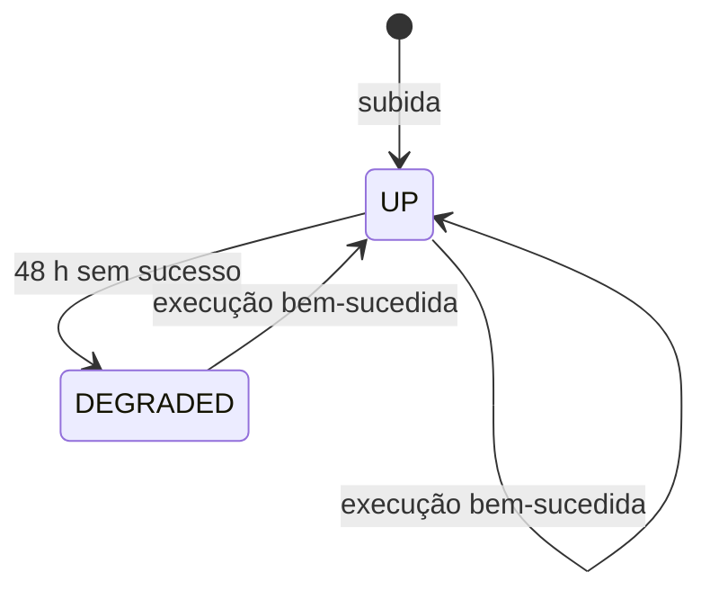
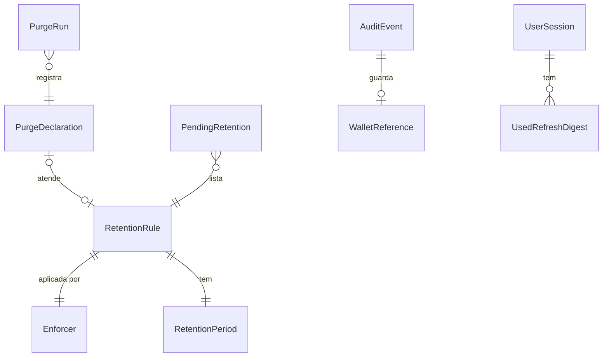

# Especificação funcional — U2 `u2-retention`

Conversa: português (Brasil). Este documento é a fonte dos fluxos e dos estados da U2. O modelo de dados está em `entities.md` e as regras em `rules.md`; os diagramas e o resumo abaixo são derivados deles.

A Unit implementa US1.4, US3.1 e US3.2, de `inception/user-stories/stories.md`. Fontes:
- `inception/units-generation/unit-of-work.md`;
- `inception/requirements-analysis/requirements.md` (FR3.1 a FR3.4, NFR1, NFR6, NFR7);
- `inception/domain-design/components.md`;
- `inception/contract-design/contract-summary.md` (J5, J6);
- `functional-design-questions.md` (Q1 a Q10, todas A).

## Fluxos

### F1 — Publicar um evento que envolve uma carteira (US3.2)

1. O módulo chamador (login do convidado ou do administrador, criação de conta, aceite de convite) monta o comando de auditoria e entrega a carteira pelo campo próprio, nunca em `details` (BR2.1).
2. O publicador calcula a máscara e o HMAC-SHA-256 com a chave da configuração (BR2.2).
3. O validador confere que nenhum valor de `details` tem a forma de um endereço Base58 completo (BR2.3). Se tiver, o evento é recusado: o log registra o campo e o motivo, nunca o valor.
4. O publicador grava o evento na saída da trilha (`audit_outbox`), com o `actor` mascarado e o campo `walletHmac` no payload, sem o endereço.
5. O relay copia o evento da saída para a trilha (`audit_event`). O `walletHmac` do payload vai para a coluna `wallet_hmac`; um payload sem o campo deixa a coluna nula (BR2.18).
6. Dois eventos da mesma carteira têm o mesmo `walletHmac`, o que permite correlacionar sem guardar o endereço.

**Login recusado com endereço inválido (BR2.15):** quando o texto recebido não é uma carteira válida:
- o `actor` é `anonymous` e não há `walletHmac`, porque o HMAC nunca é calculado sobre texto que não é carteira;
- `details` leva só `addressFormat=INVALID`, nunca o texto recebido;
- a resposta do login continua sendo a recusa de sempre.

Como nenhum chamador põe mais texto recebido em `details`, a recusa do validador (BR2.3) não acontece no fluxo normal. Se acontecer, é um defeito que os testes de recusa de login apontam.

### F2 — Subir sem a chave do HMAC

1. Na subida, a API e o worker leem a chave da configuração (`.env` local; gerenciador de segredos na nuvem).
2. Sem a chave, ou com menos de 32 bytes, o processo não sobe e diz qual configuração falta, sem mostrar valor (BR2.4).

### F3 — Expurgo diário de desafios (US3.1)

1. Às 03:20 UTC, uma só instância da API obtém a trava do expurgo `loginChallengePurge` (BR2.7).
2. O corte é o instante do relógio injetável menos 24 horas.
3. Os lotes apagam até 1000 desafios com `expiresAt` anterior ou igual ao corte, em qualquer estado, até um lote voltar menor (BR2.5).
4. Ao fim, o expurgo publica `LOGIN_CHALLENGES_PURGED` pelo `system`, com a contagem, e registra o sucesso.
5. Numa falha, os lotes feitos ficam, o log registra a falha só com totais e a classe do erro, e a próxima execução tenta de novo.

### F4 — Expurgo diário de sessões (US3.1)

1. Às 03:40 UTC, uma só instância obtém a trava `sessionPurge`.
2. O corte é o instante atual menos 30 dias.
3. A cada lote, o expurgo escolhe até 1000 sessões terminadas antes do corte. O fim de uma sessão é `revokedAt` quando ela foi revogada; senão, é o menor entre os dois vencimentos.
4. Na mesma transação, o expurgo apaga primeiro os digests usados dessas sessões e depois as sessões (BR2.6).
5. Uma sessão com fim no futuro nunca é escolhida, mesmo com estado gravado `REVOKED` ou `EXPIRED` sem fim passado.
6. Ao fim, o expurgo publica `SESSIONS_PURGED` com as duas contagens (sessões e digests).

### F5 — Saúde e recuperação dos expurgos

1. No fim de cada execução, o expurgo grava a linha dele na tabela de execuções do Identity, em transação própria: início, resultado, último sucesso, corte e contagem (BR2.16).
2. Os indicadores `loginChallengePurge` e `sessionPurge` leem essa linha, então todas as instâncias mostram o mesmo estado.
3. Cada indicador fica `UP` até 48 horas depois da subida, ou enquanto o último sucesso tiver 48 horas ou menos. Fora disso, fica `DEGRADED` (BR2.8).
4. Quando a API fica pronta, roda na hora, sempre pela mesma trava, cada expurgo novo que esteja numa destas situações:
   - sem linha;
   - sem sucesso;
   - com último sucesso há mais de 24 horas.

   Isso cobre a máquina local desligada no horário, no padrão da recuperação dos jobs da auditoria.

### F6 — Tabela da política a partir do catálogo (US1.4)

1. O módulo novo `privacy` registra a implementação dele da porta de retenção do Identity (J5). Ela substitui a implementação padrão da U1, que lia o `retention.tsv`.
2. A resposta de `/api/v1/legal/**` passa a listar as linhas do `RetentionCatalog`, na ordem dele (BR2.9).

### F7 — Teste de conformidade (US1.4)

1. A suíte lê o catálogo, as declarações dos expurgos (prazo e âncora lidos da configuração de cada expurgo), a lista de pendências e o `retention.tsv` de cada versão não legacy do catálogo de termos.
2. Para cada linha do catálogo:
   - `PURGE` exige que o expurgo exista com a mesma declaração;
   - `GUARD` exige o prazo "enquanto a conta existir";
   - `PLANNED` exige que a linha esteja na lista de pendências e que o expurgo ainda não exista (BR2.10, BR2.12).
3. Cada `retention.tsv` não legacy precisa ser igual ao catálogo (BR2.11).
4. Uma divergência faz o teste falhar com a linha, o prazo declarado e o prazo aplicado.

| Linha (`id`) | Prazo | Quem aplica |
|---|---|---|
| `ACCOUNT` (conta, carteira, provedor) | enquanto a conta existir | `GUARD` |
| `PAPER_HISTORY` (bots e histórico PAPER) | enquanto a conta existir | `GUARD` |
| `TERMS_ACCEPTANCES` | enquanto a conta existir | `GUARD` |
| `AUDIT_TRAIL` | 12 meses | `PURGE` `auditRetention` (Audit, job `AUDIT_RETENTION_PURGE`, existente) |
| `AUDIT_OUTBOX` | 7 dias após a entrega | `PURGE` `auditOutboxCleanup` (Audit, job `AUDIT_OUTBOX_CLEANUP`, existente) |
| `FEEDBACK` | 180 dias | `PURGE` `feedbackPurge` (Feedback, `FeedbackPurgeJob`, existente) |
| `HOLD_NO_TRADE_DECISIONS` | 30 dias | `PURGE` `decisionPurge` (Bots, `DecisionPurgeJob`, no worker, existente) |
| `APPROVED_RISK_EVALUATIONS` | 30 dias | `PURGE` `riskcontrol-purge` (RiskControl, `RiskEvaluationPurgeJob`, existente) |
| `IDEMPOTENCY_KEYS` | 24 horas | `PURGE` `idempotencyCleanup` (Identity, `IdempotencyCleanupJob`, existente) |
| `LOGIN_CHALLENGES` | 24 horas após expirar | `PURGE` `loginChallengePurge` (Identity, novo) |
| `SESSIONS` | 30 dias após o fim | `PURGE` `sessionPurge` (Identity, novo) |
| `DATA_SUBJECT_REQUESTS` | 12 meses após concluídos | `PLANNED` `u4-data-requests` |

**Declaração dos expurgos (BR2.17).** A interface `RetentionEnforcerDeclaration` fica no pacote compartilhado (`com.memetrade.shared.retention`), com um método que devolve `purgeId`, o prazo e a âncora.
- **Quem registra:** cada módulo da tabela acima registra uma declaração na configuração dele, lendo o prazo da propriedade que o próprio expurgo usa: Audit, Feedback, Bots, RiskControl e Identity. A declaração do `decisionPurge` existe também no contexto da API, embora o expurgo rode no worker.
- **Quem lê:** o Privacy recebe a lista das declarações e nunca lê tabela de outro módulo.
- **Sem ciclo:** os módulos dependem só do pacote compartilhado, e o Privacy também.
- **Contrato:** é um contrato interno e aditivo de esquema compartilhado. A geração de código acrescenta o bloco `J7-RetentionEnforcerDeclaration` ao resumo de contratos no mesmo commit, pela regra "contrato e código juntos".

## Estados

### Indicador de um expurgo

Texto: o indicador começa `UP` na subida. Ele passa a `DEGRADED` quando passam 48 horas sem sucesso e volta a `UP` no próximo sucesso.

### Sessão (só a parte que o expurgo lê)

A sessão `ACTIVE` passa a `REVOKED` (com `revokedAt`) ou deixa de poder ser renovada quando vence o menor dos dois vencimentos. Trinta dias depois do fim, ela e os digests dela são apagados. Esta Unit não muda as transições da sessão, só acrescenta o fim do ciclo.

## Diagrama de entidades (derivado de `entities.md`)

Texto: uma `RetentionRule` tem um prazo e é aplicada por um `Enforcer`. Uma `PurgeDeclaration` atende no máximo uma linha, e a `PendingRetention` lista as linhas `PLANNED`. Um `AuditEvent` guarda no máximo uma `WalletReference`. Uma `UserSession` tem vários `UsedRefreshDigest`, e cada expurgo registra os próprios `PurgeRun`.

## Regras (resumo derivado de `rules.md`)

- **Auditoria:**
  - BR2.1 a BR2.3: a auditoria guarda só a máscara e o HMAC, nunca o endereço completo;
  - BR2.4: a chave do HMAC é obrigatória, com 32 bytes ou mais;
  - BR2.14: nenhum evento antigo é reescrito;
  - BR2.15: um login recusado com endereço inválido não leva o texto recebido;
  - BR2.18: o relay copia o `walletHmac` para a coluna;
  - BR2.19: a chave não tem rotação no beta.
- **Expurgos:**
  - BR2.5: os desafios são apagados 24 horas depois de vencerem;
  - BR2.6: as sessões e os digests são apagados 30 dias depois do fim;
  - BR2.7 e BR2.8: a execução é diária, em lotes, e a saúde fica `DEGRADED` depois de 48 horas sem sucesso;
  - BR2.16: o último sucesso fica no banco e a execução perdida é recuperada na subida;
  - BR2.17: os expurgos se declaram por uma interface compartilhada, sem ciclo.
- **Retenção:**
  - BR2.9 a BR2.12: o catálogo é a fonte da tabela e é conferido contra os expurgos e contra o `retention.tsv`, com a lista de pendências;
  - BR2.13: o checklist de abertura exige banco novo, a chave e as consultas de conferência.

## Decisões de implementação registradas

- **Coluna nova `wallet_hmac`:** em `audit_event`, anulável e com índice, numa migração que só acrescenta. O payload da saída da trilha ganha o campo `walletHmac`. O consumidor da saída precisa ignorar campos desconhecidos.
- **Chave do HMAC:** variável `MEMETRADE_AUDIT_WALLET_HMAC_KEY`, com o nome no `.env.example` e sem valor. O responsável do projeto acrescenta a variável ao `scripts/verify.sh` (segredo efêmero por execução) e ao passo `Compose config` do `ci.yml`.
- **Sessões de administrador:** o expurgo de sessões vale também para elas, porque ficam na mesma tabela.
- **Tabela de execuções:** a tabela do Identity (por exemplo `identity_job_run`) tem uma linha por expurgo novo e é criada na migração da Unit, que só acrescenta. O padrão é o de `audit_job_run`.
- **Chave do HMAC (BR2.19):**
  - não há rotação no beta; a troca só acontece por incidente e fica registrada no runbook;
  - o que fazer com o `walletHmac` e com o ator mascarado na anonimização é uma pendência registrada para a `u5-anonymization`.
- **Checklist de abertura:** os itens de BR2.13 entram no checklist de `docs/api/u1-legal-documents.md` ou num checklist de privacidade em `docs/`.
- **Pacote do módulo novo:** `com.memetrade.privacy`, com o catálogo, as declarações e a porta. Ele depende só das interfaces públicas do Identity e de cada módulo que declara um expurgo.
