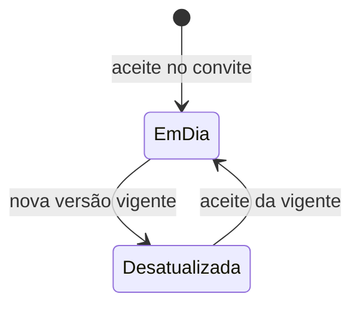
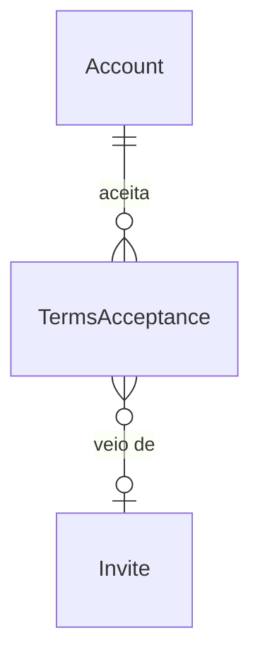

# Especificação funcional — U3 `u3-reacceptance`

Conversa: português (Brasil). Este documento é a fonte dos fluxos e dos estados da U3. O modelo de dados está em `entities.md` e as regras em `rules.md`.

A Unit implementa US2.3, US4.1 e US4.2 de `inception/user-stories/stories.md`. Fontes:
- `inception/units-generation/unit-of-work.md`;
- `inception/requirements-analysis/requirements.md` (FR2.3, FR4);
- `inception/domain-design/components.md`;
- `inception/contract-design/contract-summary.md` (L2, L3);
- `functional-design-questions.md` (Q1 a Q7, todas A).

## Fluxos

### F1 — Trava de novo aceite (US4.1)

1. Uma requisição autenticada com token de convidado (`BETA_USER`) passa pelo `AuthenticationFilter` e depois pela trava.
2. Se o caminho começa por um prefixo liberado (BR3.2), a requisição segue.
3. Se não começa, a trava confere no banco se a pessoa, pela pessoa e pelo tenant da autenticação, tem um aceite da vigente efetiva da U1 (BR1.16). A trava não compara só com o aceite mais recente: se a vigente voltar a uma versão já aceita, a pessoa segue em dia. A consulta usa a restrição única `(user_id, terms_version)` e acrescenta no máximo 5 ms (p95).
4. Se o aceite existe, a requisição segue. Senão, inclusive numa conta sem nenhum aceite, a resposta é `403 TERMS_REACCEPTANCE_REQUIRED`, com `currentVersion` no `ProblemDetail` (BR3.1). O evento `REQUEST_FORBIDDEN` existente não é publicado: a trava não é uma tentativa de acesso indevido.
5. Tokens de administrador e o worker não passam pela trava. Os bots ativos seguem no worker, e as rotas de bot recebem o `403` (BR3.3).

### F2 — Aceitar a versão nova (US4.2)

1. O app envia `POST /api/v1/terms/acceptances` com `Idempotency-Key` e `{version}`.
2. O mecanismo comum de idempotência do Identity devolve a resposta guardada quando a chave se repete (BR3.5).
3. Se a versão não é a vigente efetiva, a resposta é `409 TERMS_VERSION_OUTDATED` com `currentVersion`, sem gravar (BR3.6).
4. Se a pessoa já aceitou essa versão, a resposta é `200` com o `TermsStatus` existente, sem gravar (BR3.5).
5. Senão, um aceite `REACCEPTANCE` é gravado com o instante do relógio, `TERMS_ACCEPTED` é publicado pela pessoa (sem carteira) na mesma transação, e a resposta é `200` com `upToDate=true` (BR3.4).
6. Como a trava lê o banco, o mesmo token já passa na requisição seguinte.

Uma corrida entre dois aceites da mesma versão é resolvida pela restrição única `(user_id, terms_version)`: o segundo lê o aceite gravado e devolve o mesmo resultado.

### F3 — Tela de novo aceite no app (US4.1, US4.2)

1. O cliente da API do app recebe `403 TERMS_REACCEPTANCE_REQUIRED` e leva a `/novo-aceite?voltar=<rota atual>`. A rota de volta só aceita caminho interno do app.
2. A tela carrega os documentos da vigente (L1) e mostra:
   - o resumo dos termos e da política;
   - os links para `/termos` e `/privacidade`, em outra aba;
   - as duas caixas, com o botão "Aceitar e continuar" desabilitado e o motivo em texto até as duas estarem marcadas.
3. Enquanto carrega, aparece "carregando"; numa falha, aparece o erro com "tentar de novo". Nos dois casos as caixas ficam desabilitadas.
4. No aceite:
   - **`200`:** volta à rota anterior;
   - **`409`:** recarrega os documentos, desmarca as caixas e explica que a versão mudou;
   - **outro erro:** mostra o erro em texto.
5. A tela funciona só pelo teclado, com foco visível (BR3.9).

### F4 — Convite (US2.3)

1. O convite mostra o resumo da vigente, lido de L1, e as duas caixas que já existem.
2. Enquanto os documentos carregam ou quando falham, as caixas ficam desabilitadas e aparece o texto do estado (BR3.8).
3. Os links abrem as páginas completas em outra aba, então as marcações ficam.
4. Com as duas caixas marcadas, a pessoa conecta a carteira, e a conta nasce com o aceite `INVITE` da vigente efetiva (o fluxo da U1 continua).

### F5 — Conta

`GET /api/v1/account` traz `terms: TermsStatus`. A tela Conta mostra a versão aceita e a data e, com `upToDate=false`, o link "Aceitar a nova versão" para `/novo-aceite` (BR3.10).

## Estados

### Situação da pessoa diante dos termos

Texto: a pessoa fica em dia depois do aceite no convite. Uma nova versão vigente a deixa desatualizada, e o aceite dessa versão a deixa em dia de novo. Desatualizada, ela só usa as rotas liberadas.

## Diagrama de entidades (derivado de `entities.md`)

Texto: uma conta tem vários aceites, no máximo um por versão. Um aceite pode vir de um convite (`INVITE`) ou de um novo aceite sem convite (`REACCEPTANCE`).

## Regras (resumo derivado de `rules.md`)

- **BR3.1 a BR3.3:** trava, rotas liberadas e bots.
- **BR3.4 a BR3.6:** rota de aceite, idempotência e versão superada.
- **BR3.7 a BR3.10:** telas de novo aceite, convite e Conta, com acessibilidade.
- **BR3.11:** desempenho do aceite.

## Decisões de implementação registradas

- **Migração (expand):** a migração faz:
  - `ALTER COLUMN invite_id DROP NOT NULL`;
  - coluna `source` com padrão `INVITE` e `CHECK` dos dois valores;
  - `CHECK` cruzado: `(source = 'INVITE') = (invite_id IS NOT NULL)`;
  - restrição única `(user_id, terms_version)`.
- **Registro de rotas:** `POST /api/v1/terms/acceptances` entra no `route-registry.yml` com escopo `CLIENT` e o teste negativo de tenant. A tabela segue sem `UPDATE` nem `DELETE` para a aplicação.
- **Erros novos em `ErrorCode`:** `TERMS_REACCEPTANCE_REQUIRED` (403) e `TERMS_VERSION_OUTDATED` (409), os dois com `currentVersion` como extensão do `ProblemDetail`.
- **Ação de auditoria `TERMS_ACCEPTED`** (J6), pela pessoa, com `details` `{version, source}`.
- **Teste obrigatório do time:** "a versão nova dos termos exige novo aceite antes de qualquer outra rota". Ele percorre o registro de rotas do convidado: cada rota fora da lista liberada recebe `403`, e cada rota liberada não recebe.
- **Telas:** `/novo-aceite` no app do convidado (T7), fora do `AppShell` com navegação. O `SiteFooter` continua.
