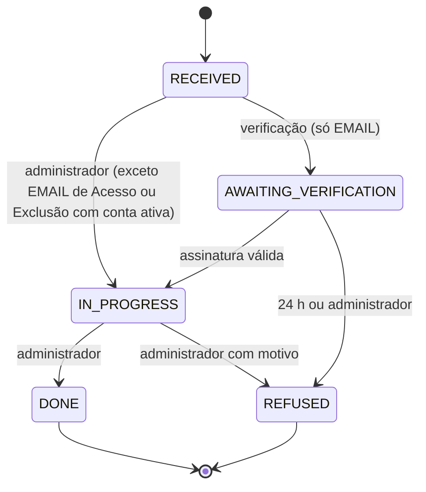
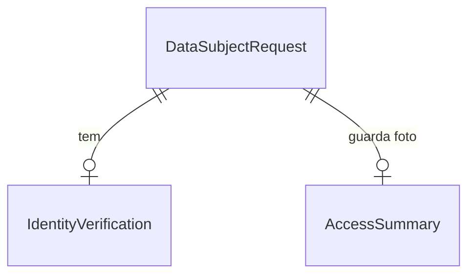

# Especificação funcional — U4 `u4-data-requests`

Conversa: português (Brasil). Este documento é a fonte dos fluxos e dos estados da U4. O modelo de dados está em `entities.md` e as regras em `rules.md`.

A Unit implementa US5.1 a US5.9 de `inception/user-stories/stories.md`. Fontes:
- `inception/units-generation/unit-of-work.md`;
- `inception/requirements-analysis/requirements.md` (FR5, FR7.1);
- `inception/domain-design/components.md`;
- `inception/contract-design/contract-summary.md` (P1, P2, J1 a J4);
- `functional-design-questions.md` (Q1 a Q8, todas A).

A rota de anonimização de P2 é da U5.

## Fluxos

### F1 — Pedido pela Conta (US5.1, US5.2)

1. Na Conta, seção "Meus dados (LGPD)", a pessoa escolhe o tipo, escreve o texto (contador até 1000) e envia com chave de idempotência.
2. A API valida (BR4.1) e confere se já há pedido aberto do mesmo tipo (BR4.2). Depois grava `RECEIVED`, com `dueAt` 15 dias depois, e publica `DATA_REQUEST_CREATED` sem o texto (BR4.3, BR4.6).
3. A lista mostra tipo, data, situação e prazo. O detalhe mostra a resposta, o motivo e o resumo de Acesso só depois de `DONE` ou `REFUSED` (BR4.4).
4. Um pedido de outra pessoa ou de outro tenant responde `404` (BR4.4).

### F2 — Atendimento pelo administrador (US5.3, US5.4, US5.5, US5.9)

1. A lista (T6) mostra tipo, origem, conta, recebimento, prazo e situação. Ela tem filtro por situação e alerta com ícone e texto a 3 dias ou menos do prazo, ou vencido (BR4.16).
2. O detalhe (T6a) mostra o texto, a resposta editável e as ações. Para ACCESS, mostra também a prévia do resumo (BR4.8). Para CORRECTION, o campo de resposta vem preenchido com o modelo (BR4.17).
3. A transição valida o estado de origem e o de destino e, numa recusa, o motivo (BR4.5). Concluir um ACCESS com `releaseAccessSummary` exige identidade confirmada quando a origem é EMAIL (BR4.9) e grava a foto do resumo (BR4.8).
4. Cada transição publica `DATA_REQUEST_TRANSITIONED` (BR4.6).

### F3 — Pedido por e-mail e verificação (US5.6)

1. Em T6b, o administrador registra o tipo, o texto, o contato, a data de recebimento e a conta opcional (BR4.10). O pedido nasce `EMAIL` e `RECEIVED`.
2. Um pedido ACCESS ou DELETION ligado a uma conta ativa não pode ir direto para Em andamento: o administrador inicia a verificação (T6c), que é o único caminho até Em andamento. O sistema gera a mensagem única, válida por 24 h, e leva o pedido a `AWAITING_VERIFICATION` (BR4.11). O administrador envia a mensagem ao contato fora do sistema.
3. O administrador cola a assinatura recebida. A J1 confere com a carteira da conta:
   - **válida:** o pedido vai para `IN_PROGRESS`, com `identityVerified`;
   - **inválida:** `422`, e o pedido continua aguardando;
   - **repetida:** `409 VERIFICATION_ALREADY_USED`.

   (BR4.12)
4. Sem assinatura válida em 24 h, o job recusa o pedido com "identidade não confirmada" (BR4.13).
5. Com o pedido encerrado, o app mostra a resposta pronta para o contato, e "Marcar como enviada" grava `replySentAt` (BR4.17).

### F4 — Vencimento e expurgo (US5.7, US5.8)

1. A cada 15 minutos, o job:
   - recusa as verificações vencidas;
   - publica `DATA_REQUEST_OVERDUE` uma única vez por pedido aberto vencido (BR4.14).
2. A métrica de vencidos e a saúde `dataRequests` refletem os vencidos abertos e voltam ao normal quando eles são encerrados (BR4.14).
3. Todo dia às 04:00 UTC, o expurgo apaga os pedidos encerrados há 12 meses. Ele declara o prazo e sai das pendências do catálogo de retenção da U2 (BR4.15).

## Estados

Texto: o pedido nasce Recebido. O administrador o leva a Em andamento; um pedido por e-mail pode antes ir a Aguardando verificação, que só sai por assinatura válida (Em andamento) ou por recusa (24 h ou o administrador). De Em andamento, o pedido vai a Concluído ou a Recusado com motivo. Concluído e Recusado são finais.

## Diagrama de entidades (derivado de `entities.md`)

Texto: um pedido pode ter uma verificação e, quando é um Acesso concluído com liberação, uma foto do resumo.

## Regras (resumo derivado de `rules.md`)

- **Criação, isolamento e privacidade dos textos:** BR4.1 a BR4.4.
- **Transições, auditoria e papel:** BR4.5 a BR4.7.
- **Resumo e identidade:** BR4.8 e BR4.9.
- **Pedido por e-mail e verificação:** BR4.10 a BR4.13.
- **Vencimento e expurgo:** BR4.14 e BR4.15.
- **Telas:** lista e respostas modelo em BR4.16 e BR4.17; acessibilidade em BR4.18.
- **Desempenho e trava:** BR4.19 e BR4.20.

## Decisões de implementação registradas

- **Módulo `com.memetrade.privacy`** (criado na U2): ganha domínio, infraestrutura e web dos pedidos. Ele depende de Identity, Bots, Ledger e Feedback só pelas interfaces J1 a J4 (novas: `PersonDataPort` no Identity, `BotOwnerDataPort.countOwnerBots`, `PaperOrderCountPort`, `FeedbackOwnerDataPort.countByUser`). Os métodos de escrita da U5 não entram.
- **Tabelas:**
  - `data_subject_request`, com índice único parcial dos abertos por tipo;
  - `data_subject_verification`.

  Uma migração só aditiva cria as duas.
- **Erros novos:**
  - `DATA_REQUEST_ALREADY_OPEN`, `DATA_REQUEST_CLOSED`, `INVALID_TRANSITION` e `IDENTITY_NOT_VERIFIED`;
  - `VERIFICATION_INVALID`, `VERIFICATION_EXPIRED` e `VERIFICATION_ALREADY_USED`.
- **Ações de auditoria:** `DATA_REQUEST_CREATED`, `DATA_REQUEST_TRANSITIONED`, `DATA_REQUEST_VERIFICATION_STARTED`, `DATA_REQUEST_VERIFIED` e `DATA_REQUEST_OVERDUE`, sem texto. A conta ligada vai como alvo, por identificador.
- **Mensagem de verificação:** a primeira linha `MemeTrade - verificação de pedido de titular` separa a mensagem da de login. O login já só aceita a mensagem exata de um desafio emitido por nonce, então não muda: um teste prova que a assinatura de verificação enviada ao login é recusada. A J1 `verifyAccountSignature` recusa toda mensagem que não comece pela linha de verificação, inclusive uma de login (AC5.6.7).
- **J1 novo método** `Optional<AccountRef> findAccount(UUID userId)`: devolve o tenant e o estado (`ACTIVE` ou `ANONYMIZED`) da conta, só para uso administrativo do Privacy. É aditivo ao contrato J1, e o bloco J1 do resumo de contratos é atualizado no mesmo commit.
- **Contrato P2:** `adminRegisterEmailRequest` ganha a resposta `409 DATA_REQUEST_ALREADY_OPEN` (aditiva). `adminTransitionDataRequest` explica que `RECEIVED` para `IN_PROGRESS` é recusado num pedido EMAIL de ACCESS ou DELETION com conta ativa.
- **Trava e rotas:** o prefixo `/api/v1/privacy/` entra nos prefixos liberados da trava da U3. As rotas novas entram no `route-registry.yml`: as do convidado com escopo `CLIENT` e teste negativo de tenant; as administrativas com escopo `ADMIN`.
- **Retenção:** a linha `DATA_SUBJECT_REQUESTS` do catálogo vira `PURGE dataSubjectRequestPurge` e sai da lista de pendências.
