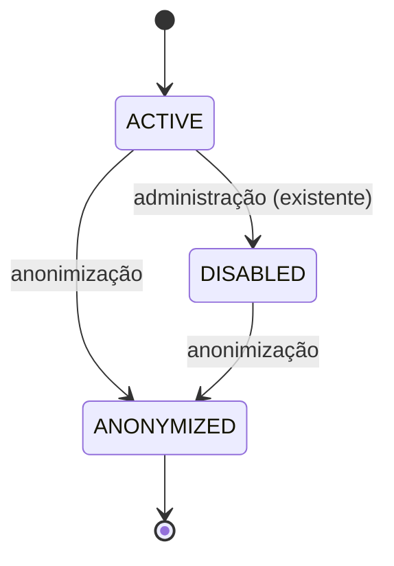
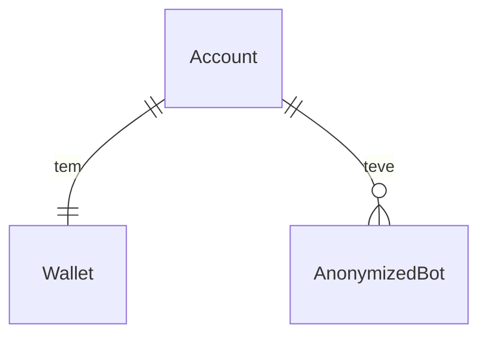

# Especificação funcional — U5 `u5-anonymization`

Conversa: português (Brasil). Este documento é a fonte dos fluxos e dos estados da U5. O modelo de dados está em `entities.md` e as regras em `rules.md`.

A Unit implementa US6.1, US6.2 e US6.3 de `inception/user-stories/stories.md`. Fontes:
- `inception/units-generation/unit-of-work.md`;
- `inception/requirements-analysis/requirements.md` (FR6);
- `inception/domain-design/components.md`;
- `inception/contract-design/contract-summary.md` (P2 anonimização, J1 a J3, J6);
- `functional-design-questions.md` (Q1 a Q5, todas A).

## Fluxos

### F1 — Acionar a anonimização (US6.1)

1. No detalhe de um pedido de Exclusão em andamento (T6a), o administrador abre "Anonimizar conta" (T8). O diálogo diz o que sai: a carteira, o provedor, as sessões, o feedback e os nomes dos bots. Diz também o que fica sem vínculo: o histórico PAPER, o ledger e os aceites.
2. O envio só habilita com `ANONIMIZAR` digitado (BR5.9). A chamada vai a `POST /api/v1/admin/privacy/requests/{id}/anonymization`, com chave de idempotência.
3. A API confere a confirmação, o tipo e o estado do pedido, a conta ligada e, na origem EMAIL, a identidade confirmada (BR5.1).

### F2 — Transação de anonimização (US6.2)

Tudo numa transação aberta pelo Privacy (BR5.2):
1. J2 `anonymizeOwnerBots`: trava pela `LockOrder` do módulo Bots: sistema, `bot_owner` e depois todas as linhas de `bot` da pessoa numa só consulta `FOR UPDATE` ordenada por `bot_id`, com o `lock_timeout` existente. A `LockOrder` ganha esse passo para vários bots. Então:
   - a regra nova `anonymizeStop` aceita `ACTIVE`, `PAUSED` e `CLOSING_PENDING` e leva os três direto a `STOPPED`, sem fechamento pendente;
   - o `ClosingCheckJob` já ignora um bot que não está mais em `CLOSING_PENDING`;
   - `DRAFT` e `VALIDATED` ficam no estado em que estão;
   - todos os bots são renomeados para "Bot anonimizado";
   - as posições abertas ficam como estão (BR5.3).
2. J3 `deleteByUser`: chama a função `erase_feedback_of_user` (`SECURITY DEFINER`), que apaga só o feedback da pessoa (BR5.8).
3. J1 `anonymizeAccount`:
   - trava as sessões da pessoa (`FOR UPDATE`, por `session_id`) e depois a conta;
   - grava `ANONYMIZED`;
   - apaga o endereço e o provedor (com `anonymized_at`);
   - revoga todas as sessões;
   - apaga os desafios desse endereço.

   A ordem bots, sessões e conta é a mesma dos caminhos concorrentes (BR5.6). Um `lock_timeout` desfaz tudo e responde `503`.
4. J6 publica `ACCOUNT_ANONYMIZED` pelo administrador, com `details` só de contagens e o identificador interno como alvo.
5. O pedido vai para `DONE` com a resposta modelo de exclusão, e o `DATA_REQUEST_TRANSITIONED` é publicado.

Qualquer exceção desfaz tudo, e o pedido continua `IN_PROGRESS` (AC6.2.4).

### F3 — Repetição e concorrência (US6.2)

- **Repetição** numa conta já `ANONYMIZED`: devolve o mesmo resultado, sem escrita nem evento (BR5.5).
- **Login e renovação concorrentes:** leem a conta com trava compartilhada. Se ela estiver `ANONYMIZED`, recusam (BR5.6).
- **Ciclo de bot concorrente:** relê o estado sob a trava existente e não age num bot `STOPPED` (BR5.6).

### F4 — Depois da anonimização (US6.3)

1. O login com a mesma carteira não encontra conta ativa e recusa como conta inexistente.
2. Um convite novo cria uma conta nova, sem histórico da antiga (BR5.7).

## Estados

Texto: a conta nasce ativa e pode ser desativada pela administração existente. Ativa ou desativada, ela pode ser anonimizada, e o estado anonimizado é final.

## Diagrama de entidades (derivado de `entities.md`)

Texto: a conta mantém a linha da carteira, sem endereço depois da anonimização. Os bots ficam parados e renomeados.

## Regras (resumo derivado de `rules.md`)

- **BR5.1:** acionamento.
- **BR5.2 e BR5.3:** a transação e o que fica intacto.
- **BR5.4:** o teste obrigatório.
- **BR5.5 e BR5.6:** repetição e concorrência.
- **BR5.7:** entrada bloqueada.
- **BR5.8:** gatilho do feedback.
- **BR5.9:** diálogo.

## Decisões de implementação registradas

- **Migração (expand):**
  - `app_user_status_ck` com `ANONYMIZED`;
  - `wallet.address` e `wallet.provider` sem `NOT NULL`;
  - coluna `wallet.anonymized_at` e `CHECK` de que endereço e provedor são nulos se e só se `anonymized_at` existe;
  - `CHECK` de Base58 só quando o endereço existe;
  - função `erase_feedback_of_user(uuid, uuid)` com `SECURITY DEFINER` e `search_path` fixo. O dono do esquema entra em `feedback_retention`, e o `EXECUTE` fica só para o papel da aplicação. O gatilho de `feedback_entry` não muda.
- **Leitores de `wallet.address` e `provider`:** passam a tratar nulo.
  - `JdbcAccountDetailsRepository` devolve `Optional` para a carteira, e a Conta de uma conta anonimizada nunca é lida (o login falha antes).
  - A listagem administrativa de contas mostra "Conta anonimizada", sem endereço mascarado.
  - A J1 `personSummary` devolve `Optional.empty()` para conta anonimizada.
  - O teste de cada leitor cobre o nulo.
- **Token já emitido:** a geração de código confere primeiro se a leitura por requisição existente (`JdbcSessionRepository`, que já calcula `user_status = ACTIVE`) recusa a conta anonimizada. Se não recusa, a consulta da trava da U3 passa a exigir `app_user.status = ACTIVE` e responde `401 SESSION_REVOKED`. Nos dois casos, um teste prova que o token de até 15 minutos deixa de valer na próxima requisição.
- **HMAC da carteira na trilha:** os eventos antigos guardam o HMAC por até 12 meses, e um convite novo com a mesma carteira gera o mesmo HMAC. A correlação fica restrita à trilha de segurança, que só o administrador lê, e acaba no expurgo de 12 meses. Essa é a decisão registrada para a pendência BR2.19 da U2.

  Cada changeset tem rollback, válido só antes da primeira anonimização.
- **Interfaces:** J1 `anonymizeAccount`, J2 `anonymizeOwnerBots` e J3 `deleteByUser`, todas com `Propagation.MANDATORY`. Os blocos J1 a J3 e J6 do resumo de contratos são atualizados.
- **Teste obrigatório do time:** "a anonimização não deixa a carteira em nenhuma tabela nem log". Ele varre todas as colunas de texto de todas as tabelas do esquema, inclusive a trilha, a saída da trilha e o payload JSON, e os logs capturados, procurando o endereço completo.
- **Mensagens:** a resposta modelo de exclusão entra nas respostas modelo do admin (U4).
