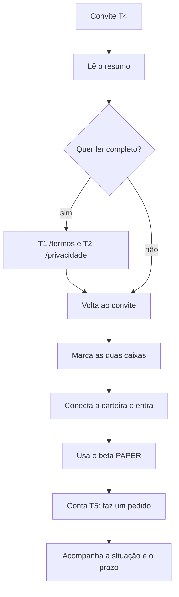
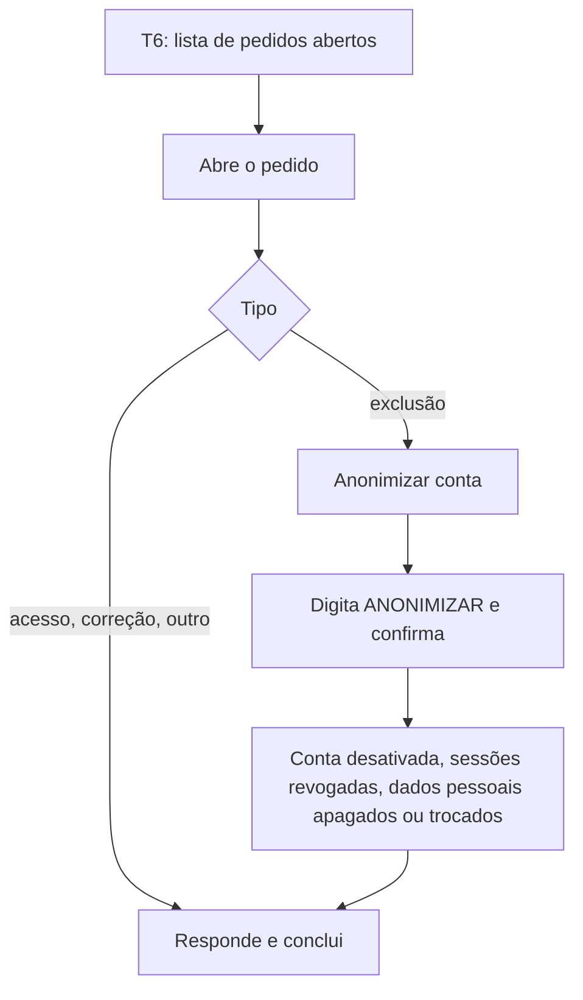

# Fluxos — Termos de uso e LGPD

Conversa: português (Brasil). Base: `ideation/intent-capture/intent-statement.md`, `ideation/scope-definition/scope-document.md`, `intent-backlog.md` e `rough-mockups-questions.md` (Q2).

## Fluxo do convidado

Texto: convite → resumo → (opcional) páginas completas → aceite → entra → usa o beta → Conta: pedido → acompanha a situação.

## Fluxo do administrador

Texto: lista → pedido → acesso, correção ou outro: responde e conclui; exclusão: anonimizar com dupla confirmação → conta desativada, sessões revogadas, dados pessoais apagados ou trocados → conclui.

## Mudança de versão

Versão nova publicada → no próximo acesso, a tela de novo aceite mostra o resumo do que mudou e os links → o convidado aceita → continua.

## Arquitetura da informação

| Lugar | Conteúdo |
|---|---|
| Páginas públicas | `/termos`, `/privacidade` |
| Rodapé | links para as duas páginas e a versão aceita, quando há login |
| Convite | resumo, links e aceite |
| Conta | versão aceita, pedidos de titular |
| Administrador | pedidos de titular e anonimização |
