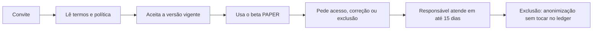

# Documento de escopo — Termos de uso e LGPD

Conversa: português (Brasil). Base: `ideation/intent-capture/intent-statement.md`, `ideation/feasibility/feasibility-assessment.md`, `constraint-register.md`, `raid-log.md` e as respostas de `scope-definition-questions.md`.

## Objetivo

Deixar o beta PAPER pronto para receber convidados com termos de uso definitivos e uma política de privacidade fiel ao que o sistema faz, cumprindo a LGPD (intent-statement.md).

## Dentro do escopo

| ID | Capacidade | Prioridade | Origem |
|---|---|---|---|
| C1 | Termos de uso v2 e política de privacidade, textos versionados no catálogo da U3, com novo aceite quando a versão muda | Must | Q1, Q2 |
| C2 | Páginas públicas `/termos` e `/privacidade`, sem login, com links no rodapé dos dois apps e na tela do convite | Must | Q1, Q2 |
| C3 | Tabela de retenção na política, ligada aos expurgos reais e coberta por testes | Must | Q1, Q2 |
| C4 | Pedidos de titular: formulário na tela Conta, registro com datas e prazo de 15 dias, atendimento no app do administrador | Must | Q2 |
| C5 | Exclusão por anonimização: conta desativada, sessões revogadas, dados que identificam a pessoa apagados ou trocados; ledger e auditoria preservados com identificadores internos | Must | Q2 |
| C6 | Campos de implantação: local de armazenamento, transferência internacional e e-mail do encarregado, configurados fora do código | Must | Q1, Q2 |
| C7 | Alerta de prazo dos pedidos no app do administrador | Should | Q2 |
| C8 | Histórico das versões anteriores dos documentos publicado na página | Could | Q2 |

**Escopo mínimo que entrega valor:** C1, C2, C3 e C6 (Q1).

## Fora do escopo

Banner de cookies de terceiros, exportação automática dos dados pelo próprio titular, textos em outros idiomas, termos do modo REAL e encarregado externo contratado (intent-statement.md).

## Dependências e ordem

- C2 depende de C1; C3 alimenta a seção de retenção de C1; C5 depende de C4; C6 bloqueia só a publicação da versão do beta (Q3).
- Ordem: C1, C3 e C2; depois C4 e C5, onde está o maior risco técnico; por último C6, na implantação (Q4).

## Prazo

Sem data fixa; tudo antes da abertura do beta (Q5). Desenvolvedor solo, sem orçamento extra (constraint-register.md, TL-C06).

## Restrições que limitam o escopo

Ledger append-only (TL-C02), sem script de terceiro (TL-C03), e-mail do encarregado fora do código (TL-C07), textos sem promessa de lucro e com aviso de simulação (TL-C08), tenant sempre do contexto de autenticação (TL-C09), publicação do beta só com o local de armazenamento definido (TL-C05) (constraint-register.md).

## Fluxo de valor

Texto do fluxo: convite → leitura dos termos e da política → aceite da versão vigente → uso do beta → pedido do titular → atendimento em até 15 dias → exclusão por anonimização, sem tocar no ledger.
