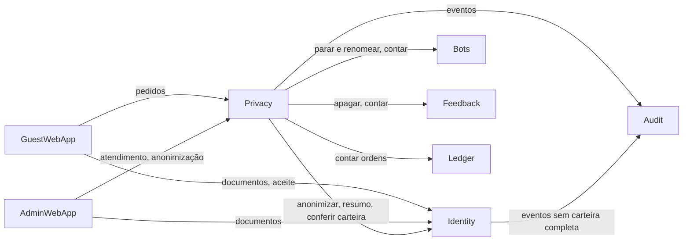

# Catálogo de componentes — Termos de uso e LGPD

Conversa: português (Brasil). Fontes:
- `inception/requirements-analysis/requirements.md`;
- `inception/user-stories/stories.md`;
- a base de conhecimento do código (`aidlc/spaces/default/codekb/eureka-trader-ai/architecture.md` e `component-inventory.md`);
- `inception/practices-discovery/team-practices.md`;
- as respostas de `domain-design-questions.md`.

O catálogo lista só os componentes que este trabalho cria ou muda. Os demais módulos do monólito ficam como estão. Infraestrutura (PostgreSQL) aparece como dependência externa.

## Catálogo (fonte da verdade)

```yaml
components:
  - name: Identity
    summary: Conta, carteira, sessões, catálogo de termos versionado, aceite e trava de novo aceite
    behaviour: >
      Serve a versão vigente dos termos, da política e do aviso de risco, com resumos e campos de implantação vindos
      da configuração. Uma versão só fica vigente com a revisão jurídica registrada (data e responsável) e os campos
      de implantação preenchidos; senão mantém a anterior e registra aviso. Grava aceites novos sem alterar os
      anteriores; versão enviada diferente da vigente responde TERMS_VERSION_OUTDATED; aceite repetido não grava de
      novo. Um filtro web, depois da autenticação, responde TERMS_REACCEPTANCE_REQUIRED a toda rota do convidado fora
      da lista liberada (documentos, aceite, Conta, pedidos de titular, sair); o worker não passa por ele. Expurga
      desafios de login 24 h após expirarem e sessões e digests 30 dias após o fim ou a revogação. Oferece interfaces
      públicas para anonimizar a conta (revogar sessões, apagar os desafios de login daquele endereço, apagar carteira
      e provedor, estado ANONYMIZED) e para ler o resumo da pessoa (carteira mascarada, datas, versões aceitas). O
      estado ANONYMIZED e a carteira sem endereço exigem migração expand-contract: o CHECK de app_user.status hoje só
      aceita ACTIVE e DISABLED, e wallet.address é obrigatório e único. Conta ANONYMIZED nunca reabre; a carteira só
      volta como conta nova por convite novo. O tenant vem sempre da autenticação. A lista de rotas liberadas do filtro
      inclui, por prefixo configurado, as rotas de pedidos de titular do Privacy, coberto por teste da lista.
    responsibilities:
      - Catálogo de termos e política versionado, com ativação condicionada à revisão jurídica
      - Aceite e novo aceite por versão
      - Trava das rotas do convidado até o novo aceite
      - Expurgo de desafios de login e de sessões
      - Anonimização dos dados de conta, carteira e sessões
    depends_on:
      - component: Audit
        interaction: publicar eventos de login, criação de conta e aceite sem a carteira completa
        style: sync
    dependents:
      - component: Privacy
        interaction: anonimizar conta e ler o resumo da pessoa
      - component: GuestWebApp
        interaction: documentos, aceite, novo aceite e Conta
      - component: AdminWebApp
        interaction: documentos para as páginas públicas do administrador
    external_dependencies:
      - name: PostgreSQL
        kind: database
        purpose: tabelas de conta, carteira, sessões, desafios e aceites
    entities:
      - name: TermsVersion
        identifier: version
        attributes: [version, effectiveAt, termsText, privacyText, riskNoticeText, termsSummary, privacySummary, legalReviewedAt, legalReviewedBy, storageLocation, internationalTransfer, dpoEmail]
      - name: TermsAcceptance
        identifier: acceptanceId
        attributes: [acceptanceId, userId, tenantId, version, acceptedAt, inviteId]
        references:
          - entity: Account
            owned_by: Identity
            relationship: cada aceite pertence a uma conta
      - name: Account
        identifier: userId
        attributes: [userId, tenantId, role, status, createdAt, lastLoginAt]
      - name: Wallet
        identifier: walletId
        attributes: [walletId, userId, address, provider, verifiedAt]
      - name: LoginChallenge
        identifier: nonce
        attributes: [nonce, walletAddress, message, expiresAt, state]
      - name: Session
        identifier: sessionId
        attributes: [sessionId, userId, refreshDigest, createdAt, endedAt, revokedAt]

  - name: Audit
    summary: Trilha de auditoria append-only, agora sem a carteira completa
    behaviour: >
      Recebe eventos pela tabela de saída e os grava sem edição. Eventos com carteira passam a guardar só o endereço
      mascarado e um código de correlação HMAC-SHA-256 com chave secreta da configuração; o endereço completo nunca é
      gravado em audit_event nem em audit_outbox. Expurga eventos com mais de 12 meses e saídas entregues há mais de
      7 dias, como hoje. Nunca grava texto de pedido de titular, mensagem ou assinatura de verificação. A mudança
      também tira o endereço completo de `details` nos eventos de login do convidado e do administrador
      (`AdminLoginService` hoje o grava). O HMAC é um campo novo (walletHmac) ao lado das colunas existentes.
    responsibilities:
      - Gravar eventos sem a carteira completa
      - Correlação por HMAC
      - Retenção da trilha e da saída
    depends_on: []
    dependents:
      - component: Identity
        interaction: eventos de conta, login e aceite
      - component: Privacy
        interaction: eventos de pedidos, verificação e ACCOUNT_ANONYMIZED
    external_dependencies:
      - name: PostgreSQL
        kind: database
        purpose: audit_event e audit_outbox
    entities:
      - name: AuditEvent
        identifier: eventId
        attributes: [eventId, action, actorType, actor, targetRef, correlationId, walletHmac, tenantId, details, occurredAt]

  - name: Privacy
    summary: Pedidos de titular, verificação de identidade, resumo de Acesso, catálogo de retenção e coordenação da anonimização
    behaviour: >
      Cria pedidos dos tipos Acesso, Correção, Exclusão e Outro (texto até 1000, um aberto por tipo e pessoa), com
      prazo de 15 dias corridos e estados Recebido, Aguardando verificação (só origem e-mail), Em andamento,
      Concluído e Recusado (motivo obrigatório); estados encerrados não mudam. Pedidos por e-mail são registrados pelo
      administrador com contato e conta opcional. A verificação gera mensagem única por pedido (domínio, pedido,
      finalidade, validade de 24 h), aceita só assinatura da carteira da conta, é de uso único e não vale para login
      nem para operar; sem assinatura em 24 h o pedido é recusado com "identidade não confirmada". Liberar resumo de
      Acesso ou anonimizar exige identidade confirmada em pedido por e-mail (IDENTITY_NOT_VERIFIED). O resumo de
      Acesso é montado pelas interfaces públicas de leitura de Identity, Bots, Ledger e Feedback. A anonimização abre
      uma transação e chama Bots, Feedback, Identity e Audit nessa ordem; qualquer falha desfaz tudo; repetir numa conta
      ANONYMIZED não muda nada. Pedido vencido gera DATA_REQUEST_OVERDUE uma vez, métrica e saúde DEGRADED. Pedidos
      encerrados há 12 meses são apagados. O catálogo de retenção lista cada dado, finalidade, prazo, ação no fim e
      quem aplica, e é a fonte da tabela da política e do teste de conformidade. Isolamento por tenant e pessoa; rotas
      administrativas só para ADMIN; nenhum texto de pedido, mensagem ou assinatura em log ou evento.
    responsibilities:
      - Pedidos de titular e o ciclo de vida deles
      - Verificação de identidade por assinatura para pedidos por e-mail
      - Resumo de Acesso
      - Coordenação da anonimização
      - Catálogo de retenção e expurgo dos próprios pedidos
      - Alerta de prazo vencido
    depends_on:
      - component: Identity
        interaction: anonimizar conta, ler resumo da pessoa e conferir a carteira da conta na verificação
        style: sync
      - component: Bots
        interaction: parar e renomear os bots da pessoa; contar bots
        style: sync
      - component: Feedback
        interaction: apagar o feedback da pessoa; contar feedbacks
        style: sync
      - component: Ledger
        interaction: contar ordens PAPER da pessoa
        style: sync
      - component: Audit
        interaction: publicar eventos de pedidos, verificação e ACCOUNT_ANONYMIZED
        style: sync
    dependents:
      - component: GuestWebApp
        interaction: criar e acompanhar pedidos
      - component: AdminWebApp
        interaction: atender, verificar, recusar, registrar por e-mail e anonimizar
    external_dependencies:
      - name: PostgreSQL
        kind: database
        purpose: pedidos e verificações
    entities:
      - name: DataSubjectRequest
        identifier: requestId
        attributes: [requestId, tenantId, userId, type, origin, status, details, contact, receivedAt, dueAt, response, refusalReason, accessSummary, closedAt, replySentAt, overdueNotifiedAt]
        references:
          - entity: Account
            owned_by: Identity
            relationship: cada pedido pertence a no máximo uma conta (pedido por e-mail pode não ter conta)
      - name: IdentityVerification
        identifier: verificationId
        attributes: [verificationId, requestId, message, expiresAt, confirmedAt, usedAt]
        references:
          - entity: DataSubjectRequest
            owned_by: Privacy
            relationship: cada verificação pertence a um pedido
      - name: RetentionRule
        identifier: dataItem
        attributes: [dataItem, purpose, period, endAction, enforcedBy]

  - name: Bots
    summary: Bots PAPER (módulo existente), com interfaces novas para anonimização e contagem
    behaviour: >
      Ganha interfaces públicas para parar e renomear para "Bot anonimizado" todos os bots de uma pessoa, na transação
      de quem chama, e para contar os bots da pessoa. Trava primeiro os bots da pessoa para nenhum ciclo novo criar
      ordem durante a anonimização. Os comandos de bot do convidado ficam atrás do filtro web de novo aceite do
      Identity, que age antes da requisição chegar ao Bots (não é chamada do Bots ao Identity). A referência
      ownerUserId aponta para Account, do Identity, só como identificador, sem chamada nem leitura de tabela.
    responsibilities:
      - Parar e renomear os bots da pessoa
      - Contar os bots da pessoa
    depends_on: []
    dependents:
      - component: Privacy
        interaction: anonimização e contagem
    external_dependencies:
      - name: PostgreSQL
        kind: database
        purpose: tabela de bots
    entities:
      - name: Bot
        identifier: botId
        attributes: [botId, ownerUserId, tenantId, name, state]
        references:
          - entity: Account
            owned_by: Identity
            relationship: cada bot pertence a uma conta

  - name: Feedback
    summary: Feedback do beta (módulo existente), com interfaces novas para exclusão e contagem
    behaviour: >
      Ganha interfaces públicas para apagar todo o feedback de uma pessoa na transação de quem chama e para contá-lo.
      O expurgo de 180 dias continua. A referência userId aponta para Account, do Identity, só como identificador.
    responsibilities:
      - Apagar o feedback da pessoa
      - Contar o feedback da pessoa
    depends_on: []
    dependents:
      - component: Privacy
        interaction: anonimização e contagem
    external_dependencies:
      - name: PostgreSQL
        kind: database
        purpose: feedback_entry
    entities:
      - name: FeedbackEntry
        identifier: entryId
        attributes: [entryId, userId, tenantId, screen, text, createdAt]
        references:
          - entity: Account
            owned_by: Identity
            relationship: cada feedback pertence a uma conta

  - name: Ledger
    summary: Núcleo financeiro PAPER (módulo existente), só com uma interface nova de contagem
    behaviour: >
      Ganha uma interface pública de leitura que conta as ordens PAPER da pessoa. Nada muda no ledger, nos fills nem
      nas ordens: continuam append-only e nunca são alterados pela anonimização. A referência ownerUserId aponta para
      Account, do Identity, só como identificador.
    responsibilities:
      - Contar as ordens PAPER da pessoa
    depends_on: []
    dependents:
      - component: Privacy
        interaction: contagem para o resumo de Acesso
    external_dependencies:
      - name: PostgreSQL
        kind: database
        purpose: paper_order e ledger_entry
    entities:
      - name: PaperOrder
        identifier: orderId
        attributes: [orderId, ownerUserId, tenantId, botId, createdAt]
        references:
          - entity: Account
            owned_by: Identity
            relationship: cada ordem pertence a uma conta

  - name: GuestWebApp
    summary: App do convidado (Next.js) com páginas legais, rodapé, convite, novo aceite e Meus dados
    behaviour: >
      features/legal com /termos e /privacidade (LegalDocument, públicas, adaptáveis de 320 px), SiteFooter no shell,
      convite com resumo e duas caixas, features/terms-reacceptance (T7) ao receber TERMS_REACCEPTANCE_REQUIRED, e
      features/account ampliado com o formulário e a lista de pedidos. Tipos gerados do contrato da API.
    responsibilities:
      - Telas T1 a T5 e T7
    depends_on:
      - component: Identity
        interaction: documentos, aceite e novo aceite
        style: sync
      - component: Privacy
        interaction: criar e acompanhar pedidos
        style: sync
    dependents: []
    entities: []

  - name: AdminWebApp
    summary: App do administrador (Next.js) com pedidos de titular, verificação, recusa, registro por e-mail e anonimização
    behaviour: >
      features/data-requests com T6, T6a, T6b, T6c e T8; LegalDocument e SiteFooter nas páginas públicas. Tipos
      gerados do contrato da API administrativa.
    responsibilities:
      - Telas T6, T6a, T6b, T6c e T8
    depends_on:
      - component: Privacy
        interaction: atender, verificar, recusar, registrar e anonimizar
        style: sync
      - component: Identity
        interaction: documentos para as páginas públicas
        style: sync
    dependents: []
    entities: []
```

## Diagrama



Texto do diagrama:
- os dois apps chamam `Identity` (documentos e aceite) e `Privacy` (pedidos);
- `Privacy` chama `Identity`, `Bots`, `Feedback`, `Ledger` e `Audit`;
- `Identity` chama `Audit`.

Não há ciclo.

## Resumo dos componentes

| Component | Purpose | Depends On | Dependents | Entities Owned |
|---|---|---|---|---|
| Identity | Conta, carteira, sessões, termos, aceite e trava | Audit | Privacy, GuestWebApp, AdminWebApp | TermsVersion, TermsAcceptance, Account, Wallet, LoginChallenge, Session |
| Audit | Trilha sem carteira completa | — | Identity, Privacy | AuditEvent |
| Privacy | Pedidos, verificação, resumo, retenção, anonimização | Identity, Bots, Feedback, Ledger, Audit | GuestWebApp, AdminWebApp | DataSubjectRequest, IdentityVerification, RetentionRule |
| Bots | Parar, renomear e contar bots | — | Privacy | Bot |
| Feedback | Apagar e contar feedback | — | Privacy | FeedbackEntry |
| Ledger | Contar ordens PAPER | — | Privacy | PaperOrder |
| GuestWebApp | Telas do convidado | Identity, Privacy | — | — |
| AdminWebApp | Telas do administrador | Privacy, Identity | — | — |

## Propriedade das entidades

| Entity | Owning Component | Identifier | Attributes | References |
|---|---|---|---|---|
| TermsVersion | Identity | version | version, effectiveAt, termsText, privacyText, riskNoticeText, termsSummary, privacySummary, legalReviewedAt, legalReviewedBy, storageLocation, internationalTransfer, dpoEmail | — |
| TermsAcceptance | Identity | acceptanceId | acceptanceId, userId, tenantId, version, acceptedAt, inviteId | Account |
| Account | Identity | userId | userId, tenantId, role, status, createdAt, lastLoginAt | — |
| Wallet | Identity | walletId | walletId, userId, address, provider, verifiedAt | — |
| LoginChallenge | Identity | nonce | nonce, walletAddress, message, expiresAt, state | — |
| Session | Identity | sessionId | sessionId, userId, refreshDigest, createdAt, endedAt, revokedAt | — |
| AuditEvent | Audit | eventId | eventId, action, actorType, actor, targetRef, correlationId, walletHmac (novo), tenantId, details, occurredAt | — |
| DataSubjectRequest | Privacy | requestId | requestId, tenantId, userId, type, origin, status, details, contact, receivedAt, dueAt, response, refusalReason, accessSummary, closedAt, replySentAt, overdueNotifiedAt | Account |
| IdentityVerification | Privacy | verificationId | verificationId, requestId, message, expiresAt, confirmedAt, usedAt | DataSubjectRequest |
| RetentionRule | Privacy | dataItem | dataItem, purpose, period, endAction, enforcedBy | — |
| Bot | Bots | botId | botId, ownerUserId, tenantId, name, state | Account |
| FeedbackEntry | Feedback | entryId | entryId, userId, tenantId, screen, text, createdAt | Account |
| PaperOrder | Ledger | orderId | orderId, ownerUserId, tenantId, botId, createdAt | Account |

## Dependências externas

| Component | Dependency | Kind | Purpose |
|---|---|---|---|
| Identity | PostgreSQL | database | conta, carteira, sessões, desafios, aceites |
| Audit | PostgreSQL | database | audit_event, audit_outbox |
| Privacy | PostgreSQL | database | pedidos e verificações |
| Bots | PostgreSQL | database | bots |
| Feedback | PostgreSQL | database | feedback |
| Ledger | PostgreSQL | database | ordens e ledger |

## Justificativa

| Component | Por que é separado |
|---|---|
| Identity | Dono dos dados de identidade e dos termos (dados próprios); a trava do aceite pertence a quem conhece a versão aceita |
| Audit | Ciclo de vida próprio (append-only, 12 meses) e regra de minimização própria |
| Privacy | Preocupação distinta (direitos do titular, prazos legais), dados próprios (pedidos, verificações) e ritmo de mudança ligado à regulação; coordena sem ler tabelas de outros |
| Bots, Feedback, Ledger | Já existem; cada um apaga, troca ou conta só os próprios dados, como pede a regra do time |
| GuestWebApp, AdminWebApp | Apps separados já existentes (públicos diferentes, papéis diferentes) |

**Alternativas rejeitadas:**
- tudo em `Identity`: misturaria direitos do titular com autenticação e faria o `Identity` depender de `Bots` e `Ledger`;
- anonimização por eventos assíncronos: sem transação única, uma falha deixaria a conta meio anonimizada;
- consulta SQL única para o resumo: quebraria a regra de não ler tabelas de outro módulo.

Detalhes em `decisions.md`.
