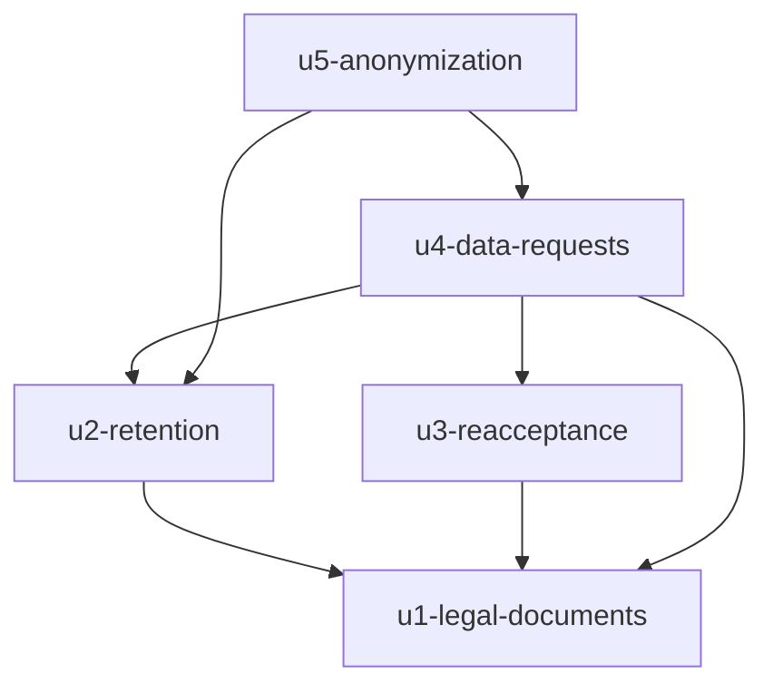

# Dependências entre Units — Termos de uso e LGPD

Conversa: português (Brasil). Fontes: `inception/domain-design/components.md`, `decisions.md`, `inception/requirements-analysis/requirements.md`, `inception/user-stories/stories.md` e `units-generation-questions.md` (Q2, Q3).

## Grafo

```yaml
units:
  - name: u1-legal-documents
    kind: service
    depends_on: []
  - name: u2-retention
    kind: service
    depends_on: [u1-legal-documents]
  - name: u3-reacceptance
    kind: service
    depends_on: [u1-legal-documents]
  - name: u4-data-requests
    kind: service
    depends_on: [u1-legal-documents, u2-retention, u3-reacceptance]
  - name: u5-anonymization
    kind: service
    depends_on: [u4-data-requests, u2-retention]
```



Texto:
- U2 e U3 dependem de U1;
- U4 depende de U1, de U2 (que cria a base do módulo `privacy`) e de U3 (filtro com a lista liberada);
- U5 depende de U4 e de U2.

Não há ciclo.

## Pontos de integração

| De | Para | Como | O quê |
|---|---|---|---|
| U2 | U1 | interface Java (`Privacy` → catálogo de termos) | U2 cria a base do módulo `privacy` (pacote, interface pública e `RetentionRule`); a tabela de retenção da política passa a vir do catálogo de retenção |
| U4 | U2 | módulo `privacy` | U4 estende o módulo criado em U2 com pedidos e verificação |
| U3 | U1 | interface Java no `Identity` | versão vigente do catálogo para o filtro e o aceite |
| U4 | U1 | página `/privacidade` | o botão "Fazer um pedido", entregue em U1 levando à Conta já existente, passa a cair na seção "Meus dados (LGPD)" criada em U4 |
| U4 | U3 | configuração | U3 entrega o filtro com a lista liberada por prefixos configuráveis; U4 registra o prefixo das rotas de pedidos e traz o teste de que elas ficam liberadas durante o novo aceite |
| U5 | U4 | interface Java no `Privacy` | pedido de Exclusão em andamento e identidade confirmada |
| U5 | U2 | comportamento do `Audit` | a trilha sem o endereço completo é pré-requisito do teste "sem resíduo" |
| todas | apps | API REST | tipos gerados do contrato |

## Fatia fina

U1 é a primeira Unit e roda sozinha: `/privacidade` servida pela API, a partir do catálogo v2, e mostrada sem login, com um spec novo de ponta a ponta no `verify.sh`. Ela não precisa de nenhuma outra Unit, porque a seção de retenção usa o texto do catálogo de termos até U2 existir.

## Oportunidades de paralelismo

U2 e U3 não dependem entre si. Mesmo assim, o time trabalha uma Unit por vez (Q2). A ordem válida é U1, U2, U3, U4, U5 (ou U1, U3, U2, U4, U5).
