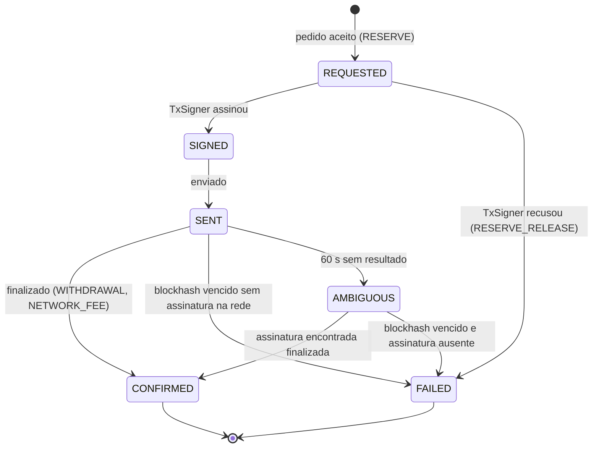
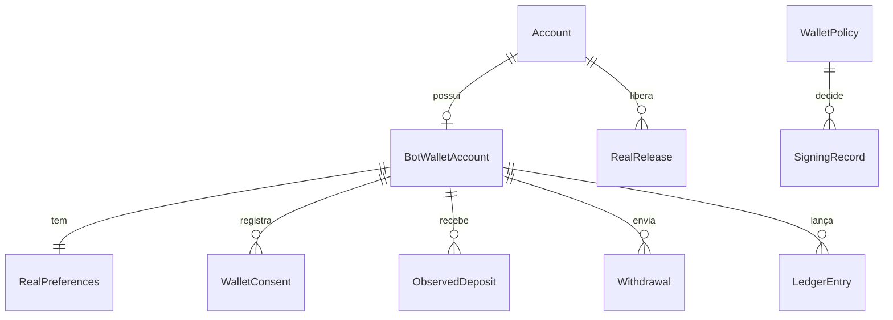

# Especificação funcional — U1 `u1-bot-wallet`

Conversa: português (Brasil). Esta Unit implementa as histórias US1.2, US2.2, US5.1 e US8.5 de `inception/user-stories/stories.md`, e a parte de servidor da US1.1 (versão v3 e recusa da ativação), conforme `inception/units-generation/unit-of-work-story-map.md` e `inception/units-generation/unit-of-work.md`. Outras fontes: `inception/requirements-analysis/requirements.md`, `inception/domain-design/components.md`, `inception/contract-design/contract-summary.md` (R1, R2, M1 a M3, M8, M9) e `functional-design-questions.md` (Q1 a Q11). Este arquivo é a fonte da verdade dos fluxos e das máquinas de estado; o diagrama e o resumo de regras no fim são derivados de `entities.md` e `rules.md`.

## Escopo da Unit

- **Entra:** termos v3 no catálogo e recusa da ativação sem aceite; liberação mínima por semente de teste; desafio e consentimento; ativação com criação de chave no TxSigner; preferências (teto, modo para baixo, pausa e retomada); detecção de depósito; saque; auditoria tipada; ledger REAL para depósito, saque, taxa e reserva; tela mínima de ativação, endereço, saldo e saque.
- **Não entra:** ordens e swaps (U4), barreira (U3), reconciliação e área do administrador (U5), telas completas (U6).
- **Processos:** API (rotas R2), worker (varredura de depósitos e acompanhamento de saques), TxSigner (processo próprio, R1).

## Fluxos

### F1 — Ativar a carteira do bot (US1.2; US1.1 no servidor)

1. O usuário abre a ativação. A API confere BR1.1 (REAL ligado), BR1.2 (termos v3) e BR1.3 (liberação vigente); falhando, devolve o erro e a tela mostra o motivo, sem passos seguintes.
2. O usuário escolhe o teto (até `maxCapLamports`) e pede o desafio ACTIVATE. A API confere BR1.4 (sem carteira ativa) e monta a mensagem canônica com modo SIGNED, o teto escolhido, `bot-wallet: NEW`, a rede do ambiente, a carteira principal verificada no login, nonce novo e validade de 5 min (BR1.9).
3. A tela pede à carteira principal que assine a mensagem.
4. A API recebe `challengeId` e assinatura e confere BR1.5 pela M9, comparando a mensagem byte a byte com a guardada; trava o desafio (`IN_USE`) sem consumi-lo (BR1.10).
5. A API chama o R1 `POST /wallets` com `requestId` = `challengeId`, a carteira principal, a mensagem e a assinatura.
6. O TxSigner confere o flag dele (BR1.1) e confere de novo a mensagem, os limites e o nonce (BR5.3). Ele cria a chave no KMS, grava a WalletPolicy (carteira principal fixa, teto e modo autorizados, `creationRequestId`) e devolve o endereço e a referência opaca (BR1.6). Para o mesmo `requestId`, devolve sempre a mesma carteira.
7. Numa única transação, a API consome o desafio, grava o nonce (BR1.8), grava BotWalletAccount, RealPreferences (BR1.7) e WalletConsent, e registra os eventos de ativação criada e consentimento aceito (BR6.1).
8. A tela mostra o endereço para depósito e o aviso de que o bot só opera até o teto.

**Falhas:**
- Passo 5 ou 6 sem resposta: o desafio volta a `PENDING`, a ativação responde 503, e o usuário pode repetir com o mesmo desafio enquanto ele valer. O mesmo `requestId` devolve a mesma carteira, então não nasce uma segunda chave.
- Desafio vencido com política criada no TxSigner e sem carteira na API: a verificação diária de órfãs alerta. O endereço nunca foi mostrado, então não recebe depósito.
- Passo 6 recusado: o desafio é consumido, a ativação falha com 422 CONSENT_INVALID e o evento de recusa é gravado.

### F2 — Mudar teto, modo ou pausa (BR2.x)

1. **Baixar teto ou modo:** a API aplica na hora, avisa o TxSigner (`LOWER_CAP` ou `LOWER_MODE`) e grava o evento. Se o TxSigner estiver fora do ar, a mudança fica pendente e é reenviada; a API passa a usar o valor mais restrito.
2. **Subir teto (U1) ou modo (U4):** desafio RAISE_CAP ou RAISE_MODE, assinatura, conferência, depois o TxSigner confere de novo e amplia a política. Sem o aceite do TxSigner, nada muda.
3. **Pausar:** a API acrescenta o motivo USER. **Retomar:** só retira USER (BR2.3).

### F3 — Detectar depósitos (US2.2)

1. A cada 15 s, o worker lista as carteiras ACTIVE e pede à ChainWatcher as entradas finalizadas desde a última assinatura vista.
2. Para cada entrada nova (BR3.1), numa transação: grava ObservedDeposit, o lançamento DEPOSIT (`idempotencyKey` = assinatura) e o evento de auditoria.
3. Origem diferente da carteira principal (BR3.2): marca `knownSource=false`, grava a origem só como HMAC, alerta o administrador, avisa o usuário e grava um ReconciliationMark.
4. O canal ao vivo recebe `REAL_DEPOSIT`.
5. Falha da ChainWatcher: a varredura tenta de novo no próximo ciclo; nenhum depósito é perdido, porque a busca recomeça da última assinatura gravada.

### F4 — Calcular o saldo (BR3.3, BR3.4, BR3.5)

- **total:** soma, com sinal, dos lançamentos de saldo em SOL: DEPOSIT, WITHDRAWAL, NETWORK_FEE, RENT, as pernas em SOL de SWAP_FILL e COMPENSATION. RESERVE e RESERVE_RELEASE ficam fora dessa soma.
- **reservado:** soma(RESERVE) menos soma(RESERVE_RELEASE).
- **livre:** total menos reservado.
- **posições e ordens em andamento:** lidas do próprio ledger: SWAP_FILL por mint e RESERVE de ordem ainda sem liberação. A U1 não chama a U4.
- **reserva para taxas:** `feeReserveLamports`.
- **operável:** min(livre - reserva para taxas, teto).
- **acima do teto:** max(0, livre - reserva para taxas - teto).

### F5 — Sacar (US5.1)

1. O usuário pede um saque parcial (valor em lamports) ou total, com `Idempotency-Key` (BR4.8). Nenhuma condição de flag, kill switch, liberação, termos ou pausa bloqueia o pedido (BR4.2).
2. Numa única transação, com trava exclusiva da carteira (BR4.9): a API calcula o sacável a partir do ledger (BR4.3; com pausa DIVERGENCE, também limitado pela rede, BR4.6) e aplica BR4.4 ou BR4.5, recusando com o máximo sacável quando o valor não cabe. Em seguida grava o Withdrawal REQUESTED, o lançamento `RESERVE` (valor mais a taxa calculada, NFR4.3) e o evento.
3. O worker pede o blockhash recente e monta a transação na forma exata de BR5.1: uma transferência para `mainWalletAddress` e, no máximo, o limite e o preço de compute, sem nonce durável e sem tabela de endereços. Depois pede a assinatura ao TxSigner com `signingRequestId` e o contexto (valor e destino). O TxSigner aplica BR5.1 e BR5.2.
4. Com a transação assinada, o Withdrawal passa a SIGNED e guarda a `signedTransaction` e o `messageDigest`.
5. O worker envia pela ChainWatcher, e o Withdrawal passa a SENT.
6. Acompanhamento, sempre em commitment finalized:
   - **Finalizado:** CONFIRMED. Na mesma transação grava `WITHDRAWAL`(-valor), `NETWORK_FEE`(-taxa real) e `RESERVE_RELEASE`, mais o evento e um ReconciliationMark.
   - **Blockhash vencido sem a assinatura na rede:** FAILED, com `RESERVE_RELEASE` e o evento.
   - **Sem resultado em 60 s:** AMBIGUOUS (BR4.7).
7. AMBIGUOUS: a assinatura é conferida em finalized até a altura passar de `lastValidHeight`; então o saque vira CONFIRMED ou FAILED. Todo reenvio usa a `signedTransaction` guardada, e nunca se pede outra assinatura para o mesmo saque.
8. Recusa do TxSigner: FAILED com `failureCode`, RESERVE_RELEASE e alerta.

### F6 — Liberação mínima (BR7.1)

A semente do perfil de teste e local grava uma RealRelease do fundador de teste na rede do ambiente, com `effectiveAt` 24 h depois. Nos testes, o relógio injetável avança para tornar a liberação vigente.

## Máquinas de estado

### Withdrawal

Texto: pedido → assinado → enviado → confirmado; recusa ou blockhash vencido levam a falhou; sem resposta em 60 s fica ambíguo até a conferência na rede.

### BotWalletAccount

`ACTIVE` → `CLOSED` só pela anonimização (U5); na U1 só existe ACTIVE.

### ConsentChallenge

`emitido` → `consumido` (aceito ou recusado) ou `vencido` (5 min). Um desafio consumido ou vencido nunca é aceito.

## Modelo (derivado de entities.md)

Texto: cada conta tem no máximo uma carteira do bot; a carteira tem preferências, consentimentos, depósitos, saques e lançamentos; a liberação pertence à conta; a política e os registros de assinatura ficam no banco do TxSigner.

## Resumo das regras (derivado de rules.md)

| Grupo | Regras |
|---|---|
| Ativação e consentimento | BR1.1 a BR1.10 |
| Preferências e pausa | BR2.1 a BR2.3 |
| Depósito e saldo | BR3.1 a BR3.5 |
| Saque | BR4.1 a BR4.9 |
| TxSigner | BR5.1 a BR5.3 |
| Auditoria, ledger e isolamento | BR6.1 a BR6.4 |
| Liberação mínima | BR7.1 |

## Cenários de teste obrigatórios (testes antes do código)

- REAL desligado por padrão: nenhuma carteira criada e nenhuma assinatura (BR1.1).
- Mensagem de login no lugar do consentimento é recusada (BR1.5); nonce repetido é recusado nos dois lados (BR1.8).
- Saque para outro destino é recusado pela API e pelo TxSigner (BR4.1, BR5.1).
- Saque processado com kill switch, REAL desligado e sem o novo aceite (BR4.2).
- Saque ambíguo nunca gera segunda transação (BR4.7); mesma chave de idempotência devolve o mesmo saque (BR4.8).
- Depósito repetido é contado uma vez (BR3.1).
- Ataques ao TxSigner (BR5.1, BR5.2, BR5.3):
  - programa fora da lista; Assign, Allocate, CreateAccount ou TransferWithSeed escondidos no System Program;
  - duas transferências; nonce durável; tabela de endereços;
  - preço de prioridade acima do teto de taxa;
  - segundo assinante; outro pagador; destino estranho; valor diferente;
  - contexto ausente; tipo SWAP antes da U4;
  - mesmo `signingRequestId` com outra mensagem; consentimento com `purpose` ou `bot-wallet` trocados; teto acima de 10 SOL.
- Dois saques simultâneos da mesma carteira nunca sacam o mesmo saldo (BR4.9).
- Ativação com o TxSigner fora do ar e repetida com o mesmo desafio cria uma única carteira (BR1.10).
- Isolamento entre contas: carteira, saque ou depósito de outro usuário responde 404.
- Separação REAL e PAPER no ledger (BR6.3).

## Tela mínima

Uma página com ativação, endereço, saldo e saque, só para o esqueleto; os estados de carregando, erro e indisponível são visíveis em texto. A interface completa fica na U6.
