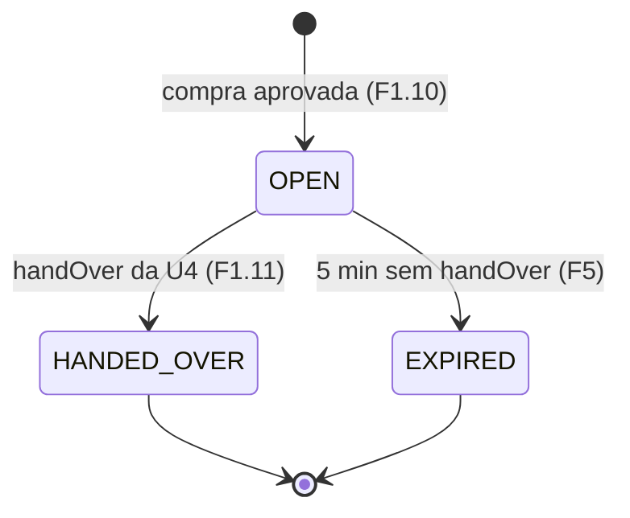
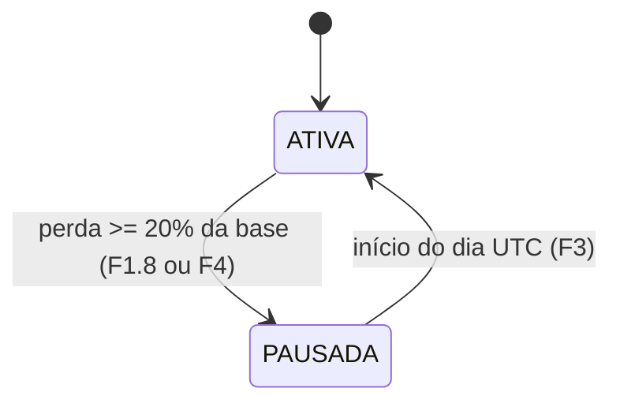
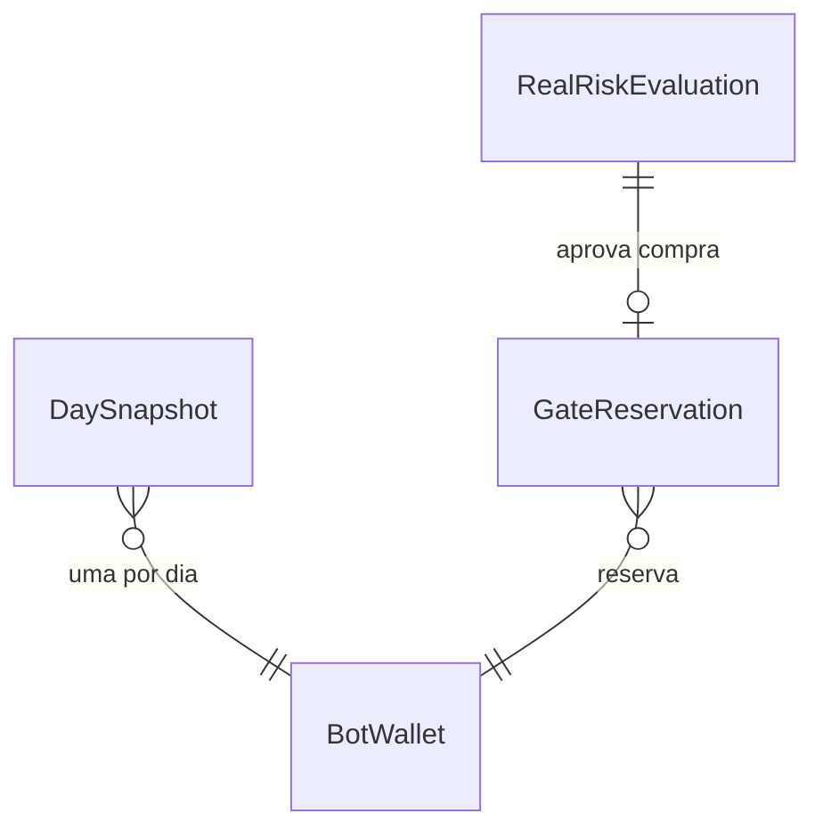

# Especificação funcional — U3 `u3-real-risk`

Conversa: português (Brasil). Fontes: `rules.md` (BR1.1 a BR7.3), `entities.md`, `inception/contract-design/contract-summary.md` (M1, M2, M4, M5), `inception/user-stories/stories.md` (US2.1, US6.1, US6.2, US6.3) e `functional-design-questions.md` (Q1 a Q12).

## Escopo

A U3 é a barreira REAL da RiskControl. Ela decide se uma ordem REAL pode seguir para a execução (U4), guarda a lista de bloqueio de tokens e pausa a carteira pela perda do dia.

A U3 não monta, assina nem envia transação, e não confere a idade da cotação da Jupiter (isso é da U4). A tela do teto e a validação do teto máximo no perfil ficam na U1 (preferências) e na U6 (campo).

## Interface M5 (ajustes aditivos ao contrato)

```text
evaluate(OrderIntent) -> Approved{ approvalId? } | Rejected{ code, detail, figures }
handOver(approvalId) -> HandedOver | AlreadyHandedOver | ReservationExpired
blockToken(chain, mint, reason, adminId) -> BlockedToken
unblockToken(chain, mint, adminId) -> Unblocked | NotBlocked
```

Os ajustes em relação ao `contract-summary.md` são três:
- `OrderIntent` ganha `origin`, `decisionId` e `tokenBaseUnits`;
- `handOver` é novo, e a U4 o chama na mesma transação do `RESERVE`;
- a regra "vendas de saída sempre passam" passa a valer só depois do estado e da fonte (BR1.1, BR1.2).

A U4 já depende da U3, então nenhuma aresta nova entra no grafo. Duas mudanças não são aditivas:
- a regra das vendas fica mais estreita;
- a M1 passa de `pausedReason` para `pausedReasons`, porque a U1 já guarda um conjunto de motivos.

A U4 ainda não foi construída, então nenhum consumidor quebra. Pela regra das interfaces de módulo, o contrato e os consumidores mudam no mesmo commit da Code Generation da U3.

Com a pausa `DAILY_LOSS`, as vendas do bot e as saídas automáticas pela barreira também param (Q8, "pausa do bot impede novas operações"). Só a liquidação pedida pelo usuário passa. As ordens condicionais da Jupiter (U7) já assinadas não passam pela barreira.

## Fluxos

### F1 — Avaliar uma compra do bot

1. A U4 chama `evaluate` dentro da transação do ciclo do bot, com origem `BOT` e lado `BUY`. A decisão é gravada pela M6 nessa mesma transação.
2. A U3 pega a trava da carteira do bot (BR6.1). Se já existe avaliação com o mesmo `decisionId`, devolve o resultado gravado e termina.
3. Lê o estado pela M1. Se a carteira não estiver liberada, estiver com o REAL desligado ou estiver pausada, recusa com `REAL_PAUSED` (BR1.1).
4. Lê o tipo de fonte pela M4. Se a fonte for simulada, recusa com `SIMULATED_SOURCE_ACTIVE` (BR1.2).
5. Lê a avaliação do scanner e a lista de bloqueio. Se o token não estiver disponível ou estiver bloqueado, recusa com `TOKEN_NOT_ELIGIBLE` (BR2.1, BR2.2).
6. Confere preço, liquidez e volume do token (BR3.1) e o preço de cada posição aberta (BR2.4). Se algum faltar ou tiver mais de 60 s, recusa com `STALE_DATA`.
7. Confere o tamanho da ordem (BR4.1) e o número de compras do bot no dia (BR4.2). Se passar, recusa com `REAL_LIMIT_EXCEEDED`.
8. Garante a foto do dia (BR4.4) e calcula a perda do dia (BR4.3). Se chegar a 20%, recusa com `REAL_LIMIT_EXCEEDED` / `DAILY_LOSS` e pausa a carteira.
9. Confere o teto e o saldo livre (BR5.1). Se não couber, recusa com `REAL_CAP_EXCEEDED`.
10. Aprova, grava a reserva `OPEN` (BR6.2) e a avaliação (BR7.1) na transação do ciclo, e devolve o `approvalId`. A trava acaba quando o ciclo termina. Uma recusa também é gravada e auditada na transação do ciclo (BR7.1).
11. Depois, em outra transação, o consumidor da fila da U4 pega a mesma trava, cria a ordem, grava o `RESERVE` no ledger e chama `handOver`. Se a reserva já venceu, a ordem não é criada.

### F2 — Avaliar uma venda

1. A U4 chama `evaluate` com lado `SELL`, origem `BOT` ou `USER_LIQUIDATION`.
2. Passos 3 e 4 de F1, com a exceção de BR1.1 para `USER_LIQUIDATION`.
3. Aprova sem reserva e grava a avaliação. Não há trava: a venda não consome teto nem limite.

### F3 — Trabalho do dia (a cada 5 min, uma instância por ShedLock)

1. Para cada carteira liberada sem foto do dia UTC atual, grava a foto (BR4.4). Na prática, a primeira execução depois de 00:00 UTC grava todas as fotos.
2. Retoma a pausa `DAILY_LOSS` de cada carteira pausada num dia anterior (BR4.5). O trabalho é idempotente.

### F4 — Trabalho da perda do dia (a cada minuto)

Para cada carteira liberada, sem pausa `DAILY_LOSS` e com foto do dia, calcula a perda (BR4.3). Se chegar a 20%, pausa a carteira com `DAILY_LOSS` pela M1.

### F5 — Vencimento das reservas (a cada minuto)

As reservas `OPEN` com `expiresAt` passado viram `EXPIRED` (BR6.2).

### F6 — Lista de bloqueio

A U5 chama `blockToken` ou `unblockToken` com o administrador autenticado. A U3 grava ou apaga, audita e devolve o resultado (BR2.3).

## Máquina de estados — GateReservation



Texto: `OPEN` vira `HANDED_OVER` pelo `handOver` ou `EXPIRED` pelo vencimento. Os dois estados finais não mudam mais.

## Máquina de estados — pausa DAILY_LOSS (vista pela U3; o estado fica na BotWallet)



Texto: a carteira ativa pausa ao chegar a 20% de perda e volta no dia seguinte. Outras pausas não são mexidas pela U3.

## Visão derivada — relações das entidades



Texto: uma avaliação aprovada de compra tem uma reserva. Cada carteira tem várias reservas e uma foto por dia. A lista de bloqueio não se liga a carteira nenhuma.

## Cenários

| # | Dado | Quando | Então |
|---|---|---|---|
| S1 | teto 10 SOL | compra de 1,1 SOL | `REAL_LIMIT_EXCEEDED` / `ORDER_SIZE` (AC6.1.1) |
| S2 | 20 compras aprovadas hoje pelo bot | 21ª compra | `REAL_LIMIT_EXCEEDED` / `DAILY_ORDER_COUNT` (AC6.1.3) |
| S3 | foto de 10 SOL, teto 10 SOL, valor atual 8 SOL, sem fluxos | compra | `DAILY_LOSS`, pausa até 00:00 UTC (AC6.1.2) |
| S4 | foto de 10 SOL, depósito de 2 SOL depois da foto, valor atual 10,5 SOL | compra | perda 1,5 SOL, abaixo de 2 SOL, segue |
| S4b | foto tirada às 09:00 depois de um depósito de 2 SOL às 08:00 | cálculo da perda | o depósito das 08:00 não entra: os fluxos contam a partir da foto |
| S4c | teto 0 | compra | `REAL_LIMIT_EXCEEDED` / `ORDER_SIZE` (o limite por ordem é 0); a perda do dia não se aplica e não há pausa |
| S5b | teto 10 SOL, saldo 20 SOL, posições a 8,5 SOL e 1 SOL em ordem ambígua sem preenchimento | compra de 0,9 SOL | `REAL_CAP_EXCEEDED` / `CAP` (8,5 + 1 + 0,9 > 10): a ordem ambígua conta no teto |
| S5c | mesma decisão avaliada duas vezes | segunda avaliação | devolve o mesmo resultado, sem contar outra compra nem outra reserva |
| S5 | duas decisões simultâneas de 0,6 SOL com 1 SOL de margem no teto | as duas avaliadas | uma aprovada, outra `REAL_CAP_EXCEEDED` (AC6.1.4) |
| S6 | reserva aprovada que virou ordem ambígua | nova compra | o `RESERVE` do ledger ainda conta no saldo (AC6.1.5) |
| S7 | saldo PAPER alto e saldo REAL zero | compra | `REAL_CAP_EXCEEDED` / `FREE_BALANCE` (AC6.1.6) |
| S8 | token sem avaliação | compra | `TOKEN_NOT_ELIGIBLE` / `NO_ASSESSMENT` (AC6.2.1) |
| S9 | posição com preço `unknown` | compra de outro token | `STALE_DATA` / `POSITION_PRICE_UNKNOWN` (AC6.2.2) |
| S10 | token bloqueado | compra; venda | compra `TOKEN_NOT_ELIGIBLE` / `BLOCKED`; venda aprovada (AC6.2.3) |
| S11 | fonte simulada ativa | compra ou venda | `SIMULATED_SOURCE_ACTIVE` (AC6.3.2) |
| S12 | preço do token com 61 s | compra | `STALE_DATA` / `SIGNAL_STALE` (AC6.3.3) |
| S13 | posições a 9 SOL, teto baixado para 5 SOL | compra; venda | compra `REAL_CAP_EXCEEDED`; venda aprovada; nada vendido à força (AC2.1.4) |
| S14 | posição com preço `unknown`, custo 2 SOL | cálculo do teto | a posição vale 2 SOL (AC2.1.3) |
| S15 | saldo livre 12 SOL, teto 10 SOL, sem posições | compra de 1 SOL | aprovada; o excedente de 2 SOL nunca entra (AC2.2.2) |
| S16 | kill switch ativo | "vender tudo e sacar" | `REAL_PAUSED` / `PAUSED_KILL_SWITCH`; o saque continua pela U1 |
| S17 | pausa `USER` | venda do bot; "vender tudo e sacar" | venda do bot `REAL_PAUSED`; liquidação aprovada |

## Erros e casos de canto

- **Sem transação ativa:** `evaluate` de compra falha com erro técnico e nunca aprova (BR6.1).
- **M4 sem resposta para o token:** é o mesmo que `unknown`, ou seja, `STALE_DATA`.
- **Avaliação do scanner falhando por erro técnico:** a compra é recusada com `TOKEN_NOT_ELIGIBLE` / `NO_ASSESSMENT`, nunca aprovada.
- **Carteira sem foto do dia e sem M2 disponível:** erro técnico e a compra não passa.
- **Relógio:** um só relógio injetável para 00:00 UTC, 60 s e 5 min.
