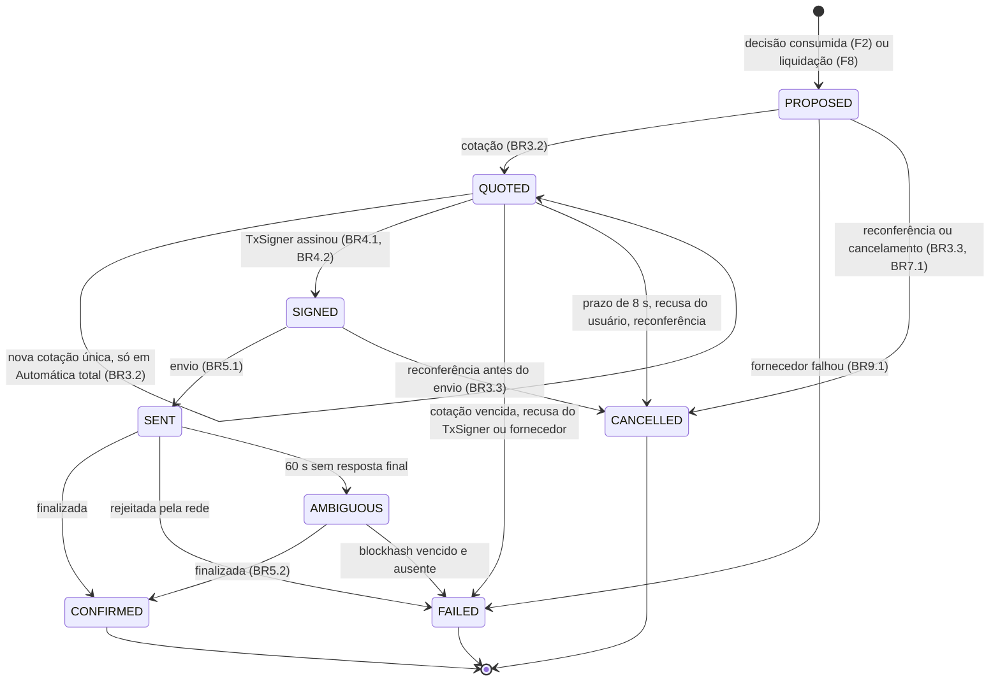
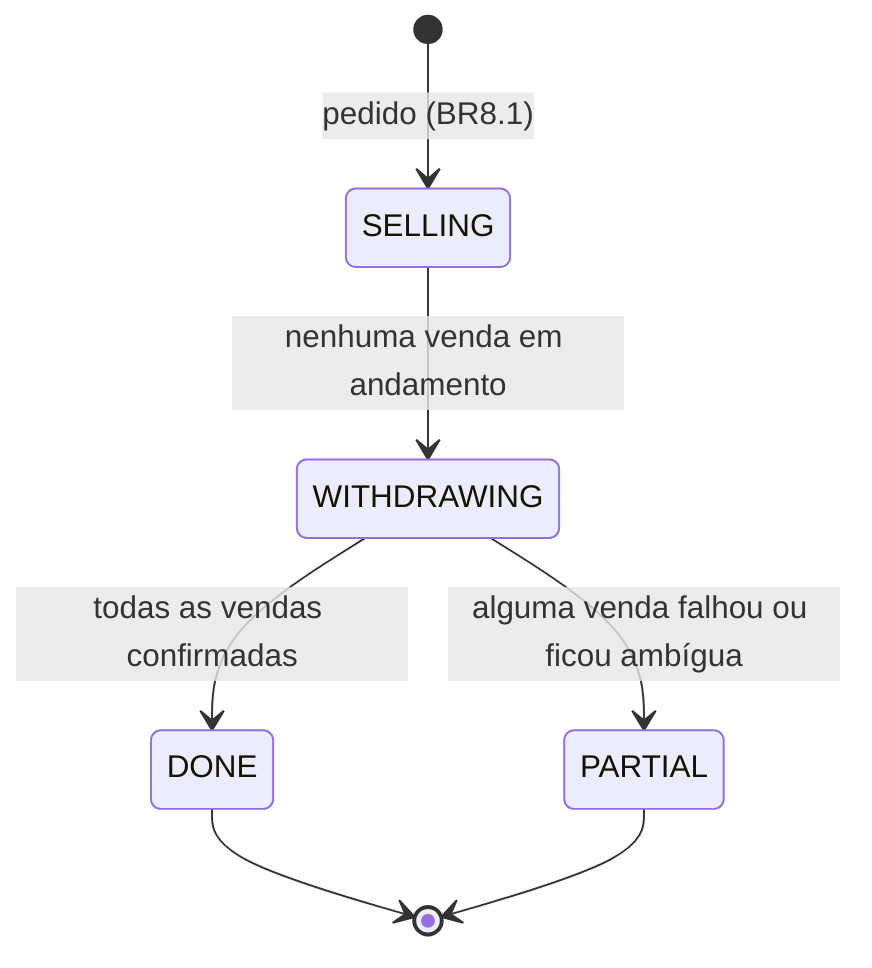
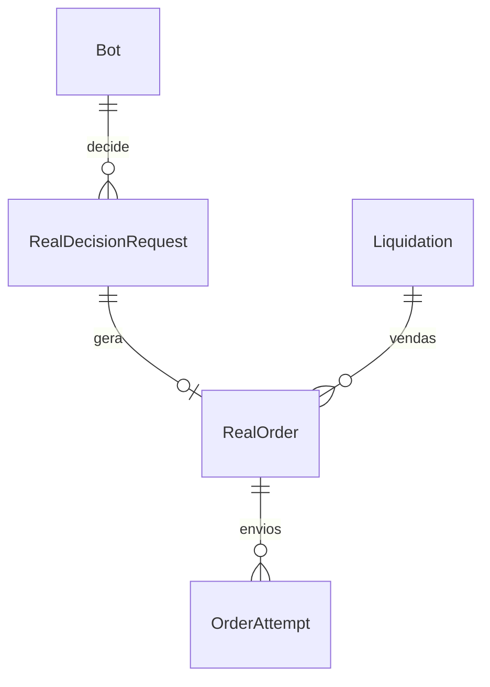

# Especificação funcional — U4 `u4-real-execution`

Conversa: português (Brasil). Fontes: `rules.md` (BR1.1 a BR10.2), `entities.md`, `inception/contract-design/contract-summary.md` (R1, R3, R6, M1 a M6, X1, X3 e adendos), `inception/user-stories/stories.md` e `functional-design-questions.md` (Q1 a Q15).

## Escopo

A U4 executa as ordens REAL, da decisão do bot até o ledger:
- o bot REAL e a fila de decisões;
- a máquina de estados da ordem, a cotação e o swap pela Jupiter;
- a assinatura pelo TxSigner (Automática total) ou pela cossinatura da carteira principal (Assinada), e a política de swap do TxSigner;
- o envio, a confirmação e a ordem ambígua;
- os lançamentos no ledger e o P&L REAL;
- a troca de modo e o "vender tudo e sacar".

As telas ficam na U6. As ordens condicionais e a exportação fiscal ficam na U7. A reconciliação, a liberação e o kill switch ficam na U5, que usa a M6 `cancelUnsent`.

## Mudanças de contrato (adendo da U4)

- **R1 `/signatures`:** passa a aceitar `operationKind: SWAP`, com `mode` (`SIGNED` ou `AUTO_FULL`), `quotedOut`, `minOut` e `maxSlippageBps`. No modo `SIGNED`, a transação recebida já traz a assinatura da carteira principal.
- **M6:** passa a ter `recordDecision`, `hasOrderInProgress(botId)`, `cancelUnsent(scope, reason)` e `recentOrders`.
- **Bot:** ganha o campo `market` no OpenAPI do bot. É aditivo, com `PAPER` como padrão.

## Fluxos

### F1 — Decisão do bot REAL (no ciclo)

1. O ciclo do bot REAL decide comprar ou vender.
2. Pergunta à M6 se há ordem em andamento. Se houver, descarta a decisão com `ORDER_IN_PROGRESS` (BR2.2).
3. Confere a posse do bot e chama a M5 `evaluate`. Recusa: fim, com o motivo registrado pela U3.
4. Aprovada: `recordDecision` grava a `RealDecisionRequest` `PENDING` na transação do ciclo (BR1.2).

### F2 — Consumo da decisão (worker, a cada 200 ms)

1. Pega as decisões `PENDING` com `SKIP LOCKED`.
2. Confere a posse do bot de novo. Numa compra, faz o `handOver` e grava o `RESERVE`.
3. Cria a ordem `PROPOSED` e marca a decisão `PROCESSED` (BR2.1).

### F3 — Cotação e assinatura em Automática total

1. `PROPOSED`: cota na Jupiter e vai para `QUOTED` (BR3.2).
2. Reconfere a carteira (BR3.3).
3. Pede ao TxSigner a assinatura do swap (BR4.1, BR4.3).
4. Grava a assinatura e a transação e vai para `SIGNED`.
5. Segue para F5.

### F4 — Assinatura no modo Assinada

Vale também para as ordens a mercado no modo Automática nas saídas.

1. `PROPOSED`: cota e monta a mensagem pelas instruções de swap da Jupiter, com a carteira principal como pagadora. A ordem vai para `QUOTED` e a sessão é publicada no mesmo instante, com o prazo de 8 s (BR4.2). Depois disso a ordem não é recotada.
2. O canal ao vivo avisa da sessão.
3. O navegador lê a sessão (`GET .../signing-session`) e a carteira principal assina.
4. O navegador envia a transação assinada (`POST .../signing-session`).
5. O servidor confere o prazo e a mensagem, reivindica a ordem (compare-and-set) e reconfere a carteira (BR3.3).
6. O TxSigner confere a assinatura da carteira principal e assina como dono dos fundos. A ordem vai para `SIGNED` e segue para F5.
7. Recusa (`POST .../reject`) ou prazo vencido sem reivindicação: `CANCELLED`, com `RESERVE_RELEASE`.

### F5 — Envio e confirmação

1. Reconfere a carteira (BR3.3). Grava `SENT` e o `OrderAttempt` antes da chamada de rede, e só então envia pela M3 (BR5.1).
2. A cada 2 s consulta o estado da transação:
   - **Finalizada:** vai para `CONFIRMED`, e os lançamentos entram no ledger (BR6.1).
   - **Falhou na rede:** vai para `FAILED`, com a taxa e a liberação da reserva.
   - **60 s sem resposta final:** vai para `AMBIGUOUS`.

### F6 — Conferência das ambíguas (a cada 15 s)

Segue BR5.2:
- **Transação finalizada:** vai para `CONFIRMED`.
- **Blockhash vencido e transação ausente:** vai para `FAILED`.
- **RPC fora:** a ordem continua ambígua, a carteira pausa com `UPSTREAM` e o alerta dispara.

### F7 — Troca de modo (`PUT /api/v1/real/mode`)

- **Rebaixar** (BR7.1): vale na hora e cancela as ordens não enviadas.
- **Subir** (BR7.2): exige consentimento; é recusado se houver ordem ambígua.

### F8 — Vender tudo e sacar (`POST /api/v1/real/liquidations`)

1. Cria a liquidação, cancela as ordens não enviadas e bloqueia as decisões novas dos bots REAL do usuário (BR8.1).
2. Espera as ordens já enviadas terminarem.
3. Cria uma venda por vez, com a quantidade da posição naquele momento. Cada venda segue F3 ou F4, com uma sessão de assinatura por vez.
4. Quando não sobra venda em andamento, pede o saque total e fecha a liquidação como `DONE` ou `PARTIAL` (BR8.2).

### F9 — Falha de fornecedor

Segue BR9.1: a ordem vira `FAILED` e a reserva é liberada; três falhas seguidas pausam o REAL do usuário; com o fornecedor saudável por 5 min, a pausa sai sozinha.

### F10 — Cancelamento externo (M6 `cancelUnsent`, usado pela U5)

As ordens `PROPOSED` e `QUOTED` do escopo (um usuário ou todos) viram `CANCELLED`, com o motivo e a liberação da reserva. As `SIGNED` são canceladas na reconferência antes do envio.

## Máquina de estados — RealOrder

Os mesmos estados em texto:
- `PROPOSED` vai para `QUOTED`, `FAILED` ou `CANCELLED`.
- `QUOTED` pode cotar de novo uma vez, só em Automática total, e vai para `SIGNED`, `FAILED` ou `CANCELLED`.
- `SIGNED` vai para `SENT` ou `CANCELLED`.
- `SENT` vai para `CONFIRMED`, `FAILED` ou `AMBIGUOUS`.
- `AMBIGUOUS` só sai para `CONFIRMED` ou `FAILED`, pela conferência na rede.
- `CONFIRMED`, `FAILED` e `CANCELLED` são finais.

## Máquina de estados — Liquidation

Os mesmos estados em texto: `SELLING` vira `WITHDRAWING` quando as vendas terminam ou ficam ambíguas. Depois do pedido de saque, vira `DONE` ou `PARTIAL`.

## Visão derivada — relações

Em texto:
- uma decisão gera no máximo uma ordem;
- uma ordem tem zero ou mais envios da mesma transação;
- uma liquidação tem várias vendas;
- um bot REAL tem várias decisões.

## Cenários

| # | Dado | Quando | Então |
|---|---|---|---|
| S1 | bot REAL em AUTO_FULL, decisão aprovada | o ciclo decide | a ordem passa por PROPOSED, QUOTED, SIGNED, SENT e CONFIRMED (AC3.3.1) |
| S2 | cotação com 11 s no momento de assinar | assinar | cota de novo; se vencer de novo, FAILED QUOTE_EXPIRED (AC3.3.2) |
| S3 | bot com ordem SENT | nova decisão | descartada com ORDER_IN_PROGRESS (AC3.3.3) |
| S4 | ordem SIGNED e reinício do worker | reenvio | mesma transação e mesma assinatura; uma transação na rede (AC3.3.4) |
| S5 | a rede rejeita por derrapagem | confirmação | FAILED SLIPPAGE_EXCEEDED; o ledger só registra a taxa (AC3.3.5) |
| S6 | modo Assinada | sessão aberta | mostra token, valor, saída esperada e mínima, taxa e razão do bot (AC3.2.1) |
| S7 | modo Assinada | assina em 5 s | o servidor confere, o TxSigner cossigna, envia e acompanha (AC3.2.2) |
| S8 | modo Assinada | não assina em 8 s | CANCELLED SIGNING_DEADLINE_EXPIRED; nada enviado (AC3.2.3) |
| S9 | modo Assinada | recusa na carteira | CANCELLED USER_REJECTED, registrado (AC3.2.4) |
| S10 | modo Assinada | transação assinada com mensagem diferente | 422 SIGNED_MESSAGE_MISMATCH; nada enviado |
| S11 | ordem SENT há 60 s | sem confirmação | AMBIGUOUS, valor reservado (AC8.3.1, AC4.1.2) |
| S12 | AMBIGUOUS | a rede finaliza; ou o blockhash vence ausente | CONFIRMED; ou FAILED (AC8.3.2) |
| S13 | AMBIGUOUS com RPC fora | conferência | continua AMBIGUOUS, pausa UPSTREAM, alerta (AC8.3.3) |
| S14 | AMBIGUOUS | qualquer momento | nunca reenviada nem reassinada antes da conferência (AC8.3.4) |
| S15 | ordem confirmada | ledger | SWAP_FILL_IN, SWAP_FILL_OUT, NETWORK_FEE e RESERVE_RELEASE com a assinatura (AC4.2.2) |
| S16 | compras e venda confirmadas | GET /pnl | P&L por custo médio, com taxas; nenhum valor PAPER (AC4.2.1) |
| S17 | AUTO_FULL com ordem QUOTED | rebaixar para Assinada | troca na hora; a QUOTED vira CANCELLED; a SENT segue (AC3.1.2, AC3.1.4) |
| S18 | Assinada | subir para AUTO_FULL sem consentimento; com consentimento | 422; aplicado (AC3.1.3) |
| S19 | duas posições | vender tudo | duas vendas e, depois, o saque total (AC5.2.1) |
| S20 | uma venda falha | vender tudo | saque do livre; PARTIAL mostrando a posição e o motivo (AC5.2.2) |
| S21 | Jupiter fora três vezes seguidas | ordens | três FAILED UPSTREAM_UNAVAILABLE e pausa UPSTREAM; o saque segue |
| S22 | transação com programa fora da lista, destino de terceiro ou minOut abaixo | TxSigner | 422 SIGNING_POLICY_REFUSED com o motivo |
| S23 | ordem de outro usuário | GET /orders/{id} | 404 |
| S24 | queda do worker logo depois de gravar SENT, antes do envio | retomada | reenvia a mesma transação; se o blockhash vencer sem ela na rede, FAILED; nunca CANCELLED com a transação na rede |
| S25 | modo Assinada, usuário envia a assinatura no último instante e o trabalho de prazo roda junto | corrida | só um vence: reivindicada segue para o TxSigner; não reivindicada vira CANCELLED |
| S26 | liquidação com compra do bot em SENT | vender tudo | a compra termina, depois as vendas uma a uma, incluindo a posição nova; nenhuma decisão nova do bot nasce |
| S27 | modo SIGNED, transação em que a carteira principal também transfere SOL ou é dona de conta | TxSigner | 422 SIGNING_POLICY_REFUSED |
| S28 | modo Assinada confirmado | ledger e P&L | sem NETWORK_FEE na carteira do bot; a taxa da principal fica na ordem e entra no P&L |
| S29 | ordem reivindicada e worker cai antes da resposta do TxSigner | 15 s depois | repete com o mesmo signingRequestId; com a cotação vencida, FAILED QUOTE_EXPIRED e reserva liberada |
| S30 | liquidação pedida enquanto o consumidor processa uma decisão do mesmo usuário | corrida | a trava da pessoa serializa: ou a ordem nasce antes e é cancelada, ou a decisão é descartada com LIQUIDATION_ACTIVE |

## Erros e casos de canto

- **Duplicidade:** a mesma decisão consumida duas vezes cria uma ordem só, por causa da chave única.
- **Kill switch entre assinar e enviar:** a reconferência cancela a ordem `SIGNED` e libera a reserva.
- **Assinatura do TxSigner sem resposta:** a ordem vira `FAILED` (`UPSTREAM_UNAVAILABLE`). O mesmo `signingRequestId` nunca é reaproveitado com outro conteúdo.
- **Relógio:** um só, injetável, para 8 s, 10 s, 60 s, 2 s, 15 s e 5 min.
