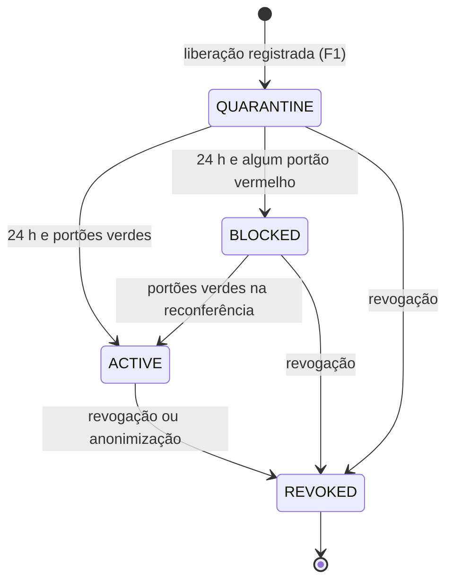
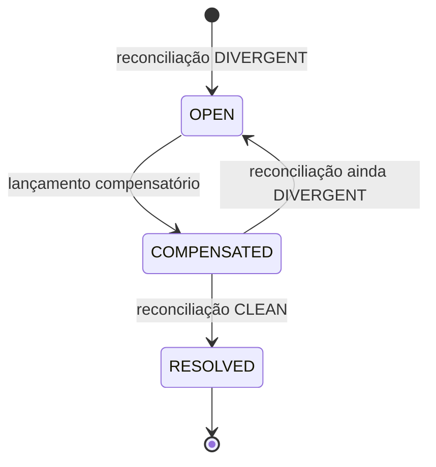
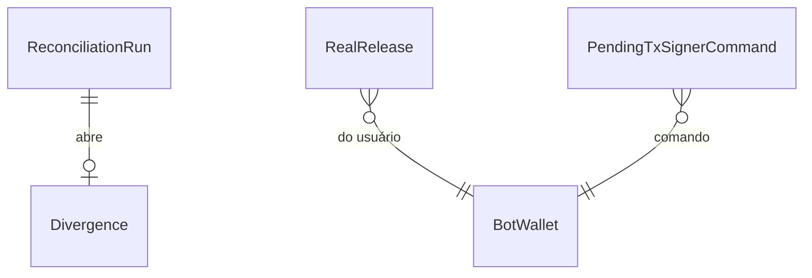

# Especificação funcional — U5 `u5-real-operations`

Conversa: português (Brasil). Fontes: `rules.md` (BR1.1 a BR7.2), `entities.md`, `inception/contract-design/contract-summary.md` (R4, M1, M2, M5, M6, M7), `inception/user-stories/stories.md` e `functional-design-questions.md` (Q1 a Q12).

## Escopo

A U5 opera o REAL. Ela cuida de:
- a liberação por usuário, com a quarentena de 24 horas e os portões;
- a reconciliação com a rede e as divergências;
- o kill switch REAL;
- o teto e a lista de bloqueio pelo administrador;
- a visão do administrador;
- a anonimização com a carteira do bot;
- a reconciliação depois de restaurar o banco.

Ela também corrige o `decision.mode` dos bots REAL, que ficou pendente da U4.

As telas do administrador ficam na U6. As condicionais que o kill switch marca ficam na U7, que lê a M7.

## Mudanças de contrato (adendo da U5)

- **R4:** as rotas de mudança exigem `Idempotency-Key`. A liberação ganha os estados `QUARANTINE`, `ACTIVE`, `BLOCKED` e `REVOKED`, e a recusa ganha `FOUNDER_FIRST` e `PILOT_FULL`.
- **M7:** `current()` lê a tabela `real_kill_switch`.
- **M1:** `withdrawable` passa a considerar a divergência aberta (BR2.4). `adminLowerCap` passa a gravar o comando pendente.
- **Porta nova `CiStatus`:** a última execução do workflow `ci` em `main`. Em produção é o GitHub; no local e nos testes é um valor configurado.

## Fluxos

### F1 — Liberar um usuário

1. O administrador pede a liberação de um usuário. O sistema confere a carteira ativa, os termos v3, a liberação já existente e, na mainnet, o "fundador primeiro" e o limite de 20 (BR1.2, BR1.3).
2. Cria a liberação em `QUARANTINE`, com `effectiveAt` 24 horas depois, e audita.
3. O trabalho de portões (a cada 5 minutos) encontra a liberação vencida e confere os portões (BR1.4).
4. Com os portões verdes, a liberação vira `ACTIVE` e o REAL do usuário passa a valer (BR1.1).
5. Com algum portão vermelho, ela vira `BLOCKED`, com o motivo, e é conferida de novo a cada 5 minutos.

### F2 — Revogar (BR1.6)

O administrador revoga a liberação, com motivo. Sob a trava da pessoa, ela vira `REVOKED` e as ordens não enviadas são canceladas. O saque continua.

### F3 — Reconciliar (BR2.1, BR2.2)

1. O gatilho é uma ordem confirmada (U4) ou o trabalho a cada 15 minutos.
2. Com ordem ou saque em trânsito, ou com entrada na rede ainda não registrada, o resultado é `DEFERRED` e a reconciliação tenta de novo. Depois de 2 horas assim, dispara um alerta.
3. Com a carteira assentada, lê no último slot finalizado os saldos de SOL e dos tokens na rede e compara com o ledger, sem tolerância.
4. Resultado:
   - **`CLEAN`:** nada mais.
   - **`DIVERGENT`:** abre ou atualiza a divergência, pausa o usuário (`DIVERGENCE`) e dispara o alerta.
   - **`UNAVAILABLE`:** só registra.

### F4 — Corrigir uma divergência (BR2.3)

1. O administrador informa um lançamento por ativo divergente, igual à diferença medida, e o motivo. A rota é `/divergences/{divergenceId}/compensation`. A divergência vira `COMPENSATED`.
2. Roda uma reconciliação nova.
3. Se ela vier `CLEAN`, a divergência vira `RESOLVED` e a pausa sai.
4. Se não, a divergência volta a `OPEN`.

### F5 — Sacar com divergência (BR2.4)

O valor sacável passa a ser o menor entre o saldo do ledger e o da rede. O saque continua disponível.

### F6 — Kill switch REAL (BR3.1, BR3.2)

- **Ligar:** grava o interruptor numa transação curta. A leitura ao vivo da M7 passa a valer na hora para todas as carteiras, inclusive as novas, e ninguém precisa de pausa gravada. Depois, um trabalho cancela as ordens não enviadas de todos e repete a cada minuto até não sobrar nenhuma.
- **Desligar:** a leitura da M7 deixa de pausar, sem religar nenhum bot.

### F7 — Teto e bloqueio (BR4.1, BR4.2)

- **Teto:** o administrador só pode baixar. O teto novo vale na hora, e o comando `LOWER_CAP` vai ao TxSigner, reenviado a cada minuto até confirmar.
- **Bloqueio:** o bloqueio e o desbloqueio de token passam pela M5.

### F8 — Visão do administrador (BR5.1)

A lista e o detalhe de cada usuário saem sem chave e com a carteira principal abreviada.

### F9 — Anonimização (BR6.1, BR6.2)

1. A carteira com saldo, posição ou ordem em andamento é recusada, com a explicação de sacar antes.
2. Sem nada disso, na mesma transação:
   - a carteira do bot é encerrada;
   - o comando `DEACTIVATE` vai ao TxSigner, só com o id da carteira;
   - são limpos a carteira principal, a mensagem de consentimento e as transações e mensagens dos saques;
   - as liberações são revogadas.
3. Quando o TxSigner confirma o `DEACTIVATE`, o endereço da carteira do bot também é limpo.

### F10 — Restauração do banco (BR2.5)

1. Na subida, o worker procura na rede as assinaturas em que a carteira do bot assina e que o banco não conhece. Depósitos não contam.
2. Se achar alguma, liga a pausa global `RESTORE`.
3. Roda a reconciliação completa.
4. A pausa só sai quando todas as carteiras vierem limpas e o administrador confirmar.
5. Com o RPC fora na subida, as ordens novas ficam recusadas (`RESTORE_CHECK_PENDING`) até a conferência terminar. O saque continua.

## Máquina de estados — RealRelease

Os mesmos estados em texto:
- `QUARANTINE` vira `ACTIVE` ou `BLOCKED` quando a quarentena vence.
- `BLOCKED` vira `ACTIVE` quando os portões ficam verdes.
- Qualquer estado vira `REVOKED` pela revogação. `ACTIVE` também vira `REVOKED` pela anonimização.
- `REVOKED` é final.

## Máquina de estados — Divergence

Os mesmos estados em texto:
- `OPEN` vira `COMPENSATED` com o lançamento compensatório.
- `COMPENSATED` vira `RESOLVED` se a reconciliação vier limpa, ou volta a `OPEN` se não vier.
- `RESOLVED` é final.

## Visão derivada — relações

Em texto:
- uma reconciliação abre no máximo uma divergência;
- a liberação é do usuário dono da carteira;
- os comandos pendentes são de uma carteira.

## Cenários

| # | Dado | Quando | Então |
|---|---|---|---|
| S1 | ambiente novo | qualquer ordem REAL | recusada, sem liberação ativa (AC7.1.1) |
| S2 | liberação registrada | antes de 24 h | continua `QUARANTINE`; o REAL não vale (AC7.1.2) |
| S3 | 24 h depois, com a CI verde, sem divergência, sem kill switch e na rede certa | trabalho de portões | `ACTIVE` (AC7.1.2) |
| S4 | 24 h depois, com a CI vermelha | trabalho de portões | `BLOCKED CI_RED`; vira `ACTIVE` quando a CI voltar a verde |
| S5 | mainnet, sem fundador ativo | liberar um convidado | 409 `FOUNDER_FIRST` (AC7.1.3) |
| S6 | mainnet, fundador ativo há 1 h | liberar um convidado | aceito, sem espera de 7 dias (Q2) |
| S7 | mainnet, 20 convidados liberados | liberar o 21º | 409 `PILOT_FULL` |
| S8 | API em perfil que não é de produção | configurar mainnet | não sobe (AC7.1.4) |
| S9 | liberação `ACTIVE` com ordem `QUOTED` | revogar | `REVOKED`; ordem `CANCELLED`; saque disponível |
| S10 | ordem confirmada | reconciliação | roda; `CLEAN` (AC8.2.1) |
| S11 | 1.000 lamports a mais na rede | reconciliação | `DIVERGENT`; pausa `DIVERGENCE`; alerta (AC8.2.2) |
| S12 | ordem `SENT` com 0,05 SOL reservado | reconciliação | `DEFERRED`; nenhuma divergência até a ordem terminar |
| S12b | depósito finalizado na rede ainda não lido | reconciliação | `DEFERRED`; a próxima, depois da leitura, vem `CLEAN` |
| S12c | modo Assinada com a taxa paga pela carteira principal | reconciliação | `CLEAN`: a taxa não toca a carteira do bot nem o ledger dela |
| S13 | divergência aberta | compensar com +1.000 lamports | `COMPENSATED`; reconciliação `CLEAN`; `RESOLVED`; pausa sai |
| S14 | divergência aberta | compensar com o valor errado | volta a `OPEN`; pausa continua |
| S15 | divergência aberta, ledger 2 SOL e rede 1,5 SOL | sacar tudo | saca até 1,5 SOL menos a reserva |
| S16 | ordens não enviadas de vários usuários | ligar o kill switch | canceladas; enviadas seguem; saque disponível; posições ficam (AC8.1.1 a AC8.1.4) |
| S17 | kill switch ligado | desligar | pausa `KILL_SWITCH` sai; bots parados continuam parados |
| S18 | teto de 10 SOL | administrador baixa para 3 SOL | teto 3 SOL na hora; `LOWER_CAP` reenviado até o TxSigner confirmar (AC7.2.1) |
| S19 | teto de 3 SOL | administrador tenta 5 SOL | 422 `CAP_ONLY_LOWERED` |
| S20 | token bloqueado | qualquer bot tenta comprar | recusado (AC7.2.2) |
| S21 | visão do administrador | listar usuários | carteira principal abreviada; nenhuma chave (AC7.3.1) |
| S22 | carteira com saldo | anonimizar | 409 `BALANCE`, com a explicação de sacar (AC8.4.1) |
| S23 | carteira vazia, sem posição e sem ordem | anonimizar | carteira `CLOSED`; endereços limpos; `DEACTIVATE` enviado; nenhum endereço em tabela ou log (AC8.4.2) |
| S24 | banco restaurado de um backup antigo, com trocas posteriores na rede | subida | assinaturas desconhecidas; pausa `RESTORE`; reconciliação completa; despausa com tudo limpo e a confirmação do administrador |
| S24b | reinício comum depois de um depósito recente | subida | nada desconhecido (o depósito não é assinado pela carteira do bot); ninguém é pausado |
| S24c | RPC fora na subida | subida | `RESTORE_CHECK_PENDING` recusa ordens novas; o saque continua; conferência repetida a cada minuto |
| S26 | kill switch ligado | carteira liberada depois | a ordem é recusada na hora, pela leitura ao vivo da M7 |
| S27 | dois pedidos de liberação de convidados ao mesmo tempo com 19 liberados | criação | um aceito, outro 409 `PILOT_FULL` |
| S28 | rede MAINNET sem `founder-user-id` | subida | não sobe |
| S29 | CI de `main` verde num commit antigo e vermelha no commit implantado | portões | `BLOCKED CI_RED` |
| S25 | bot REAL decide | ciclo | `decision.mode` gravado `REAL` |

## Erros e casos de canto

- **Concorrência:** a liberação, o kill switch e a revogação usam compare-and-set e `Idempotency-Key`. Dois pedidos iguais têm um efeito só.
- **CI indisponível na conferência:** o portão fica vermelho (`CI_RED`) e é conferido de novo. Nunca libera sem a CI.
- **Rede indisponível na reconciliação:** `UNAVAILABLE`, sem divergência e sem pausa nova.
- **Relógio:** injetável para 24 horas, 15 minutos, 5 minutos e 1 minuto.
