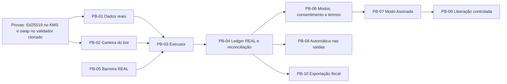

# Documento de escopo — Trading REAL

Conversa: português (Brasil). Base: `ideation/intent-capture/intent-statement.md` (problema, modos, liberação), `ideation/feasibility/feasibility-assessment.md` (condições e exposição), `ideation/feasibility/constraint-register.md` (TR-C01 a TR-C24) e `scope-definition-questions.md` (Q1 a Q8, confirmadas em 2026-11-13).

## Objetivo

Permitir que o bot opere com dinheiro real na Solana, com o modo Assinada como padrão e o modo Automática total, pela carteira do bot com teto, como foco; o risco fica limitado por teto, limites e kill switch, e a liberação é controlada: devnet, depois a carteira do fundador, depois até 20 convidados, cada passo após 24 horas com tudo verde.

## Dentro do escopo

| Capacidade | Prioridade | Fonte |
|---|---|---|
| PB-01 Dados de mercado reais (CoinGecko paga, com atribuição) | Must | Q1; TR-C06 |
| PB-02 Carteira do bot: chave no KMS, depósito até o teto configurável no perfil, saque só para a carteira principal | Must | Q1; TR-C02, TR-C09, TR-C11, TR-C12 |
| PB-03 Executor: cotação e swap pela Jupiter, assinatura pelo KMS, envio, confirmação, repetição sem duplicar | Must | Q1; TR-C03, TR-C07 |
| PB-04 Ledger REAL separado e reconciliação com a blockchain | Must | Q1; TR-C01 |
| PB-05 Barreira de risco REAL: limites por ordem e por dia, teto, pausa e kill switch | Must | Q1; TR-C13 |
| PB-06 Modos, consentimento assinado e termos do REAL com novo aceite | Must | Q1; TR-C14, TR-C22 |
| PB-07 Modo Assinada (padrão) | Must | Q1 |
| PB-09 Liberação controlada: REAL por usuário, quarentena de 24 horas, fundador antes dos convidados | Must | Q1; TR-C15 |
| PB-08 Automática nas saídas (ordens condicionais da Jupiter) | Should | Q1 |
| PB-10 Exportação fiscal | Should | Q1; TR-C23 |

## Regras de produto confirmadas

- **Tokens permitidos:** só os que passaram pela avaliação do scanner com cobertura suficiente (`unknown` nunca conta como seguro), mais uma lista de bloqueio do administrador (Q5).
- **Moeda:** SOL; depósito, teto e saque em SOL, e o bot compra e vende contra SOL (Q6).
- **Kill switch no REAL:** bloqueia novas ordens REAL de todos, cancela as ordens condicionais abertas das carteiras do bot e mantém o saque liberado; as posições abertas ficam como estão (Q7).
- **Teto:** máximo de 10 SOL, para o fundador e para cada convidado; cada convidado escolhe o próprio teto no perfil, até o máximo (TR-C11, TR-C12).
- **Limites:** por ordem até 10% do teto; perda máxima no dia de 20% do teto, com pausa até o dia seguinte; até 20 ordens por dia por bot (TR-C13).

## Fora do escopo

| Item | Fonte |
|---|---|
| Vault ou programa on-chain próprio e auditoria externa (G3) | Q8; intent-statement |
| Público aberto e cobrança | Q8 |
| Outras redes e outros roteadores além da Solana e da Jupiter | Q8 |
| Alavancagem, derivativos e empréstimo | Q8 |

## Sequência e dependências

Ordem por risco (Q2), respeitando as dependências (Q3):

Texto: as provas técnicas vêm primeiro; dados reais e carteira do bot alimentam o executor, que só roda depois da barreira de risco; o executor alimenta o ledger REAL e a reconciliação; modos e termos vêm antes do modo Assinada e da liberação; as capacidades Should dependem do executor e do ledger.

## Mapa de valor

| Etapa do usuário | Capacidades |
|---|---|
| Aceitar os termos do REAL e escolher o modo | PB-06 |
| Ativar a carteira do bot, definir o teto e depositar | PB-02 |
| O bot decide com dados reais e a barreira confere | PB-01, PB-05 |
| A ordem é executada e confirmada | PB-03, PB-07 |
| O resultado aparece no ledger e no P&L, conciliado | PB-04 |
| Sacar para a carteira principal | PB-02 |

## Prazo

Sem data fixa (Q4); 3 a 6 semanas de trabalho técnico estimadas na viabilidade.
