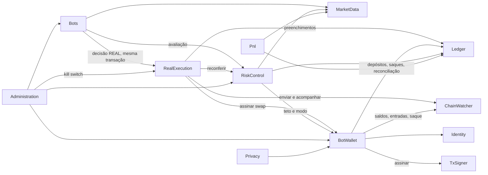

# Componentes — Trading REAL

Conversa: português (Brasil). Fontes: `inception/requirements-analysis/requirements.md`, `inception/user-stories/stories.md`, o mapa do código (`architecture.md`, `component-inventory.md`) e `domain-design-questions.md` (Q1 a Q7). Três componentes são novos (BotWallet, RealExecution, ChainWatcher); os demais já existem e ganham responsabilidades REAL.

```yaml
components:
  - name: TxSigner
    summary: Serviço de assinatura isolado, o único com permissão de assinar no KMS
    behaviour: >
      Roda como processo próprio, com credencial AWS própria e banco próprio (esquema e usuário separados): só ele tem a
      permissão de assinar no KMS; a API e o worker não têm. Mantém a sua própria política por carteira (WalletPolicy):
      carteira principal de saque, teto e modo autorizados, derivados só de consentimentos assinados pela carteira
      principal, cuja assinatura Ed25519 ele mesmo confere (com nonce, validade e os valores autorizados); o contexto
      que chega da API só pode restringir, nunca ampliar. Recebe da BotWallet a transação serializada e o contexto (tipo
      da operação, valor, saída mínima) e aplica a política de conteúdo antes de assinar: só programas da lista
      (agregador da Jupiter, System Program, Token Program, Token-2022, Associated Token Account, Compute Budget); a
      carteira do bot é o único assinante e o pagador da taxa; toda transferência de SOL ou de token fora da instrução da Jupiter
      sai só para contas da própria carteira do bot, ou para a carteira principal registrada na WalletPolicy (só em
      saque); o que acontece dentro da rota da Jupiter é limitado pela quantidade de entrada, pela conta de saída da
      carteira do bot e pela saída mínima; a conta de token de saída pertence à carteira do bot; a saída mínima é pelo
      menos a cotação menos a derrapagem; tabelas de endereços (ALT) são resolvidas e conferidas; nenhuma instrução de
      troca de autoridade nem de fechamento para terceiros; SOL total que sai não passa do valor da ordem mais taxas.
      Recusa e registra qualquer transação fora da política.
    responsibilities:
      - assinatura Ed25519 pelo KMS sob política de conteúdo
      - criação de chaves no KMS
    depends_on:
      - component: Audit
        interaction: evento a cada assinatura e a cada recusa
        style: event
    dependents:
      - component: BotWallet
        interaction: pede criação de chave e assinatura
    external_dependencies:
      - name: AWS KMS
        kind: third-party-api
        purpose: chave não exportável e assinatura Ed25519
      - name: PostgreSQL (esquema próprio)
        kind: database
        purpose: WalletPolicy e SigningRecord, com usuário de banco próprio
    entities:
      - name: WalletPolicy
        identifier: botWalletAddress
        attributes: [botWalletAddress, kmsKeyRef, mainWalletAddress, authorizedCap, authorizedMode, lastConsentNonce, updatedAt]
      - name: SigningRecord
        identifier: signingId
        attributes: [signingId, botWalletAddress, operationKind, messageDigest, decision, refusalReason, signedAt]

  - name: BotWallet
    summary: Carteira do bot de cada usuário, saque, depósitos, reconciliação, preferências e liberação
    behaviour: >
      Ativa a carteira do bot só com termos v3 aceitos, liberação vigente (24 h após registrada) e consentimento
      assinado pela carteira principal (mensagem própria, nunca a de login); subir de modo e subir o teto também exigem
      consentimento assinado. Pede ao TxSigner a criação da chave e guarda só a referência. Guarda modo de operação,
      teto (até 10 SOL), derrapagem e reserva para taxas. Detecta depósitos pela ChainWatcher (origem desconhecida é
      registrada e sinalizada) e lança no ledger REAL. Faz o saque (estados pedido, assinado, enviado, confirmado,
      falhou, ambíguo) só para a carteira principal verificada, reservando o valor. Roda a reconciliação do ledger REAL
      com a rede depois de cada ordem confirmada e a cada 15 min; divergência pausa o REAL do usuário.
    responsibilities:
      - ativação, consentimentos e encerramento da carteira do bot
      - depósitos, saques e reconciliação
      - modo de operação, teto, derrapagem, reserva e pausa REAL por usuário
      - liberação REAL por usuário com quarentena de 24 horas
    depends_on:
      - component: Identity
        interaction: carteira principal verificada, conferência das assinaturas de consentimento e aceite dos termos v3
        style: sync
      - component: TxSigner
        interaction: criação de chave e assinatura de saques e swaps
        style: sync
      - component: ChainWatcher
        interaction: saldos, entradas por endereço, envio e confirmação do saque
        style: sync
      - component: Ledger
        interaction: lançamentos de depósito, saque e taxa; leitura para reconciliação
        style: sync
      - component: Audit
        interaction: eventos de ativação, consentimento, depósito, saque, modo, teto, liberação e divergência
        style: event
    dependents:
      - component: RiskControl
        interaction: lê teto, modo, reserva e pausa
      - component: RealExecution
        interaction: pede a assinatura de um swap
      - component: Administration
        interaction: libera ou desliga o REAL e baixa o teto
      - component: Privacy
        interaction: confere, encerra e desvincula na anonimização
    external_dependencies:
      - name: PostgreSQL
        kind: database
        purpose: carteiras, consentimentos, preferências, liberações, depósitos, saques e reconciliações
    entities:
      - name: BotWalletAccount
        identifier: botWalletId
        attributes: [botWalletId, tenantId, userId, publicAddress, kmsKeyRef, status, createdAt, closedAt]
        references:
          - entity: Account
            owned_by: Identity
            relationship: cada carteira do bot pertence a uma conta
      - name: RealPreferences
        identifier: botWalletId
        attributes: [operationMode, cap, maxSlippage, feeReserve, pausedReason, updatedAt]
      - name: WalletConsent
        identifier: consentId
        attributes: [consentId, tenantId, botWalletId, kind, nonce, expiresAt, authorizedCap, authorizedMode, signedMessageDigest, signedAt]
      - name: RealRelease
        identifier: releaseId
        attributes: [releaseId, userId, network, requestedBy, requestedAt, effectiveAt, revokedAt]
        references:
          - entity: Account
            owned_by: Identity
            relationship: cada liberação vale para uma conta
      - name: ObservedDeposit
        identifier: txSignature
        attributes: [txSignature, tenantId, botWalletId, sourceAddressHmac, lamports, finalizedAt, knownSource]
      - name: Withdrawal
        identifier: withdrawalId
        attributes: [withdrawalId, tenantId, botWalletId, lamports, state, idempotencyKey, txSignature, requestedAt]
      - name: ReconciliationRun
        identifier: runId
        attributes: [runId, botWalletId, startedAt, result, divergenceLamports]

  - name: RealExecution
    summary: Ordem REAL com estados, da decisão à confirmação, e ordens condicionais
    behaviour: >
      Recebe a decisão REAL do ciclo do bot pela própria fila de decisões: o ciclo grava a RealDecisionRequest na mesma
      transação curta (interface com propagação obrigatória); um consumidor com trava (SKIP LOCKED) processa fora do
      ciclo, com repetição segura. Uma ordem por bot em andamento. Estados: proposta, cotada, assinada, enviada,
      confirmada, falhou, ambígua. Cotação da Jupiter com no máximo 10 s; prazo de assinatura no modo Assinada de 8 s,
      para sobrar validade da cotação no envio. Reconfere a barreira antes de assinar. Idempotência pelo mecanismo
      comum do projeto; ordem ambígua só repete depois de conferida na rede. Antes de assinar e antes de enviar,
      reconfere na BotWallet o modo de operação e a pausa: uma ordem ainda não enviada é cancelada nesse ponto quando o
      REAL foi desligado, o modo foi rebaixado ou o REAL do usuário foi pausado; o kill switch chama o cancelamento
      direto. Mantém as ordens condicionais da Jupiter (stop e alvo) do modo Automática nas saídas, criadas e assinadas
      pela carteira principal do usuário (nunca pelo TxSigner), com estados aberta, preenchida, cancelada; consulta a
      API da Jupiter para detectar o preenchimento e grava no Ledger. Como só o usuário pode cancelar uma condicional
      que ele assinou, o kill switch e o rebaixamento de modo marcam as condicionais abertas e avisam o usuário para
      cancelá-las. Grava preenchimentos e taxas no Ledger.
    responsibilities:
      - fila de decisões REAL e máquina de estados da ordem
      - cotação, montagem e envio do swap
      - ordens condicionais e cancelamentos
    depends_on:
      - component: BotWallet
        interaction: assinatura do swap no modo Automática total
        style: sync
      - component: RiskControl
        interaction: nova conferência da barreira antes de assinar e ao criar condicionais
        style: sync
      - component: Ledger
        interaction: preenchimentos e taxas REAL
        style: sync
      - component: ChainWatcher
        interaction: envio e estado da confirmação
        style: sync
      - component: Audit
        interaction: evento a cada mudança de estado
        style: event
    dependents:
      - component: Bots
        interaction: grava a decisão REAL na mesma transação do ciclo
      - component: Administration
        interaction: cancelamentos no kill switch e no desligamento
    external_dependencies:
      - name: Jupiter (Swap, Quote e Trigger API)
        kind: third-party-api
        purpose: cotação, transação de swap e ordens condicionais
      - name: PostgreSQL
        kind: database
        purpose: decisões, ordens, tentativas e condicionais
    entities:
      - name: RealDecisionRequest
        identifier: decisionRequestId
        attributes: [decisionRequestId, tenantId, userId, botId, decisionId, createdAt, claimedAt, processedAt]
      - name: RealOrder
        identifier: realOrderId
        attributes: [realOrderId, tenantId, userId, botId, side, token, amount, operationMode, state, idempotencyKey, quoteAt, txSignature, failureReason, createdAt, updatedAt]
        references:
          - entity: BotWalletAccount
            owned_by: BotWallet
            relationship: cada ordem REAL usa uma carteira do bot ou a carteira principal no modo Assinada
      - name: OrderAttempt
        identifier: attemptId
        attributes: [attemptId, realOrderId, blockhash, lastValidHeight, sentAt, outcome]
      - name: ConditionalOrder
        identifier: conditionalOrderId
        attributes: [conditionalOrderId, tenantId, userId, realOrderId, kind, triggerPrice, externalOrderRef, state, createdAt, filledAt]

  - name: ChainWatcher
    summary: Porta para a rede Solana, sem regra de negócio
    behaviour: >
      Envia transações assinadas, consulta o estado de assinaturas (confirmada pela finalização; falhou pela expiração
      do blockhash), saldos e entradas por endereço, usando dois provedores de RPC; quando os dois discordam, usa o
      resultado finalizado e marca o caso como incerto. Rede escolhida por ambiente. Não conhece usuários nem
      carteiras: recebe endereços e assinaturas de quem chama.
    responsibilities:
      - envio, confirmação, saldos e entradas por endereço
    depends_on: []
    dependents:
      - component: BotWallet
        interaction: saldos, entradas e saque
      - component: RealExecution
        interaction: envio e confirmação
    external_dependencies:
      - name: Solana RPC (dois provedores)
        kind: third-party-api
        purpose: envio, confirmação, saldos e entradas
    entities: []

  - name: Bots
    summary: Ciclo do bot (existente), agora com decisão REAL
    behaviour: >
      O ciclo continua numa transação curta; no REAL, grava a decisão e a RealDecisionRequest na mesma transação e não
      executa nada. Respeita a pausa do sistema (kill switch).
    responsibilities:
      - decisão do bot e registro da decisão REAL
    depends_on:
      - component: RiskControl
        interaction: avaliação da barreira
        style: sync
      - component: RealExecution
        interaction: registro da decisão REAL na mesma transação
        style: sync
      - component: MarketData
        interaction: dados para a decisão
        style: sync
      - component: Audit
        interaction: eventos do bot
        style: event
    dependents:
      - component: Administration
        interaction: pausa do sistema no kill switch
    entities: []

  - name: RiskControl
    summary: Barreira de risco (existente), agora com regras REAL
    behaviour: >
      Para REAL, usa só saldo e ledger REAL. Limites valem para compras: até 10% do teto por ordem, perda do dia
      (realizada mais não realizada, com taxas, desde 00:00 UTC) até 20% do teto, até 20 ordens por dia por bot; vendas
      de saída sempre passam. Teto sobre saldo livre mais posições a preço de cotação; posição sem preço vale pelo custo
      e bloqueia novas compras. Confere sob trava. Tokens só com avaliação de cobertura suficiente e fora da lista de
      bloqueio. Dados com mais de 60 s recusam a ordem.
    responsibilities:
      - avaliação REAL por ordem
      - lista de bloqueio de tokens
    depends_on:
      - component: BotWallet
        interaction: teto, modo, reserva e pausa
        style: sync
      - component: Ledger
        interaction: saldo, exposição e perda do dia REAL
        style: sync
      - component: MarketData
        interaction: preço e frescor
        style: sync
      - component: Audit
        interaction: avaliações e bloqueios
        style: event
    dependents:
      - component: Bots
        interaction: avaliação no ciclo
      - component: RealExecution
        interaction: nova conferência antes de assinar
      - component: Administration
        interaction: bloqueio de tokens
    entities:
      - name: TokenBlock
        identifier: mint
        attributes: [mint, reason, blockedBy, blockedAt]

  - name: Ledger
    summary: Ledger append-only (existente), agora aceitando o modo REAL
    behaviour: >
      Linhas REAL por tipo (depósito, saque, preenchimento de swap com as duas pernas, taxa de rede, aluguel de conta,
      reserva e liberação de reserva, compensação), cada uma com a assinatura on-chain quando houver; a reserva de
      ordens e saques em andamento é uma linha própria, então o saldo livre que a RiskControl lê já desconta o
      reservado; gravadas só pela RealExecution (preenchimentos e taxas do swap) e pela BotWallet
      (depósitos, saques e suas taxas, compensações da reconciliação); correção só por compensação; toda consulta
      filtra pelo modo.
    responsibilities:
      - lançamentos, preenchimentos e posições REAL
    depends_on:
      - component: Audit
        interaction: eventos de lançamento
        style: event
    dependents:
      - component: RealExecution
        interaction: grava preenchimentos e taxas do swap
      - component: BotWallet
        interaction: grava depósitos, saques e compensações; lê para reconciliar
      - component: RiskControl
        interaction: saldo e exposição REAL
      - component: Pnl
        interaction: P&L REAL
    entities:
      - name: LedgerEntry
        identifier: entryId
        attributes: [entryId, tenantId, mode, entryKind, botId, botWalletId, mint, tokenAmount, lamports, txSignature, createdAt]

  - name: Pnl
    summary: P&L (existente), com P&L REAL separado
    behaviour: >
      Calcula o P&L REAL com taxas a partir do ledger REAL; nunca mistura valores PAPER.
    responsibilities:
      - P&L REAL
    depends_on:
      - component: Ledger
        interaction: lançamentos REAL
        style: sync
      - component: MarketData
        interaction: marcação a mercado
        style: sync
    dependents: []
    entities: []

  - name: MarketData
    summary: Dados de mercado (existente), com fonte real
    behaviour: >
      Ganha o adaptador da fonte paga (CoinGecko) atrás da interface existente, com atribuição; a lista fixa de fontes
      passa a vir da configuração; informa se a fonte ativa é a simulada, e nesse caso o REAL não opera.
    responsibilities:
      - fonte real de dados de mercado
    depends_on: []
    dependents:
      - component: Bots
        interaction: dados para a decisão
      - component: RiskControl
        interaction: preço e frescor
      - component: Pnl
        interaction: marcação a mercado
    external_dependencies:
      - name: CoinGecko (plano pago)
        kind: third-party-api
        purpose: preço, liquidez, volume, holders e criação
    entities: []

  - name: Administration
    summary: Administração (existente), com liberação REAL e kill switch REAL
    behaviour: >
      Libera ou desliga o REAL por usuário pela BotWallet, baixa tetos, bloqueia tokens pela RiskControl. O kill switch
      pausa os bots e cancela as ordens REAL não enviadas e as condicionais. Não existe comando de saque para endereço
      que não seja a carteira principal do usuário.
    responsibilities:
      - comandos administrativos do REAL
    depends_on:
      - component: BotWallet
        interaction: liberação, desligamento e teto
        style: sync
      - component: RealExecution
        interaction: cancelamentos
        style: sync
      - component: RiskControl
        interaction: lista de bloqueio
        style: sync
      - component: Bots
        interaction: pausa do sistema
        style: sync
      - component: Audit
        interaction: eventos administrativos
        style: event
    dependents: []
    entities: []

  - name: Identity
    summary: Identidade (existente), carteira principal, termos e consentimento
    behaviour: >
      Confere as assinaturas de consentimento com Ed25519 nativo; fornece a carteira principal verificada; termos v3
      pelo mecanismo de novo aceite existente.
    responsibilities:
      - carteira principal e conferência de assinatura
    depends_on:
      - component: Audit
        interaction: eventos de identidade
        style: event
    dependents:
      - component: BotWallet
        interaction: carteira principal, consentimento e termos
    entities:
      - name: Account
        identifier: userId
        attributes: [userId, tenantId, status]

  - name: Privacy
    summary: Privacidade (existente), anonimização com carteira do bot
    behaviour: >
      Recusa a anonimização enquanto a carteira do bot tiver saldo, posição ou ordem em andamento; sem eles, pede à
      BotWallet o encerramento e o desvínculo: endereços de origem de depósitos ficam só como HMAC; o endereço da
      carteira do bot e as assinaturas das transações (dados públicos da rede, necessários ao ledger e ao fiscal) ficam
      ligados só ao identificador interno, como o ledger PAPER.
    responsibilities:
      - anonimização com carteira do bot
    depends_on:
      - component: BotWallet
        interaction: saldo, posição, encerramento e desvínculo
        style: sync
      - component: Audit
        interaction: eventos de privacidade
        style: event
    dependents: []
    entities: []

  - name: Audit
    summary: Trilha de auditoria (existente), com campos REAL tipados
    behaviour: >
      O validador muda: eventos REAL têm campos próprios e tipados para assinatura de transação, mint e carteira do bot,
      aceitos só nessas chaves; a carteira principal continua só como HMAC; `details` livre mantém a regra atual; logs
      mascaram endereços e assinaturas.
    responsibilities:
      - eventos REAL tipados
    depends_on: []
    dependents:
      - component: TxSigner
        interaction: eventos
      - component: BotWallet
        interaction: eventos
      - component: RealExecution
        interaction: eventos
      - component: Bots
        interaction: eventos
      - component: RiskControl
        interaction: eventos
      - component: Ledger
        interaction: eventos
      - component: Administration
        interaction: eventos
      - component: Identity
        interaction: eventos
      - component: Privacy
        interaction: eventos
    entities: []
```

## Component Diagram



Texto: o ciclo do bot grava a decisão REAL; a execução REAL reconfere a barreira, pede a assinatura à carteira do bot, que a repassa ao serviço de assinatura isolado; a execução envia pela rede e grava no ledger; a carteira do bot detecta depósitos, faz saques e reconcilia; a rede é só uma porta sem regra de negócio. Todos publicam na auditoria (omitida no diagrama).

## Component Summary

| Component | Purpose | Depends On | Dependents | Entities Owned |
|---|---|---|---|---|
| TxSigner | assinatura isolada no KMS com política própria | Audit | BotWallet | WalletPolicy, SigningRecord |
| BotWallet | carteira do bot, depósitos, saques, reconciliação, preferências, liberação | Identity, TxSigner, ChainWatcher, Ledger, Audit | RiskControl, RealExecution, Administration, Privacy | BotWalletAccount, RealPreferences, WalletConsent, RealRelease, ObservedDeposit, Withdrawal, ReconciliationRun |
| RealExecution | fila de decisões, ordem REAL, condicionais | BotWallet, RiskControl, Ledger, ChainWatcher, Audit | Bots, Administration | RealDecisionRequest, RealOrder, OrderAttempt, ConditionalOrder |
| ChainWatcher | porta para a rede Solana | — | BotWallet, RealExecution | — |
| Bots | ciclo e decisão REAL | RiskControl, RealExecution, MarketData, Audit | Administration | — |
| RiskControl | barreira REAL | BotWallet, Ledger, MarketData, Audit | Bots, RealExecution, Administration | TokenBlock |
| Ledger | ledger com modo REAL | Audit | RealExecution, BotWallet, RiskControl, Pnl | LedgerEntry |
| Pnl | P&L REAL | Ledger, MarketData | — | — |
| MarketData | fonte real | — | Bots, RiskControl, Pnl | — |
| Administration | liberação, bloqueio, kill switch | BotWallet, RealExecution, RiskControl, Bots, Audit | — | — |
| Identity | carteira principal e consentimento | Audit | BotWallet | Account |
| Privacy | anonimização com carteira do bot | BotWallet, Audit | — | — |
| Audit | eventos REAL tipados | — | todos os demais | — |

## Entity Ownership

| Entity | Owning Component | Identifier | Attributes | References |
|---|---|---|---|---|
| WalletPolicy | TxSigner | botWalletAddress | mainWalletAddress, authorizedCap, authorizedMode, lastConsentNonce | — |
| SigningRecord | TxSigner | signingId | operationKind, messageDigest, decision, refusalReason | — |
| BotWalletAccount | BotWallet | botWalletId | publicAddress, kmsKeyRef, status | Account (Identity) |
| RealPreferences | BotWallet | botWalletId | operationMode, cap, maxSlippage, feeReserve, pausedReason | — |
| WalletConsent | BotWallet | consentId | kind, signedMessageDigest, signedAt | — |
| RealRelease | BotWallet | releaseId | network, effectiveAt, revokedAt | Account (Identity) |
| ObservedDeposit | BotWallet | txSignature | sourceAddressHmac, lamports, knownSource | — |
| Withdrawal | BotWallet | withdrawalId | lamports, state, idempotencyKey, txSignature | — |
| ReconciliationRun | BotWallet | runId | result, divergenceLamports | — |
| RealDecisionRequest | RealExecution | decisionRequestId | decisionId, claimedAt, processedAt | — |
| RealOrder | RealExecution | realOrderId | side, token, amount, operationMode, state, idempotencyKey, txSignature | BotWalletAccount (BotWallet) |
| OrderAttempt | RealExecution | attemptId | blockhash, lastValidHeight, outcome | — |
| ConditionalOrder | RealExecution | conditionalOrderId | kind, triggerPrice, externalOrderRef, state | — |
| TokenBlock | RiskControl | mint | reason, blockedBy | — |
| LedgerEntry | Ledger | entryId | mode, entryKind, amount, txSignature | — |
| Account | Identity | userId | tenantId, status | — |

## External Dependencies

| Component | Dependency | Kind | Purpose |
|---|---|---|---|
| TxSigner | AWS KMS | third-party-api | chave e assinatura Ed25519, com credencial própria |
| TxSigner | PostgreSQL (esquema próprio) | database | política e registro de assinaturas |
| RealExecution | Jupiter (Swap, Quote, Trigger) | third-party-api | cotação, swap e condicionais |
| ChainWatcher | Solana RPC (dois) | third-party-api | envio, confirmação, saldos, entradas |
| MarketData | CoinGecko | third-party-api | dados reais |
| BotWallet, RealExecution | PostgreSQL | database | estado |

## Rationale

| Component | Por que é separado |
|---|---|
| TxSigner | o único dono da credencial que assina; processo próprio para que nenhum outro código do monólito consiga assinar (ADR-010) |
| BotWallet | estado REAL do usuário, depósitos, saques e reconciliação num lugar só (ADR-007, ADR-009) |
| RealExecution | ciclo de vida assíncrono e lento, diferente do ciclo curto do bot (ADR-003) |
| ChainWatcher | porta sem regra de negócio; trocar de provedor não toca nada (ADR-006) |
| Ledger, RiskControl, Pnl com modo REAL | o esquema já tem `mode`; separar duplicaria regras (ADR-001) |

**Alternatives Rejected:** módulos REAL separados para ledger e barreira; um único módulo "real"; assinatura dentro do processo da API; outbox genérica nova para um único consumidor. Detalhes em `decisions.md`.
