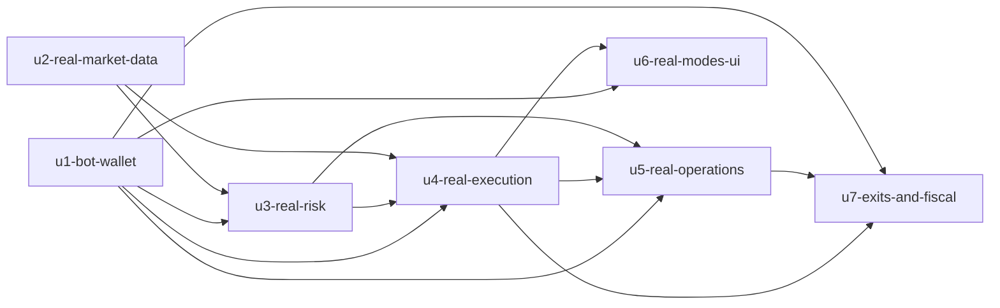

# Dependências entre Units — Trading REAL

Conversa: português (Brasil). Fontes: `unit-of-work.md`, `inception/domain-design/components.md`, `inception/domain-design/decisions.md`, `inception/requirements-analysis/requirements.md` e `inception/user-stories/stories.md`.

## Grafo

```yaml
units:
  - name: u1-bot-wallet
    kind: service
    depends_on: []
  - name: u2-real-market-data
    kind: service
    depends_on: []
  - name: u3-real-risk
    kind: service
    depends_on: [u1-bot-wallet, u2-real-market-data]
  - name: u4-real-execution
    kind: service
    depends_on: [u1-bot-wallet, u2-real-market-data, u3-real-risk]
  - name: u5-real-operations
    kind: service
    depends_on: [u1-bot-wallet, u3-real-risk, u4-real-execution]
  - name: u6-real-modes-ui
    kind: ui
    depends_on: [u1-bot-wallet, u4-real-execution]
  - name: u7-exits-and-fiscal
    kind: service
    depends_on: [u1-bot-wallet, u4-real-execution, u5-real-operations]
```



Texto: a seta vai da Unit de que outra depende para a dependente. U1 e U2 não dependem de nada; U3 precisa das duas; U4 precisa de U1, U2 e U3; U5 precisa de U1, U3 e U4; U6 precisa de U1 e U4; U7 precisa de U1, U4 e U5. As arestas U2→U4 (marcação a mercado do P&L REAL), U3→U5 (lista de bloqueio pelo administrador) e U1→U7 (lançamentos de preenchimento das condicionais no ledger REAL) vieram do Contract Design, para que todo contrato siga uma aresta direta.

## Esqueleto

A primeira Unit no grafo, `u1-bot-wallet`, é a fatia integrada: navegador (tela mínima) → API → BotWallet → TxSigner (processo separado, KMS simulado) → ChainWatcher → validador local → ledger REAL. Ela roda sozinha antes das demais porque não depende de ordens, barreira nem dados de mercado: ativa, recebe um depósito e saca.

Para a ativação ser real, a U1 traz as pré-condições em versão mínima, sem depender da U5 nem da U6: a versão v3 dos termos no catálogo com recusa da ativação sem o aceite, e a marca de liberação do REAL por usuário (só o fundador, pelo perfil de teste). A U6 depois entrega a tela de novo aceite, e a U5 a liberação pelo administrador com quarentena de 24 horas, ambas sobre essas mesmas peças.

## Pontos de integração

| De | Para | Como |
|---|---|---|
| U1 | U3, U4, U5 | interfaces públicas da BotWallet (teto, modo, pausa, assinatura, liberação) e lançamentos REAL no Ledger |
| U1 | U5, U6 | marca de liberação RealRelease e versão v3 dos termos, ampliadas depois |
| U2 | U3 | interface de fonte de mercado existente, com o sinal de fonte simulada e o frescor |
| U3 | U4 | avaliação REAL por ordem |
| U4 | U5, U6, U7 | interfaces da RealExecution (cancelamento, estados, condicionais), rota de troca de modo e rotas REST |
| U5 | U7 | evento do kill switch REAL, usado para avisar sobre condicionais abertas |
| TxSigner | BotWallet | interface interna autenticada entre processos |

## Paralelismo

U1 e U2 são independentes; U5 e U6 também são independentes entre si depois de U4; U7 vem depois de U5. A construção segue uma Unit por vez (Q5).
