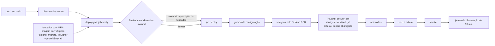

# Configuração da entrega contínua (CD) — intent `261113-trading-real-bot`

Data: 2026-11-20. Commit de referência: `3497b2bc49052f01adb93de7094a05880532222b` (`main`). Conversa: português (Brasil).

Decisões deste estágio (`deployment-pipeline-questions.md`, todas opção A, resumo confirmado):
- rolling no ECS, com a tarefa nova saudável antes de a antiga sair; TxSigner primeiro e só depois de pronto; circuit breaker com rollback automático [Q1];
- quatro portões de promoção: CI verde, devnet, mainnet do fundador e convidados [Q2];
- aprovação pelo GitHub Environments, com o responsável como revisor obrigatório da `mainnet`; implantação manual pelo SHA aprovado; credencial AWS por OIDC, sem chave longa [Q3];
- rollback com o kill switch ou o REAL desligado primeiro, imagens anteriores na ordem inversa, nenhuma migração revertida, smoke, saque e reconciliação, e o REAL religado só com o fundador [Q4];
- flags como variáveis de ambiente das definições de tarefa, versionadas no Terraform; kill switch e liberação continuam no banco [Q5];
- o `deploy.yml` chega como texto pronto para o responsável criar [Q6].

**O que este estágio mudou no repositório:** só arquivos em `infra/terraform/` (seção 3). Nenhum arquivo em `.github/workflows/` nem o `scripts/verify.sh` foi editado. Nenhuma conta AWS foi tocada. Nenhum segredo foi escrito.

Documentos irmãos: `deployment-strategy.md` (estratégia, ordem, critérios de aborto) e `rollback-runbook.md` (passo a passo do rollback e ensaio na devnet).

> **Correção da revisão de segurança (2026-11-20, `environment-provisioning/security-posture-review.md`, SP-01 Crítico).** O papel de implantação do GitHub não pode mais assinar nem ler segredos por via indireta. Por isso ele deixou de implantar o TxSigner: não passa o papel de tarefa do TxSigner nem os papéis de execução das famílias do TxSigner e de bootstrap, não roda nem atualiza essas famílias, não grava imagens no repositório `txsigner` e só lê o grupo de log das migrações. A migração do TxSigner, a revisão nova do TxSigner e a conferência de prontidão passaram a ser **um passo manual do fundador, com MFA, feito antes do `deploy.yml`** (seção 4.6). O `deploy.yml` (seção 4.4) só confere, por leitura, que o TxSigner em serviço roda a imagem do SHA e está saudável, e segue com `db-migrate`, `api-worker`, web e admin. As seções 1, 3.2, 3.3, 4.1, 4.3 a 4.6, 5 e 8 foram ajustadas.

## 1. Visão geral do fluxo



Texto equivalente: um commit de `main` com `ci` e `security` verdes é implantado em dois tempos. Primeiro, o fundador, da máquina dele e com MFA, publica a imagem do TxSigner do SHA, roda o `txsigner-migrate`, põe a revisão nova do TxSigner em serviço e confere a prontidão (seção 4.6). Depois ele dispara o `deploy.yml`. O job `verify`, sem credencial AWS, confere o SHA, a CI e, na mainnet, a implantação anterior na devnet. O job `deploy` roda no GitHub Environment do alvo (na `mainnet`, só depois da aprovação do fundador) e faz, nesta ordem: guarda de configuração, imagens `api`, `web` e `admin` com a etiqueta do SHA (a do `txsigner` só é lida), conferência de que o TxSigner em serviço roda a imagem do SHA e está saudável, `db-migrate`, `api-worker`, web e admin, smoke e uma janela de observação de 10 minutos.

## 2. O que já existe em `infra/terraform` e o que falta

Inventário feito nesta execução (`infra/terraform/main.tf` e `modules/*`):

| Peça | Situação antes deste estágio | Situação agora | Dono |
|---|---|---|---|
| Repositórios ECR | não existiam | criados no módulo novo `delivery` (seção 3) | este estágio |
| Provedor OIDC do GitHub | não existia | criado no `delivery` (um por conta, `create_github_oidc_provider`) | este estágio |
| Papel de implantação | não existia | um por ambiente, no `delivery` | este estágio |
| Serviço `txsigner` | existia, com `minimumHealthyPercent` 100 e `maximumPercent` 200 | ganhou circuit breaker com rollback, health check de liveness e `ignore_changes` da revisão em serviço | este estágio |
| Rede do TxSigner para o probe de prontidão | não existia | regra 8444 só do grupo de segurança do TxSigner para ele mesmo | este estágio |
| `TXSIGNER_NETWORK` | fixo em `MAINNET` | `upper(var.environment)` (devnet ou mainnet) | este estágio |
| Serviço `api-worker` (tarefa com os contêineres `api` e `worker`) | não existe | **pré-requisito** (seção 6.2) | Environment Provisioning |
| Definições de tarefa `${name}-txsigner-migrate` e `${name}-db-migrate` | não existem | **pré-requisito** (seção 6.3) | Environment Provisioning |
| Load balancer, target group e certificado da API | não existem | **pré-requisito** | Environment Provisioning |
| Papéis de execução das tarefas (pull do ECR, segredos, logs) | não existem; a tarefa do TxSigner não tem `execution_role_arn` | **pré-requisito**; passar os ARNs em `deploy_passable_role_arns` | Environment Provisioning |
| Grupos de log `/ecs/${name}/...` | não existem | **pré-requisito** | Environment Provisioning |
| Regras de saída dos grupos de segurança | o TxSigner só sai para os endpoints (443); falta 5432 para o RDS dele e a lista de prefixos do S3 (camadas do ECR); a API e o worker não têm regra de saída | **pré-requisito** (achado deste inventário) | Environment Provisioning |
| Web e admin na nuvem | o Infrastructure Design não define onde rodam | o workflow os implanta só com `WEB_ADMIN_ON_ECS=true` | decisão do responsável no Environment Provisioning |

Os nomes que o workflow espera são os da tabela da seção 4.3. Sem os pré-requisitos, o job `deploy` falha cedo, na guarda de configuração, com a mensagem do item que falta. Ele nunca pula um passo em silêncio.

## 3. Terraform alterado neste estágio

### 3.1 Arquivos

| Arquivo | Mudança |
|---|---|
| `infra/terraform/modules/delivery/main.tf` (novo) | 4 repositórios ECR (`${name}/api`, `txsigner`, `web`, `admin`) com etiqueta imutável, varredura no push, AES256 e retenção das 30 últimas imagens; provedor OIDC do GitHub (opcional); papel `${name}-deploy-${environment}` com a confiança e a política da seção 3.2; regras 8444 do probe |
| `infra/terraform/main.tf` | variáveis `environment` (devnet ou mainnet, validada), `github_repository` (padrão `rafaelcruz-net/eureka-trade-ai`), `create_github_oidc_provider` e `deploy_passable_role_arns`; módulo `delivery`; saídas `deploy_role_arn` e `ecr_repository_urls`; `TXSIGNER_NETWORK = upper(var.environment)`; provedor AWS `~> 5.81` (antes `~> 5.80`) |
| `infra/terraform/modules/services/main.tf` | serviço `txsigner`: `deployment_circuit_breaker { enable = true, rollback = true }`; `healthCheck` do contêiner na liveness (`wget … :8444/actuator/health/liveness`, intervalo 10 s, 6 tentativas, início 60 s); `lifecycle { ignore_changes = [task_definition] }` |

Por que o provedor subiu para `~> 5.81`: o `aws_iam_openid_connect_provider` sem `thumbprint_list` falha no `validate` com o provedor 5.80.0 ("The argument thumbprint_list is required") e passa a partir do 5.81.0. Assim nenhuma impressão digital de certificado precisa ser inventada nem mantida.

Por que `ignore_changes = [task_definition]`: a revisão em serviço passa a ser escolhida pelo `deploy.yml` (imagem pelo digest do SHA). O Terraform continua dono das definições de tarefa (flags, CPU, memória, segredos) e registra uma revisão nova quando algo muda, mas não a coloca em serviço sozinho. A mudança chega ao serviço por uma execução do `deploy.yml` (seção 7).

### 3.2 Papel de implantação: confiança e permissões

**Confiança** (`sts:AssumeRoleWithWebIdentity`, provedor `token.actions.githubusercontent.com`):
- `aud` igual a `sts.amazonaws.com`;
- `sub` igual a `repo:rafaelcruz-net/eureka-trade-ai:environment:<env>`. Só um job que roda no GitHub Environment `devnet` assume o papel da devnet, e só um job no Environment `mainnet`, depois da aprovação do fundador, assume o da mainnet. Um PR, um fork ou outra branch não recebem o papel.

**Permissões (mínimas):**

| Sid | Ações | Recurso |
|---|---|---|
| `EcrLogin` | `ecr:GetAuthorizationToken` | `*` (a ação não aceita recurso) |
| `EcrPushAndReadTheApiWebAdminRepositoriesOnly` | push e leitura de camadas, `ecr:DescribeImages` | repositórios `api`, `web` e `admin` |
| `EcrReadTheTxSignerDigestOnly` | `ecr:DescribeImages` | repositório `txsigner` (só o digest; quem publica a imagem é o fundador) |
| `EcsTaskDefinitionRevisions` | `ecs:DescribeTaskDefinition`, `ecs:RegisterTaskDefinition` | `*`, só na região do estado (o IAM não aceita condição por família nessa ação; ver o risco que sobra na seção 3.3) |
| `EcsDescribeServicesOfThisCluster` | `ecs:DescribeServices` | serviços do cluster `${name}` |
| `EcsUpdateTheApiWorkerWebAdminServicesOnly` | `ecs:UpdateService` | só os serviços `api-worker`, `web` e `admin` |
| `EcsRunTheDbMigrationOnly` | `ecs:RunTask` | só a família `${name}-db-migrate`, só no cluster `${name}` |
| `EcsReadAndStopTasksOfThisCluster`, `EcsListTasksOfThisCluster` | `ecs:DescribeTasks`, `ecs:StopTask`, `ecs:ListTasks` | tarefas do cluster `${name}` |
| `PassOnlyTheDeployRolesToEcs` | `iam:PassRole` com `iam:PassedToService = ecs-tasks.amazonaws.com` | só os papéis de execução de `api-worker`, `web`, `admin` e `db-migrate` (mais `deploy_passable_role_arns`, que recusa no plano um papel exclusivo do fundador) |
| `LoadBalancerHealthRead` | `elasticloadbalancing:DescribeTargetGroups`, `DescribeTargetHealth` | `*` (só leitura) |
| `ReadMetricsForTheAbortCriteria` | `cloudwatch:GetMetricData` | `*` (a ação não aceita recurso) |
| `ReadTheAlarmsOfThisEnvironment` | `cloudwatch:DescribeAlarms` | alarmes `${name}-*` |
| `ReadTheLogsOfTheMigrationsOnly` | `logs:FilterLogEvents`, `logs:GetLogEvents` | só o grupo `/ecs/${name}/migrate` (nunca o do TxSigner nem o do bootstrap) |
| `NeverKmsSecretsOrShell` (**Deny**) | `kms:*`, `secretsmanager:*`, `ecs:ExecuteCommand`, `ssm:StartSession` | `*` |
| `NeverRunTheFounderOnlyOrLongRunningFamiliesAsOneOff` (**Deny**) | `ecs:RunTask`, `ecs:StartTask` | famílias `${name}-txsigner*` (TxSigner, migração, probe e bootstrap do TxSigner), `${name}-db-bootstrap`, `${name}-api-worker`, `${name}-web`, `${name}-admin` |
| `NeverChangeTheTxSignerService` (**Deny**) | `ecs:CreateService`, `DeleteService`, `UpdateService` | serviço `txsigner` |
| `NeverUseAFounderOnlyRevision` (**Deny**) | `ecs:CreateService`, `RunTask`, `StartTask`, `UpdateService` | `*` com `ecs:task-definition` igual a uma revisão das famílias do TxSigner ou do bootstrap: impede pôr uma revisão do TxSigner no serviço `api-worker`, por exemplo |
| `NeverWriteTheTxSignerImages` (**Deny**) | push e `ecr:BatchDeleteImage` | repositório `txsigner` |
| `NeverPassTheFounderOnlyRoles` (**Deny**) | `iam:PassRole` | papel de tarefa do TxSigner e papéis de execução `txsigner`, `txsigner-migrate`, `txsigner-probe`, `db-bootstrap` e `txsigner-db-bootstrap` |

O papel não tem nenhuma permissão do KMS (nem `Sign`), não lê segredo, não passa nenhum papel que leia segredo do TxSigner ou o segredo mestre do RDS, não abre shell numa tarefa e não aplica Terraform. A SCP da organização (`infra/terraform/org`) reforça isso: sem MFA, ninguém na conta passa, altera ou assume o papel do TxSigner, nem passa os papéis de execução das famílias do TxSigner e de bootstrap.

### 3.3 Revisão de segurança e avaliação de risco (regra da fase Operation)

| Mudança | Implicação de segurança | Mitigação | Risco que sobra |
|---|---|---|---|
| Papel de implantação por OIDC | primeira credencial AWS usada pelo GitHub Actions; antes, a CI não tinha nenhuma | confiança presa ao Environment; sessão de 1 h; `allowed-account-ids` no workflow; Deny explícito de KMS e segredos; aprovação do fundador na mainnet | quem controla a conta do GitHub do fundador consegue implantar. É o mesmo poder de quem consegue fazer push em `main`, que o `team.md` já aceita para um desenvolvedor solo |
| ~~`iam:PassRole` no papel de tarefa do TxSigner~~ **retirado (SP-01)** | o papel de implantação podia passar o papel que assina e os papéis de execução com o segredo mestre do RDS; com eles, registrar ou rodar uma revisão própria equivalia a assinar e a ler qualquer segredo (`security-posture-review.md`, SP-01, três caminhos) | o papel de implantação só passa os papéis de execução de `api-worker`, `web`, `admin` e `db-migrate`; Deny explícito de `PassRole` dos papéis exclusivos do fundador; Deny de `RunTask`, `StartTask` e `UpdateService` das famílias e do serviço do TxSigner e do bootstrap; o TxSigner é implantado pelo fundador com MFA (seção 4.6); SCP com MFA para passar, alterar ou assumir o papel do TxSigner; alarmes do CloudTrail (`${name}-security-*`) para toda revisão, execução ou atualização dessas famílias e para toda mudança IAM nesses papéis | o `RegisterTaskDefinition` não aceita condição por família no IAM: o papel ainda registra uma revisão de qualquer família, só com os papéis que pode passar. Ele não consegue pô-la em serviço nem rodá-la como TxSigner, e o alarme `${name}-security-founder-family-registered` avisa o fundador. O passo 4.6 nunca parte da revisão "mais recente" da família, só da revisão registrada pelo Terraform, e confere `registeredBy` |
| `db-migrate` com o login dono do esquema da aplicação | o papel de implantação registra e roda revisões dessa família, que recebem `DB_OWNER_PASSWORD` | só a família `db-migrate`; o grupo de rede escolhido no `RunTask` não alcança o banco do TxSigner (5432 só do grupo `txsigner`, que o deploy não usa mais) | **aceito**: quem controla o deploy pode ler o dono do esquema da aplicação. Nenhum caminho até a chave da carteira nem até o banco do TxSigner. O IAM não tem condição para proibir *overrides* de contêiner no `RunTask`; o `deploy.yml` não usa *override* |
| Regra 8444 no grupo do TxSigner | a porta de gerenciamento (health, prometheus, info, `show-details: never`) fica acessível a tarefas com o mesmo grupo de segurança | só o próprio TxSigner e o probe (família `${name}-txsigner-probe`, declarada no Terraform, sem papel de tarefa e com papel de execução sem segredo) carregam esse grupo; só o fundador roda o probe | nenhum novo acesso a dados ou assinatura |
| Circuit breaker no `txsigner` | nenhuma | — | — |
| `ignore_changes` no `txsigner` | um `terraform apply` deixa de colocar revisões em serviço | toda mudança passa pelo `deploy.yml`, que tem guarda, smoke e trilha | o Terraform mostra a revisão registrada, não a revisão em serviço; a revisão em serviço aparece no resumo do job |
| ECR com AES256, não KMS | as imagens não guardam segredo | o Deny `kms:*` do papel também barraria as chamadas que o ECR faz ao KMS em nome dele, o que quebraria o push | nenhum |
| `TXSIGNER_NETWORK = upper(var.environment)` | o mesmo código serve a devnet e a mainnet | validação `devnet`/`mainnet` na variável; a guarda do workflow confere a rede antes de implantar | nenhum |

### 3.4 Validação

Executado numa cópia de `infra/terraform` fora do repositório, como nas Units anteriores:

| Comando | Resultado |
|---|---|
| `docker run hashicorp/terraform:1.9.8 fmt -check -recursive -diff` | código de saída 0, sem diferença |
| `terraform init -backend=false` e `terraform validate` (provedor resolvido: `hashicorp/aws` 5.100.0) | "Success! The configuration is valid." |
| o mesmo, com o provedor fixado em 5.81.0 | válido |
| o mesmo, com o provedor fixado em 5.80.0 | inválido (`thumbprint_list` obrigatório), por isso o `~> 5.81` |
| `bridgecrew/checkov:3 -d infra/terraform` | módulo `delivery`: 0 achados. O `CKV_AWS_136` (ECR sem KMS) foi suprimido com justificativa na própria linha. Os 41 achados da raiz são todos de módulos anteriores (`data`, `network`, `services/aws_ecs_cluster`, entre outros) e eram os mesmos antes deste estágio |

O `KmsPolicyDocumentsTest` lê `modules/kms/policies/`. Na correção da revisão de segurança, as duas políticas de chave mudaram (etiquetas só com MFA) e o teste continuou verde: 5 de 5 (`environment-provisioning/validation-report.md`, Anexo A).

## 4. `deploy.yml` — texto pronto para o responsável

### 4.1 Como aplicar

1. Criar `.github/workflows/deploy.yml` com o conteúdo da seção 4.4, num commit em `main`.
2. Em **Settings → Environments**, criar:
   - `devnet`: "Deployment branches and tags" restrito a `main`. Revisor opcional.
   - `mainnet`: "Required reviewers" com o responsável (`rafaelcruz-net`); **desmarcar "Prevent self-review"**, porque o fundador dispara e aprova; "Deployment branches and tags" restrito a `main`.
3. Em cada Environment, cadastrar as **variáveis** da seção 4.3. Nenhum segredo é necessário.
4. Aplicar o Terraform do ambiente (o fundador, da máquina dele, com MFA) e copiar a saída `deploy_role_arn` para `AWS_DEPLOY_ROLE_ARN`.
5. Antes de cada implantação (`mode=deploy`): o passo do fundador da seção 4.6, com MFA, para o mesmo SHA.
6. Primeiro uso: `gh workflow run deploy.yml -f sha=<SHA> -f environment=devnet -f mode=deploy`.

### 4.2 Ações fixadas e conferidas nesta execução

Cada SHA foi resolvido com `gh api repos/<owner>/<repo>/git/ref/tags/<tag>`. Quando a tag é anotada, ela foi seguida até o commit com `gh api repos/<owner>/<repo>/git/tags/<sha>`. O resultado foi conferido de novo com `gh api repos/<owner>/<repo>/commits/<tag>`, e os dois caminhos deram o mesmo SHA. O `runs.using` foi lido no `action.yml` do próprio SHA.

| Ação | Tag | Tipo da ref | Commit fixado | Publicada | `runs.using` |
|---|---|---|---|---|---|
| `actions/checkout` | v7.0.1 | commit | `3d3c42e5aac5ba805825da76410c181273ba90b1` | 2026-07-20 | node24 |
| `aws-actions/configure-aws-credentials` | v6.3.0 | commit | `e1253824e5c10ff9df46874f81ed3ec929e19cfd` | 2026-09-15 | node24 |
| `aws-actions/amazon-ecr-login` | v2.1.7 | tag anotada `aded0d722166a37980e030aa969dda0bfe6b6947` → commit | `03f1aad4c6c7ffd436567f42f9384779290529bd` | 2026-08-19 | node24 |

O `amazon-ecr-login` v2.2.0 (commit `7290e214a610b32bc0eef81748948b6d466a8783`, também node24) foi publicado em 2026-11-17, há 3 dias. Pela mesma regra de espera de 5 dias usada em `ci-config.md`, ficou a v2.1.7. As entradas usadas existem no `action.yml` do SHA fixado: `role-to-assume`, `aws-region`, `allowed-account-ids`, `role-session-name`, `role-duration-seconds` e `mask-aws-account-id` no `configure-aws-credentials`; a saída `registry` no `amazon-ecr-login`.

O `actions/checkout` é o mesmo SHA proposto em `ci-config.md` (b). Depois que o Dependabot (`github-actions`) começar a ler o `deploy.yml`, ele mantém os três atualizados.

O texto da seção 4.4 passou no `rhysd/actionlint:1.7.7`, que inclui o `shellcheck` 0.10.0, sem nenhum aviso. As expressões `jq` da guarda de configuração e da troca de imagem foram testadas com definições de tarefa de exemplo: devnet válida aceita; mainnet sem `MEMETRADE_REAL_FOUNDER_USER_ID` recusada; perfil `test` recusado; saídas condicionais ligadas recusadas; rede trocada recusada; mainnet completa aceita.

### 4.3 Variáveis dos Environments (nenhuma é segredo)

| Variável | Exemplo | Uso |
|---|---|---|
| `AWS_REGION` | a definir (região da conta) | região do papel e dos recursos |
| `AWS_ACCOUNT_ID` | a definir | `allowed-account-ids`: o job recusa outra conta |
| `AWS_DEPLOY_ROLE_ARN` | saída `deploy_role_arn` do Terraform | papel do OIDC |
| `NAME_PREFIX` | `eureka-real` (ou `eureka-real-devnet` se a devnet dividir a conta) | nome do cluster e prefixo das famílias e dos repositórios |
| `API_BASE_URL` | a definir (`https://…`) | smoke e URL do Environment |
| `API_TARGET_GROUP_ARN` | a definir | saúde dos alvos e taxa de 5xx |
| `SUBNET_PRIVATE_B`, `APP_SECURITY_GROUP` | saídas `private_b_subnet_id` e `api_worker_security_group_id` do módulo `network` | rede do `db-migrate` |
| `SUBNET_PRIVATE_A`, `TXSIGNER_SECURITY_GROUP` | saídas do módulo `network` | não são mais usadas pelo workflow (SP-01); o passo 4.6 as lê de `terraform output` |
| `WEB_ADMIN_ON_ECS` | `true` ou `false` | implanta web e admin só com `true` |
| `WEB_BASE_URL`, `ADMIN_BASE_URL` | a definir | smoke do web e do admin |

**Nomes fixos que o workflow espera:** cluster `${NAME_PREFIX}`; serviços `txsigner` (só leitura), `api-worker`, `web`, `admin`; famílias `${NAME_PREFIX}-api-worker`, `-db-migrate`, `-web`, `-admin`; repositórios `${NAME_PREFIX}/api`, `/web`, `/admin` (push) e `/txsigner` (só o digest); alarmes `${NAME_PREFIX}-*`. As famílias `${NAME_PREFIX}-txsigner`, `-txsigner-migrate` e `-txsigner-probe` são do fundador (seção 4.6); o probe agora é declarado no Terraform e não é mais registrado pelo workflow.

**Primeira implantação:** a imagem inicial das definições de tarefa no Terraform (por exemplo `txsigner_image`) precisa apontar para o repositório ECR do ambiente, porque o workflow troca só a imagem dos contêineres desse repositório.

### 4.4 Conteúdo do arquivo

O workflow também exige `actions: read` no job `verify`, além do `contents: read` e do `id-token: write` pedidos. Ela é só de leitura e serve para conferir os runs do `ci`, do `security` e da implantação na devnet. O job `deploy` tem só `contents: read` e `id-token: write`.

```yaml
# Deploy of ONE commit of main to devnet or mainnet (operation/deployment-pipeline: cd-config.md,
# deployment-strategy.md, rollback-runbook.md). Manual only. The AWS credential is a short-lived OIDC session of a role
# that trusts only the GitHub Environment of the same name; the mainnet Environment requires the founder's approval.
# Third-party actions are pinned by commit SHA; no repository secret is used. The workflow never applies Terraform,
# never touches the KMS and never turns the REAL on: flags live in the task definitions (Terraform) and the kill switch
# lives in the database (administration).
# The TxSigner is NOT deployed here (security review SP-01): the founder pushes its image, runs txsigner-migrate, rolls
# the txsigner service and checks its readiness with MFA BEFORE this run (cd-config.md 4.6). This role cannot pass the
# TxSigner roles, run its families nor update its service; it only checks that the TxSigner in service runs the image
# of this SHA and is healthy.
name: deploy
run-name: deploy ${{ inputs.environment }} ${{ inputs.sha }} (${{ inputs.mode }})

on:
  workflow_dispatch:
    inputs:
      sha:
        description: Commit of main to deploy (40 lowercase hex characters), green in ci and security
        required: true
        type: string
      environment:
        description: Target environment
        required: true
        type: choice
        options: [devnet, mainnet]
      mode:
        description: deploy (migrations, TxSigner, api-worker, web/admin) or rollback (images of an earlier SHA, reverse order, no migration)
        required: true
        type: choice
        default: deploy
        options: [deploy, rollback]
      real_off_confirmed:
        description: Rollback only - the REAL kill switch is ON (or the REAL flags are off) and the sent orders were awaited (rollback-runbook.md)
        required: false
        type: boolean
        default: false

permissions:
  contents: read

concurrency:
  group: deploy-${{ inputs.environment }}
  cancel-in-progress: false

jobs:
  # No AWS credential here: everything the approver must see before approving the Environment.
  verify:
    runs-on: ubuntu-24.04
    timeout-minutes: 10
    permissions:
      contents: read
      actions: read
    env:
      GH_TOKEN: ${{ github.token }}
      REPO: ${{ github.repository }}
      SHA: ${{ inputs.sha }}
      TARGET: ${{ inputs.environment }}
      MODE: ${{ inputs.mode }}
      REAL_OFF: ${{ inputs.real_off_confirmed }}
    steps:
      - name: Inputs
        run: |
          if ! [[ "${SHA}" =~ ^[0-9a-f]{40}$ ]]; then
            echo "::error::sha must be the full 40-character lowercase commit SHA"
            exit 1
          fi
          if [ "${GITHUB_REF}" != "refs/heads/main" ]; then
            echo "::error::start the deploy from main (got ${GITHUB_REF})"
            exit 1
          fi
          if [ "${MODE}" = rollback ] && [ "${REAL_OFF}" != true ]; then
            echo "::error::a rollback needs real_off_confirmed: kill switch ON or REAL flags off first (rollback-runbook.md, step 1)"
            exit 1
          fi

      - name: The commit is on main
        run: |
          status=$(gh api "repos/${REPO}/compare/${SHA}...main" --jq .status)
          case "${status}" in
            identical | ahead) echo "${SHA} is on main (${status})" ;;
            *)
              echo "::error::${SHA} is not an ancestor of main (compare: ${status})"
              exit 1
              ;;
          esac

      - name: ci and security are green for this commit on main
        run: |
          for wf in ci.yml security.yml; do
            green=$(gh api "repos/${REPO}/actions/workflows/${wf}/runs?head_sha=${SHA}&branch=main&status=completed&per_page=100" \
              | jq '[.workflow_runs[] | select(.conclusion == "success")] | length')
            if [ "${green}" -lt 1 ]; then
              echo "::error::no green run of ${wf} for ${SHA} on main (quality-gates.md G1 to G20)"
              exit 1
            fi
            echo "${wf}: ${green} green run(s) for ${SHA}"
          done

      - name: Mainnet - the same commit was deployed to devnet with a green smoke
        if: inputs.environment == 'mainnet' && inputs.mode == 'deploy'
        run: |
          title="deploy devnet ${SHA} (deploy)"
          found=$(gh api "repos/${REPO}/actions/workflows/deploy.yml/runs?branch=main&status=success&per_page=100" \
            | jq --arg t "${title}" '[.workflow_runs[] | select(.display_title == $t)] | length')
          if [ "${found}" -lt 1 ]; then
            echo "::error::${SHA} has no successful devnet deploy; promote through devnet first (cd-config.md, promotion matrix)"
            exit 1
          fi

      - name: Summary for the approver
        run: |
          {
            echo "## deploy ${TARGET} (${MODE})"
            echo
            echo "- Commit: \`${SHA}\` (on main; \`ci\` and \`security\` green)"
            echo "- Started by: ${GITHUB_ACTOR}"
            if [ "${TARGET}" = mainnet ] && [ "${MODE}" = deploy ]; then
              echo "- Devnet: deployed with a green smoke"
              echo
              echo "### Before approving the mainnet Environment, confirm (cd-config.md, promotion matrix)"
              echo "- [ ] Bolts B1 to B6 ready; real AWS account and KMS; two RPC providers"
              echo "- [ ] performance-validation, observability-setup and environment-provisioning closed NFR3, NFR4, NFR5 and NFR9"
              echo "- [ ] the 54 Unverified targets of the Build and Test matrix re-checked"
              echo "- [ ] memetrade.real.exits.enabled stays false (U7 recording gate, phase-check condition 1); the job checks it too"
              echo "- [ ] the rollback was rehearsed on devnet (rollback-runbook.md, section 8)"
            fi
            if [ "${MODE}" = rollback ]; then
              echo "- Rollback: kill switch ON or REAL flags off confirmed by the person who started the run"
            fi
          } >> "${GITHUB_STEP_SUMMARY}"

  deploy:
    needs: verify
    runs-on: ubuntu-24.04
    timeout-minutes: 90
    environment:
      name: ${{ inputs.environment }}
      url: ${{ vars.API_BASE_URL }}
    permissions:
      contents: read
      id-token: write
    env:
      SHA: ${{ inputs.sha }}
      TARGET: ${{ inputs.environment }}
      MODE: ${{ inputs.mode }}
      NAME: ${{ vars.NAME_PREFIX }}
      CLUSTER: ${{ vars.NAME_PREFIX }}
      API_BASE_URL: ${{ vars.API_BASE_URL }}
      WEB_BASE_URL: ${{ vars.WEB_BASE_URL }}
      ADMIN_BASE_URL: ${{ vars.ADMIN_BASE_URL }}
      WEB_ADMIN_ON_ECS: ${{ vars.WEB_ADMIN_ON_ECS }}
      TARGET_GROUP_ARN: ${{ vars.API_TARGET_GROUP_ARN }}
      SUBNET_B: ${{ vars.SUBNET_PRIVATE_B }}
      APP_SG: ${{ vars.APP_SECURITY_GROUP }}
    steps:
      - uses: actions/checkout@3d3c42e5aac5ba805825da76410c181273ba90b1 # v7.0.1
        with:
          ref: ${{ inputs.sha }}
          persist-credentials: false

      - uses: aws-actions/configure-aws-credentials@e1253824e5c10ff9df46874f81ed3ec929e19cfd # v6.3.0
        with:
          role-to-assume: ${{ vars.AWS_DEPLOY_ROLE_ARN }}
          aws-region: ${{ vars.AWS_REGION }}
          allowed-account-ids: ${{ vars.AWS_ACCOUNT_ID }}
          role-session-name: deploy-${{ inputs.environment }}-${{ github.run_id }}
          role-duration-seconds: 3600
          mask-aws-account-id: true

      - id: ecr
        uses: aws-actions/amazon-ecr-login@03f1aad4c6c7ffd436567f42f9384779290529bd # v2.1.7

      - name: Deploy helpers
        env:
          REGISTRY: ${{ steps.ecr.outputs.registry }}
        run: |
          echo "REGISTRY=${REGISTRY}" >> "${GITHUB_ENV}"
          cat > "${RUNNER_TEMP}/deploy-lib.sh" <<'LIB'
          set -euo pipefail

          # Latest ACTIVE revision of a family (Terraform registers flag changes there).
          td_latest() { aws ecs describe-task-definition --task-definition "$1" --query taskDefinition --output json; }

          # New revision of FAMILY: the latest one with every container of REPO switched to IMAGE (repo@digest).
          register_with_image() {
            local family="$1" repo="$2" image="$3" out="${RUNNER_TEMP}/td-$1.json"
            td_latest "${family}" | jq --arg repo "${repo}" --arg img "${image}" '
              (.containerDefinitions | map(select(.image | startswith($repo))) | length) as $n
              | if $n == 0 then error("no container of " + $repo + " in this family") else . end
              | .containerDefinitions |= map(if (.image | startswith($repo)) then .image = $img else . end)
              | {family, taskRoleArn, executionRoleArn, networkMode, containerDefinitions, volumes, placementConstraints,
                 requiresCompatibilities, cpu, memory, runtimePlatform, ephemeralStorage, proxyConfiguration}
              | with_entries(select(.value != null))' > "${out}"
            aws ecs register-task-definition --cli-input-json "file://${out}" \
              --query taskDefinition.taskDefinitionArn --output text
          }

          service_td() {
            aws ecs describe-services --cluster "${CLUSTER}" --services "$1" --query 'services[0].taskDefinition' --output text
          }

          # minimumHealthyPercent 100, maximumPercent 200 and the circuit breaker with rollback, set by Terraform.
          assert_rolling_config() {
            aws ecs describe-services --cluster "${CLUSTER}" --services "$1" --query 'services[0].deploymentConfiguration' \
              | jq -e '.minimumHealthyPercent == 100 and .maximumPercent == 200
                       and .deploymentCircuitBreaker.enable == true and .deploymentCircuitBreaker.rollback == true' > /dev/null \
              || { echo "::error::$1 is not rolling 100/200 with the circuit breaker (cd-config.md, ECS settings)"; return 1; }
          }

          # Update SERVICE to TD and wait (at most 20 min) for that revision to be COMPLETED. A circuit-breaker rollback
          # also ends "stable", but on the old revision: that is a failure here.
          roll() {
            local service="$1" td="$2" primary state running desired
            assert_rolling_config "${service}"
            aws ecs update-service --cluster "${CLUSTER}" --service "${service}" --task-definition "${td}" > /dev/null
            for _ in $(seq 1 80); do
              read -r primary state running desired <<< "$(aws ecs describe-services --cluster "${CLUSTER}" --services "${service}" \
                --query 'services[0].deployments[?status==`PRIMARY`] | [0].[taskDefinition,rolloutState,runningCount,desiredCount]' \
                --output text)"
              if [ "${primary}" != "${td}" ]; then
                echo "::error::${service}: the circuit breaker rolled back to ${primary}"
                return 1
              fi
              case "${state}" in
                COMPLETED)
                  if [ "${running}" = "${desired}" ]; then echo "${service}: ${td} COMPLETED (${running}/${desired})"; return 0; fi ;;
                FAILED) echo "::error::${service}: rollout FAILED"; return 1 ;;
              esac
              sleep 15
            done
            echo "::error::${service}: ${td} not COMPLETED after 20 min"
            return 1
          }

          # Run a one-off task (db-migrate only; no container override) and require exit code 0 of its essential
          # container (at most 15 min).
          run_one_off() {
            local td="$1" subnet="$2" sg="$3" task code reason
            task=$(aws ecs run-task --cluster "${CLUSTER}" --task-definition "${td}" --launch-type FARGATE --count 1 \
              --network-configuration "awsvpcConfiguration={subnets=[${subnet}],securityGroups=[${sg}],assignPublicIp=DISABLED}" \
              --started-by "deploy-${GITHUB_RUN_ID}" --query 'tasks[0].taskArn' --output text)
            if [ -z "${task}" ] || [ "${task}" = None ]; then echo "::error::run-task of ${td} returned no task"; return 1; fi
            for _ in $(seq 1 90); do
              [ "$(aws ecs describe-tasks --cluster "${CLUSTER}" --tasks "${task}" --query 'tasks[0].lastStatus' --output text)" = STOPPED ] && break
              sleep 10
            done
            read -r code reason <<< "$(aws ecs describe-tasks --cluster "${CLUSTER}" --tasks "${task}" \
              --query 'tasks[0].[containers[?essential!=`false`] | [0].exitCode, stoppedReason]' --output text)"
            if [ "${code}" != 0 ]; then
              aws ecs stop-task --cluster "${CLUSTER}" --task "${task}" --reason "deploy timeout" > /dev/null 2>&1 || true
              echo "::error::${td} ended with exit code ${code} (${reason})"
              return 1
            fi
            echo "${td}: exit 0"
          }

          # The TxSigner is deployed by the founder with MFA (cd-config.md 4.6); this role can neither update its
          # service nor run its families. Read-only check: the PRIMARY deployment of txsigner is COMPLETED with every
          # desired task running, every task is HEALTHY (container liveness) and, when IMAGE (repo@digest) is given,
          # runs only that image. The readiness (database and ListKeys) was checked by the founder's probe.
          txsigner_in_service() {
            local image="${1:-}" state running desired tasks
            read -r state running desired <<< "$(aws ecs describe-services --cluster "${CLUSTER}" --services txsigner \
              --query 'services[0].deployments[?status==`PRIMARY`] | [0].[rolloutState,runningCount,desiredCount]' --output text)"
            if [ "${state}" != COMPLETED ] || [ "${running}" != "${desired}" ] || [ "${running}" = 0 ]; then
              echo "::error::txsigner is ${state} ${running}/${desired}; the founder step comes first (cd-config.md 4.6)"
              return 1
            fi
            mapfile -t tasks < <(aws ecs list-tasks --cluster "${CLUSTER}" --service-name txsigner --desired-status RUNNING \
              --query 'taskArns[]' --output json | jq -r '.[]')
            [ "${#tasks[@]}" -gt 0 ] || { echo "::error::no RUNNING TxSigner task"; return 1; }
            aws ecs describe-tasks --cluster "${CLUSTER}" --tasks "${tasks[@]}" --output json \
              | jq -e --arg repo "${image%%@*}" --arg want "${image##*@}" --arg img "${image}" '
                  (.tasks | length > 0) and all(.tasks[]; .healthStatus == "HEALTHY")
                  and ($img == "" or ([.tasks[].containers[] | select(.image | startswith($repo)) | .imageDigest]
                                      | length > 0 and all(. == $want)))' > /dev/null \
              || { echo "::error::the TxSigner in service is not HEALTHY on ${image:-its current image}; run the founder step (cd-config.md 4.6) for this SHA"; return 1; }
            echo "TxSigner in service and HEALTHY${image:+ on ${image}}"
          }
          LIB

      - name: Configuration guard (flags and network of the target)
        run: |
          source "${RUNNER_TEMP}/deploy-lib.sh"
          NETWORK=$(echo "${TARGET}" | tr '[:lower:]' '[:upper:]')
          export NETWORK
          td_latest "${NAME}-txsigner" | jq -e --arg net "${NETWORK}" '
            [.containerDefinitions[].environment[]? | select(.name == "TXSIGNER_NETWORK") | .value] == [$net]' > /dev/null \
            || { echo "::error::TXSIGNER_NETWORK of ${NAME}-txsigner is not ${NETWORK}"; exit 1; }
          td_latest "${NAME}-api-worker" > "${RUNNER_TEMP}/api-worker.json"
          jq -e --arg net "${NETWORK}" --arg target "${TARGET}" '
            def envmap(c): [c.environment[]? | {(.name): .value}] | add // {};
            def names(c): [c.environment[]?.name] + [c.secrets[]?.name];
            [.containerDefinitions[] | envmap(.)] as $envs
            | [.containerDefinitions[] | names(.)] | add as $all
            | (all($envs[]; (.MEMETRADE_REAL_NETWORK // "") == $net))
              and (all($envs[]; (.MEMETRADE_REAL_EXITS_ENABLED // "false") != "true"))
              and (all($envs[]; (.MEMETRADE_REAL_SEED_TEST_RELEASE // "false") != "true"))
              and (all($envs[]; (.SPRING_PROFILES_ACTIVE // "") | split(",") | map(ltrimstr(" ") | rtrimstr(" "))
                                | any(. == "test" or . == "local" or . == "kms-sim") | not))
              and (all($envs[]; has("MEMETRADE_REAL_OPS_CI") | not))
              and (($all | index("MEMETRADE_RPC_PRIMARY_URL")) != null)
              and (($all | index("MEMETRADE_RPC_SECONDARY_URL")) != null)
              and ($target != "mainnet" or (($all | index("MEMETRADE_REAL_FOUNDER_USER_ID")) != null))' \
            "${RUNNER_TEMP}/api-worker.json" > /dev/null \
            || { echo "::error::${NAME}-api-worker breaks a deploy rule: network ${NETWORK}, exits off, no test seed/profile, no fixed CI, two RPC providers, founder id on mainnet (cd-config.md, Flags)"; exit 1; }
          echo "Configuration of ${TARGET} accepted"

      - name: Images tagged with the commit SHA (build only when missing; txsigner is read only)
        run: |
          source "${RUNNER_TEMP}/deploy-lib.sh"
          apps="api"
          if [ "${WEB_ADMIN_ON_ECS}" = true ]; then apps="${apps} web admin"; fi
          for app in ${apps}; do
            repo="${REGISTRY}/${NAME}/${app}"
            if ! aws ecr describe-images --repository-name "${NAME}/${app}" --image-ids "imageTag=${SHA}" > /dev/null 2>&1; then
              if [ "${MODE}" = rollback ]; then
                echo "::error::${repo}:${SHA} does not exist; a rollback only uses images already in ECR"
                exit 1
              fi
              docker build --build-arg BUILD_SHA="${SHA}" -t "${repo}:${SHA}" "apps/${app}"
              docker push "${repo}:${SHA}"
            fi
            digest=$(aws ecr describe-images --repository-name "${NAME}/${app}" --image-ids "imageTag=${SHA}" \
              --query 'imageDetails[0].imageDigest' --output text)
            upper=$(echo "${app}" | tr '[:lower:]' '[:upper:]')
            echo "REPO_${upper}=${repo}" >> "${GITHUB_ENV}"
            echo "IMG_${upper}=${repo}@${digest}" >> "${GITHUB_ENV}"
            echo "${app}: ${repo}@${digest}"
          done
          # txsigner: built and pushed by the founder with MFA (cd-config.md 4.6); this role only reads the digest.
          if ! digest=$(aws ecr describe-images --repository-name "${NAME}/txsigner" --image-ids "imageTag=${SHA}" \
              --query 'imageDetails[0].imageDigest' --output text 2> /dev/null); then
            echo "::error::${REGISTRY}/${NAME}/txsigner:${SHA} does not exist; the founder step (cd-config.md 4.6) pushes it first"
            exit 1
          fi
          echo "REPO_TXSIGNER=${REGISTRY}/${NAME}/txsigner" >> "${GITHUB_ENV}"
          echo "IMG_TXSIGNER=${REGISTRY}/${NAME}/txsigner@${digest}" >> "${GITHUB_ENV}"
          echo "txsigner: ${REGISTRY}/${NAME}/txsigner@${digest} (pushed by the founder)"

      - name: Revisions in service before this run (rollback targets)
        run: |
          source "${RUNNER_TEMP}/deploy-lib.sh"
          services="txsigner api-worker"
          if [ "${WEB_ADMIN_ON_ECS}" = true ]; then services="${services} web admin"; fi
          {
            echo "## Revisions before this run"
            for s in ${services}; do echo "- ${s}: \`$(service_td "${s}")\`"; done
          } | tee -a "${GITHUB_STEP_SUMMARY}"

      - name: Founder step done - the TxSigner of this SHA is in service (txsigner-migrate ran with it)
        if: inputs.mode == 'deploy'
        run: |
          source "${RUNNER_TEMP}/deploy-lib.sh"
          txsigner_in_service "${IMG_TXSIGNER}"

      - name: Migration of the application (db-migrate; expand-contract only)
        if: inputs.mode == 'deploy'
        run: |
          source "${RUNNER_TEMP}/deploy-lib.sh"
          td=$(register_with_image "${NAME}-db-migrate" "${REPO_API}" "${IMG_API}")
          run_one_off "${td}" "${SUBNET_B}" "${APP_SG}"

      - name: Deploy - api-worker, then web and admin (the TxSigner is already in service)
        if: inputs.mode == 'deploy'
        run: |
          source "${RUNNER_TEMP}/deploy-lib.sh"
          txsigner_in_service "${IMG_TXSIGNER}"
          roll api-worker "$(register_with_image "${NAME}-api-worker" "${REPO_API}" "${IMG_API}")"
          if [ "${WEB_ADMIN_ON_ECS}" = true ]; then
            roll web "$(register_with_image "${NAME}-web" "${REPO_WEB}" "${IMG_WEB}")"
            roll admin "$(register_with_image "${NAME}-admin" "${REPO_ADMIN}" "${IMG_ADMIN}")"
          fi

      - name: Rollback - web and admin, then api-worker (current flags, earlier images); the TxSigner is the founder's
        if: inputs.mode == 'rollback'
        run: |
          source "${RUNNER_TEMP}/deploy-lib.sh"
          if [ "${WEB_ADMIN_ON_ECS}" = true ]; then
            roll admin "$(register_with_image "${NAME}-admin" "${REPO_ADMIN}" "${IMG_ADMIN}")"
            roll web "$(register_with_image "${NAME}-web" "${REPO_WEB}" "${IMG_WEB}")"
          fi
          roll api-worker "$(register_with_image "${NAME}-api-worker" "${REPO_API}" "${IMG_API}")"
          {
            echo "## TxSigner"
            echo "- Not rolled back by this run: the deploy role cannot (security review SP-01)."
            echo "- If the TxSigner in service is not \`${IMG_TXSIGNER}\`, the founder rolls it back now with MFA (rollback-runbook.md, step 4, A2)."
          } >> "${GITHUB_STEP_SUMMARY}"

      - name: Smoke (the deploy is only done when this is green)
        run: |
          source "${RUNNER_TEMP}/deploy-lib.sh"
          # 1. Every task of every service runs the image of this SHA.
          check_digest() {
            local service="$1" image="$2" want tasks
            want="${image##*@}"
            mapfile -t tasks < <(aws ecs list-tasks --cluster "${CLUSTER}" --service-name "${service}" --desired-status RUNNING \
              --query 'taskArns[]' --output json | jq -r '.[]')
            [ "${#tasks[@]}" -gt 0 ] || { echo "::error::${service} has no RUNNING task"; return 1; }
            # Service Connect adds its own proxy container: only the containers of this image's repository count.
            aws ecs describe-tasks --cluster "${CLUSTER}" --tasks "${tasks[@]}" --output json \
              | jq -e --arg repo "${image%%@*}" --arg want "${want}" \
                '[.tasks[].containers[] | select(.image | startswith($repo)) | .imageDigest] | length > 0 and all(. == $want)' > /dev/null \
              || { echo "::error::${service} does not run only ${want}"; return 1; }
          }
          # The TxSigner: the image of this SHA after a deploy; after a rollback, healthy on whatever image the
          # founder keeps in service until step 4 A2 of the rollback runbook.
          if [ "${MODE}" = deploy ]; then txsigner_in_service "${IMG_TXSIGNER}"; else txsigner_in_service; fi
          check_digest api-worker "${IMG_API}"
          # 2. The load balancer sees every API target healthy.
          aws elbv2 describe-target-health --target-group-arn "${TARGET_GROUP_ARN}" \
            --query 'TargetHealthDescriptions[].TargetHealth.State' --output json \
            | jq -e 'length > 0 and all(. == "healthy")' > /dev/null \
            || { echo "::error::API targets not all healthy"; exit 1; }
          # 3. Public read through load balancer, api and database: the legal catalog in force.
          curl -fsS --max-time 10 --retry 5 --retry-all-errors --retry-delay 5 "${API_BASE_URL}/api/v1/legal/current" \
            | jq -e '(.version | length) > 0 and .publishable == true' > /dev/null \
            || { echo "::error::GET /api/v1/legal/current failed or the version in force is not publishable"; exit 1; }
          # 4. web and admin, when they run on ECS.
          if [ "${WEB_ADMIN_ON_ECS}" = true ]; then
            check_digest web "${IMG_WEB}"
            check_digest admin "${IMG_ADMIN}"
            for url in "${WEB_BASE_URL}/api/health" "${ADMIN_BASE_URL}/api/health" "${WEB_BASE_URL}/privacidade"; do
              curl -fsS --max-time 10 --retry 5 --retry-all-errors --retry-delay 5 -o /dev/null "${url}" \
                || { echo "::error::${url} failed"; exit 1; }
            done
          fi
          # 5. The TxSigner in service is still healthy after the API swap (its readiness was checked by the founder).
          txsigner_in_service
          echo "SMOKE=green" >> "${GITHUB_ENV}"

      - name: Observation window (10 min) - 5xx rate and alarms of the REAL
        run: |
          sleep 600
          end=$(date -u +%Y-%m-%dT%H:%M:%SZ)
          start=$(date -u -d '-10 min' +%Y-%m-%dT%H:%M:%SZ)
          tg=$(aws elbv2 describe-target-groups --target-group-arns "${TARGET_GROUP_ARN}" --query 'TargetGroups[0]' --output json)
          tg_dim=$(echo "${tg}" | jq -r '.TargetGroupArn | sub("^.*:"; "")')
          lb_dim=$(echo "${tg}" | jq -r '.LoadBalancerArns[0] | sub("^.*:loadbalancer/"; "")')
          queries=$(jq -nc --arg tg "${tg_dim}" --arg lb "${lb_dim}" '[
            {Id: "req", MetricStat: {Metric: {Namespace: "AWS/ApplicationELB", MetricName: "RequestCount",
              Dimensions: [{Name: "TargetGroup", Value: $tg}, {Name: "LoadBalancer", Value: $lb}]}, Period: 600, Stat: "Sum"}},
            {Id: "err", MetricStat: {Metric: {Namespace: "AWS/ApplicationELB", MetricName: "HTTPCode_Target_5XX_Count",
              Dimensions: [{Name: "TargetGroup", Value: $tg}, {Name: "LoadBalancer", Value: $lb}]}, Period: 600, Stat: "Sum"}}]')
          read -r req err <<< "$(aws cloudwatch get-metric-data --start-time "${start}" --end-time "${end}" \
            --metric-data-queries "${queries}" --output json \
            | jq -r '[(.MetricDataResults[] | select(.Id == "req") | .Values | add // 0),
                      (.MetricDataResults[] | select(.Id == "err") | .Values | add // 0)] | @tsv')"
          echo "requests=${req} target_5xx=${err}"
          alarms=$(aws cloudwatch describe-alarms --alarm-name-prefix "${NAME}-" --state-value ALARM \
            --query 'MetricAlarms[].AlarmName' --output text)
          {
            echo "## Observation window (10 min after the last swap)"
            echo "- Requests: ${req}; target 5xx: ${err}"
            echo "- Alarms in ALARM: ${alarms:-none}"
          } >> "${GITHUB_STEP_SUMMARY}"
          if [ -n "${alarms}" ]; then
            echo "::error::alarms in ALARM after the deploy: ${alarms} (deployment-strategy.md, abort conditions)"
            exit 1
          fi
          if jq -en --argjson r "${req}" --argjson e "${err}" '$e >= 5 and ($e / ([$r, 1] | max)) > 0.01' > /dev/null; then
            echo "::error::target 5xx above 1% of the requests (${err}/${req}) (deployment-strategy.md, abort conditions)"
            exit 1
          fi

      - name: Job summary
        if: always()
        run: |
          {
            echo "## Result"
            echo "- Environment: ${TARGET}; mode: ${MODE}; commit: \`${SHA}\`"
            echo "- Images: \`${IMG_API:-?}\` (api, worker), \`${IMG_TXSIGNER:-?}\` (txsigner)"
            if [ "${WEB_ADMIN_ON_ECS}" = true ]; then echo "- Images: \`${IMG_WEB:-?}\` (web), \`${IMG_ADMIN:-?}\` (admin)"; fi
            echo "- Smoke: ${SMOKE:-not green}"
            echo "- Job status: ${{ job.status }}"
            echo
            echo "If this run failed after a swap, follow rollback-runbook.md: kill switch first, then deploy.yml mode=rollback with the SHA of the revisions listed above, then the founder's TxSigner step (A2) when the TxSigner changed."
          } >> "${GITHUB_STEP_SUMMARY}"
```

### 4.5 O que cada parte faz

| Parte | Comportamento | Regra de origem |
|---|---|---|
| `run-name` | `deploy <env> <sha> (<mode>)`; serve de prova de que o SHA passou pela devnet | Q2 |
| `concurrency` | uma execução por ambiente, sem cancelar a que está rodando | — |
| job `verify` (sem AWS) | SHA de 40 caracteres; disparado de `main`; SHA ancestral de `main`; um run verde do `ci.yml` e um do `security.yml` para o SHA em `main`; na mainnet, um run verde `deploy devnet <sha> (deploy)`; resumo com a lista de conferência para quem aprova | `quality-gates.md` G1 a G20; Q2; Q3 |
| Rollback sem `real_off_confirmed` | recusado | `team.md` Rollback; Q4 |
| Guarda de configuração | lê as últimas revisões e recusa: rede diferente do alvo; `MEMETRADE_REAL_EXITS_ENABLED=true`; semente de teste; perfil `test`, `local` ou `kms-sim`; `MEMETRADE_REAL_OPS_CI`; falta de um dos dois RPC; na mainnet, falta de `MEMETRADE_REAL_FOUNDER_USER_ID` | `phase-check-construction.md` condição 1; NFR3.7 da U1; U5 BR1.3 |
| Imagens | `api`, `web` e `admin`: `docker build --build-arg BUILD_SHA=<sha>` e push com a etiqueta `<sha>`, só se ela ainda não existe (as etiquetas são imutáveis); no rollback, a imagem precisa existir; a imagem entra na definição de tarefa **pelo digest**. `txsigner`: só o digest é lido; a imagem é publicada pelo fundador (4.6), e o job falha se ela não existir | `team.md` ("artefatos são marcados com o SHA do commit"); U5 (`BUILD_SHA` lido pelo portão `CI_RED`); SP-01 |
| Revisões anteriores | listadas no resumo antes de qualquer troca: são o alvo do rollback | Q4 |
| Passo do fundador | o job confere, só por leitura, que o serviço `txsigner` está `COMPLETED`, com todas as tarefas `HEALTHY` e só com a imagem do SHA; senão para antes de qualquer troca, com a mensagem "the founder step comes first" | SP-01 |
| Migrações | `db-migrate` na subrede B, como tarefa avulsa, sem *override*; código de saída 0 obrigatório, limite de 15 min. O `txsigner-migrate` rodou no passo do fundador, antes da revisão nova do TxSigner | `cicd-pipeline.md` da U1; `team.md` (expand-contract) |
| Serviços | (TxSigner e prontidão no passo do fundador) → `api-worker` → `web` e `admin`; cada troca confere 100/200 e circuit breaker, e só segue com a revisão nova `COMPLETED` | Q1; `infrastructure-specification.md` U1, U4 e U6 |
| Rollback (`mode=rollback`) | sem migração; `admin` e `web` → `api-worker`; mantém as flags da revisão mais recente e troca só as imagens. O TxSigner volta depois, pelo fundador com MFA (`rollback-runbook.md`, passo 4, A2) | Q4; SP-01 |
| Smoke | digest em todas as tarefas da API e do web/admin; TxSigner `HEALTHY` (e, no deploy, com a imagem do SHA); todos os alvos saudáveis; `GET /api/v1/legal/current` com versão e `publishable: true`; web e admin `/api/health` e `/privacidade`; TxSigner ainda saudável depois da troca da API | `team.md` ("uma implantação só termina quando o smoke test passa") |
| Janela de observação | 10 min; falha com qualquer alarme `${name}-*` em ALARM ou com 5xx dos alvos acima de 1% (mínimo de 5 erros) | `deployment-strategy.md` seção 5 |
| Resumo | ambiente, modo, SHA, digests, revisões anteriores, smoke e o caminho do rollback | — |

O workflow **não faz rollback de imagem sozinho** depois que uma revisão nova ficou saudável. O motivo é que o `team.md` manda o rollback do REAL começar pelo kill switch, que exige a entrada administrativa assinada pelo fundador. O único rollback automático é o do circuit breaker do ECS, que devolve a revisão anterior quando a nova nunca fica saudável. Nesse caso a versão antiga nunca saiu do ar.

### 4.6 Passo do fundador com MFA: TxSigner (antes de cada `deploy.yml` com `mode=deploy`)

**Por quê.** Correção do SP-01 (Crítico) da revisão de segurança. O papel de implantação do GitHub não passa mais o papel do TxSigner nem os papéis de execução das famílias do TxSigner, não roda essas famílias e não atualiza o serviço `txsigner`. Só o fundador, numa sessão com MFA, publica a imagem do TxSigner, roda a migração do TxSigner, troca a revisão em serviço e confere a prontidão. A SCP exige MFA para passar o papel do TxSigner. Os alarmes `${name}-security-*` mandam um e-mail para cada um desses atos, inclusive os do próprio fundador. Um e-mail que não corresponda a um passo dele é um P1 (`rollback-runbook.md`, seção 9).

**Quando.** Antes de cada implantação na devnet e na mainnet, para o mesmo SHA que o `deploy.yml` vai implantar. O workflow recusa seguir sem isso.

**Pré-requisitos.** Perfil de administração com MFA (`eureka-devnet-admin` ou `eureka-mainnet-admin`, `validation-report.md` 7.1); `terraform init` do ambiente feito; árvore de trabalho limpa no SHA; Docker, AWS CLI e `jq`. Rode no Git Bash, a partir da raiz do repositório.

```bash
set -euo pipefail
export AWS_PROFILE=eureka-devnet-admin          # eureka-mainnet-admin na mainnet; o perfil pede o código MFA
export SHA=<sha de main, verde em ci e security>
git fetch origin main && git checkout --detach "$SHA" && git status --porcelain | wc -l   # esperado: 0

# 0. Valores do ambiente, todos lidos do estado do Terraform (nenhum segredo)
cd infra/terraform
VARS=$(terraform output -json github_environment_variables)
TD=$(terraform output -json founder_task_definition_arns)    # revisões registradas pelo Terraform
cd ../..
NAME=$(jq -r .NAME_PREFIX <<< "$VARS"); CLUSTER=$NAME; REGION=$(jq -r .AWS_REGION <<< "$VARS")
SUBNET_A=$(jq -r .SUBNET_PRIVATE_A <<< "$VARS"); TXSIGNER_SG=$(jq -r .TXSIGNER_SECURITY_GROUP <<< "$VARS")
ACCOUNT=$(aws sts get-caller-identity --query Account --output text)
[ "$ACCOUNT" = "$(jq -r .AWS_ACCOUNT_ID <<< "$VARS")" ] || { echo "conta errada"; exit 1; }
REG=$ACCOUNT.dkr.ecr.$REGION.amazonaws.com; REPO=$REG/$NAME/txsigner

# 1. Imagem do TxSigner do SHA (só o fundador escreve neste repositório)
if ! aws ecr describe-images --repository-name "$NAME/txsigner" --image-ids "imageTag=$SHA" > /dev/null 2>&1; then
  aws ecr get-login-password | docker login --username AWS --password-stdin "$REG"
  docker build --build-arg BUILD_SHA="$SHA" -t "$REPO:$SHA" apps/txsigner && docker push "$REPO:$SHA"
fi
IMG=$REPO@$(aws ecr describe-images --repository-name "$NAME/txsigner" --image-ids "imageTag=$SHA" \
  --query 'imageDetails[0].imageDigest' --output text)

# 2. Base de cada revisão: a revisão do Terraform, nunca a "mais recente" da família (o papel de implantação ainda
#    consegue registrar revisões; ele não consegue usá-las). Recusa a base registrada pelo papel de implantação.
base() {
  local arn by
  arn=$(jq -r --arg k "$1" '.[$k]' <<< "$TD")
  by=$(aws ecs describe-task-definition --task-definition "$arn" --query 'taskDefinition.registeredBy' --output text)
  case "$by" in *":assumed-role/$NAME-deploy-"*) echo "base $arn registrada pelo deploy: PARE, incidente P1" >&2; return 1 ;; esac
  echo "$arn"
}
# Revisão nova = base com a imagem trocada pelo digest (família, papéis, flags e segredos vêm da base)
register() {
  local arn; arn=$(base "$1")
  aws ecs register-task-definition --query taskDefinition.taskDefinitionArn --output text --cli-input-json "$(
    aws ecs describe-task-definition --task-definition "$arn" --query taskDefinition --output json \
    | jq -c --arg img "$IMG" --arg repo "$REPO" '
        .containerDefinitions |= map(if (.image | startswith($repo)) then .image = $img else . end)
        | {family, taskRoleArn, executionRoleArn, networkMode, containerDefinitions, volumes, placementConstraints,
           requiresCompatibilities, cpu, memory, runtimePlatform, ephemeralStorage, proxyConfiguration}
        | with_entries(select(.value != null))')"
}
run_task() {   # $1 revisão, $2 overrides (opcional); subrede A e grupo do TxSigner; saída 0 obrigatória
  local t code
  t=$(aws ecs run-task --cluster "$CLUSTER" --task-definition "$1" --launch-type FARGATE --count 1 \
    --network-configuration "awsvpcConfiguration={subnets=[$SUBNET_A],securityGroups=[$TXSIGNER_SG],assignPublicIp=DISABLED}" \
    --started-by "founder-${SHA:0:12}" ${2:+--overrides "$2"} --query 'tasks[0].taskArn' --output text)
  aws ecs wait tasks-stopped --cluster "$CLUSTER" --tasks "$t"
  code=$(aws ecs describe-tasks --cluster "$CLUSTER" --tasks "$t" --query 'tasks[0].containers[0].exitCode' --output text)
  [ "$code" = 0 ] || { echo "$1 terminou com $code: PARE"; return 1; }
}

# 3. Migração do TxSigner (só expansão)
run_task "$(register txsigner-migrate)"

# 4. Revisão nova do TxSigner em serviço (100/200 com circuit breaker). Antes, conferir papel e flags.
NEW=$(register txsigner)
aws ecs describe-task-definition --task-definition "$NEW" \
  --query 'taskDefinition.[taskRoleArn, containerDefinitions[0].environment[?name==`TXSIGNER_NETWORK` || name==`TXSIGNER_REAL_ENABLED`]]'
aws ecs update-service --cluster "$CLUSTER" --service txsigner --task-definition "$NEW" > /dev/null
aws ecs wait services-stable --cluster "$CLUSTER" --services txsigner
aws ecs describe-services --cluster "$CLUSTER" --services txsigner \
  --query 'services[0].deployments[?status==`PRIMARY`].[taskDefinition,rolloutState,runningCount,desiredCount]' --output text
# esperado: $NEW COMPLETED 1 1. Outro ARN = o circuit breaker devolveu a revisão anterior: PARE e investigue.

# 5. Prontidão (banco e ListKeys) com o probe do Terraform: sem papel de tarefa, sem segredo, IP por variável
# shellcheck disable=SC2046  # um argumento por tarefa, de propósito
IP=$(aws ecs describe-tasks --cluster "$CLUSTER" --tasks $(aws ecs list-tasks --cluster "$CLUSTER" --service-name txsigner \
  --desired-status RUNNING --query 'taskArns[]' --output text) \
  --query "tasks[?taskDefinitionArn=='$NEW' && lastStatus=='RUNNING'] | [0].attachments[0].details[?name=='privateIPv4Address'].value | [0]" --output text)
run_task "$(base txsigner-probe)" \
  "{\"containerOverrides\":[{\"name\":\"probe\",\"environment\":[{\"name\":\"TXSIGNER_PROBE_IP\",\"value\":\"$IP\"}]}]}"
echo "TxSigner $SHA em serviço ($NEW), pronto"

# 6. Só então: gh workflow run deploy.yml --ref main -f sha=$SHA -f environment=<env> -f mode=deploy
```

**O que esperar.** Os e-mails dos alarmes `${name}-security-founder-family-registered` (duas revisões), `-founder-family-run` (migração e probe) e `-txsigner-service-updated` chegam em até 5 minutos e voltam a OK sozinhos no período seguinte. A janela de observação do `deploy.yml` lê os alarmes uns 20 minutos depois; se algum ainda estiver em ALARM, espere ele voltar e rode o workflow de novo.

**Se algo falhar.** Migração com saída diferente de 0: pare; nada foi trocado. Circuit breaker: a revisão anterior continua em serviço; não rode o `deploy.yml`. Probe com saída diferente de 0: o TxSigner novo fica em serviço sem prontidão; decida pelo `rollback-runbook.md` (passo 4, A2, com o SHA anterior).

**Mudança de flag do TxSigner** (seção 7): o `terraform apply` registra a revisão nova e atualiza `founder_task_definition_arns`. Depois, este mesmo passo com o SHA em serviço põe a revisão em serviço, e o `deploy.yml` segue igual.

## 5. Configurações do ECS

### 5.1 Por serviço

| Serviço | Instâncias | `minimumHealthyPercent` / `maximumPercent` | Circuit breaker | Health check do contêiner | Prontidão conferida pelo deploy |
|---|---|---|---|---|---|
| `txsigner` | 1 | 100 / 200: a tarefa nova sobe e fica saudável antes de a antiga sair | ligado, com rollback | liveness `:8444/actuator/health/liveness`, 10 s, 6 tentativas, início 60 s (já aplicado no Terraform) | probe avulso `${name}-txsigner-probe` em `:8444/actuator/health/readiness` (grupos `readinessState`, `db`, `kms`), até 30 tentativas de 10 s, **rodado pelo fundador com MFA** (4.6); o `deploy.yml` só confere `HEALTHY` e a imagem |
| `api-worker` | 1 tarefa com os contêineres `api` e `worker` | 100 / 200 | ligado, com rollback | `api`: `HealthProbe` (como no Compose); `worker`: `HealthProbe` em `:8081/actuator/health/liveness` | target group do load balancer em `:8081/actuator/health/readiness` (`readinessState`, `db`, `migrations`) |
| `web`, `admin` (se no ECS) | 1 cada | 100 / 200 | ligado, com rollback | `node … fetch('/api/health')` (como no Dockerfile) | `/api/health` pelo load balancer |

A regra própria do TxSigner único é esta: com 100/200, existe sempre pelo menos uma instância saudável, porque a antiga só sai depois de a nova passar no health check. A liveness é a regra do ECS, para que um KMS lento nunca reinicie a tarefa. A prontidão (banco e `ListKeys`) é conferida pelo deploy antes de seguir para a API e o worker. Os riscos que sobram estão em `deployment-strategy.md`, seção 6.

### 5.2 Serviço `api-worker`: texto pronto para o Environment Provisioning

O trecho abaixo **não foi aplicado**. A tarefa do worker está pendente desde a U2, e a forma final (uma tarefa ou duas) é do Environment Provisioning. Ele só fixa as configurações de implantação que este estágio exige.

```hcl
resource "aws_ecs_service" "api_worker" {
  name                               = "api-worker"
  cluster                            = aws_ecs_cluster.main.id
  task_definition                    = aws_ecs_task_definition.api_worker.arn
  desired_count                      = 1
  launch_type                        = "FARGATE"
  deployment_minimum_healthy_percent = 100
  deployment_maximum_percent         = 200
  health_check_grace_period_seconds  = 120

  deployment_circuit_breaker {
    enable   = true
    rollback = true
  }

  load_balancer {
    target_group_arn = aws_lb_target_group.api.arn
    container_name   = "api"
    container_port   = 8080
  }

  network_configuration {
    subnets          = [var.private_b_subnet_id]
    security_groups  = [var.api_worker_security_group_id]
    assign_public_ip = false
  }

  # The revision in service is chosen by deploy.yml (cd-config.md).
  lifecycle {
    ignore_changes = [task_definition]
  }
}

resource "aws_lb_target_group" "api" {
  name                 = "${var.name}-api"
  port                 = 8080
  protocol             = "HTTP"
  target_type          = "ip"
  vpc_id               = var.vpc_id
  deregistration_delay = 30

  health_check {
    path                = "/actuator/health/readiness"
    port                = "8081"
    matcher             = "200"
    interval            = 15
    timeout             = 5
    healthy_threshold   = 2
    unhealthy_threshold = 3
  }
}
```

Com o health check em `8081`, o grupo de segurança da API e do worker precisa aceitar 8081 do load balancer, além do 8080 do `infrastructure-specification.md` da U1.

### 5.3 Tarefas avulsas: texto pronto para o Environment Provisioning

| Família | Imagem | Ponto de entrada | Rede | Credencial |
|---|---|---|---|---|
| `${name}-txsigner-migrate` | `${name}/txsigner` | o da imagem, com `SPRING_PROFILES_ACTIVE=migrate` | subrede A, grupo do TxSigner | login dono do esquema `txsigner` (Secrets Manager), só nesta família. **Rodada só pelo fundador com MFA** (4.6) |
| `${name}-txsigner-probe` | `${name}/txsigner` | `sh -c` com `wget` na readiness de `TXSIGNER_PROBE_IP` | subrede A, grupo do TxSigner | nenhuma: sem papel de tarefa e com papel de execução sem segredo. **Rodada só pelo fundador** (4.6) |
| `${name}-db-migrate` | `${name}/api` | `java -Dloader.main=com.memetrade.ops.MigrationRunner -cp /app/app.jar org.springframework.boot.loader.launch.PropertiesLauncher` (igual ao `docker-compose.yml`) | subrede B, grupo da API e do worker | login dono do esquema da aplicação (Secrets Manager), só nesta família |

Os dois contêineres de migração precisam de `logConfiguration` para `/ecs/${name}/migrate`. Só o papel de execução do `db-migrate` entra no `PassRole` do papel de implantação; os do `txsigner-migrate` e do `txsigner-probe` são exclusivos do fundador (SP-01).

## 6. Promoção entre ambientes (matriz)

Cada etapa só começa com a anterior cumprida. O fundador é o único que aprova (`team.md`: revisor único dos gates do REAL).

| # | Etapa | Portões | Quem aprova | Evidência exigida |
|---|---|---|---|---|
| 0 | **Local** (Windows, Docker Compose) | `bash scripts/verify.sh` verde, com os 42 specs, inclusive `real-bot-wallet`, `real-swap`, `real-ops`, `real-ui`, `real-v1-exports` e `real-v2-exits` | o fundador, ao pedir o commit | saída do `verify.sh`. Se o local morrer por memória, vale a execução da CI |
| 1 | **CI verde** | todos os portões G1 a G20 de `quality-gates.md` no `ci` e no `security` do SHA em `main` | automático (job `verify`) | IDs dos runs `ci` e `security` do SHA |
| 2 | **Devnet** (KMS real, RPC devnet) | guarda de configuração (rede `DEVNET`, saídas desligadas, dois RPC); migrações com saída 0; rolling `COMPLETED`; TxSigner pronto; smoke verde; janela de 10 min sem alarme e com 5xx ≤ 1%. **Manual na primeira vez:** spec da carteira na devnet (ativar, depositar SOL da devnet, conferir saldo, sacar para a carteira principal, recusar outro destino); prova técnica do B1 no KMS real (chave criada com as quatro etiquetas, troca de etiqueta recusada, criação sem `mainWalletMac` recusada); conferência da compressão da resposta da CoinGecko (U2) | o fundador dispara; sem revisor obrigatório | run `deploy devnet <sha> (deploy)` verde, com o resumo; registro do spec da carteira e da prova do B1 |
| 3 | **Mainnet do fundador** | o mesmo SHA já verde na devnet (job `verify`); guarda de configuração da mainnet (`MAINNET`, `MEMETRADE_REAL_FOUNDER_USER_ID`, dois RPC, saídas desligadas); aprovação do Environment `mainnet`. **Pré-requisitos confirmados pelo fundador na aprovação** (lista no resumo do job): Bolts B1 a B6 prontos; conta AWS e KMS reais; dois provedores de RPC; `performance-validation`, `observability-setup` e `environment-provisioning` verificaram as partes adiadas de NFR3, NFR4, NFR5 e NFR9 (condição 2 da passagem condicional); as 54 metas `Unverified` do B&T conferidas de novo (condição 3); `memetrade.real.exits.enabled=false` até a gravação real da Trigger, a volta à Code Generation da U7 e o sensor entre Units com NFR1 e NFR8 cobertos (condição 1); rollback ensaiado na devnet (`rollback-runbook.md`, seção 8); simulador de políticas da AWS rodado sobre as políticas do KMS (U1). Depois da implantação, o REAL do fundador só vale com a flag do REAL ligada por uma implantação auditada (seção 7) e a liberação dele com 24 h de quarentena | o fundador, revisor obrigatório do Environment `mainnet`, e a liberação na administração | run `deploy mainnet <sha> (deploy)` verde, com a aprovação registrada pelo GitHub; registro da liberação (`real_release`) com motivo |
| 4 | **Convidados (até 20)** | não é uma implantação, é uma liberação por pessoa. Exige as três condições do `team.md`: quarentena de 24 h de cada liberação (imposta pelo código); pelo menos 7 dias da carteira do fundador na mainnet sem divergência; parecer de custódia decidido. O código também impõe `FOUNDER_FIRST` e `PILOT_FULL` (no máximo 20) | o fundador | 7 dias de reconciliações `CLEAN` da carteira do fundador, sem linha em `real_divergence`; parecer de custódia registrado (a definir: onde fica o documento); registro de cada liberação |

**Como fica a transição condicional da Construction (`phase-check-construction.md`, seção 6):**
1. A condição 1 é verificada por máquina em toda implantação: a guarda de configuração recusa `MEMETRADE_REAL_EXITS_ENABLED=true` em qualquer ambiente da nuvem. Para mudar isso depois da gravação real, a guarda precisa ser alterada no `deploy.yml` pelo responsável, junto com a decisão registrada.
2. A condição 2 bloqueia a etapa 3: o fundador só aprova a mainnet com os estágios donos concluídos. Para o NFR4.1 (SLO de 99,5% em 30 dias), a forma de medição depois da mainnet é definida pelo `performance-validation` (a definir).
3. A condição 3 está na lista de aprovação da mainnet.

## 7. Flags de funcionalidade (Q5)

| Flag | Variável de ambiente | Onde | Padrão | Dono | Como muda |
|---|---|---|---|---|---|
| REAL na API e no worker | `MEMETRADE_REAL_ENABLED` (`memetrade.real.enabled`) | contêineres `api` e `worker` | `false` (fixo no `application.yml`) | fundador | implantação auditada (abaixo) |
| REAL no TxSigner | `TXSIGNER_REAL_ENABLED` (`txsigner.real.enabled`) | `txsigner` | `false` | fundador | implantação auditada |
| Saídas condicionais | `MEMETRADE_REAL_EXITS_ENABLED` | `api` e `worker` | `false` | fundador, depois da gravação real (BR0) | bloqueada pela guarda do workflow até a decisão registrada (condição 1) |
| Adaptador das saídas | `MEMETRADE_REAL_EXITS_ADAPTER` | `api` e `worker` | `jupiter` | — | `simulated` é recusado fora da `LOCALNET` pelo próprio código |
| Rede | `MEMETRADE_REAL_NETWORK`, `TXSIGNER_NETWORK` | todos | `LOCALNET` no código; `DEVNET`/`MAINNET` no Terraform | fundador | a guarda recusa rede diferente do alvo |
| Fundador | `MEMETRADE_REAL_FOUNDER_USER_ID` | `api` e `worker` | vazio | fundador | obrigatória na mainnet (a guarda e o próprio código recusam sem ela) |
| CI fixa | `MEMETRADE_REAL_OPS_CI` | — | vazio | — | nunca na nuvem; a guarda recusa |
| Liberação de teste | `MEMETRADE_REAL_SEED_TEST_RELEASE` | — | `false` | — | nunca na nuvem; a guarda recusa |
| Recuperação do TxSigner | `TXSIGNER_RECOVERY` | `txsigner` | `false` | fundador | só pelo runbook `docs/runbooks/txsigner-recovery.md` |
| **Kill switch REAL** | — (banco, `real_kill_switch`) | administração | desligado | fundador | `PUT`/`DELETE /api/v1/admin/real/kill-switch`, com `Idempotency-Key` e motivo; vale em segundos; auditado na trilha |
| **Liberação por pessoa** | — (banco, `real_release`) | administração | nenhuma | fundador | `POST`/`DELETE /api/v1/admin/real/users/{userId}/release`; quarentena de 24 h e portões (`CI_RED`, `DIVERGENCE_OPEN`, `KILL_SWITCH_ON`, `NETWORK_MISMATCH`) |
| Modo "um provedor só" | — (comando administrativo) | administração | desligado | fundador | comando auditado, no máximo 24 h (U1) |

**Mudar uma flag é uma implantação auditada:**
1. Commit em `main` mudando o mapa `environment` da definição de tarefa no Terraform (histórico do Git), com a CI verde.
2. `terraform plan` revisado e `terraform apply` pelo fundador, com MFA. Isso registra uma revisão nova (`RegisterTaskDefinition` no CloudTrail), mas **não** a coloca em serviço (`ignore_changes`).
3. `gh workflow run deploy.yml -f sha=<SHA em serviço> -f environment=<env> -f mode=deploy`. O workflow parte da revisão mais recente (com a flag nova), troca só a imagem pelo mesmo digest e passa pela guarda, pela aprovação (na mainnet), pelo smoke e pela janela de observação. O run fica com o SHA, o ator e o resumo. **Flag do TxSigner** (`TXSIGNER_REAL_ENABLED`): antes do workflow, o passo do fundador da seção 4.6 com o SHA em serviço põe a revisão nova do Terraform em serviço (SP-01).

Para **desligar** o REAL numa emergência, o caminho rápido é o kill switch (segundos). As flags levam o tempo de um apply e uma implantação (cerca de 20 a 30 min) e servem quando a administração não responde ou quando o REAL deve ficar desligado por mais tempo. Nenhum serviço novo de flags (AppConfig, Evidently) entra no piloto.

## 8. Itens em aberto para o responsável

1. Criar o `deploy.yml` (seção 4.4) e os Environments `devnet` e `mainnet` (seção 4.1), com "Prevent self-review" desmarcado na `mainnet`.
2. Decidir se a devnet e a mainnet ficam em contas AWS separadas (recomendado: o raio de impacto da chave da mainnet fica isolado) ou na mesma conta. Na mesma conta, usar `name = eureka-real-devnet` no estado da devnet e `create_github_oidc_provider = false` no segundo estado.
3. Environment Provisioning: serviço `api-worker`, load balancer e target group (seção 5.2), famílias de migração (seção 5.3), papéis de execução (e os ARNs em `deploy_passable_role_arns`), grupos de log, regras de saída dos grupos de segurança (seção 2) e onde rodam o web e o admin.
4. Valores das variáveis dos Environments (seção 4.3): região, conta e URLs.
5. ~~Alarme do CloudTrail para `RegisterTaskDefinition` da família do TxSigner~~ feito na correção da revisão de segurança: alarmes `${name}-security-*` em `infra/terraform/modules/observability/detection.tf` (SP-11).
10. Passo do fundador com MFA antes de cada implantação (4.6): ensaiar na devnet junto com o rollback (`rollback-runbook.md`, seção 8).
6. Onde fica registrado o parecer de custódia (etapa 4 da matriz).
7. Como o NFR4.1 é medido depois da mainnet (`performance-validation`).
8. Contatos de escalonamento (`rollback-runbook.md`, seção 9): todos "a definir".
9. O `ci.yml` ainda não roda `terraform fmt -check` e `validate`, embora o `cicd-pipeline.md` da U1 os previsse. O texto pronto já está no code-summary da U1. Com o módulo `delivery`, vale aplicá-lo.

## Sources

- `operation/deployment-pipeline/deployment-pipeline-questions.md` (Q1 a Q6 e o resumo confirmado)
- `construction/ci-pipeline/ci-config.md` (workflows, SHAs das ações, regra de espera de 5 dias, `main` sem proteção, repositório público) e `construction/ci-pipeline/quality-gates.md` (G1 a G20)
- `verification/phase-check-construction.md` (transição condicional, condições 1 a 3)
- `infrastructure-specification.md` e `cicd-pipeline.md` das 7 Units em `construction/u*/infrastructure-design/` (ordem, rollback, saúde, rede, segredos, custo)
- `infra/terraform/` (todos os módulos), `docker-compose.yml`, `infra/docker-compose.real.yml`, `infra/docker-compose.test.yml`, `apps/{api,txsigner,web,admin}/Dockerfile`, `apps/api/src/main/resources/application.yml`, `apps/txsigner/src/main/resources/application.yml`, `apps/api/openapi/openapi-guest.yaml` e `openapi-admin.yaml`, `docs/runbooks/real-operations.md`, `scripts/verify.sh` (só leitura), `.github/workflows/*.yml` (só leitura)
- `team.md` (Way of Working, Deployment), `project.md` (Forbidden, Mandated)
- `gh api` (releases, refs, tags, commits e `action.yml` das ações; repositório `rafaelcruz-net/eureka-trade-ai`), executado em 2026-11-20
