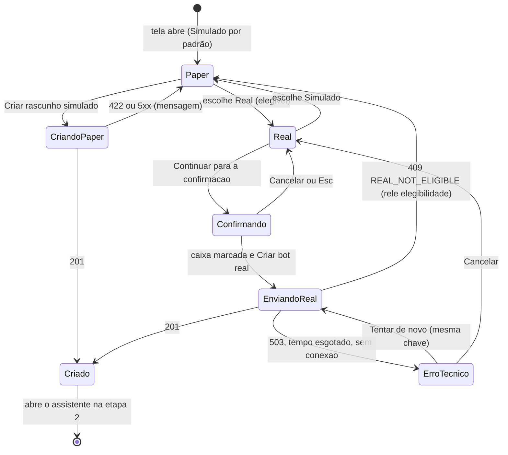
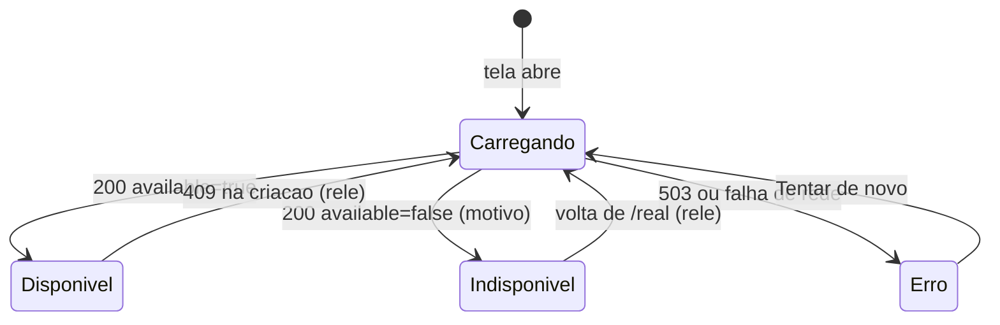
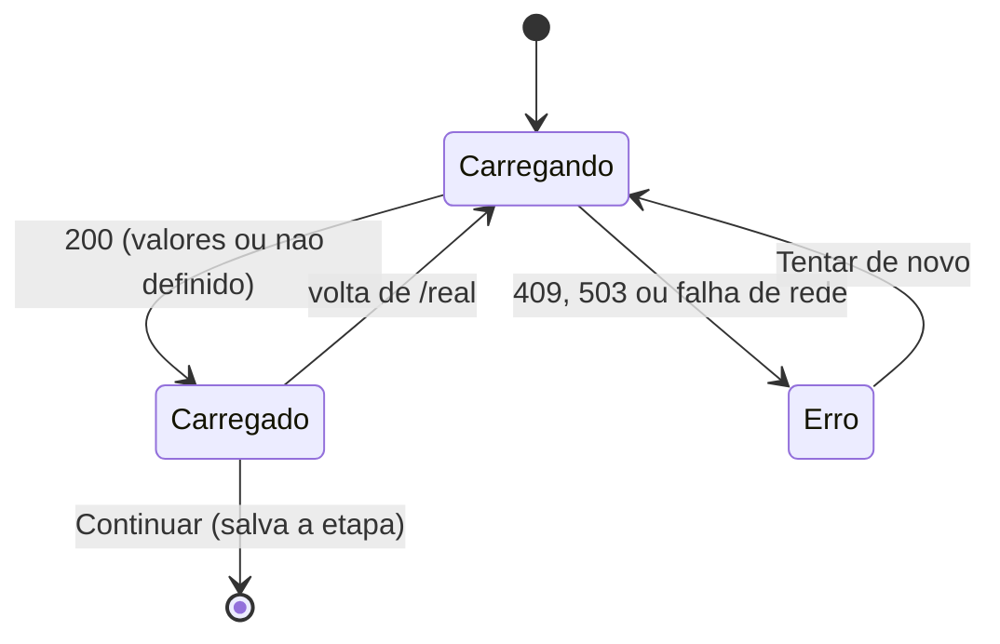
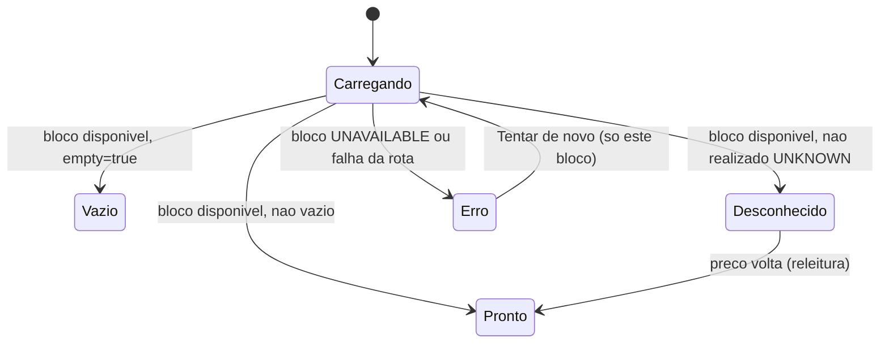
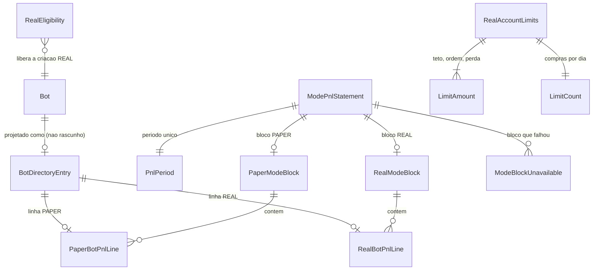

# Especificação funcional — U1 `u1-mode-skeleton`

Conversa: português (Brasil). Data: 2026-11-21.

Este arquivo é a fonte de verdade dos fluxos e das máquinas de estado da U1. A forma dos dados está em `entities.md` e as decisões em `rules.md`; o diagrama ER e o resumo das regras abaixo são vistas derivadas desses dois arquivos.

## Histórias que a U1 implementa

Fonte: `inception/user-stories/stories.md` e `inception/units-generation/unit-of-work-story-map.md`.

| História | Parte da U1 |
|---|---|
| US1.1 Escolher Simulado ou Real na criação | inteira |
| US1.2 Ver por que "Real" está desabilitado | inteira |
| US1.3 Confirmar que o bot opera com dinheiro real | inteira |
| US1.4 Modo fixo depois da criação | inteira |
| US1.5 Um único ambiente para os dois modos | inteira |
| US2.1 Ver bots simulados e reais juntos | inteira |
| US2.2 P&L de cada bot na moeda do próprio modo | inteira |
| US2.4 Um único campo diz o modo do bot | inteira |
| US3.1 P&L simulado por bot como hoje | inteira |
| US3.2 P&L real por bot | AC3.2.5 e AC3.2.6; AC3.2.1 a AC3.2.4 com a U2 |
| US4.1 Totais separados por modo | AC4.1.1 a AC4.1.5 em `/pnl`, na API e em `/bots`; o painel com a U3 |
| US4.2 Aviso do simulado | AC4.2.1, AC4.2.3, AC4.2.6, AC4.2.7; os demais com a U3 |
| US4.4 Totais acessíveis | AC4.4.1 a AC4.4.5 em `/bots` e `/pnl`; painel e detalhe com a U3 |
| US4.5 Celular e estados distintos | AC4.5.1 a AC4.5.3 em `/bots` e `/pnl`; painel e detalhe com a U3 |
| US5.3 O P&L de cada modo fecha com o ledger | AC5.3.2 (PAPER); os demais com a U2 |

## F1 — Criar um bot no modo escolhido

Atores: a pessoa (BETA_USER), o app web (`/bots/new`), a API (Bots, RealCreationEligibility), o BotWallet (leitura).

**Caminho feliz, Simulado**
1. A pessoa abre `/bots/new`. A tela mostra a etapa "1 de 5: Modo e nome", com "Simulado" selecionado (BR1.7), e lê a elegibilidade do REAL uma vez (F2).
2. A pessoa escolhe a estratégia modelo e o nome e clica "Criar rascunho simulado".
3. O app envia o pedido de criação com `market = PAPER` e uma chave de idempotência nova.
4. A API valida o corpo (400 se malformado), o `market` (BR1.1) e, dentro do comando idempotente, a estratégia e o nome (422 se inválidos). A elegibilidade do REAL não é lida (BR2.5).
5. O bot nasce `DRAFT`, `market = PAPER`. A resposta 201 traz o resumo com `mode == market` (BR1.3).
6. O app abre o assistente do bot novo na etapa 2.

**Caminho feliz, Real**
1. Como no passo 1 acima; a elegibilidade chega `available = true`.
2. A pessoa marca "Real". O botão passa a "Continuar para a confirmação".
3. A pessoa clica e o RealConfirmDialog abre, com a chave de idempotência criada nesse momento (BR1.5). "Criar bot real" fica desabilitado até a caixa ser marcada.
4. A pessoa marca a caixa e clica "Criar bot real". Os dois botões ficam desabilitados e aparece "Criando o bot real…".
5. O app envia o pedido com `market = REAL` e a chave do diálogo.
6. A API valida o corpo e o `market`. Com `market = REAL`, dentro do comando idempotente e antes de criar, avalia a elegibilidade de novo (BR2.3, BR2.1).
7. Disponível: o bot nasce `DRAFT`, `market = REAL`; 201 com `mode == market = REAL`.
8. O diálogo fecha e o app abre o assistente na etapa 2.

**Repetição (duplo clique ou "Tentar de novo")**
- O mesmo pedido com a mesma chave e o mesmo corpo devolve a resposta guardada, sem criar outro bot e sem reavaliar a elegibilidade (BR1.4).

**Recusa de domínio: a elegibilidade mudou entre a leitura e o envio**
1. No passo 6 do caminho Real, a avaliação devolve um motivo.
2. A API responde 409 `REAL_NOT_ELIGIBLE` com `reason` = o motivo mais forte e `correlationId`. O comando é desfeito e nenhum bot é criado. A auditoria da recusa é gravada fora da transação desfeita (BR2.4). A recusa não fica guardada como resposta idempotente, então uma repetição com a mesma chave reavalia a elegibilidade (BR1.4). O mesmo vale para o 503.
3. O diálogo fecha. O app relê a elegibilidade (F2), volta para "Simulado", mostra o cartão "Real" indisponível com o motivo novo e a mensagem "O bot real não foi criado." com o texto do motivo e o código para o suporte, em alerta; o foco vai para a mensagem (BR2.8). O nome e a estratégia continuam preenchidos.

**Recusa técnica: a fonte da elegibilidade falhou**
1. No passo 6, uma leitura necessária falha (BR2.5).
2. A API responde 503 `SERVICE_UNAVAILABLE`, sem criar bot.
3. O diálogo continua aberto com "Não foi possível criar o bot real. Tente de novo.", o código e "Tentar de novo", que reenvia com a mesma chave (BR2.8). O mesmo vale para tempo esgotado e falta de conexão.

**Campo inválido**
- `market` com valor desconhecido: 422 `VALIDATION_FAILED` no campo `market` (BR1.1). Nome ou estratégia inválidos: 422 como hoje.

### Máquina de estados da tela de criação (F1)

Texto equivalente: a tela começa em Simulado. Com o REAL elegível, a pessoa pode passar a Real e voltar. Em Simulado, criar leva a 201 (assistente) ou a uma mensagem de erro. Em Real, "Continuar" abre a confirmação; Cancelar ou Esc voltam a Real; com a caixa marcada, "Criar bot real" envia. A resposta 201 abre o assistente; 409 volta a Simulado com a elegibilidade relida; 503, tempo esgotado ou sem conexão deixam o diálogo em erro técnico, com "Tentar de novo" na mesma chave ou "Cancelar".

### Ciclo de vida do bot (sem mudança nas transições)

A U1 não muda as transições da máquina de estados do bot (`DRAFT` → `VALIDATED` → `ACTIVE` ↔ `PAUSED` → `CLOSING_PENDING` → `STOPPED`). Ela acrescenta três invariantes, válidos em todos os estados:
- `market` nunca muda (BR1.2);
- `mode == market` em toda resposta (BR1.3);
- um bot REAL não tem saldo virtual nem limites próprios (BR1.9, decisão do fundador de 2026-11-21).

Para cumprir o terceiro, a leitura da versão de limites do bot passa para o ramo PAPER nos quatro caminhos que hoje a fazem para todo bot:

| Caminho | Bot PAPER (sem mudança) | Bot REAL |
|---|---|---|
| validar o rascunho | exige saldo virtual e limites e grava a versão de limites | valida sem saldo virtual e sem limites; nenhuma versão é gravada |
| ciclo do bot | lê a versão e os limites do bot | o desvio para o REAL vem antes; nenhuma leitura de limites do bot |
| parar | exige a versão de limites | não exige |
| retomar | lê os limites atuais do bot | não lê |

O bot REAL usa só os limites REAL da conta, que a barreira REAL confere antes de cada ordem.

Teste obrigatório do percurso: validar → ativar → rodar um ciclo → pausar → retomar → parar, para um bot REAL sem saldo virtual nem limites próprios, sem exceção. O mesmo percurso roda para um bot PAPER, que continua igual.

Para o P&L, os estados se reduzem por BR4.1:

| Estado do bot | No P&L | Linha no bloco do modo |
|---|---|---|
| `DRAFT`, `VALIDATED` | não entra | não |
| `ACTIVE`, `CLOSING_PENDING` | `ACTIVE` ("Ativo") | sim |
| `PAUSED` | `PAUSED` ("Pausado") | sim |
| `STOPPED` | `REMOVED` ("Removido") | sim, com o P&L que teve |

## F2 — Ler a elegibilidade do REAL

1. A tela pede a elegibilidade (C2). O tenant e a pessoa vêm do contexto de autenticação (BR8.1).
2. A API avalia em ordem, parando no primeiro motivo (BR2.1):
   1. lê o kill switch REAL; acionado → `KILL_SWITCH`;
   2. lê a liberação da pessoa com o REAL do ambiente; REAL desligado → `REAL_DISABLED`;
   3. lê a carteira do bot ativa; ausente → `WALLET_INACTIVE` com `action = ACTIVATE_BOT_WALLET`;
   4. liberação `NONE`, `BLOCKED` ou `REVOKED` → `NOT_RELEASED`;
   5. liberação `QUARANTINE` → `QUARANTINE` com `effectiveAt` (BR2.2);
   6. senão, `available = true`.
3. Uma leitura que falha antes de um motivo decidido dá 503 (BR2.5).
4. A tela mostra o cartão "Real" conforme o resultado (BR2.7): disponível; indisponível com o texto do motivo; carregando ("Conferindo se o modo real está disponível…"); ou erro ("Não foi possível conferir o modo real agora.", código e "Tentar de novo"). Em todos os casos, "Simulado" continua disponível.
5. Com uma versão nova dos termos pendente, a rota responde 403 `TERMS_REACCEPTANCE_REQUIRED` (BR8.3).

### Máquina de estados do cartão "Real" (ModeStep)

Texto equivalente: o cartão começa carregando. Com 200, fica disponível ou indisponível com o motivo; com 503 ou falha de rede, fica em erro, e "Tentar de novo" volta a carregar. Uma recusa 409 na criação e a volta da área `/real` relêem a elegibilidade.

## F3 — Etapa de limites de um bot REAL

1. O assistente de um bot REAL chega à etapa "3 de 5: Limites" com a linha "Modo: REAL · não pode ser trocado depois da criação" (BR1.6).
2. A tela pede os limites REAL da conta (C3).
3. A API lê a carteira do bot ativa e a configuração da barreira REAL e calcula os quatro limites (BR3.1):
   - o teto;
   - o tamanho máximo da ordem, em lamports e como percentual do teto;
   - as compras por bot, por dia UTC, sempre conhecidas;
   - a perda máxima do dia, em lamports sobre a base `min(teto no início do dia, teto atual)`, a mesma da barreira, e como percentual.

   Sem teto, o teto, a ordem e a perda vêm `NOT_DEFINED` (BR3.2).
4. Sem carteira do bot ativa: 409 `REAL_NOT_ELIGIBLE` / `WALLET_INACTIVE`. Falha de uma dependência: 503 (BR3.3).
5. A tela mostra os limites só para leitura, em SOL (BR7.1), com "não definido" no lugar de valor ausente, e o link "Alterar limites" (ou "Definir o teto" sem teto) para `/real`.
6. "Continuar" salva a etapa sem saldo virtual e sem limites próprios (BR1.8). A validação do rascunho REAL não exige nenhum dos dois e não grava versão de limites (BR1.9). O botão fica desabilitado enquanto carrega ou depois de erro (BR3.4).
7. Ao voltar de `/real`, a etapa relê os limites.

Para um bot PAPER, a etapa 3 continua como hoje (saldo virtual e limites do bot).

### Máquina de estados da etapa de limites

Texto equivalente: a etapa começa carregando; com 200 fica carregada e "Continuar" salva a etapa; com 409, 503 ou falha de rede fica em erro, com "Continuar" desabilitado e "Tentar de novo"; a volta de `/real` relê.

## F4 — Ler o P&L por modo, com falha parcial

1. A tela `/pnl` (e a lista `/bots`, por F5) pede a visão por modo (C4), sem parâmetro ou com `period = ALL` (BR5.6).
2. A API (ModePnlView) obtém os bots da pessoa pelo diretório (BR4.1), separados por modo.
3. Bloco PAPER (PaperPnl): o P&L de cada bot PAPER como hoje (BR5.9) e o total PAPER do modo, `realized + unrealized − fees` em US$ exato, `UNKNOWN` se o não realizado for desconhecido (BR5.4). Inclui o aviso fixo (BR6.1).
4. Bloco REAL (RealBotPnlQuery, primeira implementação), por BR5.5:
   - cada bot REAL usa o cálculo por ordens de hoje, só sobre as ordens do bot;
   - o total do modo é o cálculo de hoje sobre todas as ordens da pessoa;
   - o realizado é líquido de taxas, o total é `realized + unrealized`, e as taxas são só informação;
   - `prorated` vem vazio e `unowned` vem `null`.

   Na U1, o bloco REAL não vazio sempre mostra a nota fixa "Algumas operações ainda não têm bot dono; o rateio chega na próxima etapa.", porque as ordens sem bot entram no total e em nenhuma linha. A nota é fixa porque a tela não soma as linhas. A U2 retira a nota.
5. Os blocos são calculados de forma independente. Se um falha, ele vem `UNAVAILABLE` com código e `correlationId`, e o outro vem completo; a resposta é 200 (BR5.3).
6. A resposta tem só `period`, `paper` e `real` (BR5.1), cada bloco só com o próprio modo e moeda (BR5.2), sem endereço de carteira (BR5.8).
7. A tela mostra um `PnlModeBlock` por modo, Simulado e depois Real. Um bloco `UNAVAILABLE` mostra "Não foi possível carregar o resultado real." (ou simulado), o código e "Tentar de novo", que relê a rota e atualiza só esse bloco; o outro não muda.

### Máquina de estados de um bloco (PnlModeBlock)

Texto equivalente: cada bloco começa carregando e vai, por conta própria, para pronto, vazio, desconhecido (total desconhecido, realizado e taxas exatos) ou erro. "Tentar de novo" leva só esse bloco de volta a carregando. Um bloco desconhecido passa a pronto quando uma releitura traz o preço.

## F5 — Lista única com a coluna de modo

1. A pessoa abre `/bots`. A tela pede a lista de bots (como hoje) e a visão por modo (C4) em paralelo.
2. A lista mostra todos os bots da pessoa na ordem de criação, do mais novo para o mais antigo, sem ordenação por P&L (BR4.2).
3. Cada linha mostra o nome, o selo e o texto do modo (`SIMULADO` ou `REAL`), o estado e o P&L na moeda do modo, lido da linha do bot no bloco do modo dele (BR4.3, BR7.1, BR7.2). Rascunho: "Rascunho" e "—".
4. Se o bloco do modo do bot veio `UNAVAILABLE` ou C4 falhou, o P&L da linha mostra "P&L indisponível agora" e a lista continua usável. P&L desconhecido mostra "desconhecido (<motivo>)" (BR4.4).
5. Com pelo menos um bot simulado na lista visível, o aviso do simulado aparece acima da lista (BR6.1).
6. Estados da lista: carregando, erro com "Tentar de novo", vazio com "Você ainda não tem bots." e "+ Novo bot" (BR4.4).
7. A partir de 768 px a lista é uma tabela; abaixo, cartões empilhados, sem rolagem lateral (BR9.3).

O filtro por modo (FR2.3) é da U3 e o aviso da venda da própria quantidade (FR6.2) é da U4; a lista da U1 já deixa o lugar dos dois sem mudar a forma.

## F6 — Cenário de ponta a ponta do esqueleto

Ambiente: `docker compose` local com a API, o worker, o app web, o PostgreSQL, o TxSigner com KMS simulado e o validador Solana local; perfil de teste com a semente de liberação ligada (BR10.2) e o REAL ligado; kill switch desligado.

1. O spec entra com a conta do smoke (BETA_USER semeada só no perfil de teste; a carteira principal de teste é gerada só no código de teste).
2. A semente já deixou a liberação REAL da conta `ACTIVE`, registrada há mais de 24 horas pelo relógio do ambiente.
3. O spec ativa a carteira do bot e deposita SOL a partir da carteira principal de teste, como o spec `e2e/real-bot-wallet` já faz.
4. O spec abre `/bots/new`, mantém "Simulado", cria o bot PAPER, conclui o assistente e inicia o bot.
5. O spec abre `/bots/new`, confere que "Real" está disponível, escolhe "Real", confirma no diálogo, cria o bot REAL, passa pela etapa de limites só para leitura, conclui e inicia o bot.
6. O ciclo de cada bot faz uma compra simples (estratégia gravada do perfil de teste), sem venda, liquidação, condicional nem excedente.
7. O spec abre `/pnl` e confere:
   - o bloco "Simulado, em dólares" lista só o bot PAPER e mostra o aviso do simulado;
   - o bloco "Real, em SOL" lista só o bot REAL e não mostra o aviso;
   - nenhum texto ou valor da tela junta os dois modos;
   - a resposta de C4 tem só `period`, `paper` e `real`.
8. O spec abre `/bots` e confere que os dois bots aparecem na mesma lista, cada um com o modo em texto e o P&L na moeda do modo.
9. O spec repete `/pnl` e `/bots` numa janela de 360 px e confere que não há rolagem lateral.
10. O spec não confere valores que dependam do arredondamento do custo (RK-4).

A verificação continua sendo `bash scripts/verify.sh`; o responsável acrescenta o spec ao script (BR10.1).

## Diagrama entidade-relacionamento (derivado de `entities.md`)

Texto equivalente:
- Um Bot que não é rascunho é projetado como uma BotDirectoryEntry, que tem no máximo uma linha de P&L no bloco do seu modo (PaperBotPnlLine ou RealBotPnlLine).
- Uma ModePnlStatement tem um PnlPeriod e, para cada modo, um bloco disponível (PaperModeBlock ou RealModeBlock) ou um ModeBlockUnavailable; nunca um total que junte os dois.
- Cada bloco contém as linhas dos bots do próprio modo.
- RealAccountLimits tem três LimitAmount (teto, ordem, perda do dia) e um LimitCount (compras por dia).
- RealEligibility é avaliada antes de um Bot REAL ser criado e não é gravada.

## Resumo das regras (derivado de `rules.md`)

| Grupo | Regras | Ideia |
|---|---|---|
| Criação e modo | BR1.1 a BR1.9 | `market` na criação, PAPER por padrão, imutável; `mode == market`; idempotência (recusa e 503 não guardados); confirmação do REAL; etapa de limites REAL só leitura; bot REAL sem limites próprios em validar, ciclo, parar e retomar |
| Elegibilidade | BR2.1 a BR2.8 | ordem kill switch, REAL desligado, carteira inativa, liberação ausente, quarentena; só o mais forte; conferida na leitura e na criação; 409 para os cinco motivos; 503 com a fonte indisponível; PAPER nunca afetado |
| Limites | BR3.1 a BR3.4 | quatro limites das entradas da barreira; "não definido", nunca zero; só leitura |
| Diretório e lista | BR4.1 a BR4.4 | ACTIVE, PAUSED, REMOVED; rascunhos fora do P&L; lista única com o modo em texto e o P&L na moeda do modo |
| Visão por modo | BR5.1 a BR5.10 | nunca somar; cada bloco no próprio modo; UNAVAILABLE por bloco; total dentro do bloco; linha REAL da U1 pelas ordens do bot; só "desde o início"; conferência PAPER exata |
| Aviso e textos | BR6.1, BR6.2 | aviso fixo no simulado e só nele; nada promete lucro |
| Formatos | BR7.1 a BR7.5 | SOL exato sem zeros à direita e com 2 casas no mínimo; US$ com 2 casas; telas REAL existentes sem mudança; UTC; sem ponto flutuante |
| Isolamento | BR8.1 a BR8.3 | tenant do contexto; 404 para o bot de outra pessoa; novo aceite dos termos |
| Acessibilidade e telas | BR9.1 a BR9.4 | contraste, rótulos, foco, 360 px, teclado |
| Entrega e verificação | BR10.1 a BR10.5 | spec de ponta a ponta; semente só de teste com guarda; U1 nunca sem a U2; nenhum serviço AWS novo; alargamento de `mode` com os leitores do web |

## Sources

- `functional-design-questions.md`: Q1 a Q8 e o resumo confirmado.
- `inception/units-generation/unit-of-work.md` (U1, RK-1 a RK-4) e `unit-of-work-story-map.md` (linhas da U1, histórias compartilhadas e a ordem dentro da U1).
- `inception/user-stories/stories.md`: as histórias e os ACs da tabela acima.
- `inception/requirements-analysis/requirements.md`: FR1, FR2, FR3.1, FR3.5, FR3.11, FR4, FR5.3, NFR3 a NFR8.
- `inception/domain-design/components.md` e `decisions.md`: ADR-003, ADR-005 (alinhado em `rules.md`), ADR-007, ADR-008, ADR-009.
- `inception/contract-design/contract-summary.md`: C1 a C4, C8 a C10, C17.
- `inception/refined-mockups/mockups.md` (M1, M2, M3, M3b, M4, M5), `interaction-spec.md`, `accessibility-checklist.md`.
- `aidlc/spaces/default/memory/team.md`: Walking Skeleton ("Fatia do intent `261121-paper-real-unico`") e Testing Posture.
- Código lido: `BotCommandService`, `BotController`, `BotState`, `RealStateQuery`, `RealReleaseInfo`, `RealKillSwitchState`, `RealRiskPolicy`, `RealPnlCalculator`, `RealPnlService`, `RealTestSeeder`.

## Assumptions & Open Questions

1. [assumption] No F6, a compra de cada bot vem do ciclo com a estratégia gravada do perfil de teste, como nos specs atuais; a fatia não chama fornecedor real.
2. [assumption] A lista `/bots` lê o P&L de cada bot da visão por modo (C4), como diz o contrato, e não de uma rota por bot. Uma falha de C4 não derruba a lista.
3. As divergências com o código e os contratos estão em `rules.md`, nas seções "Alinhamento do ADR-005" e "Ajustes de contrato que a U1 faz como dona" e nas suposições. O fundador decidiu em 2026-11-21 os nomes dos motivos e o bot REAL sem limites próprios (BR1.9).
