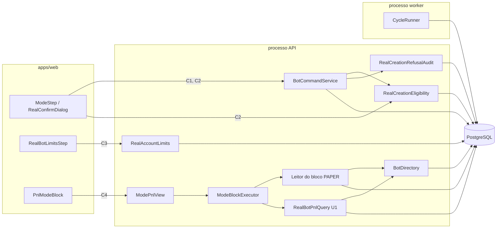

# Componentes lógicos — U1 `u1-mode-skeleton`

Conversa: português (Brasil). Data: 2026-11-21.

A U1 vive dentro do monólito modular (processos API e worker do mesmo app Spring Boot, um PostgreSQL) e do `apps/web`. Ela não cria serviço, processo, fila, cache ou recurso AWS [Q6]. Este arquivo mostra onde cada padrão de NFR se aplica, quais são os domínios de falha e até onde uma falha da U1 chega. É a ponte para o Infrastructure Design, que para a U1 não tem nada a provisionar (NFR8.1).

## Inventário

Os nomes marcados com * são propostas deste estágio; a Code Generation pode ajustá-los sem mudar a fronteira.

| Componente lógico | Pacote ou lugar | Processo | Papel | Padrões de NFR aplicados |
|---|---|---|---|---|
| `ModePnlView` | `com.memetrade.pnl.modeview` | API | monta C4 com os dois blocos lado a lado, nunca somados | paralelo com prazo por bloco, `UNAVAILABLE` por bloco, `NEVER_SUM_MODES` (NFR1.1, NFR1.9, NFR4.1, NFR4.4) |
| `ModeBlockExecutor`* | `com.memetrade.pnl.modeview` | API | pool `pnl-mode-block` (8 threads, fila de 16), cópia do MDC, prazo e desistência tardia | antepara (bulkhead), contrapressão (NFR1.9, NFR1.11, NFR3.12) |
| `PnlByModeProperties`* | `com.memetrade.pnl.modeview` | API | `memetrade.pnl.by-mode.*` validado na subida | configuração fixa e testada (NFR1.9) |
| `PnlModeMetrics`* | `com.memetrade.pnl.modeview` | API | contador `pnl.mode_block.unavailable{market}` | métrica sem dado pessoal (NFR4.6, NFR3.6) |
| Leitor do bloco PAPER (`PaperPnl`) | `com.memetrade.pnl.application` (reaproveita `PnlQueryService`) | API | linhas por bot e total PAPER na janela `ALL`, numa transação REPEATABLE READ | exatidão por construção (NFR2.1, NFR2.2, NFR4.2) |
| Primeira implementação de `RealBotPnlQuery` (C10) | `com.memetrade.pnl.application` (cálculo puro em `pnl.real`) | API | uma leitura das ordens assentadas, agrupadas por bot; total pelo mesmo cálculo | uma consulta por pessoa com índice atual (NFR1.1, NFR2.3, NFR4.2) |
| Adaptador de `BotDirectory` (C8) | `com.memetrade.bots` (implementa `pnl.api.BotDirectory`) | API | bots da pessoa por modo, em ordem de criação | tenant do token, 404 (NFR3.1, NFR3.2) |
| `RealCreationEligibility` | `com.memetrade.bots` (regra pura no domínio e leitor na aplicação) | API e worker (sem `@ProcessRole`; só chamada na API) | elegibilidade de BR2.1 para C1 e C2 | leitura com prazo num ponto de salvamento, falha fechada (NFR1.8, NFR3.4, NFR4.5) |
| `BotCommandService` (muda) | `com.memetrade.bots.application` | API | criação no modo, com elegibilidade dentro do comando idempotente; `validate`, `stop` e `resume` só leem limites no PAPER | idempotência comum, recusa e 503 nunca guardados (NFR1.12, NFR4.9, NFR7.4) |
| `RealCreationRefusalAudit`* | `com.memetrade.bots.infra` | API e worker (sem `@ProcessRole`; só chamada na API) | evento de auditoria da recusa REAL em `REQUIRES_NEW`, depois do rollback | auditoria que sobrevive ao rollback (NFR3.5) |
| `BotCreationMetrics`* | `com.memetrade.bots.infra` | API e worker (sem `@ProcessRole`; séries em zero no worker) | contador `bots.real.create.refusals{reason}` | métrica sem dado pessoal (NFR3.10) |
| Implementação de `RealAccountLimits` (C9) | `com.memetrade.riskcontrol.real` | API (rota C3) e worker (teto de ordem do ramo REAL do ciclo) | os quatro limites de BR3.1, só leitura, com prazo na rota | falha fechada com 503 (NFR1.3, NFR4.5) |
| `CycleRunner` (muda) | `com.memetrade.bots.worker` | worker | lê a versão de limites só no ramo PAPER; no ramo REAL, `maxOrderSize` vem do limite de ordem da conta (C9) e `limitsVersion = 0` | raio de impacto protegido pelo teste do percurso (NFR7.4) |
| `RealTestSeeder` (sem mudança de papel) e `RealSeedProfileGuardTest`* | `com.memetrade.botwallet.infra` e o teste | API, só no perfil `test` | liberação ACTIVE do spec local | guarda de configuração (NFR3.8) |
| Componentes web: `ModeStep`, `RealConfirmDialog`, `RealBotLimitsStep`, `SimulatedBadge`, `PnlModeBlock` | `apps/web` | navegador | escolha do modo, limites só leitura e blocos de P&L | estados distintos, acessibilidade, nenhum total geral (NFR4.1, NFR5.1 a NFR5.3, NFR6.1, NFR6.2) |

## Diagrama

Texto equivalente:

- O `apps/web` chama:
  - o `BotCommandService` para criar (C1);
  - a `RealCreationEligibility` para a elegibilidade (C2);
  - os `RealAccountLimits` na etapa de limites (C3);
  - o `ModePnlView` para a visão por modo (C4).
- O `BotCommandService` usa a elegibilidade dentro do comando e a auditoria da recusa depois do rollback.
- O `ModePnlView` envia os dois blocos ao `ModeBlockExecutor`. Cada bloco usa o `BotDirectory`.
- Todos os componentes do backend leem ou gravam o mesmo PostgreSQL.
- O `CycleRunner` do worker muda só na leitura dos limites.

## Domínios de falha e raio de impacto

| Falha | Domínio | Alcance | Fica de fora | Garantia |
|---|---|---|---|---|
| Fonte da elegibilidade (kill switch, carteira, liberação) | a criação REAL e C2 | 503 na criação REAL e em C2 | a criação PAPER, C3, C4, o ciclo e o saque | a criação PAPER não lê a elegibilidade (BR2.5); teste "PAPER com a fonte quebrada" |
| Prazo da elegibilidade estourado | um pedido de criação REAL | 503 nesse pedido; a chave fica livre | os outros pedidos e a transação dos outros comandos | ponto de salvamento e `statement_timeout` local à transação |
| Bloco REAL de C4 | um pedido de C4 | só o bloco REAL vem `UNAVAILABLE` | o bloco PAPER, a lista `/bots` (que mostra "P&L indisponível agora" só nas linhas REAL) | tarefa, transação e prazo próprios; teste dos 3 cenários |
| Bloco PAPER de C4 | um pedido de C4 | só o bloco PAPER vem `UNAVAILABLE` | o bloco REAL | idem |
| Pool `pnl-mode-block` saturado | os pedidos de C4 daquele processo | blocos `UNAVAILABLE` até a fila esvaziar | C1, C2, C3 e o resto da API (as 12 conexões que sobram) | fila limitada e teto de 8 conexões |
| Gravação da auditoria da recusa | um pedido de criação REAL | 503 nesse pedido | o resto | gravação depois do rollback, sem segurar a conexão do comando |
| `RealAccountLimits` | C3 | 503 em C3; a etapa de limites fica em Erro com "Tentar de novo" | a criação PAPER, C2 e C4 | exceção `RealLimitsUnavailable` mapeada para 503 |
| Mudança do BR1.9 no `CycleRunner` e nos comandos | os ciclos e comandos de bots REAL | um erro aqui pararia os ciclos REAL (ciclo `FAILED`, `bots.cycle.errors`) ou um comando REAL | os bots PAPER, cujo caminho não muda | teste do percurso (NFR7.4) e as suítes atuais do PAPER; o spec de ponta a ponta faz uma compra REAL |

Nenhuma falha da U1 alcança o saque para a carteira principal, a barreira REAL, o TxSigner ou o ledger. A U1 não grava nesses componentes e não muda o caminho deles.

## Recursos compartilhados

| Recurso | Quem da U1 usa | Isolamento |
|---|---|---|
| Pool Hikari da API (20 conexões) | os blocos de C4 (até 8), os comandos, C2 e C3 | teto de 8 pelo pool dos blocos; prazos de 500 ms a 800 ms; a thread do pedido de C4 não segura conexão |
| PostgreSQL | todas as leituras e a criação | leituras sem trava (MVCC); `statement_timeout` local por bloco e na elegibilidade; nenhuma migração |
| Threads HTTP do Tomcat | todas as rotas | a espera de C4 é limitada pelo prazo do bloco |
| MDC (`correlationId`) | logs e respostas | cópia explícita para as threads do pool e limpeza no fim de cada tarefa |
| `MeterRegistry` | os dois contadores | 7 séries de enum, sem etiqueta pessoal |
| Mecanismo comum de idempotência | a criação | o mesmo de hoje; recusa e 503 desfazem a reivindicação |

## Estratégia de isolamento

1. **Por modo:** tipos, transações, tarefas e prazos separados para PAPER e REAL; o único ponto que vê os dois é o `ModePnlView`, que não faz conta (ADR-003).
2. **Por caminho:** a elegibilidade só existe no ramo REAL da criação e em C2. Nenhum caminho de ordem depende dela (regra ArchUnit do NFR3.4).
3. **Por recurso:** o pool próprio dos blocos limita a parte do Hikari que C4 pode usar.
4. **Por processo:** as rotas C1 a C4 só respondem no processo da API, porque os controladores e a cadeia de C4 (`ModePnlView`, `ModeBlockExecutor`, `PnlModeMetrics`) são `@ProcessRole(API)`. `RealCreationEligibility`, `RealCreationRefusalAudit` e `BotCreationMetrics` ficam **sem** `@ProcessRole`, porque o `BotCommandService`, que as usa, existe nos dois processos; é o padrão do `RealOpsMetrics` e do `BotAudit` (achado R-01, ver `observability-design.md`, "Processos"). No worker elas existem, mas nunca são chamadas pela criação. O worker muda o `CycleRunner` e passa a ler C9 no ramo REAL (decisão do fundador em `reliability-design.md`).

## Mapa NFR → componente

| NFR | Componente e solução |
|---|---|
| NFR1.1 | `ModePnlView` + `ModeBlockExecutor`: blocos em paralelo, prazo de 800 ms cada; o bloco REAL faz uma leitura por pessoa |
| NFR1.2 | `RealCreationEligibility`: até 3 leituras pontuais indexadas com prazo de 500 ms |
| NFR1.3 | `RealAccountLimits`: leitura da configuração e do teto com prazo de 500 ms |
| NFR1.4 | `BotCommandService`: elegibilidade no comando só no REAL; o PAPER mantém o custo de hoje |
| NFR1.5 | `ModePnlLatencyIT` com a semente de referência e as linhas de `pnl_daily`; p95 no log |
| NFR1.6 | portão no cenário de carga da U2; a U1 não muda `scripts/load/` |
| NFR1.7 | leituras sem `FOR UPDATE`; `statement_timeout` por bloco; teste com um ciclo em paralelo |
| NFR1.8 | `RealCreationEligibility`: só banco e configuração, 0 chamadas de rede |
| NFR1.9 | `ModeBlockExecutor`: prazo por bloco desde o envio; o pior caso do pedido é um prazo, não a soma |
| NFR1.10 | volume de referência fixado; acima dele, sem meta |
| NFR1.11 | 0 serviços, réplicas, filas ou caches; o pool dos blocos só tem threads |
| NFR1.12 | `IdempotencyService` comum; teste com 10 pedidos simultâneos, mais a variante REAL |
| NFR1.13 | 0 migrações; as gravações são as de hoje |
| NFR1.14 | SLI `http.server.requests` por `uri`; sem SLO novo |
| NFR2.1 | `long` com `Math.*Exact`, `BigInteger`, `BigDecimal`; lint do dinheiro em `features/pnl` |
| NFR2.2 | leitor do bloco PAPER: mesmo cálculo de hoje, uma transação REPEATABLE READ; conferência exata |
| NFR2.3 | `RealBotPnlQuery` U1: `RealPnlCalculator` por bot e no total; `UNKNOWN` com preço ausente |
| NFR3.1 | `Principal` explícito em todas as portas; corpo recusa campo não declarado |
| NFR3.2 | `BotDirectory` filtrado pela pessoa; `botOf` e `botPnl` vazios viram 404 |
| NFR3.3 | as rotas fora de `allowed-prefixes`; teste das 4 rotas × 401 e 403 |
| NFR3.4 | regra ArchUnit: nenhum caminho de ordem depende de `RealCreationEligibility` |
| NFR3.5 | `RealCreationRefusalAudit` em `REQUIRES_NEW`, depois do rollback |
| NFR3.6 | sem endereço em C4, nos logs e nas etiquetas; máscara Base58 como segunda barreira |
| NFR3.7 | nada de token, `Authorization`, nonce ou assinatura no log; 0 `NEXT_PUBLIC_*` novas |
| NFR3.8 | `RealSeedProfileGuardTest` (inclui Dockerfiles, workflows e `.env.example`), teste de contexto e a checagem `LOCALNET` obrigatória no `RealTestSeeder` |
| NFR3.9 | nenhuma chamada ao TxSigner; `REAL_DISABLED` com o padrão desligado |
| NFR3.10 | `BotCreationMetrics` (sem `@ProcessRole`): `bots.real.create.refusals{reason}` |
| NFR3.11 | logs JSON com `correlationId`: `INFO` na recusa, `WARN` no bloco e na fonte |
| NFR3.12 | cópia do MDC para o pool; `correlationId` lido na thread do pedido |
| NFR3.13 | sem tracing; correlação pelo `correlationId` |
| NFR4.1 | `NEVER_SUM_MODES`, teste de contrato, teste de propriedade e teste de tela |
| NFR4.2 | cada bloco lê só o próprio modo, na própria moeda |
| NFR4.3 | DTOs de edição sem `market`; `bot_market_immutable`; `mode == market` |
| NFR4.4 | `ModePnlView`: `ModeBlockUnavailable` por bloco, inclusive com a fila cheia e acima de `real-max-orders`; sempre 200 |
| NFR4.5 | elegibilidade com falha fechada (503) num ponto de salvamento; C3 com 503 |
| NFR4.6 | `PnlModeMetrics`: `pnl.mode_block.unavailable{market}` |
| NFR4.7 | prontidão sem mudança; 0 SLOs novos |
| NFR4.8 | leituras sem gravação; "Tentar de novo" relê C4 |
| NFR4.9 | `Idempotency-Key` obrigatória; recusa e 503 desfazem a reivindicação |
| NFR5.1 | componentes web com teclado e foco visível |
| NFR5.2 | tokens de cor de pelo menos 4,5:1; cor sempre com texto |
| NFR5.3 | nome acessível dos totais; `h1` e `h2` por modo |
| NFR6.1 | cartões empilhados em 360 px; conferência no spec |
| NFR6.2 | 5 estados distintos do `PnlModeBlock` |
| NFR7.1 | Test Strategy `Standard` por BR |
| NFR7.2 | os 7 testes obrigatórios por risco |
| NFR7.3 | piso de 80% no backend e no `apps/web` |
| NFR7.4 | `BotModePathIT` (REAL e PAPER) protege o `CycleRunner` e os comandos, com os casos do `DecisionRequest` REAL decidido pelo fundador e o 422 de `changeLimits` |
| NFR7.5 | `RealBotCreationEligibilityIT` e a função pura de BR2.1 |
| NFR7.6 | testes antes do código no P&L, na deduplicação e no percurso do BR1.9 |
| NFR7.7 | spec da fatia no `scripts/verify.sh` |
| NFR7.8 | alargamento de `mode` e leitores do web no mesmo commit |
| NFR8.1 | nenhum recurso novo em `infra/terraform/` |
| NFR8.2 | US$ 350 por conta, sem custo novo |
| NFR8.3 | devnet fechada aos usuários |
| NFR8.4 | a U1 só vai para a mainnet com a U2 |
| NFR8.5 | 0 alarmes e 0 painéis novos |

## Sources

- `reviews/review-01.md`: achados R-01 a R-06 da revisão deste estágio; decisão do fundador de 2026-11-21 sobre o `DecisionRequest` do ramo REAL.
- `nfr-design-questions.md`: Q1 a Q6 e o resumo confirmado [Q1] [Q2] [Q3] [Q4] [Q5] [Q6].
- `construction/u1-mode-skeleton/nfr-requirements/`: os cinco arquivos de requisitos e `tech-stack-decisions.md`.
- `construction/u1-mode-skeleton/functional-design/rules.md` (BR1.9, BR2.1, BR2.5, BR5.3, BR10.2), `functional-spec.md` e `frontend-components.md`.
- `inception/domain-design/components.md`: ModePnlView, RealCreationEligibility, Bots, PaperPnl, RealBotPnl, BotWallet; ADR-003.
- `inception/contract-design/contract-summary.md`: C1 a C4, C8 a C10, C17.
- Os demais arquivos deste estágio: `performance-design.md`, `security-design.md`, `scalability-design.md`, `reliability-design.md` e `observability-design.md`.
- Código lido: `administration/infra/AdministrationConfig.java`, `bots/application/BotCommandService.java`, `bots/worker/CycleRunner.java`, `pnl/application/PnlQueryService.java`, `pnl/application/RealPnlService.java`, `botwallet/infra/RealTestSeeder.java` e `application.yml` (Hikari).

## Assumptions & Open Questions

1. [assumption] Os componentes novos marcados com * são nomes propostos; as fronteiras (módulo dono, processo, contratos) são as do domain design e do contract design e não mudam.
2. O `DecisionRequest` do ramo REAL (decisão do fundador de 2026-11-21) e o 422 de `changeLimits` num bot REAL estão em `reliability-design.md`. O BR1.9 do `functional-design/rules.md` ainda precisa receber esses detalhes; a Code Generation lê as duas fontes.
